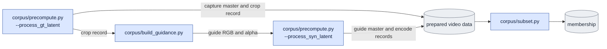
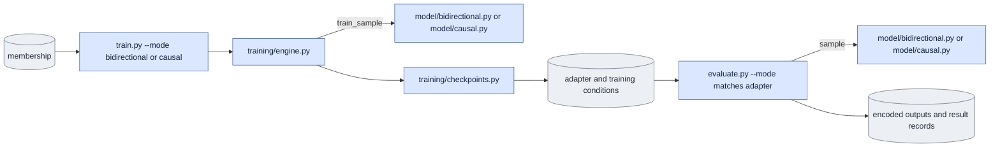
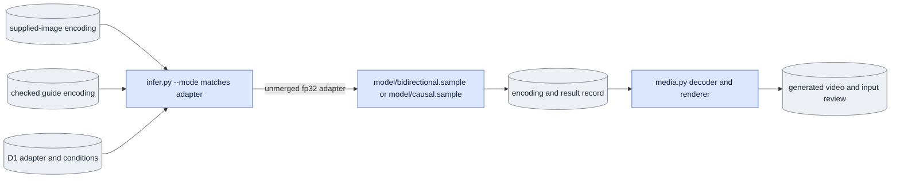

# `onestep_avatar` — prepare avatar data, train and run an avatar renderer

The renderer receives one real first image and an ARGAvatar guide video. It
generates a video with LTX-2.5 and a LoRA adapter. A LoRA adapter is a small
set of trainable weights added to the frozen base model.

**Start here:** the [run guide](configs/README.md) gives the command for each
workflow and each experiment. The [design index](doc/README.md) links every
module design.

## Terms used here

- **Capture video:** the recorded real video. Training uses it as the correct output.
- **Guide video:** the ARGAvatar render. It provides motion input for D1.
- **Encoded frame:** a frame in the VAE's compressed video data. It is not an RGB video frame.
  Seven encoded frames cover 49 RGB frames; seventeen cover 129.
- **Video segment:** consecutive encoded frames taken from one video.
- **First-image input (`c0`):** encoded first-image data with no added noise.
  Training uses the first capture frame of its segment. Product generation uses the supplied image.
- **Block:** the group of encoded frames processed together in causal mode.
- **Cache:** memory that keeps model data for past frames in causal mode.
- **Master:** the saved VAE encoding of a whole continuous video. Both modes read the same master.
- **Membership (fixed video list):** a JSON record of video files, person groups and file hashes.
- **D0 / D1:** D0 adds noise to capture frames and tests model capacity. D1 adds noise to
  guide frames and is the product task. Both train against capture frames and keep `c0` clean.
- **Objective (`bg` / `white`):** the background of capture and guide: the real background,
  or both matted to white.

## Workflows

Blue boxes name code files. Grey cylinders name saved data.
See the [shared legend](doc/core_algorithm.md#7-end-to-end-data-flow).

**1. Prepare data.** Encode capture masters and record crop boxes, render guides
into those boxes, encode the guides, then write a membership file.

**2. Train an adapter** in one of two modes, then **evaluate** it with the same mode.

- **Bidirectional mode** processes all encoded frames of a segment together.
  Each token attends to every token in the segment. There is no cache.
- **Causal mode** processes blocks in time order. Each block reads its own
  frames and cached data for past frames, never a future block. Training primes
  the cache once, computes gradients after each block and refreshes the cache
  between blocks. Generation starts with an empty cache and uses its own
  generated past frames.

The adapter records its mode and every training condition. Evaluation and
product generation check these conditions before any weights load. Evaluation
can record an explicit research override; product generation refuses every
difference.

**3. Generate the product video** from a supplied image and a guide.

`prepare_inputs.py supplied-image` encodes one real RGB image for this step.
Product generation uses D1, generated history and no capture target.

**4. Inspect results.** Fixed previews show the same inputs at each saved
checkpoint. `decode_saved.py` and `comparisons.py` render saved encodings
without running the transformer again. `plot_training.py` draws loss, gradient
size and time by update. `bench.py` measures warmed generation cost.

**5. Run experiments.** Acceptance checks and studies are modules in
`experiments/`; the queue runs each one from a pinned specification. The
[run guide](configs/README.md#9-experiments) lists them; the
[verification contract](doc/verification.md#acceptance-gates) defines the gates.

## Entry points

| Task | Command or queue kind | Recipe |
|---|---|---|
| Encode capture masters | `corpus.precompute --process_gt_latent` | [§3](configs/README.md#3-prepare-the-corpus) |
| Render guides (`argavatar`) | `corpus.build_guidance` | [§3](configs/README.md#3-prepare-the-corpus) |
| Encode guide masters | `corpus.precompute --process_syn_latent` | [§3](configs/README.md#3-prepare-the-corpus) |
| Create a membership | `corpus.subset` | [§3](configs/README.md#3-prepare-the-corpus) |
| Train | queue `train` (`train.py`) | [§4](configs/README.md#4-train-an-adapter) |
| Evaluate | queue `evaluate` (`evaluate.py`) | [§5](configs/README.md#5-evaluate-an-adapter) |
| Training previews | `media --prepare-training-references`, `prepare_inputs preview`, queue `preview` | [§6](configs/README.md#6-fixed-training-previews) |
| Product video | `prepare_inputs supplied-image`, queue `product` (`infer.py`) | [§7](configs/README.md#7-product-generation-from-a-supplied-image) |
| Decode, render, cost, plots | queue `decode`, `render`, `bench`; `plot_training` | [§8](configs/README.md#8-decoding-comparison-media-cost-and-plots) |
| Experiments E1–E5 and studies | queue `experiment` | [§9](configs/README.md#9-experiments) |

## Rules

- Run from the LTX-2 root as `python -m scripts.onestep_avatar.<module>` in the
  `ltx` environment. Only `corpus/build_guidance.py` uses `argavatar`. Keep
  `LTX-2/scripts/` a namespace package (no `__init__.py`).
- The package queue starts all model work except corpus production and input
  preparation. Query `nvidia-smi` first; use free GPUs 0–7; training uses four.
- Each saved data type has one producer. Readers fail on missing or changed
  inputs; they never recreate them.
- Code under `expr/` only builds reports from saved results. It never starts
  training, generation, evaluation or decoding.
- Keep datasets, weights, videos and logs out of version control.

## Design documents

- [Architecture](doc/architecture.md): package layout, ownership, dependencies and queue kinds.
- [Core algorithm](doc/core_algorithm.md): symbols, conditioning, both modes and data flow.
- [Training choices](doc/training_choices.md): D0/D1, backgrounds, history and schedules.
- [Verification](doc/verification.md): worked checks and the E1–E5 acceptance gates.
- [Known gaps](doc/known_gaps.md): current limits.
- [Package guidance](CLAUDE.md): rules for changing this package.

Files over 100 lines have a design at `doc/<source path>.md`; smaller files
describe their logic in their header. Documents use short sentences and one
term for each concept (about 80% ASD-STE100 style).
