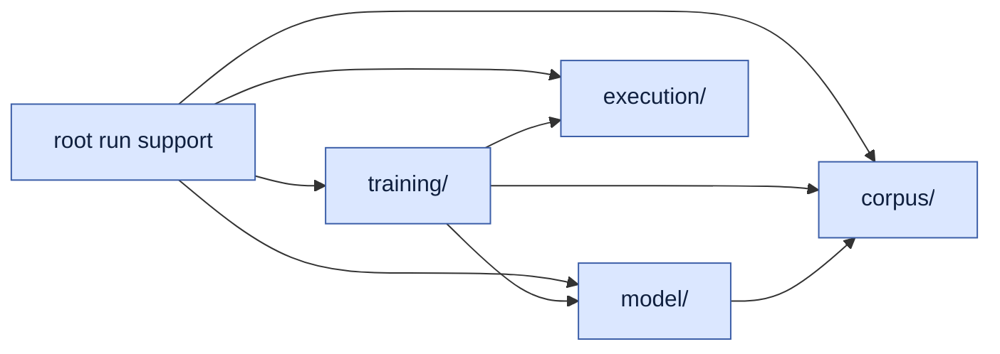
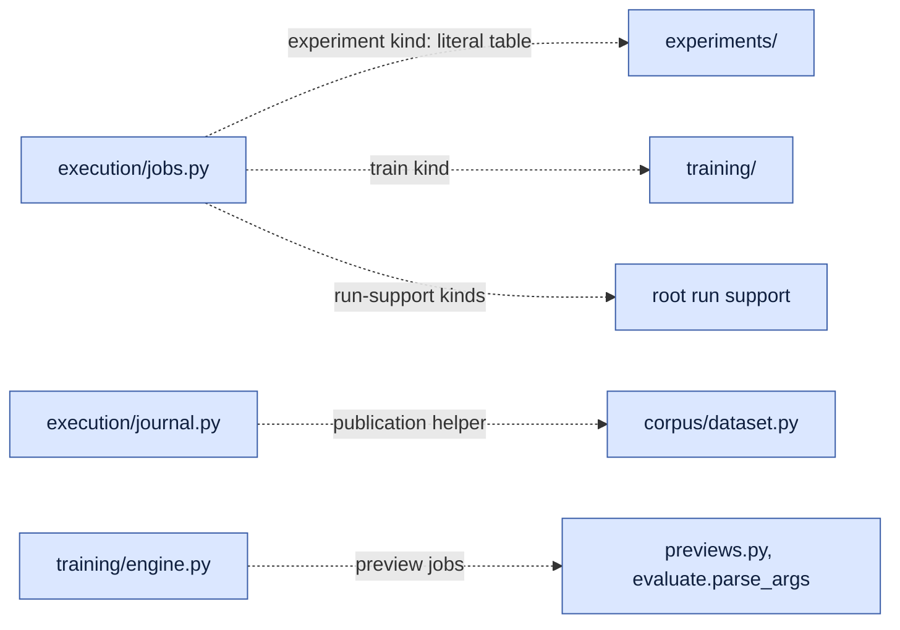
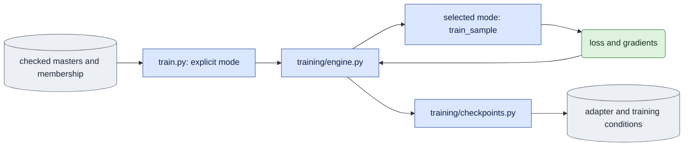
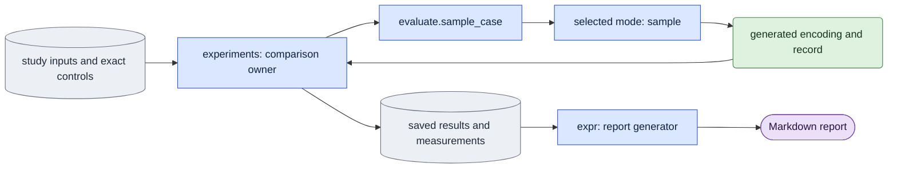

# Architecture — package layout, ownership and dependencies

This document owns the package layout, the ownership and dependency rules, the
queue kinds and the boundary checks. GPU and process rules (direct `nvidia-smi`,
one shared own-process ledger, GPUs 0–7) are in the [package guidance](../CLAUDE.md)
and the [run guide](../configs/README.md). Do not copy test counts or run status
into this document.

- **Required** means the agreed rule.
- **Current** means the behavior of the inspected source.
- **Verified** means a check with saved evidence and an explicit scope.

## Objective and authority

Keep one shared trainer and the two model modes. Separate this runtime from the
code that defines a scientific comparison. An
experiment uses the shared runtime. It does not carry another trainer, sampler,
adapter loader, condition checker or decoder.

[Core algorithm](core_algorithm.md) owns the numerical and conditioning rules.
[Training choices](training_choices.md) owns the D0/D1, background and history
settings. `doc/experiments/` is reserved for experiment-module docs.
Per-module docs explain current calculations. Update them in the same change as
the source they describe.

## Terms and classification

- **Core runtime:** code that trains or generates in ordinary supported
  conditions. It includes both mode algorithms. A mode is not a study.
- **Corpus code:** code that names, reads, checks or produces capture, guide,
  crop, mask and VAE data, and the fixed video list.
- **Ordinary run support:** preparation, evaluation, measurement, previews,
  decoding, rendering and plotting that several runs use without knowing a
  scientific question.
- **Execution and provenance:** dispatch, own-process tracking, bounded
  supervision and the identity of source and runtime bytes.
- **Experiment code:** code that chooses interventions, comparison controls, a
  study's exact inventory or the interpretation of
  study measurements. Acceptance checkers (E1–E4) are experiment code.
- **Study data:** membership, frame plans, exact schedules, noise, job lists and
  narrative settings. Study data can live under `expr/onestep_avatar/`.
- **Report code:** code under `expr/` that reads saved evidence and writes a
  report. It never generates a missing result.
- **Maintained report:** a report that must rebuild from saved results.
  **Frozen report:** a report whose code stays unchanged and is not
  rebuild-tested.
- **Archived executor:** an `expr/` file kept as non-executable provenance
  (`.py.txt`/`.sh.txt`). It is data, never imported or run.

Classify a function by its responsibility, not by its number of callers. A
general decoder with one caller is still run support. A converter for two fixed
source views is study-specific even when several jobs use it. Exact mathematics
and supported default settings belong to their common owner. A study's actor
list, sigma grid and comparison roles do not.

## Package layout

All paths are relative to `LTX-2/scripts/onestep_avatar/` unless stated.

```text
__init__.py          package marker; PACKAGE_ROOT, LTX_ROOT, WORKSPACE_ROOT
hashing.py           leaf utility: file and tensor content identity
train.py             thin training CLI; requires --mode
infer.py             product CLI/API: supplied image + guide, no capture target
evaluate.py          ordinary evaluation: preflight, sample_case, save_case, CLI
metrics.py           general latent, RGB, subject and LPIPS measurements
previews.py          training-preview jobs: verify, state, generate, render
comparisons.py       saved-comparison rendering (queue kind "render")
media.py             decoding use, panels, videos and layout
decode_saved.py      decode saved encodings (queue kind "decode")
prepare_inputs.py    fixed preview and supplied-image preparation
bench.py             measured generation and operation cost
plot_training.py     training-log plots
corpus/              dataset, subset, precompute, build_guidance,
                     geometry, motion, mask_video, qa
model/               common, backbone, adapters, sampling, bidirectional, causal
training/            config, engine, checkpoints, startup, runtime,
                     resources, numerics, consumer_trace, update_state
execution/           queue, jobs, journal, recovery, completion, attempt, clock, processes,
                     queue_launch, queue_protocol, process_registry, supervision, software, devices, runtime, terminal
experiments/         training_update_check, training_slice_check,
                     adapter_effect_check, continuation_check, causality,
                     stock_parity, fusion_parity, sigma_sweep,
                     sigma_sweep_results, short_causal_check,
                     stats, saved_probe_metrics, spec_protocol,
                     prune_baseline, prune_reproduction, prepare_continuation,
                     continuation_identity_check, conditioning_check,
                     capacity_review, reference_inputs, past_influence_check
configs/             fsdp.yaml, fsdp_forward_prefetch.yaml, README.md recipes
doc/                 mirrored module designs and cross-module contracts
tests/               ordinary tests; tests/experiments/ for experiment tests
```

`corpus/`, `execution/` and `experiments/` each use an empty `__init__.py`,
like `model/` and `training/`. Do not add `LTX-2/scripts/__init__.py`.
`scripts` must stay a namespace package, so that `corpus/build_guidance.py`
can merge ARGAvatar's `scripts.inference` at run time.

## Ownership by package

| Package | Owns | Does not own |
|---|---|---|
| `corpus/` | Artifact names and readers, checked membership and splits, crop/mask/pose/VAE producers, guide rendering (the only `argavatar` module) | Mode frame plans beyond shared facts, model calls, study selections |
| `model/` | Token layout, noise, `c0`, loss, base weights, adapter function, exact denoising steps, both mode algorithms, cache state and diagnostic numerical paths | Settings parsing, optimizer loop, comparison orchestration |
| `training/` | Typed settings and preflight, the one optimizer loop, checkpoint contract and export, runtime/resource/numerical evidence, preview enqueue | Evaluation, sampling CLIs, studies |
| Root run support | Ordinary evaluation, product, previews, saved comparisons, decoding, media, preparation, cost and plots | Interventions, comparison protocols, study inventories |
| `execution/` | Managed launches: queue kinds, GPU pool and claims, launch gate, own-process ledger, bounded supervision and deadlines; terminal output; software manifests | Model calculations, study logic |
| Root leaf utilities | Repository roots (`__init__.py`) and file/tensor content hashes (`hashing.py`) | Any package import; heavy imports at module load |
| `experiments/` | Comparison protocols, acceptance checkers, interventions and study-only metrics | A second trainer, sampler, adapter loader, condition checker, decoder, registry, queue or launcher |
| `expr/` report code | Sections, captions, report plots, saved-result summaries, report validation | Any model, VAE, training or queue execution |

Shared knowledge keeps one spelling. Artifact names live in
`corpus/dataset.py`, the crop box in `corpus/geometry.py`, the block plan in
`model/causal.py`, the mask codec in `corpus/mask_video.py`, LoRA targets in
`model/adapters.py` and repository roots in `__init__.py`.

## Allowed dependencies

The table lists package-internal imports. Lazy imports inside functions count.

| Importing package | May import | Must not import |
|---|---|---|
| Root leaf utilities (`__init__.py`, `hashing.py`) | The standard library only at module import | Every package module |
| `corpus/` | `corpus/`, root leaf utilities | Everything else in the package |
| `model/` | `model/`, `corpus/`, root leaf utilities | `training/`, root run support, `execution/`, `experiments/` |
| `training/` | `training/`, `model/`, `corpus/`, `execution/`, root leaf utilities; lazily `previews.py` and `evaluate.parse_args` for preview jobs | Other root run support, `experiments/` |
| Root run support | Any package code outside `experiments/` | `experiments/`, `train.py` |
| `execution/` | `execution/`, root leaf utilities; lazily `corpus/`, `training/` and root run support for each job kind | `experiments/`, except through the literal table in `execution/jobs.py` |
| `experiments/` | Public names of every package owner, other experiments | Private `_names` of other modules, `expr/` code, `train.py` |
| `expr/` report code | Model-free readers: `corpus/` readers, `hashing.py`, saved-record readers | Model, VAE or text-encoder loaders, queue execution, `experiments/` CLIs |
| `scripts/prune/` | Public `corpus/` readers and `model/` owners | `experiments/`, root run support, `training/` |

Rules that the table does not show:

1. Core training, ordinary evaluation and product must start and finish when
   `experiments/` cannot be imported. They do not dispatch a scientific
   protocol from an ordinary CLI.
2. A software profile that requires a file is a dependency, even without an
   import. No ordinary profile lists an `experiments/` or `expr/` file.
3. Add no import cycle between modules. Package-level back edges exist only as
   the lazy edges named in the table.
4. An experiment that needs a private helper makes it public in its owner and
   documents it there. It does not import `_name` across modules.
5. Diagnostic numerical paths can stay in `model/causal.py` when they reuse its
   block/cache primitives. Ordinary defaults never select them.
6. A general metric stays in `metrics.py`. A wrapper that needs one study's
   boundaries, frames or score inventory belongs to that experiment.
7. Study data paths can point into `expr/`. A path argument never permits
   importing Python from `expr/` or running a data field as code.
8. Only `execution/` claims GPUs, writes own-process ledger rows or supervises
   a child process. Run support and experiments do none of these.
   Agents run model work inside queue jobs. Humans can use those jobs or run
   the same task modules directly. Direct launches have no queue receipt,
   process ledger or external supervision. CPU commands can run directly.

**Corpus ownership.** `corpus.subset` surveys saved producer files, assigns
person groups and writes content-pinned membership. Frame selection belongs
to `training.config`, which calls the canonical model frame planner. Corpus
imports, including lazy imports, load no model or training owner.

`model.adapters` owns `LORA_TARGETS`. Its loader receives a validated
contract and the adapter SHA-256 as data. Callers run the public
`training.checkpoints.recheck_adapter` immediately before they open the
weights. The model owner checks the file identity again, without an import of
`training`. The model owner does not repeat the contract validation.

The first diagram shows imports that run when a module loads. They form one
direction, from run support down to corpus code. Two kinds of edge are not
drawn: `experiments/` may import every package, and every package may import
the root leaf utilities.



The second diagram shows the permitted lazy imports that the first diagram
does not contain. Each runs inside one job kind or one preview path. The edge
into `experiments/` exists only through the queue's literal table.



`hashing.py` imports only the standard library at module import. Tensor
hashing imports `torch` inside the function, so `corpus/build_guidance.py`
and the import-light queue modules stay light.

## Ordinary training and experiment data flow

This diagram shows ordinary training. It has no experiment owner.
Use the [core legend](core_algorithm.md#7-end-to-end-data-flow).



This diagram shows an experiment that uses the same generation function.
Arrows carry inputs or results. They do not permit reverse imports.



## Shared mechanisms

### Repository roots

`__init__.py` defines three constants with the standard library only:

```python
PACKAGE_ROOT = Path(__file__).resolve().parent   # .../LTX-2/scripts/onestep_avatar
LTX_ROOT = PACKAGE_ROOT.parents[1]               # .../LTX-2, the cwd for python -m
WORKSPACE_ROOT = LTX_ROOT.parent                 # .../VideoDiffusionModels
```

Package code and tests use these names. No other module calculates a repository
root from `__file__`, so moving a file cannot change a root. Child processes use
`cwd=LTX_ROOT`. Hashing a module's own bytes with `sha256(Path(__file__))` is
file identity, not a root calculation.

### Queue kinds and experiment dispatch

Agent model work and managed human runs use queue jobs. Humans can also use
the [direct CLI recipes](usage.md#human-direct-cli).
Each queue kind starts one
module with `python -m scripts.onestep_avatar.<module>` from `LTX_ROOT` and
has a model-free completion check.

| Kind | Module | GPUs | Completion check |
|---|---|---|---|
| `train` | `train` through `accelerate launch` | four | `training.engine` scientific verification |
| `evaluate` | `evaluate` | one | `evaluate.verify_evaluation_conditions` |
| `preview` | `previews` | one | `previews.verify_completion`: checked preview state from `verify_preview_job` plus the immutable completion marker |
| `product` | `infer` | one | `infer.verify_completion`: raw encoding, records, generated-only MP4 and review match their recorded hashes |
| `bench` | `bench` | one | `bench.verify_completion`: the timing record is complete for the requested repetitions and warmup |
| `decode` | `decode_saved` | one | decoder receipt check |
| `render` | `comparisons` | one | `comparisons.verify_saved_comparison_completion` |
| `experiment` | the selected experiment module | one | that module's `verify_completion(spec, root)` |

**GPU pool.** The single import-light owner is `execution/devices.py`:
`GPU_POOL` is GPUs 0–7 and `TRAIN_PROCESSES` is four. The queue and ledger
import this policy; the queue's exported names are aliases, not another pool.
`train` selects four free devices and keeps four processes. Single-GPU kinds
pick one free device from the same ordered pool. Selections may be noncontiguous.

**Experiment selection.** An `experiment` job carries `experiment` (a
selector), `spec`, `spec_sha256` and `arguments`. The canonical job hash covers
every field. `execution/jobs.py` holds one literal table. Each entry is an
experiment module that loads a model or uses a GPU:

```python
EXPERIMENTS = {
    "stock_parity": "scripts.onestep_avatar.experiments.stock_parity",
    "adapter_effect_check": "scripts.onestep_avatar.experiments.adapter_effect_check",
    "continuation_check": "scripts.onestep_avatar.experiments.continuation_check",
    "continuation_identity_check": "scripts.onestep_avatar.experiments.continuation_identity_check",
    "conditioning_check": "scripts.onestep_avatar.experiments.conditioning_check",
    "training_update_check": "scripts.onestep_avatar.experiments.training_update_check",
    "training_slice_check": "scripts.onestep_avatar.experiments.training_slice_check",
    "causality": "scripts.onestep_avatar.experiments.causality",
    "fusion_parity": "scripts.onestep_avatar.experiments.fusion_parity",
    "sigma_sweep": "scripts.onestep_avatar.experiments.sigma_sweep",
    "stats": "scripts.onestep_avatar.experiments.stats",
    "prune_baseline": "scripts.onestep_avatar.experiments.prune_baseline",
    "prune_reproduction": "scripts.onestep_avatar.experiments.prune_reproduction",
}
```

Only the `experiment` branch reads the table. It imports the selected module
with `importlib.import_module` at the point of use. The selected module provides
`parse_args(argv)`, a `python -m` entry and `verify_completion(spec, root)`.
The queue checks `spec_sha256` before launch and again before completion. An
unknown selector fails before any claim, write or child process. Ordinary kinds
never read the table. Adding a queued study means editing this literal table
and its tests. There is no registration API, discovery or plugin loading.

Some experiment owners are not in the table, or have extra operations:

- `prepare_continuation` runs on CPU only and is not a queue selector. It
  prepares content-pinned E3 noise and ordinary baseline jobs. It seals the
  protocols only after the public saved verifier proves the baseline and the
  exact repeat.
- `continuation_identity_check` adds independent 17-frame image and prefix
  arms through `evaluate.sample_case`. Public transformer hooks observe the
  native input and the refresh data. They do not change the shared numerical
  path.
- `conditioning_check` changes one checked guide or text input, or compares
  D0 with D1 at sigma one or as a capture oracle. It uses the same public
  evaluator. Its optional decoding makes matched RGB/VAE reviews.
- `conditioning_check` has an explicit `capacity_review` operation. It passes
  the work to the independent saved-output owner. That owner verifies the
  completed ordinary D0 base and updates 0, 20 and 60. Then it loads only the
  decoder for matched reviews.
- `conditioning_check` has explicit `prepare_references` and `past_influence`
  operations. `reference_inputs` checks the original recorded crop before it
  adapts a copied source descriptor for RGB/VAE preparation. Membership files
  stay unchanged.
- `past_influence_check` first rebuilds the exact original cache transaction
  order, or the recomputed native input. It proves every layer K/V and the
  current prediction against fresh continuation producers. Then it changes only
  completed past frames that are not `c0`. Its `--review-of` branch loads the
  decoder for exact-prefix diagnostic reviews.

Each operation records its own source pins. A change to the past-influence
owner does not invalidate the other conditioning, reference or capacity
producers. Every evaluation or continuation output that an operation reads
must be a declared queue dependency. Ordinary jobs import none of these owners,
and no ordinary software profile lists an experiment.

`prune_baseline` reproduces one saved pruning case under bounds. Its
experiment owner gives pinned scientific settings to the public
`scripts.prune.evaluate.whole_clip_baseline` producer.

- The numerical producer stays in `prune`. `prune` imports no avatar
  experiment or execution owner.
- Queue supervision, claims and resource receipts stay in `execution/`.
- The protocol keeps the producer's original files under `baseline/`. It
  publishes separate input/software acceptance and saved-completion records at
  the job root.

`prune_reproduction` tests why that case differs from a saved reference. It
uses the same producer functions. It applies each control only at the model
call or through a process flag. So neither `prune` nor the model owners
change.

**Bounded supervision for every kind.** A job may name a resource budget in the
existing `training/resources.py` format. `train` keeps its typed
`--resource-budget` option; other kinds use the job fields `resource_budget`
and `resource_budget_sha256`. A job without a budget gets the scientific
default: 1,800 seconds per phase and 48,000,000,000 allocated bytes. The queue
supervises every child with `execution/supervision.py`, records owned
descendants in the ledger and proves worker absence at the end.

**Overall deadline.** A budget may set `overall_seconds`. The clock starts at
the first attempt and is stored in the queue journal. A startup retry or a
queue restart does not reset it. When it expires, the queue stops the owned
process tree within the shutdown bound and marks the job failed with reason
`overall_deadline`.

**Numerical environment.** A job that needs the deterministic numerical policy
declares it. The queue applies the child environment from
`training/numerics.py` before the child starts, as it does for `train`.

**Evidence.** Each attempt keeps its launch request and grant, journal entry,
supervision result with the worker-absence proof, and the child log. An owner
that ends before publishing the supervision result leaves the attempt failed
with reason `missing_supervision`; recovery never writes a success it did not observe.

**Checkers inside a job.** A checker never claims GPUs, writes a ledger row or
calls `supervise`. When a protocol needs a separate process (for example the E4
serial reference), that process is its own queue job, and the step that needs
its output depends on it through the job dependencies.

**Pinned job lists.** Every supported experiment has a fixed selector and
content-pinned scientific specification. Generation and dependent decoding use
explicit current jobs with fresh output IDs and verified prerequisite results.
Data fields never select executable source or repair missing inputs.

### Software profiles

There are five profiles: `training`, `evaluation`, `inference`, `decoding` and
`preparation`. `execution/software.py` lists `COMMON` and per-profile `ENTRIES`.
`__init__.py` and `hashing.py` are in `COMMON`.

- No ordinary profile lists an `experiments/` or `expr/` file. Common
  runtime/device/protocol owners bind queue execution without importing studies.
- An experiment binds its own files with
  `software.capture(<profile>, mode, extra_sources=(<experiment files>,))`.
  There is one provenance system.
- **Coverage check:** for each profile, a CPU test runs a representative entry
  path with experiments blocked. Every loaded `scripts.onestep_avatar` module
  must be in that profile. A missing file is a profile defect.
- A changed path or byte makes earlier manifests non-current. Earlier receipts
  keep their attribution; a changed producer needs fresh affected evidence.

### Evaluation function owners

| Functions | Owner |
|---|---|
| `tensor_sha256` | `hashing.py` (same algorithm and bytes) |
| `encoded_metrics`, `rgb_metrics`, `_check_rgb_pair`, `masked_rgb_transition_steps`, `subject_mask`, `subject_rgb_metrics`, `_lpips_batches`, `lpips_frame_scores`, `lpips_distance` | `metrics.py` |
| `check_preview_reference_bundle`, `verify_preview_job`, `_verify_preview_outputs`, `set_preview_state`, `render_preview_outputs`, `generate_preview`, `verify_preview_tensors`, the `--preview-job` CLI | `previews.py` |
| `_saved_panel_path` through `verify_saved_comparison_completion`, `parse_saved_comparison_args`, the `--render-saved-comparisons` CLI | `comparisons.py` |
| `check_adapter`, `validate_comparison`, `measure_calls`, `sample_case`, `save_case`, `parse_args`, `prepare_evaluation`, `verify_evaluation_conditions`, `evaluation_evidence_paths`, `execute_evaluation`, `main` | `evaluate.py` |
| `probe_future_noise`, `save_future_noise_probe`, the changed-noise branch of `evaluation_evidence_paths`, `causality_probe`, `evaluate_causality` | `experiments/causality.py` |
| `fusion_probe_block`, `fusion_parity_metrics`, `evaluate_fusion_parity` | `experiments/fusion_parity.py` |
| `sigma_sweep_boundary_metrics` | `experiments/sigma_sweep.py` |
| `saved_latent_metrics`, `measure_saved_probe` | `experiments/saved_probe_metrics.py` |

`previews.py` imports the ordinary evaluator in one direction only. A fixed
preview passes its public `verify_preview_tensors` checker through the typed,
keyword-only `execute_evaluation(..., preview_tensor_validator=...)` API.

- The evaluator requires that callable when `preview_fixed` is present. It
  checks this before native handles, model loads or output writes.
- It calls the checker once, after the execution tensors are assembled and
  before the transformer runs.
- The evaluation software evidence binds the source file of the validator.
- The evaluator does not import `previews` and does not discover a checker.

`metrics.py` may load the LPIPS network. It never loads the transformer, text
encoder or VAE.

**Ordinary evaluation options.** `evaluate.py` keeps `--history-mode
{cache,recompute,joint}` and `--kv-source {refresh,denoise}`. They select
shared diagnostic paths in `model/causal.py`. Every output records them. The
defaults are `cache` and `refresh`. The product refuses other values.

- Future-noise and fusion interventions belong to experiment CLIs.
- Fixed-preview jobs belong to `previews.py`.
- Saved comparisons belong to `comparisons.py`.

An unsupported ordinary option fails as an unknown argument before any write.

### Cross-package caller: `scripts/prune/`

`scripts/prune/` imports `corpus.dataset.load_training_master`, `model.common`
and `model.causal`. `scripts/prune/data/whole_clip.py` reads the saved
whole-clip rollout format.

The whole-clip producer is the prune-owned CLI
`scripts/prune/evaluate/whole_clip_baseline.py`. Its document is
`scripts/prune/doc/evaluate/whole_clip_baseline.md`.

- It keeps the saved output format.
- It has explicit view, sigma, prompt, seed, model, guidance and transformer
  options.
- It calls public `corpus/` readers and `model/` owners.
- It has no adapter or causal history setting.

A native baseline reproduction requires matched scientific inputs, numerical
policy and source identity, and successful bounded supervision.

### Tests and docs

- Experiment tests live in `tests/experiments/`. Other tests live in `tests/`.
  Test file names are unique across both folders.
- Test public behavior at its current owner; every retained calculation and failure rule needs coverage.
- Package tests do not import or run `expr/` code. A test that reads `expr/`
  data skips with a stated reason when the data is absent.
- Docs mirror source paths: `doc/corpus/`, `doc/execution/`,
  `doc/experiments/`, `doc/model/`, `doc/training/` and root `doc/<name>.md`.
  Files over 100 physical lines need a mirrored doc. Files with 100 or fewer
  lines use a header and have no separate doc.
- Cross-module docs stay at `doc/`: `architecture.md`, `core_algorithm.md`,
  `training_choices.md`, `known_gaps.md`,
  `verification.md` and the index `README.md`.
- The index lists only present sources; useful explanations stay with their current owner.

## Saved report ownership

Report code under `expr/` can read saved settings, observations, metrics,
media and provenance. It cannot run models, decode tensors, start a queue or
repair missing scientific results. A missing cited file fails before any child
process or write. Maintained report generators rebuild from checked saved
inputs. Report-specific sections, captions, sheets and plots belong there.

Saved observations keep their producer hashes and their original scientific
meaning. A current verifier can reject an observation. It does not change the
recorded bytes. Non-executable source provenance is data. It is never an import
or an execution fallback. The report-disposition inventory controls which
reports can be rebuilt.

## Change and acceptance rules

Before you remove an interface, find all its callers: in the package, in
`prune`, in tests, in recipes and in maintained reports. Keep the required
behavior in a current public owner and check it on CPU. A strict saved-data
reader also needs an inventory that proves the selected inputs meet its
contract. Do not infer missing settings. Do not rewrite evidence to pass a
check.

- No forwarding module, compatibility alias or second execution owner is
  allowed.
- Invalid options and unsupported contracts fail before model handles and
  writes.

Source, import, documentation and CPU acceptance are separate from native
scientific acceptance. A changed source profile requires new native
observations, with matched inputs, for the affected results. Full workflow,
numerical, quality, cost and pilot acceptance stay required even when focused
CPU checks pass. See the [acceptance gates](verification.md#acceptance-gates).

## Boundary checks

Run these checks after any change to layout, imports, profiles, queue kinds or
report code. The [run guide](../configs/README.md#10-check-the-code) lists the suites.

- **B1 Layout.** The tree matches the [package layout](#package-layout). Every source has one current owner. `LTX-2/scripts/__init__.py` does not exist.
- **B2 Experiments blocked.** With an import blocker that refuses
  `scripts.onestep_avatar.experiments*` (for example a `sys.meta_path` finder
  installed by `tests/conftest.py` when `ONESTEP_AVATAR_BLOCK_EXPERIMENTS=1`),
  the ordinary suite (`tests/` without `tests/experiments/`) passes. Blocked
  child commands also pass: `train --mode bidirectional --dry-run`,
  `train --mode causal --dry-run`, ordinary `evaluate` and `infer` dry runs,
  and `--help` for `previews`, `comparisons`, `decode_saved`,
  `prepare_inputs` and the queue.
- **B3 Static imports.** An AST test finds no `experiments` import outside
  `experiments/`, except the literal table in `execution/jobs.py`. It also
  checks the [dependency table](#allowed-dependencies) and private-name rule.
- **B4 Roots.** Only the package marker computes roots from `__file__`.
  An AST check tracks file-path aliases, helper returns and function parameters;
  ancestor operations on those values fail. File-byte hashing and independent
  data-path ancestors stay valid. The roots import with the standard library only.
- **B5 Profiles.** No ordinary profile lists `experiments/` or `expr/`. The
  profile coverage check passes for all five profiles.
- **B6 Queue.** Ordinary kinds never import an experiment module. An unknown
  kind or selector fails before writes. Every kind and every selector parses,
  builds its command and verifies completion on CPU fixtures. A CPU fixture
  shows bounded supervision for a non-`train` kind, and an overall deadline
  that a simulated startup retry and a queue restart do not reset. No kind can
  select a GPU outside 0–7; training still selects exactly four.
- **B7 Environments.** `conda run -n argavatar python -m
  scripts.onestep_avatar.corpus.build_guidance --help` exits zero.
- **B8 Reports.** The maintained AR report rebuilds byte-identically from saved
  results with model/VAE/queue execution disabled. Removing one cited artifact
  fails before children or writes. No executable model or queue owner is present
  in report code or source provenance.
- **B9 One launcher.** An AST test finds uses of `ProcessRegistry` and its
  `acquire`, of `supervision.supervise`, and of the `queue_launch` request,
  guard and grant functions only inside `execution/`. Phase notifications
  from a running child (`supervision.notify_phase`) are not launches.
  Every native run type (E1–E4 checkers, preview, product, bench, pilot
  training) is a queue job list that passes the queue's CPU dry run.

## Worked boundary checks

**Ordinary training.** A checked D1 membership and `--mode causal` select the
typed engine and `model.causal.train_sample`. With experiments blocked, the
settings preflight, a small-model CPU update, adapter export and preview
enqueue still work. The run knows no scientific sweep cells or study labels. Repeat the check for bidirectional mode, which has no cache.

**Queued future-noise experiment.** A job `{"kind": "experiment",
"experiment": "causality", "spec": ..., "spec_sha256": ...}` with future-noise
arguments reaches the literal table, imports `experiments.causality` and starts
`python -m scripts.onestep_avatar.experiments.causality` with `cwd=LTX_ROOT`
on one GPU from the pool, under bounded supervision.
The module keeps the earlier saved noise bytes, changes only later bytes and
calls the shared `evaluate.sample_case` twice. A changed earlier noise byte
fails preflight. A job with selector `"x"` fails before any claim. An ordinary
`evaluate` job that passes `--future-noise-start` fails as an unknown argument
before any claim.

**Maintained saved report.** With complete saved outputs, the AR report
rebuilds while model, decoder and queue execution are disabled. Removing a
cited artifact makes the rebuild fail before any child or write. A source-provenance file cannot satisfy a missing scientific result or serve as an executor.

## Queue execution ownership

The queue delegates normalized job contracts to jobs, state publication
to journal, interrupted recovery to recovery, receipt verification to completion
and one child lifecycle to attempt. Process inspection belongs to processes.
GPU inventory parsing belongs to devices. Clock owns the original overall deadline.
Infrastructure must not import execution.queue. The queue exports compatibility aliases.
Journal transactions check ownership; recovery decisions run only on explicit recovery.
The literal experiment table lives in jobs and retains lazy selected imports.
Training software identity includes the extracted owners. Saved source hashes remain strict.

The queue defaults its journal to state.json beside the job list. An explicit --state overrides that path.
