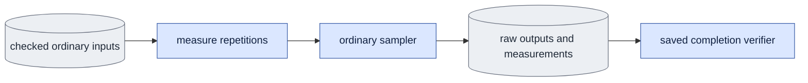

# `bench.py` — measure each mode's work

Status: **Partially implemented.** The existing causal per-block diagnostic
CLI moves here without calculation changes. The shared `measure_generation`
API measures either mode through `evaluate.sample_case`. The explicit-mode CLI
uses checked evaluation settings and saves measurements with ordinary raw
results. Real-weight performance acceptance remains pending.

## Objective

Measure generation with the same inputs and functions as normal use.
Report denoise, cache setup/update, and complete-output cost separately.

## Data flow

Check fixed inputs, weights, and schedule.
Warm up the selected path.
Synchronize the GPU, time the calls, and record call counts, elapsed time, and peak memory.
Report model loading and decoding separately from generation.

## Organization logic

The public `parse_args(argv)` selects ordinary generation or the preserved
`--operation-timing` protocol. It exposes a normalized output and local GPU
zero by default. Ordinary generation retains the evaluator's complete input
preflight, exact calls and one untimed artifact call. Saved completion derives
the exact case/variant inventory through that same preflight and calls the
public ordinary scientific verifier before checking benchmark rows.

`verify_completion(arguments, root)` requires the requested warmup and exact
repetition count, finite positive elapsed times, matching output and call
identities, exact covered/generated frame rates and recomputed timing summary.
Validate CUDA memory baseline/peak/extra relationships when recorded. CPU
measurements keep null memory fields. `evidence_paths` returns all verified
ordinary raw records, outputs, text and noise; no model or decoder opens.

Operation timing accepts queue form `--output <directory>` and writes
`operation_timing.json`. Historical `--out <file>` remains supported and
normalizes its output to that file's parent. Preserve the existing cache-depth
sweep and calculations. Record requested settings, actual denoise/refresh
repetition times, model/software identities and cache geometry with the
original summary. Completion checks both operation inventories and derives
the original statistics and per-chunk sum from the saved measurements. Its
descriptor identifies the actual result file, and missing measurements fail
rather than rerunning an operation.

Include this benchmark source in the ordinary evaluation software profile.
Retain each raw result's existing evaluator producer hash. Operation timing
records its own producer hash and actual transformer bytes. Saved ordinary
timing also checks exact denoise/refresh counts, including the shared guidance
pass rules. For depth `D`, derive query and retained-key token counts from the
same causal block plan; derive cache capacity from its clip-limited geometry.
Cache bytes use saved layer count, width and native two-byte elements.

Worked completion control: two repetitions require exactly two native timing
rows. A changed elapsed summary, warmup count or output digest fails even if
the raw encoding remains valid. An operation record with one absent depth
cannot certify its requested cache-depth sweep.

The default CLI accepts all ordinary evaluation arguments plus `--repetitions`
and `--warmup`. It requires an explicit mode. Parse/check these counts before
input access. Ordinary parsing rejects retired study options; preview jobs have a separate execution/completion contract. Reuse evaluation preflight, prompt/guidance,
adapter loading and fixed noise. For each case/adapter, run the measured sampler
with fresh cache state, then make one untimed artifact call to save an ordinary
encoding/result. Require that artifact's tensor hash to equal every measured
output hash. Save measurements in the result's `benchmark` field. Report the
extra artifact call explicitly; it is outside the warm generation timer.
`evaluate.execute_evaluation` accepts this sampler as an explicit callable
argument, never through study executable imports. Its default remains ordinary
sampling. The retained synthetic diagnostic requires `--operation-timing
--mode causal`; it is separate from complete-output measurements.

`measure_generation(transformer, *inputs, device=..., repetitions=...,
warmup=..., **sampling_settings)` passes the fixed inputs directly to
`evaluate.sample_case` for every repetition. Validate positive repetitions and
nonnegative warmup first. Warmup outputs are discarded. GPU runs synchronize
before/after each measured call and reset peak counters, recording baseline,
allocated/reserved peaks, actual call counts and output tensor identity. CPU
runs report memory as unavailable. Save each repetition separately and report
minimum/median/maximum elapsed time. Do not sum synchronized sub-operation
timings into this whole-generation duration.

The retained CLI measures causal denoise and refresh operations at separate
cache depths using its original synthetic inputs. These are instrumented
operation timings, not complete-output latency or a bidirectional comparison.

Fix saved noise, text, frame dimensions, weights, LoRA application, guidance, and output frame count.

### Measurement boundaries

- **Loading:** weights/text preparation and any decoder loading, reported outside the warm generation timer.
- **Generation:** from the selected mode's sample call to its complete encoded output.
  Include its cache allocation, denoising, refresh/removal, and output assembly.
- **Decode/write:** transfer, decode, and file creation, timed separately when requested.
- **Complete result:** measured directly from the stated start boundary until the requested artifact is ready.
  State which models were already loaded. Do not add unrelated warm/cold timings and call that a measured latency.

### Timing procedure

1. Check adapter/input settings and open the required model session.
2. Run the exact requested generation path for the recorded number of warmup repetitions.
   Discard these times and outputs. Warmup does not change saved noise or measured settings.
3. For each measured repetition, clear prior output/cache references and synchronize the GPU.
4. Reset peak allocated/reserved GPU memory counters. Start a monotonic wall clock.
5. Call the ordinary mode sampler with a fresh empty causal cache, or no cache for bidirectional mode.
6. Synchronize the GPU after the encoded output is complete. Stop the clock and read memory peaks.
7. Record the output/frame identity and a trace of denoise, prime, refresh, and guidance calls.
8. Save every repetition's times/counts, warmup/repetition counts, device/runtime identity, and exclusions.
   Report median, minimum, and maximum over measured repetitions.

Keep the same boundary for every compared mode.
Record memory at the start and the absolute peak. Extra peak memory is peak minus that baseline.
Allocated and reserved memory are different measurements; label both.
Per-operation timers can synchronize the GPU and alter execution overlap.
Mark those traces as instrumented runs. Do not silently replace the ordinary whole-call timing with their sum.

Calculate covered-frame rate as actual covered RGB frames divided by generation seconds.
Each repetition saves encoded frame count, covered RGB frame count, and both
covered/generated frame rates. Derive coverage from the returned frame count
and grid time scale, not the requested geometry. The generated-frame count
excludes the one conditioned first image. For seven encoded frames at scale
eight, report 49 covered RGB frames and 48 generated frames. If causal sampling
discards a partial tail, use its returned frame count in this calculation.
That includes the first conditioned image. Also state the generated-frame rate using one fewer frame.
Do not count a shared first frame twice or include a discarded causal tail.
Use actual output shape/time mapping, not requested frame count.

Direct bidirectional generation has one denoise and no prime/refresh.
Direct causal generation keeps one denoise and one refresh per block, including its final refresh.
For `S` denoising intervals per block in the standard causal cache path, the un-guided count is `K*S + K`.
Bidirectional generation has `S` calls. Count actual guidance passes separately.
Training priming is not an inference cost.
Do not infer gradient-checkpoint work from inference call counts.

## Invariants

- Counts include actual guidance passes and executed steps.
- Record stored past-frame limits and actual frame coverage.
- Measure memory/time changes; diagrams alone do not establish improvement.

## Gotchas

An old causal-block timing result is not a bidirectional speed measurement.
Removing unused cache work can help, but does not give a reliable numerical speed estimate.
Check available GPUs before a small real-weight benchmark.
Real-weight performance acceptance remains pending; CPU checks do not establish
GPU speed or memory savings.

## Tests

`test_ordinary_queue_completion.py` checks both modes on controlled CPU models,
then blocks native loading while verifying complete measurements. Changed
repetition/warmup counts, nonfinite times, summary/call/output/coverage claims
and memory relationships fail. Operation controls cover missing depths/times,
wrong cache geometry, changed producer bytes and altered per-chunk sums.

[V6](verification.md) supplies expected explicit call counts.
Worked check: three two-new-frame causal blocks cover seven encoded frames, or 49 RGB frames.
With one direct step, the trace has three denoises, three refreshes, and no prime.
If measured generation time is `.78` seconds, covered-frame rate is `49/.78`;
generated-frame rate is `48/.78`. Loading and decoding do not enter either value.
This is an arithmetic example, not a measured speed result.

After implementation, compare returned counts with instrumented model calls.
Use a fake clock/call trace to check timing boundaries and excluded warmup repetitions.
Reject a benchmark comparison with different saved noise or coverage.
Measure one small same-input real-weight case.
