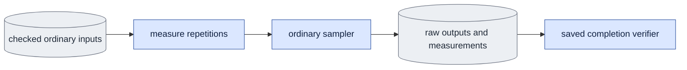

# `bench.py` — measure each mode's work

`bench.py` measures the cost of generation. The shared `measure_generation`
API measures either mode through `evaluate.sample_case`. The CLI uses the
checked evaluation settings. It saves the measurements with the ordinary raw
results.

## Objective

Measure generation with the same inputs and functions as normal use. Report
these costs separately: denoising, cache setup and update, and the complete
output.

## Usage

Humans can use the foreground queue or run this module directly.
See [launch, output and stop commands](usage.md). Agents use the queue.
The queue recipes below describe managed execution.

Start a measurement as a queue `bench` job. The queue selects the GPU. See
[run guide §8](../configs/README.md#8-decoding-comparison-media-cost-and-plots).

This is the agent path. A person can also run the same module directly, or start the queue in the foreground; see [usage](usage.md).

The CLI has two forms.

**Complete-output measurement.** Give all ordinary
[evaluation arguments](evaluate.md#usage) plus the repetition counts. Measure
one model state per job (see [gotchas](#gotchas)).

```bash
cd LTX-2
"$PY" -m scripts.onestep_avatar.bench --mode causal --subset <MEMBERSHIP.json> \
  --source <VIEW_ID> --variant dev --guide-mode d1 --schedule 0.725 0 \
  --checkpoint <ADAPTER.safetensors> --repetitions 3 --warmup 1 \
  --output <FRESH_OUT> --dry-run
```

| Argument | Meaning |
|---|---|
| `--repetitions N` | Measured repetitions. Default 3. It must be positive. |
| `--warmup N` | Warmup repetitions, not measured. Default 1. It must not be negative. |
| all `evaluate` arguments | The same meaning as in [evaluate](evaluate.md#usage). |

Output: the same `case_NNNN/variant_NNN/result.json` files as evaluation. The
measurements are in the `benchmark` field of each result.

**Causal operation timing.** This form times single denoise and refresh
operations at several cache depths with synthetic inputs. It does not measure
the latency of a complete output.

```bash
"$PY" -m scripts.onestep_avatar.bench --operation-timing --mode causal \
  --context-latent-frames 0 4 8 --reps 10 --warmup 3 --output <FRESH_OUT>
```

| Argument | Meaning |
|---|---|
| `--operation-timing`, `--mode causal` | Required. Select this form. |
| `--context-latent-frames D ...` | The cache depths to sweep. They must be unique and supported. |
| `--reps`, `--warmup` | Measured and warmup repetitions. Defaults 10 and 3. |
| `--sigma0` | The sigma, in `(0, 1]`. Default 0.725. |
| `--latent-frames` | The clip length. Default 18. It needs one complete block or more. |
| `--model`, `--seed` | The base model and the seed. |
| `--output` | Required. The command writes `operation_timing.json` here. |

## Data flow



1. Check the fixed inputs, weights and schedule.
2. Warm up the selected path.
3. Synchronize the GPU and time the calls. Record the call counts, the
   elapsed time and the peak memory.
4. Report model loading and decoding separately from generation.

## Organization logic

### Argument parsing

The public `parse_args(argv)` selects ordinary generation or the
`--operation-timing` form. Ordinary parsing reads `--repetitions` and
`--warmup`, checks them, and passes all other arguments to
`evaluate.parse_args`. Ordinary parsing refuses study options. Preview jobs
have a separate execution and completion contract.

### Complete-output measurement

The command reuses the evaluation checks, prompt and guidance, adapter loading
and fixed noise. For each case and adapter:

1. Run the measured sampler with a fresh cache state.
2. Make one untimed artifact call. It saves an ordinary encoding and result.
3. Require the artifact's tensor hash to equal every measured output hash.
4. Save the measurements in the result's `benchmark` field. Report the extra
   artifact call. It is outside the warm generation timer.

`evaluate.execute_evaluation` accepts this sampler as an explicit callable
argument. It never imports study code. Its default stays ordinary sampling.

`measure_generation(transformer, *inputs, device=..., repetitions=...,
warmup=..., **sampling_settings)` gives the same fixed inputs to
`evaluate.sample_case` for every repetition. It checks first that repetitions
are positive and warmup is not negative. It discards the warmup outputs.

Keep these items fixed: saved noise, text, frame size, weights, LoRA
application, guidance and output frame count.

### Measurement boundaries

- **Loading:** weights, text preparation and any decoder loading. These are
  outside the warm generation timer.
- **Generation:** from the sample call of the selected mode to its complete
  encoded output. It includes cache allocation, denoising, refresh, eviction
  and output assembly.
- **Decode and write:** transfer, decoding and file creation. These are timed
  separately when requested.
- **Complete result:** measured directly from the stated start until the
  requested file is ready. State which models were already loaded. Do not add
  unrelated warm and cold timings and call the sum a measured latency.

### Timing procedure

1. Check the adapter and input settings. Open the model session.
2. Run the exact generation path for the recorded number of warmup
   repetitions. Discard these times and outputs. Warmup does not change the
   saved noise or the settings.
3. For each measured repetition, clear the earlier output and cache
   references. Synchronize the GPU.
4. Reset the peak allocated and reserved memory counters. Start a monotonic
   wall clock.
5. Call the ordinary mode sampler. Causal mode starts with a fresh empty
   cache. Bidirectional mode has no cache.
6. Synchronize the GPU after the encoded output is complete. Stop the clock.
   Read the memory peaks.
7. Record the output and frame identity, and a trace of the denoise, prime,
   refresh and guidance calls.
8. Save the times and counts of every repetition, the warmup and repetition
   counts, the device and runtime identity and the exclusions. Report the
   median, minimum and maximum.

Use the same boundary for every compared mode.

**Memory.** Record the memory at the start and the absolute peak. Extra peak
memory is the peak minus that baseline. Allocated memory and reserved memory
are different measurements, so label both. On CPU, the memory fields are null.

**Instrumented runs.** Timers for each operation can synchronize the GPU and
change the overlap of execution. Mark those traces as instrumented runs. Do
not replace the whole-call timing with their sum.

### Frame rates

Each repetition saves the encoded frame count, the covered RGB frame count and
two frame rates:

- **Covered-frame rate** = covered RGB frames / generation seconds. This count
  includes the conditioned first image.
- **Generated-frame rate** = (covered RGB frames − 1) / generation seconds.
  This count excludes the conditioned first image.

Derive the coverage from the returned frame count and the time scale of the
grid, not from the requested geometry. For seven encoded frames at scale eight,
report 49 covered RGB frames and 48 generated frames. If causal sampling drops
a partial tail, use the returned frame count. Do not count a shared first
frame twice.

### Expected call counts

- Direct bidirectional generation has one denoise and no prime or refresh.
- Direct causal generation has one denoise and one refresh for each block,
  including the final refresh.
- With `S` denoising intervals per block and `K` blocks, the unguided causal
  count is `K*S + K`. Bidirectional generation has `S` calls.
- Count the guidance passes separately.

Training priming is not an inference cost. Do not infer gradient-checkpoint
work from inference call counts.

### Operation timing

Operation timing requires `--output <directory>` and writes
`operation_timing.json` there. It keeps the existing cache-depth sweep and its
calculations. It records the requested settings, the actual denoise and
refresh times, the model and software identities and the cache geometry, with
the summary.

For depth `D`, the query and retained-key token counts come from the same
causal block plan. The cache capacity comes from its clip-limited geometry.
Cache bytes use the saved layer count, width and native two-byte elements.

### Completion check

`verify_completion(arguments, root)` derives the exact case and variant list
through the evaluation checks. It calls the public ordinary verifier first.
Then it checks the benchmark rows:

- the requested warmup and the exact repetition count;
- finite positive elapsed times;
- matching output and call identities, including the guidance pass rules;
- exact covered and generated frame rates;
- the recomputed timing summary;
- the CUDA memory baseline, peak and extra values, when recorded.

For operation timing, the check verifies both operation lists. It derives the
original statistics and the sum for each chunk from the saved measurements. A
missing measurement fails. The check never runs an operation again.

`evidence_paths` returns all verified raw records, outputs, text and noise. It
opens no model or decoder. The queue can call `evidence_paths(...,
verified=True)` only after it ran this verifier in the same receipt check.
Direct callers keep the default `verified=False`, which runs the verifier
first.

The ordinary evaluation software profile includes this source. Each raw result
keeps its evaluator producer hash. Operation timing records its own producer
hash and the actual transformer bytes.

Worked completion checks:

- Two repetitions require exactly two native timing rows.
- A changed elapsed summary, warmup count or output digest fails, even when
  the raw encoding stays valid.
- An operation record with one missing depth cannot certify its requested
  sweep.

## Invariants

- Counts include the actual guidance passes and executed steps.
- Record the stored past-frame limits and the actual frame coverage.
- Measure the memory and time changes. Diagrams alone do not prove an
  improvement.

## Gotchas

- A request with three or more model states runs out of memory on a 48 GB GPU
  ([known gap](known_gaps.md#several-model-states-in-one-evaluation-process)).
  Measure one state per job and compare the saved results.
- An old causal-block timing is not a bidirectional speed measurement.
- Less cache work can help, but it does not give a reliable speed estimate.
- Check for free GPUs before a small real-weight benchmark.
- CPU checks do not prove GPU speed or memory savings. E5 measures the warmed
  real-weight cost.

## Tests

`test_ordinary_queue_completion.py` checks both modes on controlled CPU
models. Then it blocks native loading while it verifies the measurements.
These changes fail: repetition or warmup counts, nonfinite times, summary,
call, output or coverage claims, and memory relationships. Operation checks
cover missing depths or times, wrong cache geometry, changed producer bytes
and changed chunk sums.

[V6](verification.md) gives the expected call counts. Worked check: three
causal blocks of two new frames cover seven encoded frames, or 49 RGB frames.

- With one direct step, the trace has three denoises, three refreshes and no
  prime.
- If the generation time is 0.78 seconds, the covered-frame rate is `49/.78`
  and the generated-frame rate is `48/.78`.
- Loading and decoding do not enter either value.

This is an arithmetic example, not a measured speed result.

Further checks: compare the returned counts with instrumented model calls. Use
a fake clock and call trace to check the timing boundaries and the excluded
warmup. Refuse a comparison with different saved noise or coverage. Measure
one small same-input real-weight case.
