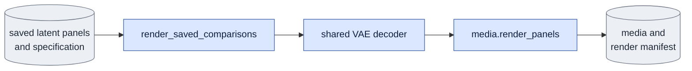
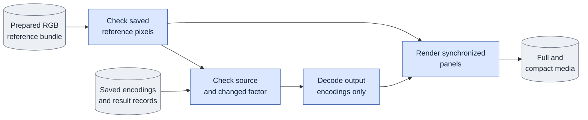

# `comparisons.py` — saved comparison rendering

## Objective

Validate saved encodings and prepared RGB references, decode through the shared
VAE owner, and publish synchronized comparison media in a full and a compact
(480-pixel) layout. Open no transformer or text encoder. The queue `render`
kind runs this module; its entry calls the shared
[runtime](execution/runtime.md) helper, which measures one resource phase in a
queued child and starts no child itself.

## Data flow

## Organization logic

### Specification and inputs

`render_saved_comparisons` reads a JSON specification of comparisons. Each
comparison names output names and panels; paths resolve relative to the
specification. A panel names a saved `latent` (a finite nonempty B,C,F,H,W
tensor), a `capture:` or `guide:` reference to a checked continuous master read
through `corpus.dataset`, or (with a reference bundle) a `reference_role`.
Masters use exactly the requested `span` (default 17); all panels need the same
encoded geometry and bundle fps must equal playback fps. Nothing is shortened
silently.

Before decoding, reject an empty specification, malformed or duplicate output
names, used destinations, missing inputs, invalid fps or coverage and unreadable
layouts. Bind the specification, decoder bytes and current software identity,
record every input file hash, and open the shared decoder only after these
checks. `parse_saved_comparison_args` serves both the CLI and queue preparation.

### Prepared RGB references

A comparison may set `reference_bundle` to a checked `references.json` from
`media --prepare-training-references`. Panels then select `reference_role`
(`recorded`, `decoded`, `guide`) instead of `latent`: recorded RGB in the
capture crop, the VAE reconstruction of the recording, and the recorded RGB
guide. These pixels are not decoded again. The form is for D1: all three roles
come first, in that order, followed by generated output panels with short
titles that keep their recorded roles.

Each generated panel names its saved `result` JSON and `latent`. Preflight
checks the result's output path, hash and shape, source, frame rate, encoded
coverage, capture-master and guide-render hashes, membership, objective and D1
choice against the reference producer, and hashes each output's first encoded
frame against its recorded `c0`. A saved result keeps its own producer
attribution; the references and rendering use current decoding software. For
two or more outputs, `changed_factor` names the one supported difference and
`evaluate.validate_comparison` runs before a decoder opens.

References must cover exactly the RGB frames `0..(span-1)*8` at the requested
rate, with the same VAE identity, decode seed and settings as the output
decoding, and pixel dimensions equal to the output encoding times the VAE
spatial factors. Missing pixels, changed files, a different crop or source
producer, malformed values or a second changed factor fail before a session or
output exists. The reference manifest, every pixel file and each result JSON
enter the input inventory and are rechecked before publication and in
completion. View metrics are not available in this form: they assume all panels
were decoded float RGB.

Worked check: prepare 17 encoded frames for one source (129 RGB frames at 30
fps). Select recorded, decoded and guide references, then cached and recomputed
output results with `changed_factor="history_mode"` and fixed schedule, source,
`c0`, noise and text. Both results must bind the same capture master and guide
render as the references. A seven-frame reference bundle covers only 49 RGB
frames and fails before decoding. This check does not establish perceptual
quality or layerwise K/V agreement.

Before each adapter model context, every requested adapter is rechecked with
`checkpoints.recheck_adapter` and its preflight contract and SHA-256; changed
bytes fail before weights load.

### Layouts and metrics

Before opening a decoder, the shared metadata-only geometry owner validates the
full presentation and a compact presentation at width 480. Both reuse the same
decoded and reference pixels, roles, synchronized source frames and fps. The
compact output is `<name>_compact.mp4` and `<name>_compact_poster.png` with a
separate rendering record under `<name>_compact/`. The `comparison` layout keeps
panel order with at most three columns and aspect-preserving padding; the
default poster frame is 96. [media's layout rules](media.md#visualization-layout)
define titles and text; titles never come from run directory names.

Specs with `view` also write `results` per comparison: frames, named video and
poster, and panel PSNR, subject PSNR and LPIPS against panel zero, excluding RGB
frame zero. LPIPS loads once through the shared metric owner.

### Manifest and completion

A schema-three manifest binds the full spec hash, decode seed, model and
variant, current VAE path and hash, native decode settings, comparison and
media source hashes, and both presentations. Spec and input bytes and VAE and
software identity are rechecked before the manifest is published; a change
leaves an unaccepted partial output. Raw panels must contain the declared
encoded frame count. The `source_code_sha256` field name is kept for format
compatibility; its value hashes `comparisons.py`, and the software manifest
names that owner.

`verify_saved_comparison_completion` reads these identities without a model
session. It requires the exact requested comparison fields and input
inventories, decoded frame count, synchronized frames and fps, titles and
layout, safe media paths and matching media hashes for both layouts. Every
nonempty panel carries a lowercase 64-character SHA-256 pixel digest, and the
full and compact digests must match; two absent digests prove nothing. File
names or a zero exit alone never complete a job. Report code may read the
manifest but never recovers missing output.

Worked check: `missing.pt` in a panel fails before a decoder opens or an output
folder appears. A compact render with altered panel pixels fails completion when
its full counterpart has unchanged pixels. Removing the digest from both copies
of the capture panel fails completion even when media hashes and labels match.

### Requesting a readable comparison

Pass the question, changed factor, exact variant values, panel roles and source
time mapping to media. Keep person/view, noise, text, frame dimensions, frame
range and playback rate fixed unless explicitly varied. Show the correct capture
reference and label original RGB versus VAE-decoded video. Bidirectional
evaluation has no capture past-frame input; causal evaluation labels
capture-history and generated-history runs separately; product-like evaluation
uses generated history. Evaluation can use people excluded from training.

## Invariants

Only saved results feed rendering. Input content, geometry, roles and timebase
must match. Saved records keep their attribution. Both layouts use the same
pixels and the shared renderer; no code executes from a spec.

## Gotchas

A saved producer receipt can keep its integrity while being noncurrent; current
rendering binds current source owners. Latent metrics and presentation pixels
have different scopes.

## Tests

Saved comparison and reference corruption, CPU decoder, narrow rendering,
digest, queue command and completion fixtures cover these rules.
