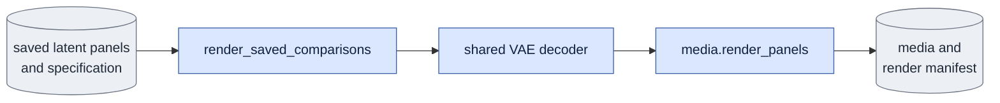
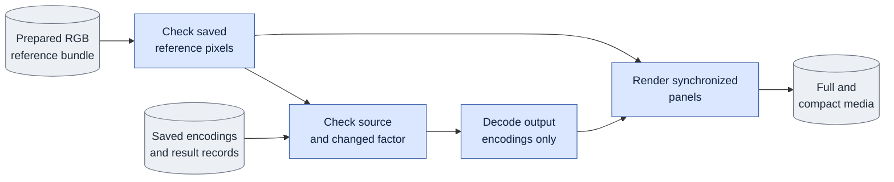

# `comparisons.py` — saved comparison rendering

## Objective

Make synchronized comparison videos from saved results. The module does these
steps:

1. Check the saved encodings and the prepared RGB references.
2. Decode the encodings with the shared VAE owner.
3. Publish the comparison media in two layouts: a full layout and a compact
   layout (480 pixels wide).

The module opens no transformer or text encoder. The queue `render` kind runs
it. Its entry calls the shared [runtime](execution/runtime.md) helper. In a
queued child, the helper measures one resource phase. It starts no child.

## Usage

Humans can use the foreground queue or run this module directly.
See [launch, output and stop commands](usage.md). Agents use the queue.
The queue recipes below describe managed execution.

Start rendering as a queue `render` job. The queue selects the GPU, so do not
put `--gpu-id` in the job. The job waits until every saved panel file exists.
See [run guide §8](../configs/README.md#8-decoding-comparison-media-cost-and-plots)
and the [job record](../configs/README.md#job-records-by-kind).

This is the agent path. A person can also run the same module directly, or start the queue in the foreground; see [usage](usage.md).

```json
{"id": "render_history", "kind": "render",
 "arguments": ["--render-saved-comparisons", "/abs/comparison_spec.json",
               "--output", "/abs/out/render_history", "--seed", "42"],
 "output": "/abs/out/render_history",
 "completion": {"manifest": "/abs/out/render_history/render_manifest.json"}}
```

| Argument | Meaning |
|---|---|
| `--render-saved-comparisons` | Required. The JSON comparison specification. |
| `--output` | Required. A new output directory. |
| `--seed` | The decode seed. |
| `--gpu-id` | Local GPU for direct CLI; assigned by the queue in a job. |

A minimal specification with one comparison: a capture master and two saved
encodings. Paths are relative to the specification file.

```json
{"comparisons": [
  {"name": "cache_vs_recompute", "question": "Cached or recomputed history?",
   "span": 17, "fps": 30,
   "panels": [
     {"title": "Capture (VAE)", "role": "capture", "latent": "capture:<VIEW_DIR>/ltx_vae_latent_white.pt"},
     {"title": "Cached", "role": "cached", "latent": "<CACHED_OUTPUT.pt>"},
     {"title": "Recomputed", "role": "recomputed", "latent": "<RECOMPUTED_OUTPUT.pt>"}]}]}
```

Outputs in `<OUT>`: for each comparison `<name>`, the full video and poster,
`<name>_compact.mp4` and `<name>_compact_poster.png`, and
`render_manifest.json`.

### Prepare checkpoint videos

Use this same module to prepare the checkpoint comparison on CPU:

```bash
conda activate ltx
cd LTX-2
python -m scripts.onestep_avatar.comparisons --prepare-checkpoint-visualization \
  --training-run /abs/run_csv --membership /abs/membership_all.json \
  --train-source Part_1/0008_01/views/view00_cam51 \
  --held-out-source Part_1/0152_01/views/view00_cam51 \
  --output /abs/visualization --sigma-min 0.38 --sigma-max 0.9
```

The command writes a checked two-view membership, frame plans, fixed noise,
evaluation jobs, comparison specifications and `visualization.json`.
It prints the reference-preparation commands and the existing queue command.
`--gpu-id <FREE_GPU>` also prepares both reference bundles through the existing
`media` CLI on that free device. `--execute` then runs the existing queue;
`--gpu-pool 6` restricts its devices. The command adds no launcher or trainer.
Use `--dry-run` to inspect schedules, sources and groups without any writes.
The output must be new. Resume the written job list through `execution.queue`.

The command supports a finished bidirectional dev D0 run. It preserves the
recorded background objective and the selected views' original data groups.
`--checkpoints` defaults to `0 1 200 400 600 800 1000`.
The two four-adapter groups are `0,1,200,400` and `400,600,800,1000`.
Update 400 repeats so both videos have a shared checkpoint.
Each schedule renders both groups, making four videos per person.

The official grid is `LTX2Scheduler().execute(steps=30)` without a latent
argument. Keep positive levels between `--sigma-min` and `--sigma-max`.
Select four nearest integer indices at equal intervals over that tail.
For 0.38–0.9, tail indices are `0,5,9,14`, original indices `13,18,22,27`.
The exact schedule is `[0.8977352380752563,0.8153185844421387,0.7016562223434448,0.3875408172607422,0]`.
One-step denoising uses the same first level and zero endpoint.
Adapter evaluations record the explicit changed-schedule research override.
Both schedules use one saved noise tensor and the same clean first image.
Each model state gets a separate evaluation process to respect the memory bound.

Every video contains recorded RGB GT, the base model and four adapters.
The full layout has two rows and three columns. Compact media uses the same
frames and pixels with readable titles at a 480-pixel viewing width.
Reports link these videos without showing extracted frames.

## Data flow



## Organization logic

### Specification and inputs

`render_saved_comparisons` reads a JSON specification. Each comparison has an
output name and a list of panels. Paths are relative to the specification
file. A panel names one of these inputs:

- a saved `latent`: a finite, nonempty `B,C,F,H,W` tensor;
- a `capture:` or `guide:` reference to a checked continuous master, read
  through `corpus.dataset`;
- a `reference_role`, when the comparison has a reference bundle.

Masters use exactly the requested `span` (default 17). All panels must have the
same encoded geometry. The bundle fps must equal the playback fps. Nothing is
shortened.

Before decoding, the command refuses these problems:

- an empty specification;
- malformed or duplicate output names, and used destinations;
- missing inputs, invalid fps or coverage, and unreadable layouts.

The command binds the specification, the decoder bytes and the current
software identity. It records the hash of every input file. It opens the shared
decoder only after these checks. `parse_saved_comparison_args` serves both the
CLI and the queue preparation.

### Prepared RGB references

A comparison can set `reference_bundle` to a checked `references.json` from
`media --prepare-training-references`. Then the first panels use
`reference_role` instead of `latent`. The roles are, in this order:

1. `recorded`: the recorded RGB in the capture crop.
2. `decoded`: the VAE reconstruction of the recording.
3. `guide`: the recorded RGB guide.

The command does not decode these pixels again. This form is for D1. The
generated output panels come after the three references, with short titles
that keep their recorded roles.

D0 comparisons set `guide_mode: "d0"` and select `recorded` alone, or
`recorded, decoded`. These roles mean RGB GT and its VAE reconstruction.
The bundle retains its explicit absent-guide record; no guide panel is shown.
Each D0 result must match the checked capture, membership, crop and frame map.

Each generated panel names its saved `result` JSON and `latent`. The check
compares these result fields with the reference producer: output path, hash
and shape, source, frame rate, encoded coverage, capture-master and
guide-render hashes, membership, objective and the D1 choice. It also hashes
the first encoded frame of each output and compares it with the recorded
`c0`. A saved result keeps its own producer attribution. The references and
the rendering use the current decoding software. For two or more outputs,
`changed_factor` names the one supported difference.
`evaluate.validate_comparison` runs before a decoder opens.

The references must meet these conditions:

- They cover exactly the RGB frames `0..(span-1)*8` at the requested rate.
- They use the same VAE identity, decode seed and settings as the output
  decoding.
- Their pixel size equals the output encoding size times the VAE spatial
  factors.

Missing pixels, changed files, a different crop or producer, malformed values
or a second changed factor fail before a session or output exists. The
reference manifest, each pixel file and each result JSON are in the input
list. The command checks them again before publication and at completion. View
metrics are not available in this form, because they assume that all panels
are decoded float RGB.

Worked check: prepare 17 encoded frames for one source (129 RGB frames at
30 fps).

- Select the recorded, decoded and guide references. Then add the cached and
  recomputed results with `changed_factor="history_mode"`. The schedule,
  source, `c0`, noise and text stay fixed.
- Both results must bind the same capture master and guide render as the
  references.
- A seven-frame reference bundle covers only 49 RGB frames. It fails before
  decoding.

This check does not prove perceptual quality or layerwise K/V agreement.



Before each adapter model context opens, the command checks each requested
adapter again with `checkpoints.recheck_adapter`, its contract and its SHA-256.
Changed bytes fail before the weights load.

### Layouts and metrics

Before a decoder opens, the shared geometry owner checks both layouts from
metadata only: the full layout and a compact layout at width 480. Both layouts
use the same decoded and reference pixels, roles, source frames and fps.

- The compact output is `<name>_compact.mp4` and `<name>_compact_poster.png`.
  Its rendering record is under `<name>_compact/`.
- The `comparison` layout keeps the panel order. It has at most three columns
  and uses aspect-preserving padding.
- The default poster frame is 96.
- [Media's layout rules](media.md#visualization-layout) define the titles and
  text. Titles never come from run directory names.

A specification with `view` also writes `results` for each comparison: the
frames, the named video and poster, and the panel PSNR, subject PSNR and LPIPS
against panel zero. RGB frame zero is excluded. LPIPS loads once through the
shared metric owner.

### Manifest and completion

A schema-three manifest binds these items:

- the full specification hash and the decode seed;
- the model and variant, the current VAE path and hash and the native decode
  settings;
- the comparison and media source hashes, and both layouts.

The command checks the specification and input bytes, the VAE and the software
identity again before it publishes the manifest. A change leaves a partial
output that is not accepted. Raw panels must have the declared encoded frame
count. The field name `source_code_sha256` stays for format compatibility. Its
value hashes `comparisons.py`, and the software manifest names that owner.

`verify_saved_comparison_completion` reads these identities without a model
session. It requires:

- the exact requested comparison fields and input lists;
- the decoded frame count, synchronized frames and fps;
- the titles and layout, safe media paths and matching media hashes for both
  layouts;
- a lowercase 64-character SHA-256 pixel digest for every nonempty panel. The
  full and compact digests must match. Two absent digests prove nothing.

File names or a zero exit code alone never complete a job. Report code can read
the manifest, but it never recovers missing output.

Worked checks:

- `missing.pt` in a panel fails before a decoder opens or an output folder
  exists.
- A compact render with changed panel pixels fails completion when its full
  layout has unchanged pixels.
- Removing the digest from both copies of the capture panel fails completion,
  even when the media hashes and labels match.

### Requesting a readable comparison

Give media the question, the changed factor, the exact variant values, the
panel roles and the source time map. Keep these items fixed unless you vary
one on purpose: person and view, noise, text, frame size, frame range and
playback rate.

- Show the correct capture reference. Label original RGB and VAE-decoded video.
- Bidirectional evaluation has no capture history input.
- Causal evaluation labels capture-history runs and generated-history runs
  separately.
- Product-like evaluation uses generated history.
- Evaluation can use people that training did not see.

## Invariants

- Only saved results feed rendering.
- Input content, geometry, roles and time base must match.
- Saved records keep their attribution.
- Both layouts use the same pixels and the shared renderer.
- No code runs from a specification.

## Gotchas

A saved producer receipt can keep its integrity and still be noncurrent.
Current rendering binds the current source owners. Latent metrics and
presentation pixels have different scopes.

## Tests

Fixtures cover these rules: corrupted saved comparisons and references, a CPU
decoder, narrow rendering, digests, the queue command and completion.
