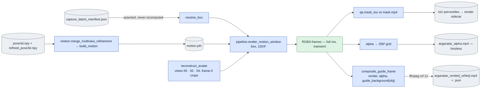

# `corpus/build_guidance.py` — render the guide

## Objective

For one clip, one driving view and **one objective**, make the guide video
that conditions the model. Also make the alpha and the QA files that the rest
of the pipeline needs. This is the expensive half of corpus building (about
20 minutes per view, on a GPU).

The module **reads** the crop box from `precompute.py --process_gt_latent`. It
never calculates the box again.

Guide production requires refined multiview body data for each clip. The
per-view record still gives the camera and crop fields. The module does these
steps:

1. Load both records.
2. Fill camera gaps.
3. Merge the refined body arrays of the same shape.
4. Use the refined validity for motion conversion.

Missing refined data fails. There is no option for a per-view-only producer.
Both file hashes are part of the motion identity.

## Usage

Run the module directly from `LTX-2` in the **`argavatar`** environment. It is
the only module that uses this environment. Use one free GPU with at least
20,000 MiB free. Run it after the capture pass of
[precompute](precompute.md#usage). See
[run guide §3, step 2](../../configs/README.md#3-prepare-the-corpus).

```bash
cd LTX-2
CUDA_VISIBLE_DEVICES=<FREE_GPU> conda run --no-capture-output -n argavatar \
  python -u -m scripts.onestep_avatar.corpus.build_guidance \
  --objective white --driving-views 1 5 --limit 8 --visualize --device cuda:0
```

Start with a small review batch (`--limit 8 --visualize`). Inspect the QA
overlays under each clip's `qa/`. Then use `--limit 0` to render all remaining
pairs.

| Argument | Meaning |
|---|---|
| `--objective {bg,white}` | `bg` (default): the render over the clip's real first frame, written as `argavatar_render.mp4`. `white`: the render on white, written as `argavatar_render_white.mp4`. |
| `--clips` | Comma-separated clip names, for example `Part_1_0008_01`. Default: all done clips. |
| `--driving-views` | The views to render. |
| `--recon-views` | The views for the avatar reconstruction. Default 00, 02, 04. |
| `--limit N` | Stop after N (clip, view) pairs. `0` means no limit. |
| `--visualize` | Also write a capture/render overlay in `qa/`. |
| `--force` | Render again pairs that already have a guide. |
| `--device` | The torch device, for example `cuda:0`. |
| `--corpus-root`, `--argavatar-root`, `--checkpoint-path` | Locations of the corpus, the ARGAvatar repository and its checkpoint. |
| `--out-size`, `--pad-factor` | The render size and the bbox padding. The padding must match the capture pass. |
| `--dry-run` | Print the plan (clips × views). No GPU work. |

The two objectives write separate files beside the same view. Building one
never invalidates the other.

Outputs beside each driving view: `argavatar_render[_white].mp4` and its
`.json` sidecar, `argavatar_alpha.mp4`, and with `--visualize`,
`qa/overlay_view<D>[_white].mp4`.

## Data flow



`composite_guide_frame` overwrites the rendered PNG in place. So the composite
is the only version that reaches the encoder.

## Organization logic

### One pass over the RGBA frames

One pass over the RGBA frames does three things: the IoU check, the alpha grid
and the composite. This is a correctness rule, not an optimization. The
full-resolution alpha exists *only* inside this loop. Only a 256² grid is
stored. A later composite pass would need a full new render. This problem
happened once with the alpha itself.

### One function for both objectives

The objectives differ in one function only. `guide_background(objective, …)`
returns what is behind the render: frame 0 of the driving view for `bg`, a
white frame for `white`. `composite_guide_frame` is one blend for both. An
objective is a *choice of background*. It is not a second guide-construction
path.

### Background replacement

The renderer's RGB is already composited over white. It is never a straight
foreground. ARG-Avatar's rasterizer (`forward.cu`: `C[ch] + T * bg_color[ch]`,
with `bg_color=torch.ones(3)`) blends over white before this module sees a
pixel. So `composite_guide_frame` *replaces* the background:

`guide = R_white + (1 - alpha) * (B - white)`

It does not apply a second alpha blend. A second blend would apply alpha twice
and leave a white fringe on every soft edge, even in the `white` objective,
where the operation must change nothing.

This formula is compositing version 2. `dataset.GUIDE_COMPOSITING_VERSION` is
written into the `compositing_version` field of every sidecar.
`_render_is_complete` checks it, as it checks `objective`. A render with a
missing or different version is rendered again. It is never used for training.
Capture bundles do not depend on guide compositing.

### Failures

A failure excludes one pair. It never stops the batch.

- A gap in the multiview body trajectory, or a reconstruction failure, loses
  that pair (or the pairs of that clip). The module collects these failures and
  reports them at the end.
- A detector gap in one view alone does not lose the pair. The refined path
  keeps the nearest finite camera and cache row in memory. It keeps the
  per-frame multiview body pose and the manifest crop.

A review batch over many actors must not stop on one bad clip.

## Invariants

- **The box is asserted against the manifest record.** It is not matched by
  equal defaults. A different `--pad-factor` between the two runs is the one
  way a pair can lose alignment without an error. This happened once.
- **Use the render's alpha for the composite, never the capture mask.** At
  deployment there is no capture mask. Training on one would break train and
  deploy parity. Also, the render's alpha is anti-aliased, but the capture
  matte is a hard threshold of lossy video.
- **The alpha stays continuous.** It is never thresholded. The boundary stays
  soft and is not quantized to the 32× latent cell.
- Latents are the product. Pixels are for review. Default runs write no capture
  video.
- **The alpha is stored as a lossless grayscale MP4**, not a raw array. It is
  42× smaller and bit-exact, and the soft edge is kept. See
  [mask_video.md](mask_video.md) for the measurements and why lossy storage was
  rejected. Stored masks are MP4 only. A `.npy` array beside a render is
  ignored. It does not make the render complete.

## Resumability

`_render_is_complete` accepts a view only if its sidecar and its video agree on
these items: frame count, geometry, alpha grid, **objective** and
**compositing_version**.

- A stopped ffmpeg never looks finished.
- A render for the other objective is rendered again.
- A render with another compositing formula is rendered again.

The alpha must exist as the lossless MP4. A sidecar must name its objective.
No field is inferred from other metadata. The motion input hash is also part
of the check. So a refined body trajectory causes a new render, even when the
geometry and frame count are unchanged.

## Gotchas

- **The alpha/IoU loop zips the render frames with `mask.mp4`, with
  `strict=True`.** `alpha_grid` is `np.empty`. A mask shorter than the render
  would leave its tail uninitialized and store it as the view's alpha. That
  file would look complete and be wrong. A frame-count difference is a corpus
  defect. The error makes it an exclusion of this pair.
- The composite overwrites the render PNG **in place**. The composited frame
  *is* the guide, not a second file. Any code that reads those PNGs after this
  loop sees composites.
- `--visualize` writes `qa/overlay_view<D>[_white].mp4`. It crops `rgb.mp4`
  while it runs. No stored `capture.mp4` is needed or made.

## Tests

Worked compositing check, with RGB values in `[0,1]`:

- `R_white=[.6,.8,1]`, render alpha `.5` and background `[.2,.2,.2]` give
  `[.2,.4,.6]` through `R_white+(1-alpha)*(background-1)`.
- A white background `[1,1,1]` returns `R_white` unchanged.
- Alpha zero replaces a white empty render pixel with the selected background.

Use the render alpha for this operation. The capture matte is a separate input
for target preparation.

`tests/test_build_guidance.py` checks:

- the background-replacement blend against renderer-faithful fixtures (already
  composited over white), with the worked numbers above;
- the exact identity of the `white` objective and the white path of
  `guide_background`;
- the `_render_is_complete` cases for objective, compositing version, motion
  and MP4 alpha.
