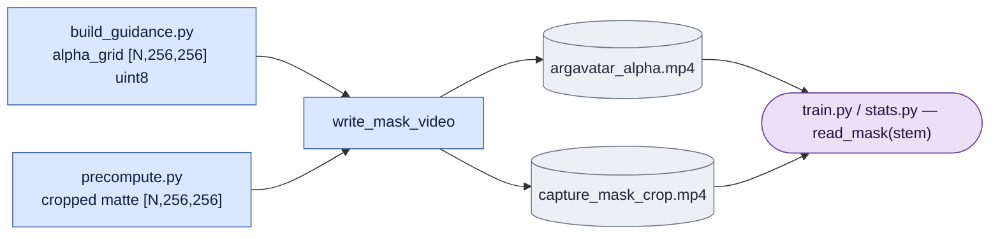

# `corpus/mask_video.py` — the mask storage format

## Objective

Store a coverage mask as a **lossless** grayscale MP4, not as a raw array. Two
masks use this format, both at 256²:

- the render's own alpha (`argavatar_alpha.mp4`);
- the capture matte cropped to the same box (`capture_mask_crop.mp4`).

## Why MP4: size

Measured on real corpus alphas (256², uint8):

| | 150 frames | 225 frames |
|---|---|---|
| raw `.npy` | 9.83 MB | 14.75 MB |
| lossless gray MP4 | **0.232 MB** | **0.361 MB** |
| | 42× | 41× |

For comparison, the dataset's own `mask.mp4` at **4096×3000** is 330–570 KB. It
has 180× more pixels than the 256² grid, but it uses less space than the raw
array. At corpus scale, the raw form is tens of GB of almost entirely flat data.

## Why lossless

Lossy settings were measured and rejected:

| | size | max error | mean error on the soft edge |
|---|---|---|---|
| lossless (crf 0) | 0.232 MB | **0** | **0** |
| crf 12 | 0.136 MB | 58 | 3.20 |
| crf 18 | 0.085 MB | 60 | 6.74 |

crf 12 is 1.7× smaller than lossless. But the errors fall **exactly** on the
1.4% of pixels that carry the anti-aliased silhouette edge. The smooth boundary
of the composite and the latent coverage both come from that edge. Also, the
masks are already one generation of lossy video away from the truth: the
capture matte is a hard threshold of H.264 video. The rule is that this
pipeline does not add a second lossy generation. So lossless storage (42×
smaller than raw, no error) is the choice, not crf 12 (72× smaller, damaged
edge).

## Why MP4 rather than `.npz` or FFV1

- It reads through the same OpenCV path as every other video here. So there is
  no new dependency and no new failure mode.
- It plays in any viewer for a review.
- It decodes frame by frame, so the whole clip is never in memory.

## Data flow

Readers pool spatially and over causal frame groups in memory; nothing is written back.

## Organization logic

### Store exact mask bytes

`write_mask_video` requires a nonempty uint8 array `[RGB_frames,height,width]`.
Pipe its one-channel bytes to ffmpeg with the declared lossless grayscale settings.
Write a temporary sibling file and atomically replace the destination only after successful encoding.
Reading takes one decoded channel directly because all decoded grayscale channels are identical.
No threshold or color conversion is part of this storage round trip.

### Derive encoded-frame coverage

For each uint8 mask frame, area-resize to the encoded height/width, then convert to float32 and divide by 255.
For temporal scale `t`, encoded frame zero averages RGB range `[0,1)`.
Encoded frame `i>0` averages `[1+(i-1)*t, 1+i*t)`.
Reject a mask too short for any requested range.
Stack these temporal means as `[F,H,W]` and return contiguous float16 coverage.
This preserves the current resize/quantization order.
It does not threshold coverage into a binary training mask or save another derived file.
Training full-frame MSE does not use this coverage as a weight.

**A test asserts `MASK_ENCODE_ARGS` itself, not only its effect.** The module
was once copied into two separate trees (different conda environments, no shared
import). The copy is gone, but the risk stays: a change to a lossy `crf` during
"storage tuning" would be invisible in every later number. So the setting
itself is pinned.

**`read_mask(stem)` takes a suffix-less path** and requires its lossless MP4; a raw
array is not a supported stored mask (it would cost about 42× more storage).

**Writes are atomic** (a temporary file, then a rename), as for every other file
here. A stopped ffmpeg must not leave a file that looks complete.

**Latent grids are derived, never stored.** When a reader asks for coverage,
`pool_to_latent_grid` applies area pooling and the causal VAE's `1, 8, 8, ...`
temporal grouping. So the MP4 files stay the only mask files, and the geometry
can change without new masks.

## Stored format

Stored-mask readers require the lossless MP4. `mask_exists` checks that file;
`read_mask` fails if it is absent, even if a raw array exists. Bit-exact MP4
round-trip tests are the format requirement.

## Invariants

- Storage preserves every uint8 grayscale value without a threshold.
- A failed encode cannot replace a completed mask video.
- Derived coverage follows the continuous VAE's first-frame/eight-frame groups.
- Derived encoded grids remain in memory and are not duplicate stored mask artifacts.
- Coverage measurements do not introduce mask weights into training MSE.

## Gotchas

Address the stored mask by RGB frame index before temporal pooling.
An encoded frame index is not a stored-video frame index.
Equal array shape does not prove matching capture/guide crops or source times.
Mask IoU thresholds used for QA are separate from grayscale storage and area pooling.

## Tests

Worked pooling check: at scale eight, three encoded frames require 17 RGB masks.
Uniform masks with values 255 at frame zero, 0 at frames 1–8, and 255 at frames 9–16
give coverage `[1,0,1]` at every encoded pixel.
A 16-frame mask fails because encoded frame two needs RGB range `[9,17)`.

`tests/test_mask_video.py` — bit-exactness, the soft edge specifically, frame-count round trip,
the encode setting itself, the compression floor, and required-MP4 failure behavior.
