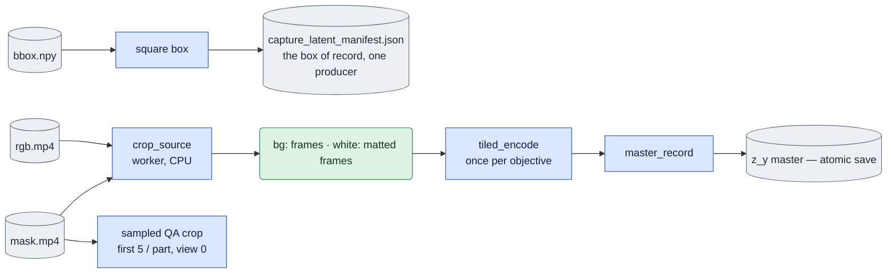
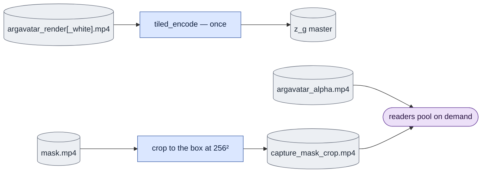

# `corpus/precompute.py` — one continuous VAE encode per view

## Objective

Turn corpus pixels into the master latents that the trainer reads. The module
can make one or both objectives (`bg`, `white`), and it can resume. Every
output is stored **beside its source video**, one per view. There is no
separate latent tree for experiments.

[prepare_inputs.py](../prepare_inputs.md) prepares a product still image. It
reuses this module's bundle contract and native encoder helper for one actual
RGB image. It has its own fresh output directory and input-role provenance. It
never slices or rewrites the continuous corpus video masters.

| File | Written by | Content |
|---|---|---|
| `ltx_vae_latent[_white].pt` | `--process_gt_latent` | `z_y`, the capture master |
| `argavatar_ltx_vae_latent[_white].pt` | `--process_syn_latent` | `z_g`, the guide master |
| `argavatar_alpha.mp4` | `build_guidance.py` | The rendered alpha, 256², lossless |
| `capture_mask_crop.mp4` | `--process_syn_latent` | The capture matte cropped to the same box, 256², lossless |
| `<subject>/qa/capture_mask_crop.mp4` | `--process_gt_latent` | A review crop, for view 0 of the first five subjects in each `Part_*` only |
| `capture_latent_manifest.json` | `--process_gt_latent` | **The recorded crop box.** `build_guidance.py` renders into it. |
| `manifest[.white].json` | `--process_syn_latent` | The provenance manifest of the paired run, at the corpus root (default `--corpus-root`) |

There is no `loss_mask_grids.pt`. The two MP4 files are the canonical masks.
`stats.py` pools them to the active latent geometry for QA and measurement.
`train.py` reads only the latent masters and computes unweighted full-frame
MSE. The `white` capture target already includes the source matte before VAE
encoding.

## Usage

Run the module directly from `LTX-2` in the `ltx` environment, on one free GPU
that you select. Check `nvidia-smi` first. The order is fixed: capture first,
then guides ([build_guidance](build_guidance.md#usage)), then guide encodes.
See [run guide §3](../../configs/README.md#3-prepare-the-corpus).

1. Encode the capture masters and record the crop boxes:

   ```bash
   cd LTX-2
   "$PY" -m scripts.onestep_avatar.corpus.precompute --process_gt_latent \
     --objective bg white --model 2.5 --gpu-id <FREE_GPU>
   ```

2. After the guides exist, encode the guide masters:

   ```bash
   "$PY" -m scripts.onestep_avatar.corpus.precompute --process_syn_latent \
     --objective white --model 2.5 --gpu-id <FREE_GPU>
   ```

| Argument | Meaning |
|---|---|
| `--process_gt_latent` | Pass 1: encode `z_y` from raw `rgb.mp4` crops. Writes the crop-box manifest. |
| `--process_syn_latent` | Pass 2: encode `z_g` from the ARGAvatar guide renders. |
| `--objective {bg,white} ...` | One or both objectives. Both together cost one decode for each source. |
| `--model {2.3,2.5}` | The VAE version. |
| `--gpu-id` | The GPU to use. |
| `--rank`, `--n-rank` | Split the corpus over several processes: rank `r` takes `items[r::n_rank]`. |
| `--corpus-root` | The corpus root. Default `data/AnimatableHuman/DNARenderingVideo`. |
| `--manifest-root` | Where the paired-run manifest goes. Default: the corpus root. |
| `--resolution`, `--pad-factor` | Pass 1 only: the square crop edge and the bbox padding factor. |
| `--crop-workers N` | Pass 1 only: parallel crop workers. Default 6. Lower it when host RAM is tight. |
| `--mask-qa-only` | With pass 1: write only the mask QA gallery. The VAE does not load. |
| `--limit N` | Encode at most N whole sources after rank sharding. For trials. |
| `--overwrite` | Encode every selected source again. |
| `--dry-run` | Print the plan only. |

A rerun encodes only the missing bundles. For a long run, use `setsid` and a
log file (see [run guide §1](../../configs/README.md#1-rules-for-every-run)).
To use four free GPUs, start one process for each rank:

```bash
for rank in 0 1 2 3; do
  OMP_NUM_THREADS=8 setsid -f "$PY" -m scripts.onestep_avatar.corpus.precompute \
    --process_gt_latent --objective bg white --gpu-id "$rank" --rank "$rank" --n_rank 4 \
    > precompute_rank$rank.log 2>&1 < /dev/null
done
```

Replace the GPU IDs with free GPUs. Use every rank in `[0, n_rank)` exactly
once.

## Data flow

The module has two passes. A CLI flag selects each pass.

**`--process_gt_latent`** owns the crop box and the capture master:



`--mask-qa-only` skips the VAE and runs only the QA crop.

**`--process_syn_latent`** is the paired guide pass:



## Organization logic

### Pixel and encoding steps

1. For a `white` capture target, blend the capture RGB with white. Use the
   recorded capture matte at full resolution. For `bg`, use the capture pixels
   with no blend.
2. Apply the recorded crop and resize. Use the same fixed crop for the full
   video. Do not move it for each frame.
3. Normalize the RGB to the VAE range `[-1,1]`.
4. Encode one continuous aligned prefix for each requested objective.
5. Store the `[C,F,H,W]` encoding with the frame rate, crop, VAE, source,
   dimensions and encoding identities.

The paired guide pass reads the guide RGB, which is already composited. It
does not blend guide and capture latents.

Worked frame check: a 130-frame RGB input at temporal scale eight uses
`8*floor((130-1)/8)+1 = 129` RGB frames. It gives 17 encoded frames. At a
1024×1024 crop, with scale 32 and 128 channels, the stored shape is
`[128,17,32,32]`. The one incomplete trailing RGB frame is not used. A request
for `bg` and `white` decodes the source pixels once and writes two master
records.

### One continuous encode per source

The module encodes each source once, as one continuous sequence, and stores
that master. Here, "source" means the complete VAE-aligned prefix:
`time * floor((F-1)/time) + 1` pixel frames. Only the incomplete trailing VAE
block is dropped. There is no window or overlap setting.

Why: a real causal keyframe exists only at latent frame 0 of a continuous
encode. Nothing sets a new keyframe during a rollout. An independent encode of
each window made a false keyframe at the local frame 0 of every window.
Measured: window 0, sliced or encoded independently, differs by about 0.1%
(the bf16 noise floor). A mid-clip window differs by about 24%. Because the
master is stored, the block geometry can change without a new encode.

### Both objectives from one decode

The expensive part is the sequential H.264 decode of a 4096×3000 source. The
white matte is a blend over pixels that are already in memory. So
`--objective bg white` costs one decode and writes two bundles.

### Resume from what is on disk

The module checks each **(source, objective)** pair. One atomic save writes
each bundle. So a bundle is current or absent. There is no half-done state.

- A run that stops mid-corpus resumes at whole-bundle level.
- Adding `white` to a corpus encoded as `bg` encodes only `white`.
- A source is decoded only for the objectives that are missing.

"Current" is an explicit provenance check, not only an expected shape. A bundle
must match all of these: `ENCODE_CONTRACT_VERSION`, source, objective, input
fingerprint (RGB, plus the matte for `white`), VAE fingerprint, crop box, pixel
and latent frame counts, fps, edge, channels and spatial scale. A bundle that
lacks this metadata, or disagrees on any field, is regenerated atomically. A
bundle without a schema-two master is regenerated. It is never converted.

### Crop boxes

- The crop box comes from `geometry.canonical_crop_box`. This pass is its only
  producer. The module imports it as `crop_geometry`, because `geometry` is
  already a parameter name for a `CaptureGeometry` (whole-clip VAE alignment,
  which is separate from spatial cropping).
- Readers get the boxes from `dataset.CaptureManifest.load(root).boxes`.
  `discover_pairs` and the paired-encode loop use this one reader of
  `capture_latent_manifest.json`. There is no second parser.

### Several GPUs

Rank `r` owns `items[r::n_rank]`. Discovery and ordering happen before the
slice. Capture mode slices whole sources, not windows. So every window and both
objectives of one source stay on one rank. Paired mode uses the same rule on
its sorted pair list.

All ranks write the same full-corpus manifest through temporary files with a
unique PID. Identical atomic replacements are safe. A manifest for each rank
would omit the crop boxes of the other ranks. Only rank 0 writes the sampled
QA gallery.

### Masks

- **The matte is applied at full resolution, before the resize.** So the matte
  and the pixels are resampled together. The guide composite is built while the
  full-resolution alpha is in memory for the same reason.
- **The matte stays continuous.** It is not thresholded again. The stored mask
  is already a threshold of lossy video. A second threshold would quantize the
  silhouette edge, and the edge is the main task of the `white` objective.
- **The two mask MP4s are the only stored mask forms.** The capture matte is
  cropped to 256² once and stored losslessly beside the render alpha (about
  0.23 MB per view; see [mask_video.md](mask_video.md)). A latent-grid `.pt`
  file would duplicate these masks and bind them to one geometry. Readers pool
  both MP4s with the same spatial and causal temporal rules when they need a
  latent grid.
- **Both masks reach the latent grid by the same route:** full resolution, then
  256, then latent. If the capture matte went directly to latent resolution
  while the alpha went through 256, the band between them would get a
  resampling mismatch. The measured cost of the extra step is a mean of 6e-5
  and a maximum of 2e-3 of a cell's coverage.
- **Mask review copies are sampled.** The canonical MP4 stays beside each
  paired view for training. A review copy goes to
  `<Part_*>/<subject>/qa/capture_mask_crop.mp4` only for view 0 of the first
  five subject directories (in name order) in each `Part_*`.

### Worker processes

Cropping runs in worker processes. The VAE runs in the main process. The pool
starts *before* the encoder, so workers never fork after this process has used
CUDA.

## Invariants

- The paired pass never encodes `z_y` again. The capture pass is its only
  producer, and the trainer reads that bundle directly. A copy could disagree
  with the original.
- The two masks stay **separate MP4 files**. Each consumer decides which region
  to measure. A combined or derived grid would fix one answer and one geometry
  in the corpus.
- All windows of a source use one fixed crop box.
- **The plan cache on disk (`enumerate_capture_jobs`,
  `.capture_plan_cache.json`) uses both `rgb_fingerprint` and
  `bbox_fingerprint` as its key.** `plan_source` computes the box from
  `bbox.npy`. With only the RGB fingerprint, a corrected bbox with an unchanged
  RGB file would keep the old cached box, and nothing else would detect it. An
  entry without `bbox_fingerprint` always misses. It is planned again once and
  then cached.
- A live multi-GPU run uses every rank in `[0, n_rank)` exactly once. Duplicate
  ranks duplicate work, although atomic writes prevent partial bundles.
- **Manifest validation.** `--process_gt_latent` always processes all available
  views. If `capture_latent_manifest.json` exists at `--corpus-root`,
  `is_capture_manifest_valid` checks it against the current `geometry`,
  `resolution`, `pad_factor` and manifest `kind`.
  - Valid manifest, no `--overwrite`: the manifest is overwritten directly.
    Bundles are not encoded again. Unchanged bundles are skipped.
  - Invalid manifest, or `--overwrite`: `overwrite` becomes `True`. The
    manifest is replaced and all capture bundles are encoded again.
  - Limitation: the manifest is written before `encode_capture_jobs` confirms
    that its bundles exist and match. A stopped or partly failed run can
    publish a box before its bundle.

## Gotchas

- **Host RAM is the failure mode, not the GPU.** A severe leak in
  `encode_capture_jobs` caused two SIGKILLs. Two fixes stay in place and are
  necessary:
  - chunked `as_completed`. Without chunks, it holds all futures, each with its
    cached frame array of about 0.5–0.7 GB, for the full generator lifetime.
  - `max_tasks_per_child=1`. numpy and cv2 do not always return freed heap to
    the OS between tasks in a long-lived worker.
- A request for both objectives puts a **second** uint8 frame array in each
  worker (about 0.5 GB at 150 frames). Lower `--crop-workers` if host RAM is
  tight.
- `--limit` applies after rank sharding. It counts whole sources or views,
  never windows.
- `_read_cropped_masks` reads one frame at a time on purpose. A 3000×4096 mask
  is 36 MB per frame, so a whole-clip `get_batch` costs about 11 GB.
- **The corpus decode paths read in order and never seek** (`crop_source`,
  `_read_cropped_masks`). These sources have very sparse keyframes, so
  `CAP_PROP_POS_FRAMES` would decode again from frame 0. Seeking on B-frame
  content can also be off by a few frames. `VideoReader.get_batch` does use
  `CAP_PROP_POS_FRAMES`. It is safe only because every caller here starts at
  frame 0 (`plan_source` and `_video_info` take frame 0; `encode_pairs` takes
  `range(pixel_frames)`). A mid-clip range would bring back the seek that this
  rule forbids.

## Tests

`tests/test_precompute.py`
