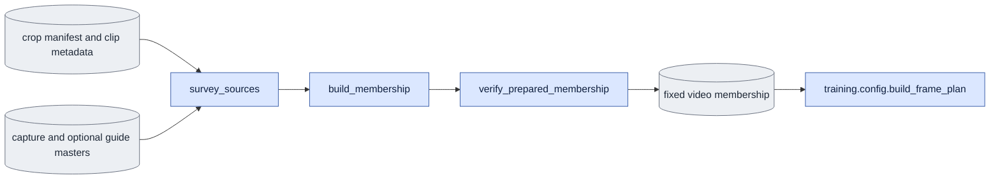

# `corpus/subset.py` — write a fixed video list

## Objective

Create a fixed membership from checked corpus files. Record each selected
video, person, data group, encoding record and content hash. Training and
evaluation reuse this membership and choose encoded frame ranges separately.
This module runs on CPU in the `ltx` environment. It loads no model, renders
no guide, changes no crop and encodes no pixels.

## Usage

Run the module directly on CPU, from `LTX-2` in the `ltx` environment. It
loads no model. See [run guide §3, step 4](../../configs/README.md#3-prepare-the-corpus).

```bash
cd LTX-2
"$PY" -m scripts.onestep_avatar.corpus.subset \
  --objective white --require-guide --splits <PERSON_GROUPS.json> \
  --output <NEW_MEMBERSHIP.json>
```

| Argument | Meaning |
|---|---|
| `--output` | Required. A new path. It must not exist, be an input or be a symbolic link. |
| `--objective {bg,white}` | The background objective of the masters. |
| `--require-guide` | Require a checked guide for each video. Use it for D1 and for paired D0/D1 work. |
| `--corpus-root` | The corpus root. Default `data/AnimatableHuman/DNARenderingVideo`. |
| `--source <VIEW>` | Select one exact view, for example `Part_1/clip/views/view00`. You can repeat it. |
| `--splits <FILE>` | Explicit person groups, for example `{"train":["1"],"held_out":["2"]}`. |
| `--held-out-fraction`, `--min-held-out` | Without `--splits`: form `train`/`held_out` groups automatically. |
| `--max-people N` | Keep at most N people before grouping. |
| `--format {csv,json}` | `json`: one file. `csv`: a small JSON with `<stem>.sources.csv` and `<stem>.excluded.csv` beside it. |

A single-person evaluation list requires an explicit group. The command pins
the hash of every selected file.

Output: the membership file. Give it to training, evaluation and the other
commands as `--subset`.

## Data flow



`build_membership` returns a checked record without writing. The command
publishes that record to a new JSON path after one more content check.
`record_hash`, `membership_hash` and `validate_membership` are shared by the
corpus readers, training settings and saved-input preparation owners.

## Organization logic

### Survey and pin videos

Discover clips and view directories in stable relative-path order. A clip
must carry complete pipeline metadata and a person ID. Read the crop box
through `dataset.CaptureManifest`; do not calculate another box.

`pin_content` reads the stored capture master through
`dataset.load_training_master`. Record its actual encoded shape and frame
rate, source and objective, VAE identity, encoding contract and crop. The
recorded source, background and crop must agree with the selected view and
crop manifest. Pin the raw RGB, master, clip metadata and crop manifest.

For a paired membership, pin the guide master, rendered RGB and render
sidecar. Use `dataset.ClipStore` to check capture/guide dimensions, frame
rate, encoding records, crop, VAE identity and guide compositing provenance.
Do not repair or re-encode a missing or changed input.

Automatic discovery records unavailable views and their reasons in
`excluded`. These exclusions happen before person grouping. An explicitly
requested `--source` must be available; a failed requested source is an error.
Selected inputs are checked again before returning or publishing the list.

### Select and group people

Use the bare person ID across every corpus part and camera view. All views
of that ID receive the same group. A requested `max_people` selects IDs in
SHA-256 order, with the ID as a stable tie breaker. Views outside the selected
people are recorded as excluded.

Explicit group lists contain unique nonempty person IDs and disjoint groups.
Each requested person must have an available selected video. Preserve the
declared group lists; record other available people as excluded.

Without explicit lists, `split_actors` sorts the unique IDs in SHA-256 order.
At least two people are required. With `N` people, held-out fraction `f` and
requested minimum `m`, choose
`h=min(max(round(N*f), min(m,N-1)), N-1)`. The first `h` IDs are held out and
the remainder train. Record the requested fraction/minimum and whether the
minimum fits. This keeps training nonempty and makes the grouping independent
of discovery order and model results.

### Freeze membership identity

The JSON has `schema_version: 2` and kind `onestep_avatar_membership`. It
records objective, corpus locator, crop-manifest hash, ordered sources,
person/group lists, selection rules, exclusions and content-pin scope.
Membership contains no attention mode, cache geometry or block chains.

`record_hash` hashes compact sorted-key JSON after removing the top-level
`sha256` field. `membership_hash` also removes `corpus_root`: relocating
unchanged files does not change video identities, groups or content pins.
The established hash payload and validation of saved memberships stay the
same. Source order and declared lists are part of the identity.

The source pins cover raw RGB, capture master and clip metadata. Paired lists
also cover the guide master, rendered guide RGB and render sidecar. The
crop-manifest hash applies to the whole list. Encoded-file pins do not prove
unrecorded inputs to a producer.

`dataset.ClipStore` verifies selected master and guide pins before model
setup. Membership preparation additionally rechecks raw RGB, clip metadata
and the crop manifest. A changed source is reported; it is never omitted
from an already fixed list.

### Keep frame selection separate

Both modes use the same membership. `training.config.build_frame_plan` owns
their encoded-frame selection, ranges and plan hash. A saved explicit plan
continues to be checked by the settings owner against membership, requested
mode, settings and stored master limits. Membership creation produces no
frame plan and imports no model or training module.

## Invariants and gotchas

- One person and all selected views belong to one data group.
- Read crop geometry and encoded frame counts from their saved owners.
- D0 can use capture-only membership; matched D0/D1 comparisons use a paired list.
- Missing or stale required guides fail before model loading.
- No selected producer artifact, saved membership or frame plan is modified.
- Changing frame-selection settings creates a separate plan, not another membership.
- Record exclusions before grouping; never repartition after inspecting model output.
- A list hash proves its recorded inputs, not identical selected frames across modes.

## Tests

`tests/test_subset.py` checks deterministic discovery and person grouping,
person caps, explicit lists, exclusions, actual master coverage, matching
crop/guide provenance, input change detection and publication refusal. It
also checks that corpus relocation preserves membership identity and that
the shared store refuses changed selected masters.

The direct current fixtures in `tests/conftest.py` support training and
evaluation preflight tests. `tests/test_corpus_model_boundaries.py` checks
that corpus imports, including function-local imports, load no model or
training owner. Frame-plan tests continue to use the public settings owner.
