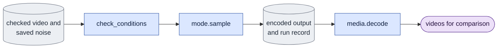

# `evaluate.py` — compare generated videos

`evaluate.py` is ordinary evaluation. It generates videos for the base model
and for named adapters from one fixed set of inputs. It saves the encoded
outputs and the run records. A separate decoding step makes videos.

## Objective

Compare the base model and named adapters with one fixed input set.

- Select bidirectional or causal mode explicitly.
- D0 or D1 selects the noised input (capture or guide). It does not select the
  execution mode.
- Save the encoded outputs and the actual run records before any video
  rendering.
- Evaluation, model probes, reusable metrics and preview execution stay in
  this LTX-2 package. Report scripts in `expr/` read saved results only. They
  do not start evaluation or model work.

The module provides these functions: explicit modes, strict checks before the
run, sampling from saved noise, guidance, raw saves, queued verification and
rendering from pinned references. `media` prepares the reference RGB, and
`prepare_inputs` assembles complete fixed records.

**Software profile.** Evaluation records `software.capture("evaluation", mode)`
before the input checks. It checks the profile again before it opens native
sessions, and stores the manifest in every result. It checks all recorded
owners and runtime versions again before it publishes. Queued completion
compares the same current profile. A record from a changed producer is still
readable, but it cannot prove completion. Decoder publication uses a separate
profile, which saved and preview rendering require.

**Queue runtime.** The module entry calls the shared queue runtime helper.
Outside a queue, the helper calls the public operation unchanged. In a queued
child, it measures one local resource phase and records any declared numerical
policy. The queue owns the launch, the supervision and the proof that no worker
remains. See [runtime](execution/runtime.md).

**Precision.** Ordinary execution requests `global_sigma_dtype` from the
float32 contract in `model.common`. The adapter check refuses an adapter that
does not declare its precision, before the weights load. Research can accept a
known different calibration. The product refuses it. Saved conditions keep the
requested precision.

**History and K/V source.** In causal mode, the requested adapter conditions
include `history_mode` and `kv_source`. The shared checker compares them with
the recorded cache-refresh calculation before any model or text session opens.
The ordinary request is `cache`/`refresh`. A different supported choice needs
`--research-override`, and the output records the difference. Base-only
diagnostics record the same choices without an override. A saved comparison
lets this field differ only when it is the declared changed factor.

**Adapter application.** The default is
`--adapter-application peft_unmerged_fp32`. It uses
`model.adapters.inference_transformer`, which shares the training configuration
and the saved tensor loading. The model returns native x0 through the stock
wrapper. All guidance passes use that same function. `fused_bf16` changes the
adapter calculation, so it needs `--research-override`. The check conditions
and the output record contain the selected method. Base-only execution uses
the native Session path.

Study protocols and their fixed metric lists are in `experiments/`. General
transition measurements have one shared owner. Original results keep their
producer identities. Structural checks do not replace missing native evidence.

## Usage

Humans can use the foreground queue or run this module directly.
See [launch, output and stop commands](usage.md). Agents use the queue.
The queue recipes below describe managed execution.

Start evaluation as a queue `evaluate` job. The queue selects the GPU, so do
not put `--gpu-id` in the job. See
[run guide §5](../configs/README.md#5-evaluate-an-adapter).

This is the agent path. A person can also run the same module directly, or start the queue in the foreground; see [usage](usage.md).

Check the arguments on CPU first. A dry run prints the checked requests. It
opens no session and writes nothing:

```bash
cd LTX-2
"$PY" -m scripts.onestep_avatar.evaluate --mode causal \
  --subset <MEMBERSHIP.json> --split held_out --source <VIEW_ID> \
  --model 2.5 --variant dev --guide-mode d1 --schedule 0.725 0 \
  --block-latent-frames 2 --blocks-per-sample 3 --context-latent-frames 8 \
  --checkpoint <ADAPTER.safetensors> --noise-file <SAVED_NOISE.pt> \
  --output <FRESH_OUT> --dry-run
```

| Argument | Meaning |
|---|---|
| `--mode {bidirectional,causal}` | Required. It must match each adapter. |
| `--subset` | Required. A version-two fixed video list. |
| `--output` | Required. A new output directory. |
| `--schedule S0 ... 0` | Required. The exact sigma schedule. |
| `--frame-plan`, `--split` | Queued jobs must give both. They select the source membership. |
| `--source` | One view ID. Without it, all selected sources run. |
| `--checkpoint` | An adapter. You can repeat it. Without it, only the base runs. |
| `--include-base` | Also run the base as a second variant. |
| `--model`, `--variant {distilled,dev}`, `--guide-mode {d0,d1}` | Base weights and the noised input. |
| `--span-latent-frames N` | The recorded training span. |
| `--output-latent-frames N` | Causal only. The number of frames to generate. See [causal output length](#causal-output-length). |
| `--block-latent-frames`, `--blocks-per-sample`, `--context-latent-frames`, `--teacher-forcing` | Causal settings. They must match the adapter. |
| `--seed`, `--noise-file` | The noise seed, or a saved noise file for the full token range. |
| `--prompt`, `--cfg`, `--negative-prompt`, `--stg`, `--stg-blocks`, `--rescale` | Text and guidance. See [guidance](#guidance). |
| `--history-mode`, `--kv-source`, `--adapter-application` | Diagnostics. A non-default value needs `--research-override`. |
| `--dry-run` | Print the checked requests only. |

**Known gap.** One process completes at most two 22B model states on a 48 GB
GPU. The third state runs out of memory. For three or more states, queue one
job for each state. See
[known gaps](known_gaps.md#several-model-states-in-one-evaluation-process).

Outputs in `<FRESH_OUT>`:

- `case_NNNN/variant_NNN/result.json` and the encoded output, for each case
  and variant.
- `text.pt`, and `negative_text.pt` when CFG is active.

## Data flow



`mode.sample` is the video generation function of the selected mode.

Queued jobs must give `--frame-plan <path>` and
`--split {train,held_out,validation,test}`. The command checks the membership
hash and the mode of the frame plan before it opens a source. The split filters
the saved source list, so a validation job cannot evaluate training frames by
accident. The command checks that the selection is not empty and that each
membership ID exists. An unknown ID or an empty split fails before base hashing
or any model session.

## Organization logic

### Define the comparison before execution

A comparison record states one question, one changed factor and the ordered
variants. Each variant gives its changed value and its full settings. The
record also states the fixed items:

- person and view, capture and guide identities, first image and text;
- saved noise, selected encoded frames and geometry;
- playback rate and adapter application method.

These items stay fixed unless one is the declared changed factor. The check
compares the selected frame data, not only the frame-plan hashes. Two modes
have different plan records even when they select the same input frames.

One saved noise array covers the whole comparison range. Block runs take slices
from this array. They do not draw a separate noise stream.

| Changed factor | What changes |
|---|---|
| D0/D1 | Only the source that gets noise. |
| Checkpoint | Only the adapter. |
| History | Only the recorded or generated past frames, with one fixed schedule. |
| Mode | The mode and its derived attention and block settings. No new inputs. |

The record states mode settings that follow from the changed factor. A second
unrelated change fails the check.

`validate_comparison` compares the input identities, coverage, text, noise,
base conditions and mode settings. Only the field group of the declared factor
can differ. Runtime, metrics and output hashes can differ. A missing identity
or condition is an error. This check does not turn latent scores into
perceptual conclusions.

### Run order for each case

1. Check the video list, capture and guide, frame size and rate, first-image
   input and frame coverage.
2. Read or save one noise array for the full frame range. Hash it. Use the
   same frame slices in every compared run.
3. Check the base weights, the schedule and the adapter settings before the
   model loads. Record any research override.
4. Call the `sample` function of the selected mode.
5. Save the encoded output and the records atomically. Record the input, noise
   and text hashes, the exact steps, frame coverage, mode, history, weights,
   adapter method, overrides and call counts.
6. Optionally call `media.py` to render synchronized comparison videos.

Do all cheap input and adapter checks before a transformer session opens. Reuse
a loaded session only when the weights and the LoRA application match.

A saved result can be reused only when all of these hashes match the request:
input, noise, text, weights, schedule, mode and history, coverage and output.
An existing file name is not sufficient. Save the run record beside the
encoding before a case is complete. A raw-only run stops there and never calls
the decoder. An invalid case records its failure. It never becomes a shorter
successful input list.

### CLI checks

The CLI requires the mode, a version-two fixed video list, the output and an
exact schedule. The command does these checks before any model session opens
and before it creates the output directory:

1. Read all selected capture and guide bytes and all adapter conditions.
2. Refuse a used output path. An existing regular file is also a used path.
3. For distilled weights, check each nonzero schedule level against the base's
   supported grid. Dev weights can use continuous levels. A research override
   does not skip this check.
4. Compare each capture and guide `vae_fingerprint` with the fingerprint of
   the base's actual VAE file. Matching shapes do not replace the VAE identity.
   A research override does not skip this check.

A declared frame limit starts at frame zero. Causal execution drops only an
incomplete final block, and it records the actual range.

Each source gets one saved noise array and one first-image input. Every
checkpoint uses the same bytes. The command opens transformer sessions one at
a time and releases each one. Then it can decode saved outputs. Evaluation is
raw-only by default. It does not create reference RGB.

**Known gap (Required / Current).** Each model state must be released before
the next one loads. Currently one process completes two 22B states and runs
out of memory on the third, on a 48 GB GPU. Run one state per job until the
[known gap](known_gaps.md#several-model-states-in-one-evaluation-process)
closes.

### Causal output length

`--output-latent-frames N` (causal only) sets how many encoded frames to
generate. `--span-latent-frames` stays the recorded training setting. The new
option is never copied into `CausalSettings`. It does not change the adapter,
and it needs no research override.

Why: a causal preview failed before the transformer loaded. Its E4 adapter
records `mode_settings.span_latent_frames=null` and `shape.frame_counts=[6,7]`.
The preview gave `--span-latent-frames 7`, which changed the requested training
setting to 7. The strict checker correctly refused it. E2 and the product
already keep the physical frame count apart from the recorded setting.
Evaluation now does the same. This is implemented and checked on CPU, and a
fresh native preview passes.

The command handles the option in this order:

1. Parse a positive integer. Refuse the option in bidirectional mode. If both
   length options are given, they must be equal.
2. Use the new option for the physical frame count when it is given.
   Otherwise use the recorded span, or the complete master.
3. Check that the frames fit every selected capture and guide master. An
   explicit count must end on a complete causal block. For example, a request
   for 8 frames that gives only 7 fails. Without the option, the command trims
   an incomplete tail as before.
4. Build the request with the unchanged `CausalSettings` and the actual frame
   count. Call the strict `check_adapter` for every adapter. All other checks
   stay the same.
5. Derive the saved-noise token shape from that frame count. Generation, fixed
   preview preparation and saved completion all use `prepare_evaluation`, so
   they derive the same inputs.

Worked check: an 18-frame continuous master, the E4 null-span adapter and
`--output-latent-frames 7`.

- The request has `shape.frames=7`, `mode_settings.span_latent_frames=null`
  and saved-noise shape `[1,7*H*W,C]`. It passes without overrides.
- With B2/K3/D8, the sampler reads `[0,3)`, `[3,5)` and `[5,7)`, and makes
  49 RGB frames.
- A pilot adapter trained with span 7 needs `--span-latent-frames 7`. Adding
  an equal output count of 7 is allowed.
- A null-span request and a span-7 request cannot replace each other.
- Output 6, changed image size, changed history, a missing guide or wrong
  noise fails before the model loads.

The public `prepare_inputs.preview_arguments` producer keeps the parsed causal
training span. It writes the physical count with the new option. It removes
both length options, including the `=` forms, and then adds each option once.
Bidirectional preparation keeps its explicit span. Without this producer
change, the `prepare_inputs -> enqueue_preview -> evaluate` path would still
publish a span-7 request for the null-span adapter.

The failed preview evidence stays unchanged. Keep the original E4 job, launch,
visits and adapter evidence. E2 and other evaluation receipts keep their old
attribution. Check them again against the current producer. Do not restamp
them.

### Guidance

- `--cfg` sets the native classifier-free guidance scale. The default is 1.
  A scale other than 1 uses a separately encoded `--negative-prompt`, or the
  native default negative prompt. A nonfinite or negative scale fails during
  parsing.
- A positive `--stg` requires explicit, unique, nonnegative `--stg-blocks`.
  The check compares the indices with the layer count of the base.
- `--rescale` takes a native rescale fraction in `[0,1]`.

The command uses the shared guided X0 helper and the native guider calculation.
There is no second formula. The record saves the scale, the STG blocks, the
rescale value and the identity of the negative text tensor. The forward hook
counts all passes: conditional, unconditional and perturbed.

Fixed previews pin the guidance settings, and the negative text when CFG uses
it. Execution loads and checks that saved tensor and does not rebuild it. A
different request fails before model sessions open. A controlled comparison
keeps the guidance fixed unless `guidance` is the only changed factor.

### History and K/V diagnostics

Causal diagnostics accept `--history-mode cache|recompute|joint` and
`--kv-source refresh|denoise`. The default is `cache`/`refresh`.

- Bidirectional commands refuse both options, even with the default values.
- `recompute` and `joint` history require `refresh`.
- Teacher history cannot use `denoise` K/V.

These combinations fail during argument checks, before data or weights load.
They are evaluation diagnostics, not training modes. Saved records include
both settings. To compare one of them, declare `history_mode` or `kv_source` as
the only changed factor. The `history` factor changes only capture or
generated history. It cannot also change the cache calculation.

### Queued completion

Queue completion derives the expected evaluation again with
`prepare_evaluation(..., require_fresh_output=False)`. This path reads saved
data and weights for identity checks. It opens no transformer, text encoder,
decoder, GPU session or prompt-cache producer. Normal generation still
requires a fresh output directory.

The check derives the exact source order and variant order from the CLI and
the fixed video list. There must be one result at every expected case and
variant path, with no duplicates, gaps or extras. The check compares these
items:

- mode settings, source, frame rate, frame coverage, schedule and seed;
- background, arm and model conditions, membership and source hashes;
- adapter bytes, contract, application and overrides;
- prompt and guidance settings, and the evaluator source digest.

A result that records only its mode is not sufficient.

Generation saves the actual positive text tensor once at `text.pt`. With CFG,
it also saves the negative tensor at `negative_text.pt`. The check requires
finite bf16 text and compares its digest with every result. It does not
generate missing text again. Saved text must have three dimensions and batch
one. Negative text must have the same shape. The check does not infer the
cross-attention width, because projected and raw contexts have different
widths.

The check compares the saved noise for each case with the output record, and
with the explicit noise input when one exists. For generated noise, it checks
the saved digest and the declared seed. This CPU check cannot reproduce CUDA
random draws. It checks the capture, guide and clean `c0` digests from the
current masters. It requires the exact output shape and an unchanged first
frame.

The check compares the clean `c0` by its exact tensor bytes, including signed
zero. Numerical equality alone does not prove that the clean condition stayed
the same.

Examples:

- A causal result from seed 42 cannot complete a seed-43 job.
- A result at `case_0000/variant_000/result.json` cannot replace a second
  requested variant.
- A different adapter at the same path changes the content digest and fails.

A missing output stays pending. Contradictory evidence raises an error. The
check never rewrites existing records or media.

### Saved comparisons

Saved comparisons open `media.open_decoder_session` after input checks. This
session uses the shared device check and a null text context. It prepares no
prompt embeddings and opens no transformer. The general session factory stays
for model diagnostics that need text.

### Shared-runtime hooks

`execute_evaluation` accepts these keyword-only arguments:

- `result_publisher`: a custom publisher. It requires a nonempty
  `extra_sources` before native loading. The default is `save_case`.
- `preview_tensor_validator`: required when `preview_fixed` is present. It is
  checked before native handles or writes. It runs once after the execution
  tensors are assembled. This module does not import `previews`.

`verify_evaluation_conditions` accepts `branch_provider`, `records_validator`
and `extra_sources`, all keyword-only.

- The provider returns ordered `(folder, noise)` pairs. `None` uses the
  verified noise of each case.
- The shared verifier still checks each branch: inventory, settings, masters,
  adapter contracts, text, clean `c0`, output shape and output identity.
- The caller owns the meaning of each pair and any extra calculation.
- Callback paths must stay under their requested variant. No callable comes
  from data or from discovery. Ordinary CLIs cannot select callbacks.

Worked check: the default one-variant run verifies only its `result.json`. A
provider for two folders must supply both records. A missing, duplicated or
escaped folder fails. A validator runs only after both outputs pass the shared
checks.

### Owner split

Reusable measurements are in [metrics](metrics.md). Fixed preview checks,
generation and rendering are in [previews](previews.md). Saved comparisons are
in [comparisons](comparisons.md). This module keeps the ordinary checks,
matched sampling, publication and scientific completion. Tensor hashes use
`hashing.py`, which imports only the standard library at module load.

## Invariants

- The saved `c0_sha256` identifies the patchified first-image tokens from
  `sample_case`. To check an unpatchified saved encoding, patchify its first
  frame with the native patchifier first. A hash of `B,C,1,H,W` is a different
  representation and cannot verify this field.
- Do not import `train.py` or private visualization functions.
- Records describe the actual inputs and levels, not names of directories.
- Input hashes prove that comparisons use the same data.
- Encoded-space metrics support video inspection. They do not prove correct
  identity or motion.
- Raw-only evaluation does not run a decoder.
- Decoding a saved output does not run the transformer again.
- Saved run records keep their original producer names.
- No evaluation code or launcher stays in `expr/` report code.

## Gotchas

- Guidance can add more model passes for each step. Record the actual cost.
- Different frame lengths need a labeled shared display range.
- Keep the adapter application method fixed unless it is the changed factor.
  Fused bf16 application is a separate numerical issue
  ([known gaps](known_gaps.md#fused-adapter-application)).

## Tests

`test_saved_comparison_references.py` checks the saved-reference reader, input
matching, the renderer and queued completion with small RGB and encoding
fixtures.

- Only the two generated encodings are decoded. All three reference pixel
  hashes stay exact.
- A change to coverage, source, master, guide, membership, `c0`, decoder or a
  second factor fails before a VAE session or output directory exists.
- A result change during decoding stops the manifest publication.
- Completion refuses changed reference, pixel or result bytes without opening
  a decoder.

These tests do not give native perceptual or model-memory evidence.

[V2, V7 and V8](verification.md) check same-input controls, adapter settings
and data conversion. Worked check: checkpoints 100 and 200 share the capture,
guide, first image, text, noise and frame hashes. They differ only in the
adapter identity and step. Both outputs are measured against the same capture.
A changed seed that gives different noise bytes fails before the model loads.
For errors `[0,4,4]`, the full-frame mean is `8/3`. An exact RGB match records
the exact-match status.

Guidance tests use `X0Model` with the actual native guider on a small model:

- In both modes, CFG scales 1 and 3 match explicit conditional and
  unconditional calls bit for bit. The clean first frame stays the same.
- STG alone, and CFG with STG and rescaling, match explicit native calls.
- Forward counts include causal refresh. Direct one-step bidirectional counts
  are 1/2. Three-block causal counts are 6/12.
- Parser tests refuse missing, duplicate or negative STG indices and invalid
  rescale values.
- A weight-loader sentinel proves that the base layer-limit check comes before
  weight access.

These CPU tests verify the shared guidance path. They do not replace stock
pipeline acceptance with real weights.

Completion tests use small checked masters and controlled backbone files. Each
test changes one setting or one saved file. Queue lifecycle tests replace only
this scientific verifier. Their claims, journal, tensor hashes and receipt
checks use the production logic. Separate tests check the verifier itself.
They include a valid paired-guide D1 case, and they refuse guide or sidecar
changes after generation. The paired guide keeps the capture crop and encoding
record. The clean first frame still comes from the capture. None of these
tests proves native model quality.
