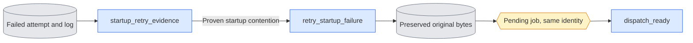

# `execution/attempt.py`

Source owner: [`execution/attempt.py`](../../execution/attempt.py).

## Objective

Execute one claimed job through the existing guard and bounded supervisor.

## Data flow

A prepared job and an owned GPU claim produce launch contracts, one child,
supervision evidence and either a verified receipt or retained failure evidence.

## Organization logic

Prepare contracts before recording the running attempt. Record registration before granting execution.
The supervisor remains the sole bounded shutdown owner.
Publish completion only after worker absence, runtime checks, artifacts and deadline checks pass.
Separate contract preparation and journal transitions from the ordered lifecycle in run_child.
Retain the state-less API for existing CPU fixtures; both modes use the same supervisor and checks.
Removing that fixture API is deferred until its callers migrate to persistent attempts.
A cancellation saves failure and propagates KeyboardInterrupt after cleanup.
Release claims only after worker absence. Retry only proven pre-update training contention.

### Foreground output and cancellation

`--foreground` uses the same dispatch, launch gate, process ledger and completion checks as `--execute`.
It defaults to loop mode; `--once` retains its usual no-free-GPU exit behavior.
The child sets `PYTHONUNBUFFERED=1`. A terminal reader copies its saved log to stdout.
The reader never owns or launches a process. It drains final bytes when the child ends.
The owner prints its PID, job, selected GPUs and log path, plus waiting and final status.

During execution, SIGINT and SIGTERM raise one `KeyboardInterrupt` in the owner.
The existing supervisor catches it, stops the exact owned process tree and publishes failure evidence.
`run_child` propagates the interruption after saving supervision bindings.
Its journal records `failure_reason: cancelled`; no receipt or startup retry is published.
If interrupted while waiting, no child or GPU claim exists.
Earlier signal handlers are restored when the CLI returns.

Worked check: interrupt a sleeping owned child. Its return code becomes terminal,
supervision records worker absence, the job stays failed and the ledger closes.
The next queued task never starts. A completed prior task keeps its receipt.

### Registered child launch

`run_child` with a state path (the CLI always gives one) starts the guard of
[`queue_launch`](queue_launch.md) for each job. The guard loads no model. The
launch does these steps:

1. Refuse a nonempty output.
2. Publish the fixed request in `launches/<token>/`.
3. Write a running attempt with the request hash and the protocol.
4. Start the guard in a new Linux session.
5. Wait at most 45 seconds for the guard's bootstrap. Refresh the owned ledger
   row while it waits.
6. Require that the bootstrap PID equals the PID from Popen, with the exact
   guard command, stable live start ticks and matching token, job and request
   hashes.
7. Save that identity in the row and the latest attempt.
8. Publish the approval. The guard then execs the fixed command.

Inspection checks the granted command change on the same PID and start ticks.
Queue JSON publication flushes and fsyncs the bytes and the directory before it
returns. Request, bootstrap and grant files are published exclusively in the
same way. A failed registration publishes no approval. A live guard keeps its
process record and running attempt. A timeout is not startup contention.

Logs use unique attempt names outside the output directory. A zero exit code
must pass artifact verification before a receipt is published. An ordinary
failure becomes `failed` after the child and all owned workers exit. An
interrupted owner keeps the running state and the record for live or uncertain
workers. Only the proven absence of all owned workers closes the active ledger
row.

`run_child` without a state path runs the child directly. Tests use this form.
It has no recovery authority. It takes a claim object with the
`ProcessRegistry` interface (`token`, `owned`, `started_ticks`, `refresh`,
`release`). Tests use the file-based `tests/claims_fixture.GPUClaims` with that
interface.

### Supervision and budgets

Every kind uses [`supervision`](supervision.md). Before launch, the queue
freezes the phase list of the selected owner beside the launch records:

- Training binds the load, update and export phases of each rank.
- Ordinary owners bind the one runtime phase that `execution.runtime.run`
  measures at their module entry.

The per-phase wall limit of the budget also limits the startup interval and the
gaps between phases. The observer keeps finite wait, signal and inventory
evidence. It never closes process records itself. A failed or unclear stop
stays failed or running, keeps its evidence and publishes no receipt. Sampled
total-device occupancy is recorded separately. The allocated-memory limit is
never used as a device-memory stop threshold.

**Overall deadline.** An explicit `overall_seconds` starts at the first launch
attempt. Time spent waiting for GPUs before that does not count. The journal
stores the first start and the absolute deadline before child registration.
Retries, restarts and recovery keep both values. An expired job fails before
it claims or launches anything, with reason `overall_deadline`. Registration
and supervision use the remaining time. After expiry, recovery or a zero exit
cannot publish success.

Worked deadline check:

- A first attempt starts at wall time 100 with a ten-second overall limit.
- Its retry at 106 keeps the deadline 110.
- A restarted queue at 111 fails that pending retry without a claim or child.
  It cannot create a new deadline of 121.

A job without an overall limit still has bounded startup, gap and phase
supervision. No total limit is inferred from the phase count.

### Startup contention retries

Training writes JSON lines with the prefix `AVATAR_QUEUE_EVENT `. Each line is
bound to the attempt token, the job hash and the global rank.

- The engine reports `updates_begin` before any sample or optimizer update.
- A CUDA `OutOfMemoryError` before that point reports `startup_contended` with
  reason `cuda_oom`.
- A typed `OSError` with `errno.EADDRINUSE` before that point can report
  `port_in_use`.
- Other exceptions report `startup_failed`, which cannot retry.

Traceback text never allows a retry. A retry requires all of these:

- a reaped child with a nonzero exit code;
- the proven absence of all owned workers;
- at least one valid matching contention event;
- no `updates_begin` from any rank;
- no nonempty `metrics_rank*.jsonl`.

Only typed training uses this path. Every other failure stops. At most three
retries follow the first failure. Under the state lock,
`retry_startup_failure` does these steps:

1. Create an exclusive archive below `superseded_startup_contention/` in the
   parent of the output.
2. Move any partial output into it and copy the log.
3. Write a README and a hashed preservation record.
4. Check the source bytes before and after.
5. Reset the job to pending with the same identity.

A failed publication puts the original output back in its location.

Worked outcome: rank 2 runs out of CUDA memory while the weights load. No rank
has written `updates_begin`, and no update was written. After all processes of
the child session end, attempt one is preserved and the unchanged job is
pending. If rank 0 had passed the update boundary, the job would stay failed.
The fourth failed launch cannot retry.

## Invariants

Keep job hashes, saved schemas, scientific settings, budgets and verification gates unchanged.
Keep ordinary execution independent of experiment imports. Preserve original attempt evidence.

## Gotchas

Public queue aliases provide import compatibility, not another implementation.
Patch the defining owner in tests. Source-byte changes need fresh affected scientific evidence.

## Tests

Worked check: Send SIGTERM to an owned CPU child with an escaped worker: both handles must end.
The journal records cancelled, keeps partial output and publishes no receipt.

Existing coverage: test_queue_foreground.py, test_queue_startup.py, test_queue_launch.py and test_supervision.py.
