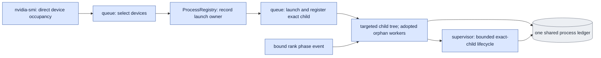

# `execution/process_registry.py` — shared records of our own package processes

## Objective

Keep one shared JSON ledger of the exact identities and GPU IDs of the
processes that this package owns. Query `nvidia-smi` directly for device
occupancy. Do not read GPU reservation files. Do not scan the environments of
unrelated processes.

## Data flow

The dedicated queue owner turns on Linux child-subreaper behavior before
launch. A subreaper adopts orphan descendants, including workers in new
sessions. The owner records its exact PID, start ticks and command, and a
baseline of its direct children before launch.

The ledger contains the attempt token, the requested GPU IDs, the owner, the
registered child and the observed descendant identities. Rank-bound phase
notifications attach rank roles to the same identities. Records keep the
observed command changes.

The ledger records ownership and coordinates the starts of this package. It is
not a reservation directory for each GPU. The device inventory stays a direct
observed input.

## Organization logic

### Ledger file

`ProcessRegistry` uses one JSON data file and a stable sibling flock file for
atomic updates.

- Lock waits have a five-second deadline.
- The ledger must be a regular JSON file of at most eight MiB. It is read
  through one nonblocking descriptor. Atomic updates refuse larger bytes before
  publication.
- The explicit timeout of an observation covers its lock wait, its read and the
  traversal of the targeted tree.

### Device selection

The import-light `execution/devices.py` is the only owner of the pool and the
topology: GPUs `(0,1,2,3,4,5,6,7)` and exactly four training processes.

1. Require a complete memory list of strict integers for all eight devices.
2. For training, pick the first four pool members that are idle and not owned.
   For other work, pick the first one.
3. An optional explicit pool limits the selection and keeps its order. The
   default is all eight devices. Pool IDs must be unique integers in 0–7.
   Noncontiguous sets are valid. Fewer than four cannot start training.

`choose` considers the direct memory observations and the active rows of this
ledger. `acquire` validates a one-device or four-device topology, locks the
ledger, queries the direct occupancy again and records a fresh owner before
`Popen`. It publishes the complete device set atomically. So two concurrent
package starts cannot both register the same devices. No claim file is read.

- A live active row of the same owner (PID and start handle) prevents
  selection and acquisition, even for other devices, because containment is
  scoped to the owner.
- Independent queue processes can own separate four-device sets at the same
  time.
- Recorded rendezvous ports stay launch settings that the caller owns.
  Concurrent training templates must declare different ports.

### Child tree observation

`refresh(child_pid=...)` registers the exact launched handle. Then it reads only
the owner's `/proc/PID/task/PID/children` tree.

- It excludes the exact baseline handles from before launch. It never reads
  broad environment contents.
- It observes the descendant handles and children twice. If an intermediate
  parent exits, Linux reparents the surviving descendants to the live
  subreaper. The second pass observes them there.
- Workers in new sessions stay descendants and cannot escape this ownership
  path.
- PID and start identity stay exact. Every discovered process and command is
  kept.

The current owner must still be the original live handle with subreaper turned
on. The module reads the task directory of every targeted process, so children
forked by another thread stay in scope. It checks the original owner and its
direct children again after the traversal before it declares an empty tree.

Each targeted read has a finite deadline and a maximum tree size. An unreadable
handle, PID reuse, a changed owner or lost containment returns incomplete
evidence. A saved row whose owner died cannot inherit proof from a new
observer. It stays unknown until a supported explicit recovery can prove
absence. No privileged read is requested or used instead.

### Observation, release and stop

- `observe_workers` returns whether any tracked descendant is live, the
  complete or incomplete scope and the exact identities.
- `release` marks the attempt closed only when the current live-owner
  containment proves that no descendant is live. It never deletes saved
  records. A failed or unknown proof keeps the active record.
- `registered_identities` returns the earlier recorded exact handles as extra
  conservative stop candidates.

The supervisor signals the leader and every identified own descendant through
individual pidfds. Unknown or surviving workers stay in the ledger for a later
exact owned recovery.

### Recovery of a lost owner

`queue_launch.recover_owned_attempt` is the explicit bounded recovery for a lost
owner whose registered rank workload has completed. It does not rebuild the
lost child tree, and it does not certify continuous supervision.

1. The caller supplies the original token, the fixed launch request and the
   ledger path.
2. The request, bootstrap, grant and unchanged interrupted journal bind the
   original token, job, owner, launcher and notification hash.
3. The launch recovery owner applies the existing supervision event rules to a
   bounded private snapshot. Every declared rank and phase is required.
4. Each producer must be an exact descendant that was contained earlier. A
   reported but uncontained producer is refused.
5. The saved launch child and all registered descendants must appear in a
   complete observation by the original owner.
6. The exact owner, launch child and every saved descendant are checked twice,
   around one direct GPU inventory. All must be absent or terminal, without PID
   reuse or denied reads.
7. Each selected GPU must use less than 1,024 MiB now.

An incomplete rank list, a live handle, changed bytes, an invalid inventory or
an expired deadline leaves the active row unchanged.

On success, only the state of that row changes, to `closed`. A separate
`recovery` record is added with the original-row hash, the observer, the
notification and event hashes, both current handle observations and the direct
GPU sample. The original process and observation fields stay unchanged. The
record sets `continuous_supervision=false` and `containment_complete=false`.

The evidence proves that the registered workload ended and that the devices are
free now. It does not prove that no unknown descendant exists after containment
was lost. The saved scientific results and the interrupted queue journal stay
separate and unchanged. The queue's explicit recovery can then verify
scientific completion against those original results.

### Reading a closed row

`inspect_record` reads a closed row without observing processes. All three
cases report no live workers.

| How the row was closed | Reported basis | Extra fields |
|---|---|---|
| `release` | `saved_complete_empty_containment` | — |
| recovery (has a `recovery` record) | `recovered_registered_handles_ended` | `containment_complete=false`, `continuous_supervision=false` |
| interrupted recovery | `recovered_interrupted_handles_ended` | also `workload_complete=false` |

A recovered row never reads as complete saved containment.

### Worked checks

**New-session worker.** A child starts a worker in a new session and exits. The
owner is still the original subreaper. The worker becomes the owner's direct
child and stays live in `observe_workers`. `release` refuses. After an exact
pidfd stop of that worker, a complete empty tree allows the attempt to close.
No SSH process or other unrelated process environment is inspected.

**Pool.** Memory above the idle threshold on devices 0, 2, 4 and 6 leaves
`(1,3,5,7)` free for four-rank training.

- If one of those devices already belongs to an active ledger row, training
  waits.
- With all devices idle, two independent original owners can acquire
  `(0,1,2,3)` and `(4,5,6,7)`. Closing one keeps the other's active row.
- A second registry in the same original owner cannot acquire either set while
  its first attempt is active.

**Dead owner.** The frozen notification contract declares four ranks. All four
producers match saved descendants, and every expected phase has begin and end
events. Both exact-handle passes find the owner, the launcher and the ranks
absent. GPU use is `[276,4,4,4]` MiB. Bounded recovery closes that one row,
with its supervision limit recorded. If the final end event of rank three is
missing, or one exact saved rank is live, the row stays active. Neither outcome
claims successful original external supervision or changes a training result.

## Invariants

- No reservation file for each device and no broad `/proc/*/environ` scan.
- Availability requires a current direct `nvidia-smi` query.
- Recorded identities contain the exact PID, start ticks and observed command.
- Only a live original subreaper owner can certify its complete descendant
  tree.
- A missing process identity is different from PID reuse or a denied read.
- A new observer cannot call lost containment "worker absence".
- Unknown or live handles refuse both closure routes. Closing keeps their
  history.
- Closure after a dead owner requires complete bound rank evidence and directly
  observed idle devices. Its evidence never claims a complete current
  descendant tree or continuous supervision.

## Gotchas

- Subreaper is a process property. The dedicated queue owner must turn it on
  before launch and run one attempt at a time.
- Children that existed before the attempt are excluded only by their exact
  baseline PID and start handles. New extra children are tracked
  conservatively.
- Inventory subprocesses finish and are reaped before the observation of the
  target tree.
- Loss of the original owner loses the complete live containment proof. The
  saved record states that limit.
- GPU memory is sampled device occupancy, not Torch allocated memory. The
  resource-budget measurements stay the allocator authority.

## Tests

CPU tests cover:

- atomic coordination of own starts and the direct inventory recheck;
- exact child registration, PID reuse and denial;
- retention of closed records and owner loss;
- subreaper adoption of a real new-session worker;
- refusal to close a live or incomplete attempt.

Recovery tests also cover complete saved rank evidence, missing or mismatched
ranks, live, reused or denied handles, uncontained producers, non-idle or
incomplete inventory, deadline failure, preservation of the original row and
the explicit closure scope. Pool tests cover noncontiguous four-device choices,
incomplete eight-device inventories, invalid indices and topologies, fewer than
four free devices and two independent CPU owners that keep separate records.
GPU inventory is mocked. No native model run is certified.
