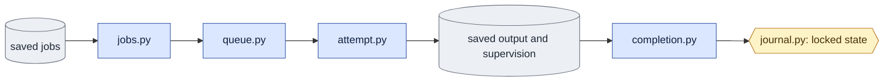

# `execution/queue.py` — schedule saved package jobs

## Objective

Run ready jobs through one managed execution path. The queue owns the CLI,
dependency scheduling, GPU claims, dispatch order and polling. Job normalization,
journal mutation, recovery and output verification have separate execution owners.
The refactor preserves public queue imports, saved formats and scientific gates.

## Usage

Run the queue owner directly from `LTX-2` in the `ltx` environment. The owner
process itself uses no GPU. It starts the children on free GPUs. See
[run guide §2](../../configs/README.md#2-the-queue) for the job record of each
kind.

1. Write a job list (`<JOBS.json>`). Its default state file is `state.json` in the same directory.
   Use `--state <STATE.json>` to select another file.
2. Check the list on CPU. A dry run writes nothing and claims no GPU:

   ```bash
   cd LTX-2
   "$PY" -m scripts.onestep_avatar.execution.queue \
     --jobs <JOBS.json> --state <STATE.json> --dry-run
   ```

3. For a human foreground run, use one command. A one-job list runs one task:

   ```bash
   OMP_NUM_THREADS=8 MKL_NUM_THREADS=8 "$PY" -m scripts.onestep_avatar.execution.queue \
     --jobs <JOBS.json> --state <STATE.json> --foreground \
     --process-ledger ../expr/onestep_avatar/processes.json
   ```

   This waits for free GPUs and streams child output while saving the child log.
   Press Ctrl+C to stop the owned child and its workers through bounded supervision.
   The queue saves the failed attempt and releases GPUs only after worker absence is proved.
   SIGTERM requests the same cleanup, including for detached owners.
   The command returns 130 for Ctrl+C and 143 for SIGTERM.
   Repeated stop signals during cleanup do not interrupt that cleanup.

4. For unattended work, start an owner in its own session, so it survives the terminal. Give it a
   log file and a CPU thread limit:

   ```bash
   OMP_NUM_THREADS=8 MKL_NUM_THREADS=8 setsid -f "$PY" -m scripts.onestep_avatar.execution.queue \
     --jobs <JOBS.json> --state <STATE.json> \
     --execute --loop --process-ledger ../expr/onestep_avatar/processes.json \
     > <LOG_FILE> 2>&1 < /dev/null
   ```

5. After an owner ended, check the ended children and the saved outputs. This
   starts nothing:

   ```bash
   "$PY" -m scripts.onestep_avatar.execution.queue \
     --jobs <JOBS.json> --state <STATE.json> --recover
   ```

| Argument | Meaning |
|---|---|
| `--jobs` | Required. The job list. |
| `--state` | Optional. Default: `state.json` in the job list's directory. |
| `--dry-run` | Check the list and print the planned commands. Writes nothing. |
| `--execute` | Claim free GPUs and run ready jobs. |
| `--foreground` | Execute with live child output; defaults to `--loop`. Requires the shared ledger. |
| `--loop` | With `--execute`: run until all jobs are complete. |
| `--once` | With `--execute`: start at most one job, then exit. |
| `--recover` | Inspect ended children and verify saved outputs. Starts nothing. |
| `--process-ledger` | The shared ledger file. Give every owner the same path. |
| `--gpu-pool 0,1,2,3` | Only use these physical GPUs. Default: GPUs 0–7. |
| `--poll-seconds N` | The wait between loop passes. Default 30, at most 60. |

Exit codes of `--loop`: 0 when every job is verified complete; 1 when a job
failed. `--once` returns 2 when ready work had no free GPU, or when a startup
retry is pending.

Stop a foreground owner with Ctrl+C, or send SIGTERM to an unattended owner.
Do not kill the owner before its bounded cleanup finishes.
If `--recover` reports a surviving child but every process of that
attempt has ended, close its ledger row with
[`queue_launch`](queue_launch.md#usage) first.

## Data flow

Normalize the saved list. Read its journal. Verify required dependency receipts.
Query device occupancy and claim a complete device set. Query occupancy again.
Delegate one attempt. Poll without retaining a claim when nothing can start.



## Organization logic

The execution owners have these responsibilities:

- `jobs`: owner parsers, fixed selectors, prepared identities, commands and runtime profiles.
- `journal`: validated reads, locked publication and shared row/attempt transitions.
- `recovery`: interrupted-child classification and explicit recovery decisions.
- `completion`: artifact checks, supervision binding and hash receipts.
- `attempt`: launch preparation, guard registration, supervision, cleanup and startup retries.
- `processes`: stable process handles and owned-worker observations.
- `devices`: the pool, device policy and GPU inventory parsing.
- `clock`: original deadlines and the shared child failure types; logic lives in its small-file header.

The scheduler calls these owners directly. Public aliases retain existing import paths.
Infrastructure imports processes and devices, never the queue scheduler.
The CLI keeps existing execution flags, outputs and exit codes. The state path is now optional.
_parse_args validates CLI options and selects the journal path before main reads or dispatches any job.
After parsing, an omitted `--state` resolves to `args.jobs.parent / "state.json"`.
An explicit `--state` keeps its supplied path. Every CLI mode uses that selected path.
For `.../d0_bidirectional_sigma0.9/jobs.json`, the default is `.../d0_bidirectional_sigma0.9/state.json`.
Several lists in one directory need separate explicit state paths when their job identities differ.
Dry runs read that journal if present. They never create it.
The state-less attempt API remains supported for current CPU fixtures.

### Dispatch loop

`--dry-run` checks the arguments and identities. It prints the normalized
jobs, the saved states and the planned commands. It writes nothing, claims no
device and checks no scientific input bytes. Planned GPU IDs are not claims of
availability.

`--execute --loop` does these steps before each dispatch:

1. Read and check the job list (append-only) and the state again.
2. Verify the receipts of completed dependencies.
3. Query the GPU memory directly.

`ready_jobs` returns pending jobs whose dependencies have verified receipts.
It verifies only the receipts that a pending job depends on, because one check
can hash every pinned input again, including model weights. A completed job
without a receipt is still refused. The loop verifies every receipt again
before it reports the list complete. Non-training jobs come first, in saved
order within each group. A `render` job also waits for every saved panel file.

`dispatch_ready` tries each ready job in that order:

1. Build a `ProcessRegistry`.
2. Choose devices from the inventory.
3. Acquire one ledger row bound to the attempt token.
4. Query the occupancy again.
5. Start the child only if every selected device is still free.

`--gpu-pool` limits the device selection of that owner to the given physical
GPU IDs. The default is all eight devices. It never changes the direct
occupancy sample. For example, use one owner with pool `0,1,2,3` for training
and another with pool `4,5,6,7` for single-device work.

- Training waits if any of its four devices is busy.
- A busy device leaves that job pending, so a later ready job can start first.
- One queue owner runs one child at a time. Independent owners use separate
  journals and the same ledger. Concurrent training jobs need different ports.
- When nothing can start, the loop waits `--poll-seconds` (default 30, at most
  60) without an active process record.

The loop exits with zero only when every job is verified complete. A complete
state with missing evidence fails. The loop returns 1 when a job has failed. It
refuses a state with a `running` job until `--recover` has checked it.
`--execute --once` starts at most one job. It returns 2 when ready work had no
free GPU, or when a preserved startup retry is pending. An empty list exits with
zero, without a GPU query or a state file.


## Invariants

Keep dependency receipts, append-only identities and the second occupancy query.
Training still requires four GPUs; other jobs require one. Ordinary jobs never import experiments.
Publish success only after scientific verification and complete owned-worker absence.
Keep deadlines, retry limits, original attempts and cancellation cleanup unchanged.

## Gotchas

Source hashes change when their owners move. Historical evidence retains its original attribution;
current source checks require fresh affected results. This refactor launches no scientific workload.
Test substitutions patch the defining owner, rather than a public compatibility alias.

## Tests

Worked check: four-rank training is ready, but only three devices are free.
Keep training pending and allow a later ready single-device job to start.
An empty queue exits without a GPU query or journal write.
Run queue, recovery, foreground and import-boundary tests, then the full CPU and blocked-import suites.

The CLI tests check the default journal for execute, foreground, recovery and dry-run modes.
They check relative jobs paths, explicit overrides and review without writes.
