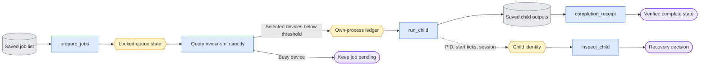
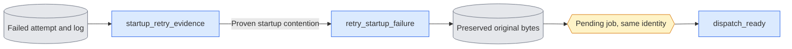

# `execution/queue.py` — run saved package jobs

## Objective

The queue is the only launcher for package model work. It reads a saved job
list, checks every job's identity and dependencies, selects free GPUs by direct
`nvidia-smi` query, starts one package child at a time under bounded
supervision, verifies the child's saved evidence and publishes a terminal state.
It records only its own processes in one shared ledger (PID, start ticks,
command, GPUs and owned descendants) through
[`process_registry`](process_registry.md). It never reads reservation files or
unrelated process environments. Commands are in the
[run guide](../../configs/README.md#2-the-queue).

Kinds are `train`, `evaluate`, `preview`, `product`, `bench`, `decode`,
`render` and `experiment`. Each kind starts one fixed module with
`python -m scripts.onestep_avatar.<module>` from `LTX_ROOT` and has a
model-free completion check. Study choices stay JSON data; the queue never runs
Python or shell code from `expr/` and never runs report commands.

## Data flow

Read a versioned job list → validate package arguments and dependencies → check
completed evidence → query GPU memory and register the attempt → start one
package child → verify its artifacts and owned-worker absence → publish the
terminal state and close the process record.

A completed state requires verified output bytes. Recovery runs only when the
CLI requests it with `--recover`.

## Organization logic

### Job list and identity

The list has `schema_version: 1` and ordered `jobs`. Each job has a unique
`id`, a `kind`, an `arguments` array of strings, `output`, `dependencies`
(earlier job IDs) and `completion` evidence. Train jobs also specify
`accelerate_config`, `processes` (exactly four) and `port`. Train and evaluate
arguments contain exactly one `--mode bidirectional|causal`.

`prepare_job` is the single-job normalization owner; `prepare_jobs` calls it
after list-level checks, and replay calls it with the saved job's directory.
It resolves path arguments against the job-list directory, parses them with the
selected owner's public parser (no input or model access), rejects
`--gpu-id`, `--dry-run`, `--help`, `--overwrite`, `--saved-metrics`,
`--verify` and (outside `preview`) `--preview-job`, and requires the recorded
output to equal the parsed `--output`. The canonical job SHA-256 hashes the
normalized job together with the resolved parser settings, including omitted
defaults: adding a seed changes identity, preparing the same list twice does
not. A supplied prepared digest must match the reconstructed one. Distinct
textual outputs that resolve to the same directory fail. A list revision may
append jobs; changing an existing job's hash fails.

Kind-specific pins enter the identity:

- `train`: the Accelerate file's full SHA-256 (`accelerate_config_sha256`) and
  the final completion step, which must equal the parsed `--steps`.
- `decode`: the resolved `--jobs` path and its content hash.
- `render`: the resolved `--render-saved-comparisons` path and hash; the
  completion manifest must be `<output>/render_manifest.json`.
- `experiment`: the selector, the spec path (equal to the single `--spec`
  argument) and its required `spec_sha256`.
- `preview`, `product`, `bench`, `experiment`: the owner parser's `completion`
  descriptor — a nonempty mapping with a `manifest` string and/or a nonempty
  `records` list, every path inside the output — must equal the job's
  `completion`. `preview` also pins its immutable `preview_identity`.
- Every kind: the effective resource budget. `train` names it with
  `--resource-budget`; other kinds use `resource_budget` and
  `resource_budget_sha256`. A supplied digest must match the file; a digest
  without a file fails. Without a file, the job binds the scientific default of
  1,800 seconds per phase and 48,000,000,000 allocated bytes. An experiment
  owner that declares its own scientific budget must receive exactly that budget.
- `numerical_policy` is absent or `"deterministic"`.

Worked check: a four-process prepared job records bf16 YAML. Changing the YAML
to `mixed_precision: no` changes the canonical digest, and reusing the original
claimed digest fails normalization. Changing only whitespace in a budget file
also changes the digest. A two-process substitution fails the four-process
rule. An unchanged raw or prepared job reconstructs the same identity.

### Experiment selection

The `experiment` kind reads one literal `EXPERIMENTS` table that maps each
selector (`stock_parity`, `adapter_effect_check`, `continuation_check`,
`training_update_check`, `training_slice_check`, `causality`, `fusion_parity`,
`sigma_sweep`, `stats`, `prune_baseline`, `prune_reproduction`) to its module. Only this branch reads
the table, importing the selected module at the point of use. An unknown
selector fails before input reads, claims, state writes or children. Ordinary
kinds never import an experiment. There is no discovery or registration API.
The selected module owns its evidence layout and its
`verify_completion(spec, root)`; for `sigma_sweep` the descriptor is exactly
`<output>/manifest.json`. `prune_baseline` runs the prune-owned whole-clip
producer for one view and one seed under the generic one-rank phase;
`prune_reproduction` runs its controls in the same kind of phase.

### Commands and environment

`job_command` builds argument arrays only for the fixed owners. Training uses
the current Python with `-m accelerate.commands.launch`, the recorded
configuration, `--num_processes 4` and the recorded port. Every child gets
`CUDA_VISIBLE_DEVICES` set to its claimed physical IDs; single-GPU children
receive `--gpu-id 0`, their local device after masking, and the state keeps the
physical ID. Training also sets `PYTORCH_CUDA_ALLOC_CONF=expandable_segments:True`.
A deterministic job receives the numerical environment from
`training/numerics.py`. The queue records only the environment changes, the
attempt token (`ONESTEP_AVATAR_QUEUE_TOKEN`), the job hash
(`ONESTEP_AVATAR_QUEUE_JOB_SHA256`) and the supervision and runtime contract
paths. Children run with `cwd=LTX_ROOT`, an argument array and no shell.

Device policy comes from `execution/devices.py`: the pool is GPUs 0–7 and
training uses four processes. A GPU is free when `nvidia-smi` reports less than
1,024 MiB used and no active own-process row claims it. Training takes the
first four free devices in pool order, which may be noncontiguous; other kinds
take one. A malformed or failed `nvidia-smi` read selects nothing.

### Dispatch loop

`--dry-run` validates arguments and identities and prints normalized jobs,
saved states and planned commands. It writes nothing, claims no device and
checks no scientific input bytes; planned GPU IDs are not availability claims.

`--execute --loop` rereads and validates the append-only job list and the state
before each dispatch, verifies completed dependency receipts, and queries GPU
memory directly each time. `ready_jobs` returns pending jobs whose dependencies
have verified receipts. It verifies only the receipts that a pending job depends
on, because one check can rehash every pinned input, model weights included. A
completed job without a receipt is still refused, and the loop verifies every
receipt again before it reports the list complete. Ready jobs come back
non-training kinds first and in saved order within each group; a `render` job also waits for every saved panel file. `dispatch_ready`
tries each ready job in that order: it builds a `ProcessRegistry`, chooses
devices from the inventory, acquires one token-bound ledger row, queries
occupancy again and starts the child only if every selected device is still
free. A busy device leaves that job pending, so a later ready job can start
first. One queue owner runs one child at a time; independent owners use
separate journals and the same ledger, and concurrent training jobs need
distinct ports. When nothing can start, the loop waits `--poll-seconds`
(default 30, at most 60) without an active process record.

The loop exits zero only when every job is verified complete; a completed
state with missing evidence fails. It returns 1 when any job has failed and
refuses a state with a `running` job until `--recover` has checked it.
`--execute --once` starts at most one job; it returns 2 when ready work had no
free GPU or when a preserved startup retry is pending. Empty lists exit zero
without a GPU query or state file.

### Registered child launch

Persistent `run_child` (the CLI always supplies a state path) launches the
model-free guard of [`queue_launch`](queue_launch.md) for each job. It refuses
a nonempty output, publishes the immutable request in `launches/<token>/`,
writes a running attempt with the request hash and protocol, then creates the
guard in a new Linux session. It waits at most 45 seconds for the guard's
bootstrap while refreshing the owned ledger row, and requires the bootstrap PID
to equal Popen's PID, the exact guard command, stable live start ticks and
matching token, job and request hashes. It saves that identity in the row and
the latest attempt before it publishes approval; the guard then execs the
fixed command. Inspection checks the granted command transition on the same
PID and start ticks. Queue JSON publication flushes and fsyncs bytes and the
containing directory before returning; request, bootstrap and grant files are
published exclusively the same way. Failed registration publishes no approval.
A live guard keeps its process record and running attempt; a timeout is not
startup contention.

Logs use unique attempt names outside the output directory. A zero exit must
pass artifact verification before a receipt is published. Ordinary failures
become failed after the child and all owned workers exit. An interrupted owner
keeps the running state and the record for live or uncertain workers. Only
complete owned-worker absence closes the active ledger row. `run_child` called
without a state path executes directly; tests use it, and it carries no
recovery authority.

### Supervision and budgets

Every kind uses [`supervision`](supervision.md). Before launch, the queue
freezes the selected owner's phase inventory beside the launch records:
training binds per-rank load, update and export phases; ordinary owners bind
the single runtime phase that `execution.runtime.run` measures at their module
entry. The budget's per-phase wall limit also bounds the startup interval and
the gaps between phases. The observer keeps finite wait, signal and inventory
evidence and never closes process records itself. A failed or ambiguous stop
stays failed or running, keeps its evidence and publishes no receipt.
Sampled total-device occupancy is recorded separately; the allocated-memory
limit is never reused as a device-memory stop threshold.

An explicit `overall_seconds` starts at the first launch attempt; waiting for
GPUs before it does not start the clock. The journal stores the first start
and the absolute deadline before child registration, and retries, restarts and
recovery keep both values. An expired job fails before claiming or launching
with reason `overall_deadline`. Registration and supervision use the remaining
time, and expiry prevents recovery or a zero exit from publishing success.

Worked deadline check: a first attempt starts at wall time 100 with a
ten-second overall limit. Its retry at 106 keeps deadline 110. A restarted
queue at 111 fails that pending retry without a claim or child and cannot
create a new deadline of 121. A job without an overall bound still has bounded
startup, gap and phase supervision; no total is inferred from the phase count.

### State and completion

The state file records each job hash, state, attempts, owner PID, child PID and
identity, start and end times, physical GPUs, exit code, log and error. States
are pending → running → complete or failed. `read_queue_state` checks the
schema, state names and exact persisted job hashes without writing; only new
IDs may be appended after the original order. `queue_state` locks the state
file, refuses another live owner or a surviving recorded child, and publishes
updates atomically; an exception keeps the previous bytes.

`verify_completion` checks each kind through its saved-artifact owner. Missing
files return false (the job stays pending); malformed or changed evidence
raises. Evidence paths must stay inside the recorded output.

- `train`: the checkpoint and its `.complete.json` marker (integer schema two,
  `state="complete"`, exact path, current byte hash and the expected final
  step), the typed adapter contract and actual matrices, a contract mode equal
  to the command's mode, and the engine's scientific verifier for typed
  settings, data/base/parent identities, frame plan and queue/source digests.
  With `--save-update-state` the receipt also binds training text, Adam moments
  and per-update records.
- `evaluate`: every listed `result.json` with complete state and the command's
  mode, its encoding hash, recorded shape and finite content, then
  `evaluate.verify_evaluation_conditions` for the exact source/variant
  inventory, adapters, saved text/noise and clean `c0`. One matching result
  cannot complete a different schedule, seed, source or adapter.
- `decode`: the declared manifest, exact job and comparison IDs, matching
  source records, the selected model's VAE hash, native decoder settings,
  source-code hash, seed and encoded shape; every video and sample hash; the
  saved video's frame count, rate and size `(F-1)*time+1`, `H*height`,
  `W*width`; sample PNG format and size. It loads saved tensors and hashes VAE
  files but opens no decoder.
- `render`: the exact spec, decoder and software identity, comparison order
  and fields, every input hash and shape, coverage, fps, panel titles and
  layout, and video/poster hashes.
- `preview`, `product`, `bench`, `experiment`: the selected owner's
  `verify_completion`; a benchmark inventory must equal the owner's.

`completion_receipt` verifies all evidence before capturing the job hash and
the hash of every declared file. `verify_receipt` requires the same identity
and unchanged evidence and reruns the artifact checks. A completed row without
a receipt is invalid; missing receipt artifacts block dependents; changed
evidence raises.

### Training launch binding

Before dispatch, `training_launch_record` captures the exact prepared job,
command, physical devices, the Accelerate bytes in base64 and the numerical
environment (`schema_version: 2`). The record is written beside the child log
and passed through `ONESTEP_AVATAR_QUEUE_LAUNCH`; training copies it into its
checked config and completion evidence. `verify_training_launch` accepts only
schema two, reconstructs the job and command, compares the original bytes with
the current file and rejects changed arguments, processes, port, command,
claimed hash or YAML before models load. These checks bind requested launch
facts; the engine separately records the actual world size, FSDP dtype policies
and rank agreement after setup. A record without these facts cannot pass replay.

### Startup contention retries

Training emits JSON lines with prefix `AVATAR_QUEUE_EVENT `, bound to the
attempt token, job hash and global rank. The engine reports `updates_begin`
before any sample or optimizer update. A CUDA `OutOfMemoryError` before that
boundary reports `startup_contended` with reason `cuda_oom`; a typed `OSError`
with `errno.EADDRINUSE` before it can report `port_in_use`. Other exceptions
report nonretryable `startup_failed`. Traceback text never authorizes a retry.

A retry requires a reaped nonzero child, complete owned-worker absence, at
least one valid matching contention event, no `updates_begin` from any rank and
no nonempty `metrics_rank*.jsonl`. Only typed training uses this path; every
other failure stops. At most three retries follow the first failure. Under the
state lock, `retry_startup_failure` creates an exclusive archive below the
output parent's `superseded_startup_contention/`, moves any partial output into
it, copies the log, writes a README and a hashed preservation record, checks
source bytes before and after, and only then resets the job to pending with the
same identity. A failed publication restores the original output location.

Worked outcome: rank 2 runs out of CUDA memory while loading weights, no rank
has emitted `updates_begin` and no update was written. After all child session
processes end, attempt one is preserved and the unchanged job is pending. If
rank 0 had crossed the update boundary, the job stays failed. The fourth failed
launch cannot retry.

### Recovery

`--recover` is mutually exclusive with `--execute` and `--dry-run` and needs an
existing journal. It validates job identities, then recovers every running
entry in one locked transaction. It never queries GPU memory, retries failed
work, moves files or starts processes. A journal without running entries gets
a read-only summary.

For each running entry it inspects the recorded child, even when this process
owns the journal. Surviving, unidentified or reused handles and a live foreign
owner refuse the whole transaction. Matching terminal or missing handles permit
artifact verification: a valid receipt marks the entry complete; absent
completion marks it failed with an interruption reason; corrupt evidence
refuses recovery and keeps the prior bytes. Failed outputs stay in place; a new
attempt uses a new job ID and output.

- **Unapproved guarded launch.** A row of the registered-child protocol with no
  PID or identity is classified `unapproved` only when the launch owner is gone,
  request and attempt bindings match, no grant exists, any saved bootstrap is a
  known terminated matching guard and no owned worker survives. It is marked
  failed without adopting output. A row without the registered-child protocol
  and an unknown launch window refuses takeover.
- **Missing supervision.** An approved attempt whose owner ended before it
  published a supervisor result can be recorded as failed before its deadline,
  after the matching bounded `queue_launch --recover-owned` closure (or
  `--recover-interrupted` when the workload stopped before it finished). That closure
  certifies only exact registered handles, not unknown descendants or continuous
  supervision. Recovery rechecks the request, approval, unchanged journal,
  original owned-row hash and ended handles, sets reason `missing_supervision`,
  keeps the prior attempt under `interruption_recovery.prior_attempt` and keeps
  all outputs and the original deadline. The selected owner still checks the
  saved scientific files; corrupt files refuse recovery. Valid outputs never
  replace the supervisor, and this branch writes no success receipt.

Worked check: the deadline is 3,700 and recovery runs at 105. The exact owned
handles are ended and the bounded closure matches. Missing supervisor fields
produce `failed` with `missing_supervision`, never a completion receipt; the
first start stays 100 and the deadline 3,700.

### Process identity

Identity uses `/proc/<pid>/stat` start ticks and exact NUL-separated command
arguments. Parse the stat fields after the last closing parenthesis, because
the process name can contain spaces or parentheses. Read stat before and after
the command; a changed start tick rejects the observation. A zombie or dead
process is terminal even if signal zero succeeds. Missing process files mean
the handle disappeared; permission and other I/O errors stay errors and never
prove death. `inspect_child` compares the saved PID and start ticks, requires
the saved command for a live handle and accepts the saved or an empty command
for a matching terminal handle (Linux clears `cmdline` before the parent reaps
a zombie). It checks surviving owned workers before returning terminal.

`owned_workers_live` uses the targeted ledger observation for rows that record a
process ledger; rows without one use the two-pass session and token scan. Both
fail closed on unreadable or reused handles, and a vanished session leader never
proves that workers ended.

Worked check: save PID 42, start ticks 100 and command `python worker.py` while
live. After exit, observe PID 42, ticks 100, terminal true and command `[]`.
With no owned workers the result is terminal; with a live token-bound worker it
is live. Ticks 101 refuse recovery in both cases.

`run_child` takes a claim object with the `ProcessRegistry` interface (`token`,
`owned`, `started_ticks`, `refresh`, `release`). Tests use the file-based
`tests/claims_fixture.GPUClaims` with that interface to drive it without a ledger.

## Invariants

- The queue is the only launcher; checkers and run-support modules never claim
  GPUs, write ledger rows or supervise children.
- Study configuration and saved scientific records keep their identities;
  completed checkpoints are immutable.
- Every receipt is published only after the owned child completes and its
  evidence verifies; a state label alone is never completion.
- Recovery and retries never overwrite outputs, never adopt unknown children and
  never infer process death from a timeout or a claim file.
- Experiment dispatch and completion change together through the literal table;
  ordinary jobs stay independent of experiments.

## Gotchas

- A queue owner started in a terminal or tool session ends with that session
  and leaves its attempt without a supervisor result; start long owners with
  `setsid` (see the run guide).
- External programs can start on a GPU after the second query; the ledger
  coordinates only this package's own starts.
- A GPU-count override never authorizes changing a recorded FSDP configuration.
- Saved-result report rebuilds must fail on missing inputs, not enqueue recovery.

## Tests

- Dispatch controls exercise direct inventory, exact owned-process registration,
  the second occupancy query, guarded bootstrap and grant ordering, persistent
  journals, all-or-nothing four-device selection and ownership-safe release.
  Busy, malformed or failed inventory starts no child.
- Scientific completion tests use serialized settings, tensors and markers and
  reject changed schedules, inputs, adapters, runtime, budgets, incomplete phase
  journals, redirected artifacts and missing evidence.
- Startup tests check bound events, pre-update-only authority, ended-worker
  evidence, the three-retry limit, exclusive preservation and rollback.
- Loop controls check append-only jobs, dependencies, immutable identities,
  waiting without an active record and refusal of failed or unrecovered work.
- Recovery controls distinguish valid completion, incomplete output, unknown
  launch windows, changed, reused or live handles and missing journals;
  `tests/test_queue_missing_supervision_recovery.py` covers the
  missing-supervision branch.
- Real Linux zombie cases leave the child unreaped while inspecting its empty
  command line. Guarded-recovery cases cover owner exits before fork, before
  bootstrap, after bootstrap and after interrupted registration.

These CPU controls cannot prove isolation from external programs or native
model and FSDP behavior.
