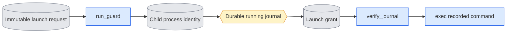

# `execution/queue_launch.py` — register the child before model execution

## Objective

A gap exists between the moment a process starts and the moment its PID is
saved durably. This module closes that gap. A queue child must not start model
work until its identity is saved and approved. Launch control stays in the
package, separate from training and evaluation logic.

The module has two kinds of operation:

- **The guard** (`--request`). The queue starts it for every job. It waits for
  approval, then replaces itself with the approved command.
- **Recovery routes** (`--recover-owned`, `--recover-interrupted`,
  `--recover-registered-owned`). You run one by hand to close a ledger row after
  an owner ended. A recovery route starts nothing.

Transient internal calls without a journal are outside the saved protocol.

## Usage

You do not start the guard yourself. The queue starts it.

Run a recovery route directly, on CPU, from `LTX-2` in the `ltx` environment.
Use it when `queue --recover` reports a surviving child, but every process of
that attempt has ended. `<TOKEN>` is the attempt's folder under
`<STATE dir>/launches/`. See [run guide §2](../../configs/README.md#commands).

```bash
cd LTX-2
"$PY" -m scripts.onestep_avatar.execution.queue_launch \
  --request <STATE dir>/launches/<TOKEN>/request.json --recover-interrupted \
  --process-ledger ../expr/onestep_avatar/processes.json
```

Then run `queue --recover` to record the job state from the saved outputs.

| Argument | Meaning |
|---|---|
| `--request` | The saved launch request of the attempt. |
| `--recover-owned` | Close an ended, approved attempt in which every rank finished every phase. |
| `--recover-interrupted` | Close an ended, approved attempt whose owner and workload stopped early. |
| `--recover-registered-owned` | Close the row of an ended direct non-training command that has no approved request. Needs `--token`, `--expected-row-sha256`, `--launch-evidence` and `--expected-launch-sha256`. |
| `--process-ledger` | The shared ledger file. |
| `--timeout`, `--poll-seconds` | The guard's finite wait and poll interval. |

A recovery route closes the ledger row only. It never writes a success result.
The job of an interrupted attempt stays failed. Retry it with a new job ID and
a new output.

## Data flow



The queue writes the request, the journal and the grant. The guard writes only
its bootstrap identity. Each file has one producer and an exclusive
publication path. These records are launch evidence. They are not model
results or completion receipts.

## Organization logic

### Request

`prepare_request` requires these items: a fresh token directory, an exact
token and job hash, the owner's process identity, a journal path, the job ID
and a nonempty command array. It resolves the paths and publishes
`request.json` exclusively. The queue selects the command through its fixed
package owners. The guard does not select models, settings, GPUs or
scientific inputs. Tests use CPU commands as controlled consumers.

### Guard

The ordinary route accepts `--request`, a finite positive wait timeout and a
poll interval. The guard does these steps:

1. Check the inherited token and job environment against the request.
2. Before any model library opens, publish `bootstrap.json` with its PID, start
   ticks and actual command.
3. Wait for `grant.json`. While it waits, verify that the exact owner (PID,
   start ticks and command) stays live, and that the request bytes do not
   change.
4. Stop if the owner handle is missing or reused. The deadline is a failure,
   never permission to run.
5. Refuse a stale or existing bootstrap or grant.

The guard parses and hashes one buffer of request bytes. It checks those bytes
again before approval and before execution. It never pairs the settings of one
file version with the hash of another.

### Grant

A grant binds the request SHA, the token, the job hash and the bootstrap
identity. Before grant publication, and again before execution, the guard reads
the saved journal. The journal must have the same job hash, running state, PID
and start ticks, token and job environment, exact command, request path and
hash and launch protocol.

- A grant published before the PID is saved cannot authorize execution.
- Unknown, changed or missing evidence stops the child.
- Only the recorded owner process can publish approval.
- After a valid grant exists, owner exit does not revoke it. The PID is
  already registered, so ordinary queue recovery can see the surviving child.

Owner exit during the grant check: if owner inspection finds the original owner
missing, terminal or replaced, the guard checks again whether a grant appeared
during that inspection. A valid durable grant can come before owner exit, even
when the earlier check saw none. If a grant now exists, the guard continues to
the full grant, request and journal validation. Otherwise it refuses. Owner
exit is never approval, and the guard never creates a grant.

- No grant → inspect owner → grant published → owner exit: honor the saved
  approval.
- No grant → owner exit with no grant: fail.

A deterministic race test pauses that decision and publishes approval before
the observed owner-death result. Real-process tests cover both paths.

### Execution

`os.execvpe` replaces the guard with the exact command and its inherited
environment. The PID and start ticks stay the same. The command changes once,
from the guard command to the approved command. `verify_command_transition`
checks that change against the request, the bootstrap, the grant and the
running journal. The guard starts no second process and stops no workers.
`publish_grant` does not close the process record.

Worked check: a CPU child would write `executed.txt`.

- Before durable PID registration and grant publication, the file must not
  exist.
- After a matching journal and grant, the child writes it and exits.
- If the owner disappears first, there is no grant. The child exits without
  writing the file.

### Dispatcher order

The queue's `run_child` uses this order for all prepared job kinds:

1. Publish a fresh request under `launches/<token>/` of the queue state.
2. Save a running attempt with the protocol, the request path and hash and the
   intended command.
3. Start the guard, which loads no model, in a new session.
4. Refresh the owned ledger row with the guard's PID.
5. Wait for a valid bootstrap. The wait is bounded by the remaining job
   deadline. Refresh the owned ledger row while waiting.
6. Require that the bootstrap PID equals the child from Popen and that its
   command equals the guard command. Require a stable live handle, the exact
   request hash, token and job hash.
7. Save the bootstrap identity in the running row and the latest attempt, in
   one atomic queue transaction.
8. Publish the grant.

A timeout, a nonzero guard exit or a mismatch publishes no approval. A
registration or grant failure calls the same owned-tree supervisor before the
ledger row is released. A still-live guard keeps its owned process record until
it exits. Never stop or adopt an unrelated process to make a timeout succeed.

The journal keeps the original identity after exec. So the guard's final
journal check cannot race with a parent rewrite. Child inspection accepts the
approved model command only after it checks the unchanged request, bootstrap,
grant and journal binding. The PID and start ticks must stay identical. Old
direct-launch rows have no such exception. A grant never authorizes a different
command or a different handle.

Exclusive publication fsyncs the file and its directory before it returns. The
queue also syncs its JSON bytes and the atomic replacement before
`publish_grant`. `wait_registration` calls the owner's refresh callback and
compares the actual Popen child with the bootstrap. A malformed or changed
registration is refused. `guard_command` selects only this CLI, with the
current interpreter.

### Recovery of an unapproved guarded launch

A running row can have a missing PID or no stable identity.
`inspect_unapproved_launch` handles that case:

1. Check the protocol and the unchanged request.
2. Require the row and the latest attempt to bind the same job, command, owner
   PID, environment token, request path and hash and valid attempt start ticks.
   Verify these fields in the original journal.
3. Require the original owner to be terminal or missing. A live or reused owner
   refuses.
4. Require that no grant exists. A grant with a missing recorded PID is
   inconsistent approval evidence and cannot authorize takeover.
5. If a bootstrap exists, require its exact token, job and request identity and
   the guard command. Inspect its PID and start ticks. A live guard or a changed
   handle refuses. A terminal matching guard can have an empty Linux zombie
   command line.
6. Require the absence of all owned workers. Use the targeted ledger
   observation. Rows without a recorded ledger use the conservative scan by
   session and token. Observation errors stay errors.

Without a bootstrap, the absence of a token does not prove that no child
exists. A child can still be between fork and exec. But a missing grant and a
terminated original owner prove that such a guard can never start model work.
The result is `unapproved`, not "a known terminated child". A different owner
identity can never issue a new approval.

Explicit recovery records an unapproved attempt as failed, with recovery
evidence in its row and latest attempt. It runs no completion checks. It never
accepts old output as completion of work that was never authorized. It keeps
partial files, logs, the request and the attempts. It starts no retry and closes
no active process record. Owned-worker observations still block duplicate
launches. Old unguarded rows with a missing PID keep the original refusal rule.

The same proof covers an interrupted registration whose exception handler saved
a PID but not the stable identity:

- A recorded PID must match an available bootstrap.
- An unknown current handle with no bootstrap refuses, even when it is
  terminal. Never adopt an unidentified or reused process.
- The latest attempt can omit the PID before publication. It must not contain a
  different PID or an identity that is already registered.
- A dangling bootstrap or grant symlink is unknown evidence and refuses
  recovery.

Before the latest attempt is marked failed, recovery copies the complete
earlier JSON record to `launch_recovery.prior_attempt`. This keeps the original
interruption error, state, PID fields, command, log and environment. The new
error explains the recovery decision. It does not erase the original failure.

A real controlled interruption after bootstrap leaves a running row with a PID
and no identity. After the owner and the guard exit, it must recover as
unapproved. Recovery does not accept saved output, and it keeps the log, the
claim and the original attempt.

### Ended owned-attempt recovery (`--recover-owned`)

This route reads an existing approved launch request and the shared ledger. It
does not enter `run_guard` and starts nothing. It adds a separate closure
record. The record's source identity is separate from the unchanged original
training producer.

`recover_owned_attempt` does these checks:

1. Require the original request, bootstrap and matching grant. Read them as
   bounded regular files.
2. Validate the request hash, token and job, the exact original owner, the
   child and the approved command against the saved running journal and its
   latest attempt.
3. Require the journal's original notification hash and the exact ledger path.
4. Copy the notification bytes to a private snapshot. Apply the unchanged
   supervision `_contract` and `_consume` rules. All expected ranks and phases
   must be complete. No external phase timing is inferred.
5. Under the stable ledger lock, require an active original subreaper attempt
   with a matching owner, launch child and GPU list. A complete earlier
   containment must cover every registered descendant. All rank producer
   handles must exactly match those contained descendants.
6. Check the owner, the launcher and every registered descendant twice, around
   one bounded direct `nvidia-smi` sample. Missing or exact terminal handles
   qualify. Live, denied or reused handles refuse.
7. Require every selected GPU below 1,024 MiB, as for dispatch. Observation
   timeouts and an invalid inventory refuse without a ledger write.
8. Check the original event and journal hashes again before publication.

The route uses the existing registry lock, read and write code as an internal
interface for this one transaction. It adds no second ledger format or writer.
The bytes of `execution/process_registry.py` and `execution/supervision.py`
stay unchanged during an original source-bound native replay. This route does
not change their scientific producer manifests or relax source verification.

Successful recovery changes only the state of the selected ledger row and adds
a `recovery` record. All original identities, commands and observations stay.
The record binds the original row, launch, journal, notification and event
hashes, the recovery source, the observer and both handle and GPU
observations. It states `continuous_supervision=false`,
`containment_complete=false` and `registered_workers_absent=true`. Unknown
descendants after owner loss are outside this proof. The interrupted
supervision and scientific files stay. The queue's `--recover` can then verify
the original saved completion. It does not create successful external
supervision.

**Direct one-rank children.** The same route supports a direct one-rank
package child:

- It requires the exact direct Python `-m` owner from the fixed queue tables,
  one physical GPU mapped to local zero and the trailing `--gpu-id 0`.
- Training, nested launch or dispatch commands and execution overrides refuse.
- The original journal and the latest attempt must bind the same runtime path
  and hash. The recorded environment must bind those bytes, the token, the job
  and the budget.
- Bounded runtime and result snapshots are validated through the unchanged
  runtime owner. The notification budget must match, and the sole rank-zero
  producer must equal the approved child.
- Generic runtime uses its one `runtime` phase. Checker-specific phases keep the
  original notification list.
- The runtime and result bytes are checked again, with all original launch,
  journal and event bytes, before closure.

This route validates saved child measurements and closes exact registered
handles only. It reports `original_exitcode=null`,
`unknown_descendants_unproven=true` and `supervision_acceptance=false`. It
creates no supervisor result. Queue completion still requires the original
successful supervision receipt. Without that receipt, the job needs a fresh
attempt with continuous supervision. For example, a passed pruning manifest and
its runtime measurements can stay scientific evidence, while the interrupted
attempt stays unaccepted by the queue. Never overwrite its output or restamp its
producer identity.

Worked case: four bound ranks finish all four declared phases. All five saved
launcher and rank handles and the owner are absent on both passes. GPU memory
is `[276,4,4,4]` MiB. Close only that row, with the scope above. A missing rank
end, an uncontained rank, a live worker, a reused PID or a busy device leaves it
active.

### Interrupted owned-attempt recovery (`--recover-interrupted`)

This variant closes an attempt whose owner and workload both ended before every
rank reported every phase, for example a run stopped during startup. Without
it, such an attempt would hold its devices in the ledger forever.

With `interrupted=True`, the notification list is not read. So no rank identity
is matched to it, and a direct child needs no complete runtime binding. Every
other check stays:

- the request, the approval and the unchanged running journal;
- the active original ledger row;
- an earlier complete observation that contains every registered handle;
- two absence passes around one direct GPU inventory;
- idle selected devices.

The record has basis `bounded_interrupted_owner_recovery`,
`notifications: null` and `workload_complete: false`. It releases devices only.
The queue's `--recover` then records the job as failed from its saved outputs.

### Registered-process recovery (`--recover-registered-owned`)

`recover_registered_attempt` is a separate route for a direct single-process
non-training command. Its owner ended without an approved queue request or a
final observer result. The route requires the shared ledger, the token, the
exact expected original-row hash, the original launch-evidence path and its
expected hash.

- The launch evidence must bind the child command, the token, the physical GPU
  and the local-to-physical device map.
- Its command must be a direct Python `-m` call to an allowed package
  non-training owner (the literal ordinary and experiment module set). Device
  checks use the shared `execution.devices.GPU_POOL`.
- Training, Accelerate, queue dispatch, supervisory child launch, rank roles
  and uncontained reported identities refuse.
- No scientific result counts as proof of process exit.

Under the same stable ledger lock, the route does these checks:

1. Require an active original subreaper row with one launch child and valid
   exact identities.
2. Require a complete earlier owner observation that covers every saved child
   and descendant handle.
3. Check the original owner and all registered handles twice, around one
   bounded direct GPU inventory. Only missing or exact terminal handles
   qualify. Live, reused, denied or unclear handles refuse.
4. Require every recorded GPU below 1,024 MiB now.
5. Check the original launch bytes and the expected row hash again before
   publication.

A deadline, invalid byte sizes, changed paths or changed bindings leave the row
unchanged.

Successful recovery closes only the selected row. It adds a record with the
original row and launch hashes, the observer, the recovery-source hash, both
handle passes and the GPU sample. The original identities, observations and
launch bytes stay. The record sets `registered_processes_absent=true`,
`continuous_supervision=false`, `containment_complete=false`,
`unknown_descendants_unproven=true` and `original_exitcode=null`.

This is cleanup of stale process bookkeeping only. It does not prove that
unknown descendants are absent, that supervision was continuous or that a
scientific result is accepted. `process_registry.inspect_record` reports such a
row with basis `recovered_registered_handles_ended`,
`containment_complete=false` and `continuous_supervision=false`. Source and
profile owners and scientific files stay unchanged.

Worked case: an original `adapter_effect_check` owner and its one registered
child are absent. The saved complete observation covers that child. The exact
original row and launch hashes match. Its physical GPU uses 272 MiB. Close only
that row, with the limited scope above. Missing launch evidence, an extra
uncontained rank, a live handle or GPU use of 1,024 MiB refuses, and the ledger
does not change.

## Invariants

- No model import and no change of scientific parameters happen here.
- Ordinary launch does not discover GPUs. Explicit ended-attempt recovery takes
  a direct inventory sample.
- Publication never replaces another record.
- Model execution requires a matching saved journal and grant.
- The request, the bootstrap and the grant have different producers.
- Owner absence before approval never authorizes work.
- Guarded recovery requires proof of absent approval and a terminated original
  owner. Missing tokens or a registration timeout alone cannot authorize
  takeover.

## Gotchas

- The child can be between fork and Python startup when its owner dies. It
  cannot run the model, because no grant exists, even if its environment token
  is not yet visible in `/proc`.
- Waiting must stay finite. A startup timeout leaves launch evidence for
  explicit recovery. It is not a training contention retry.
- A guard that already ran exec has a different command line but the same
  process identity.
- Old unguarded journal entries keep their conservative recovery rules.

## Tests

Guard tests use real CPU children and inspect the bootstrap identity while
they wait. They prove:

- no consumer output before approval;
- the same PID and start ticks after exec;
- refusal of missing or mismatched journal data and of changed requests;
- owner disappearance, exclusive record publication and a finite timeout.

Real dispatcher tests also prove the journal-before-grant order, the exact
approved command change, refusal of changed evidence and claim retention on an
interrupted registration. These tests prove the launch-control protocol. They
do not prove model execution, native GPU behavior, FSDP correctness or safe
recovery of old unguarded entries.

Ended-attempt tests check the complete rank list, exact handle absence or
terminal state, refusal of live, reused or denied handles, bound approval and
journal bytes, busy or incomplete devices and unchanged original-row evidence.
The returned scope excludes continuous supervision and complete containment
after owner loss. Direct approved-request tests also refuse unsupported
commands, device or rank map changes, runtime, attempt or environment hash
mismatches, failed child results, budget, phase or policy changes and changed
runtime bytes. Accelerate recovery tests keep their original meaning.

Registered-process tests cover the direct E2 case, a missing or changed row or
launch hash, unsupported module, training or dispatch, rank roles, uncontained
identities, live, reused or denied handles, a change between passes, nonregular
input, the device map, busy or missing inventory, preservation of the original
row and launch and the limited closure result.

## Process observation ownership

Import stable process observations from `execution/processes.py`.
Read direct GPU inventory through `execution/devices.py`.
No infrastructure helper imports the queue scheduler. Preserve existing observation and cleanup gates.
