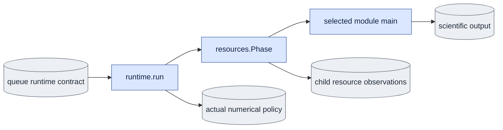

# `execution/runtime.py` — measure a queue-owned module in its own process

## Objective

Apply the queue's declared numerical policy and measure ordinary model work in
the actual child process. This owner does not start another process, choose a
GPU, claim a ledger row or supervise workers. The queue still starts the
selected public module directly. Each module calls `run(main)` at its entry.
Without the queue runtime binding, `run` calls that same `main` unchanged.

## Data flow

The queue supplies one immutable runtime contract outside the scientific output.
The environment pins its path and byte hash. The contract binds the attempt
token, job hash, effective resource budget, phase policy and numerical request.
The child checks those facts before calling the module's scientific operation.
It saves resource and numerical observations beside that contract on success
and failure. Model-free queue completion verifies these saved bytes separately
from the scientific owner checks.

## Organization logic

1. Refuse a partial or stale runtime environment binding. Require the queue
   token and job hash to match the immutable contract and effective budget.
2. If deterministic numerics were requested, apply the shared policy before
   model kernels. Record the request and actual observed flags separately.
3. For ordinary owners without their own resource phases, start one `runtime`
   phase on local CUDA device zero. The physical device is isolated by the queue.
   Reset and read the allocator in this child, never from `nvidia-smi`.
4. Call the public module's `main` exactly once. A zero return or normal
   `SystemExit(0)` is successful; a nonzero exit or exception remains failed.
5. Finish and preserve the local phase even when the scientific operation fails.
   A budget violation prevents successful publication. Existing checkers that
   own multiple phases use that inventory without an additional outer phase.
6. Publish a runtime result exclusively beside the contract. The parent checks
   the full contract, actual numerical policy, resource records and saved hash.
   This evidence does not replace the supervisor's worker-absence proof.

Worked check: a product job with an 1,800-second phase budget and a deterministic
request emits one begin/end pair, one child-local allocated/reserved measurement
and the applied numerical flags. Changing its requested job hash, budget bytes,
phase record or numerical flags causes completion refusal. A failed model call
still preserves a failed runtime result and cannot produce a complete receipt.

## Invariants

- The selected scientific operation runs once in the already owned process.
- Runtime contracts and results stay outside scientific output directories.
- An existing checker phase inventory is not replaced by an outer measurement.
- Environment setup and observed numerical flags have separate evidence.
- CPU tests do not claim CUDA allocator or native scientific acceptance.

## Gotchas

The one-phase ordinary measurement includes model loading and publication.
Benchmarked intervals remain those measured by the benchmark owner; this outer
resource observation does not alter or replace them. A CUDA allocator peak in
a nested checker belongs to that checker's existing phase records.

## Tests

Use controlled CPU operations and fake phase observations to verify exact one
call, outside-queue behavior, immutable contract bindings, success/failure
publication, numerical requests, changed results and owned-phase handling.
Actual CUDA resource evidence requires post-refactor native runs.
