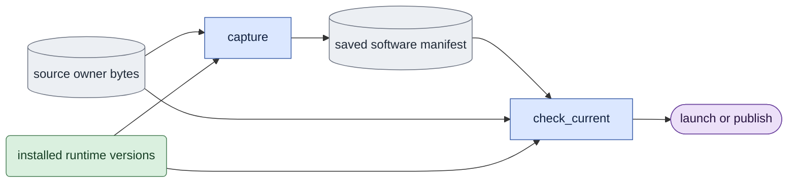

# `execution/software.py` — bind the actual producer computation

## Objective

Make and check one explicit manifest of source and runtime for training,
evaluation, inference, decoding and native input preparation. Hash the actual
worktree bytes, including uncommitted changes. A Git revision or the hash of an
entry file does not identify the computation.

## Data flow

The producer records its profile and its selected mode before launch. The
manifest contains:

- relative LTX-2 source paths and their SHA-256 digests;
- installed runtime versions, and the Python and Torch CUDA build versions;
- a canonical content digest.

Producers store the manifest in their records. They check it again before model
work and before publication. Completion verifiers require the same current
profile manifest.

## Organization logic

Every profile binds `execution/__init__.py`, the empty marker imported
before an execution owner. It joins `COMMON` with the root package marker.
Changing either marker invalidates a current manifest; integrity validation of a
saved record keeps its recorded owner list.

Import `LTX_ROOT` from the package marker for every source path. `COMMON`
includes that marker because its bytes define repository roots. A move into a
subpackage cannot change the source tree or child working directory.

An explicit experiment can add its own relative source owners through
`capture(..., extra_sources=(...))`. The sorted unique paths are saved only when
nonempty. They must remain inside the LTX-2 tree and name Python source files.
Current checks recalculate the same profile plus those saved owners. Ordinary
calls use no extras and do not bind experiment files. This extends the one
manifest calculation; it creates no second provenance format or registry.
The training profile includes the reusable optional Adam-state exporter,
applied-runtime recorder and synchronized process-resource measurement owner.
It also pins the canonical queue launch authority used by current training.
The optional actual-consumer trace and bounded supervisor are reusable support
owners. The same profile pins the current shared own-process ledger, whose direct
GPU inventory and targeted descendant tracking replace reservation files for
new launches. Old manifests retain their original owner lists and scope.

Each profile lists explicit owners:

- **All model profiles:** package data, config and checkpoints, capture
  preprocessing, common code, noise, sampling, adapter loading and the selected
  mode, plus the entry and runtime owner of the profile.
- **Model execution:** the shared pruning core and prompt-cache owners, trainer
  loading, the core transformer, attention, guidance, loader and model tools,
  and the pipeline utilities that supply stock schedules and guidance. Native
  conditioning and batch splitting are in the model source list. Without them,
  a change could alter matched sampling without invalidating a manifest.
- **Evaluation:** the reviewed native sampling pipeline calls. The stock
  comparison binds its own experiment entry through `extra_sources`. Ordinary
  profiles contain no acceptance checker.
- **Decoding:** also media, the saved decoder and sweep entry owners, native
  decode and the video-VAE source owners.
- **Preparation:** allows no model mode for the one-image producer. It pins its
  entry owner, the trainer's fixed-input reader and the native encoder and
  decoder source groups.

Declared directory groups expand in a fixed order to their current Python
files. A missing owner or group fails. Do not discover sources from imported
modules, and do not ignore absent files. This records the specified dependency
boundary, not every library source file on the system. Installed distributions
identify the third-party runtime versions, including optional attention
backends.

Before a record is used, the module validates the schema, the profile and
mode, safe relative source paths, the digest syntax, the runtime records and the
canonical manifest hash.

- `check_current` recalculates the same profile and compares all fields. An
  added, removed or changed owner, or a changed runtime version, fails.
- The read-only `validate` checks the integrity of a saved record without the
  current sources. It never restamps a saved result as current.

Keep saved outputs when the current verifier refuses them. No research override
skips the software checks.

## Invariants

- No model, decoder, GPU discovery, Git mutation or output repair occurs here.
- Relative paths identify the declared code owners; hashes bind worktree bytes.
- Launch and publication use the same saved manifest, not a new replacement.
- Saved-record integrity and current completion are separate checks.
- Dtype/application/conditions and weight/input hashes remain separate evidence.

## Gotchas

Version strings cannot identify editable local model code; source hashes cover
that code. Optional absent distributions are recorded as null. Source changes
during a job leave unaccepted partial outputs. This manifest alone proves neither
numerical parity nor quality. Decoder wrappers can depend on transformer/loader
code through native Session factories, so their declared group retains those
owners rather than assuming only video-VAE source matters.

## Tests

Check mode-owner selection, dirty source changes, added/removed dependency files,
runtime-version changes, malformed/hash-tampered records, and integrity reading
after a source change. Producer tests must show changed model helpers prevent
publication and completion while entry files remain unchanged. These are
software-identity checks; native E1–E5 still require their own evidence.

Worked check: capture an evaluation/causal manifest, then change only
`model/common.py` bytes while keeping `evaluate.py` unchanged. `validate`
succeeds for the intact saved record; `check_current` raises before
launch, publication or a current receipt. Similarly, changing a video-VAE owner
during video writing leaves partial media but no accepted rendering record.

The training source inventory includes `training/numerics.py` with the queue,
engine and runtime sources; typed training and replay capture all of them.

The empty `corpus/__init__.py` marker is part of `COMMON`, so every ordinary
profile binds the package that its corpus imports actually load.

## Experiment boundary

The ordinary decoding profile contains media, ordinary evaluation and saved
decoding owners. It contains no experiment or expr source. Sigma sweep uses
`extra_sources` to bind its own owners and marker. Evaluation likewise
contains no stock checker. The B5 coverage test blocks experiments, enters a
representative ordinary path in a fresh process and checks every loaded avatar
owner against the selected profile. Empty model/training package markers and
both eagerly imported mode owners are therefore bound even for a selected
causal evaluation; this records actual dependencies without changing mode
selection. A source omitted from that profile fails
coverage even when no import statement directly names it.

### Ordinary output-owner coverage

The five ordinary profiles bind all owners loaded by their CPU entry paths.
Tests block experiment imports in the parent and children, exercise training
frame planning and token preparation, evaluation measurements and fixed-tensor
validation, product input checks, saved comparison parsing and supplied-image
or preview preparation. Training, evaluation and product use both explicit
modes; preparation checks both preview modes plus independent RGB input.
Each child inventories real loaded module paths and requires every path in
the selected profile. Fixed-preview evaluation includes `previews.py`, the
explicit validator owner, in its source receipt. No profile includes studies.

Current common profiles bind queue runtime, device pool, phase notifications,
resource measurements and numerical policy owners. An unchanged scientific
module does not make results current when those executed shared owners change.
Original saved software manifests retain their original attribution.

## Extracted execution owners

The training profile includes jobs, journal, recovery, completion, attempt, clock and processes.
The queue retains public aliases but delegates to these sources. Pin their bytes as part of training provenance.
No ordinary profile gains an experiment source dependency. Current source checks remain strict.

Every ordinary profile also pins processes, because supervision imports its stable process reader.
