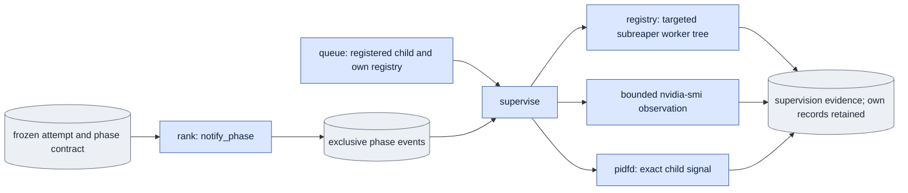

# `execution/supervision.py` — bounded observation of registered package children

## Objective

Observe an existing registered package child under explicit external
deadlines. Use the queue's process identity and the
[own process registry](process_registry.md). This module does not:

- start a model or choose a study;
- recover an old attempt or close an own record;
- use a process group instead of exact signal ownership.

## Data flow

The caller supplies its `Popen`, the registered PID, start ticks and command,
the original worker record, the owned process registry, the GPU IDs and the
evidence destination.

A separate fixed notification contract binds the attempt token, the job hash,
the rank count, the ordered phase names and the budget hash.
`prepare_notifications` writes this contract before launch. The environment
names that it returns bind the exact contract bytes. Each actual rank calls
`notify_phase` immediately before its phase work and after its measurement. The
helper writes exclusive, complete JSON events outside the scientific output
directory. It imports no model library.

The supervisor starts each phase timer when it receives that rank's begin event.
The completed Torch allocator measurements still come from `training/resources`.
Sampled total-device occupancy is explicitly a different quantity.

## Organization logic

A `KeyboardInterrupt` uses the same bounded shutdown as an ordinary failure.
This permits the queue owner's SIGINT and SIGTERM handlers to request cleanup.
The supervisor saves the interruption as failure evidence and proves worker absence.
The queue then saves the cancelled job and returns the signal exit code.

When the exact registered child becomes terminal between `Popen.poll()` and its
targeted observation, reap only that original Popen child within the existing
shutdown bound, then apply the usual exit-code, phase and descendant checks.
Linux may clear its command line briefly during exec as well as before reaping.
Only a pidfd terminal event permits waiting for the original Popen child. When
the exact PID/start ticks still match and its command is empty, reobserve on the
next ordinary poll while continuing all phase, overall, device and descendant
checks. This uncertainty is bounded by the existing shutdown limit. A restored
command must pass the original approved-transition check. A changed PID/start
identity never authorizes takeover.
Each targeted observation first retries empty command reads for at most 0.1
seconds, including the two reads around pidfd acquisition. Every retry checks
the same PID/start ticks; it grants no authority until a nonempty approved
command or a terminal state is observed. If the command restores between the
failed observation and its follow-up read, validate the restored command again.
Do not classify the normal terminal/reaping interval as lost ownership.

**Signal ownership.**

1. Validate all limits as finite positive values. Require exact agreement of
   the registry, the token, the job and the notification contract.
2. Before any signal, observe the queue's stable PID, start ticks and approved
   command change. Open a Linux pidfd. Observe again.
3. Signal through that descriptor only.

If a pidfd is not available, or an identity observation is denied, keep the
failure. Never guess a PID. The module uses Python's pidfd wrappers where they
exist. The old `ltx` Python and libc do not have them, so the module calls the
same Linux syscalls through `ctypes` on x86_64 and aarch64. Unsupported
architectures and a kernel refusal fail closed. This fallback does not use
`os.kill` and does not weaken the registered identity check.

**Deadlines.** While the leader runs, the supervisor refreshes the caller's
own process records, reads the ordered phase events and checks the deadlines.

- The first begin of a rank must arrive within the explicit startup limit.
- After every end, the next begin of that rank must arrive within the explicit
  notification-gap limit.
- Every active rank has its own phase deadline.
- An optional overall deadline is separate. No command deadline is inferred by
  multiplying the phase count.

A changed contract, unknown or duplicate events, a rank, phase or order mismatch
or a changed rank producer handle fails supervision.
The queue supplies the remaining time from its persisted first-attempt deadline,
not a fresh per-retry duration. Check overall expiry before inspecting successful
terminal completion and again after final owned-worker inventory. Time consumed
by notification reads, terminal reaping and worker observations counts too.
Equality with the absolute elapsed bound is expired; a zero exit cannot turn an
expired attempt into success. This module retains its relative-duration API and
does not own persistence, retry bookkeeping or a second launcher.

If an explicitly named `sampled_total_device_limit_bytes` is supplied, run
`nvidia-smi` with a finite timeout and record its per-device occupancy in bytes.
Do not compare it with `memory_limit_allocated_bytes`. Inventory timeout or
malformed/missing selected-device rows fails rather than reporting a free GPU.

**Shutdown.** On failure, the supervisor does these steps:

1. Collect the registry's exact own descendants and the earlier recorded
   handles.
2. Open a pidfd for each live handle, after the PID, start and command checks.
3. Send SIGTERM to all exact owned handles, including ranks in new sessions.
4. Poll for a finite total grace interval. Refresh the targeted tree during
   this interval, so newly adopted descendants also get the signal.
5. Send SIGKILL to the surviving exact handles. Poll for one more finite
   interval. Newly found owned descendants also get SIGKILL in that interval.
6. Observe only the targeted child tree of the original live subreaper owner,
   through the registry. This covers workers in new sessions and children of
   any owner or worker thread.

Never call an unbounded `wait` or `killpg`, and never signal a handle whose
ownership is not proved. A live worker, a denied targeted read, an inventory
deadline or an uncertain leader identity gives `workers_absent=false`. The
result keeps the own process records. Only the queue caller can close them,
after complete empty containment. No unrelated environment is scanned.

For a plain media command, the caller can omit `notifications_path` only with
an explicit overall deadline. Then phase/startup/gap limits and notification
hash are null in evidence; this route makes no per-phase resource claim.

Worked check: with startup=0.2 s, grace=0.1 s, poll=0.01 s, and a child that
ignores SIGTERM and emits no begin event, record startup deadline failure,
SIGTERM, then SIGKILL, and return after finite polling and inventory bounds.
Its separately started worker receives its own exact pidfd signal. If any worker
survives or cannot be identified, retain the process records as live/unknown.
Leader exit alone never changes that result into acceptance.

`queue_launch.read_completed_notifications` reads one frozen contract and its full rank/phase event
inventory without launching or observing a child. Bind the supplied original
contract hash, token and job hash. Require exactly one begin and end for every
declared phase on every rank, in the same ordering and producer identity rules
as live supervision. The launch recovery owner bounds the file count,
regular-file sizes and elapsed read time, then uses the unchanged `_contract` and
`_consume` rules on a private snapshot. These are internal compatibility
interfaces for this bounded recovery; ordinary execution does not call them
through a second supervisor. Return rank identities and content hashes only when the inventory is
complete and unchanged on a second read. This is saved workload evidence for
explicit dead-owner bookkeeping recovery; it cannot establish externally observed
timing, child exit code, continuous supervision or current worker absence.

Worked saved check: a contract with two ranks and phases `load` and `export:0`
requires eight event files. All eight must bind that contract and the same
distinct producer per rank. A missing final end or changed producer refuses the
saved check. Eight accepted events return their hashes and two exact identities,
without writing events or a new supervision result.

## Invariants

- No registry closure or queue journal mutation occurs here.
- Signal ownership requires the original PID/start ticks and approved command.
- A pidfd prevents a replacement PID from receiving a signal.
- Notification events bind the exact frozen token/job/rank/phase/budget contract.
- Completed phase measurements and external deadlines have distinct meanings.
- Unreadable handles and failed inventories never prove worker absence.
- Every device inventory, registry lock/tree observation and shutdown wait has a finite timeout.
- Evidence is published on success and failure before the caller interprets it.
- Saved notification completeness is separate from successful live supervision.

## Gotchas

The notification contract is not proof of native numerical correctness. The
supervisor's phase timer starts at receipt, so its poll interval is part of the
external detection latency. Local monotonic measurement remains the authority
for completed phase cost. Startup includes Accelerator setup before local load
measurement. A silent gap after a phase is bounded explicitly too.
Elastic ranks can leave the launcher's session. The registry's targeted tree and
rank records keep their exact handles in scope. Shutdown sends signals through
each handle's pidfd. Unknown survivors keep their records for later supported
owned recovery.
The original live subreaper owner is required for complete absence evidence.

## Tests

CPU controls exercise complete ordered notifications, changed contract and
attempt bindings, duplicate/mismatched events, missing startup and phase ends,
finite inventory timeouts, denied/missing/reused process handles, unavailable
pidfds, a real child that ignores SIGTERM, and a surviving new-session worker.
These checks establish bounded supervision and own-record retention. They establish
neither CUDA resource bounds nor native model/update agreement.
Fake-clock terminal controls verify that expiry before a zero exit or during
final worker inventory remains failure with retained shutdown/ownership evidence.
Saved notification controls cover complete and missing rank inventories, wrong
bindings, changed producer or event bytes, duplicate/extra files, bounded regular
reads and explicit absence of timing/supervision acceptance claims.

## Process observation ownership

Import stable process observations from `execution/processes.py`.
Read direct GPU inventory through `execution/devices.py`.
No infrastructure helper imports the queue scheduler. Preserve existing observation and cleanup gates.
