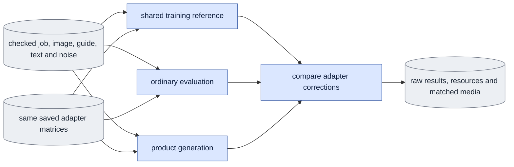

# `experiments/adapter_effect_check.py` — preserve the saved adapter correction

This module is the E2 checker. It tests whether evaluation and the product
compute the same adapter function that training optimized.

## Objective

Compare three paths with exactly the same saved adapter matrices,
supplied-image `c0`, guide, saved text and saved noise:

- the trainer's unmerged velocity function (the training reference);
- ordinary evaluation;
- product generation.

Check these adapter states:

- one-update protocol: base, zero and step-one adapters;
- pilot protocol: base, zero, step-20 and step-60 adapters.

bf16 fusion is a separate diagnostic. Its failure cannot fail the selected
path. Before the module uses a trained checkpoint as accepted calibration, the
original E4 update comparison must pass for the selected mode.

## Usage

Humans can use the foreground queue or run this module directly.
See [launch, output and stop commands](../usage.md). Agents use the queue.
The queue recipes below describe managed execution.

Start the check as a queue `experiment` job with selector
`adapter_effect_check`. Run it only after the selected native update comparison
(E4) passes. Declare the E4 reference job as a dependency. See
[run guide §9, E2](../../configs/README.md#e2--learned-adapter-function-adapter_effect_check)
and the [spec format](spec_protocol.md).

This is the agent path. A person can also run the same module directly, or start the queue in the foreground; see [usage](../usage.md).

One-update spec (all paths absolute):

```json
{"schema_version": 1, "protocol": "adapter_effect_check",
 "arguments": ["--job", "/abs/original_job.json", "--update-check", "/abs/passed_e4_result.json",
               "--inputs", "/abs/e2_inputs.json",
               "--checkpoints", "/abs/step_zero.safetensors", "/abs/step_one.safetensors",
               "--decode", "--fused-diagnostic"]}
```

For a pilot check, replace the job and checkpoint paths. Add `--update-job`
with the original E4 job, and `--subset` with the checked two-camera
membership. Give the pilot steps 0, 20 and 60 together.

Check the spec on CPU. This opens no model session and writes nothing:

```bash
cd LTX-2
CUDA_VISIBLE_DEVICES= "$PY" -m scripts.onestep_avatar.experiments.adapter_effect_check \
  --spec <SPEC.json> --output <FRESH_OUT> --dry-run
```

On the queue job, bind the original resource budget (for a pilot check, the
pilot's budget) and request `"numerical_policy": "deterministic"`.

| Scientific argument | Meaning |
|---|---|
| `--job` | Required. The training job: the one-update E4 job, or the 60-update pilot. |
| `--update-check` | Required. The passed E4 `result.json` for the mode. |
| `--inputs` | Required. The case inputs file (see [inputs file](#inputs-file)). |
| `--checkpoints` | Required. Steps 0 and 1, or pilot steps 0, 20 and 60. |
| `--update-job` | Pilot only: the original one-update E4 job. |
| `--subset` | A separately checked evaluation membership, for held-out views. |
| `--decode` | Also make matched comparison media. |
| `--fused-diagnostic` | Also run the separate fused bf16 arm. |

A failed numerical comparison exits with code 2 and keeps the completed
evidence. Outputs in `<FRESH_OUT>`: the raw arm records and arrays, resource
journals, `media/` with `--decode`, and `manifest.json`.

## Data flow



## Organization logic

### Checks before model work

1. Rebuild the selected job through `queue.prepare_job`.
2. Verify training completion through the shared engine.
3. Check the passed E4 result, the native budget, the original launch and the
   hash of every referenced input.
4. Check all selected checkpoint contracts and the exact zero B matrices.
5. Read the saved training context of the selected run. Never rebuild text in
   a new prompt session.
6. Require a fresh output path. Complete all input checks before a transformer
   loads or an output exists.

### One-update and pilot protocols

**Without `--update-job`** (one-update protocol): `--job` is the fresh D1
training job, and `--checkpoints` contains exactly steps 0 and 1.

**With `--update-job`** (pilot protocol): `--job` is the completed fresh
60-update pilot. `--update-job` is the original one-update E4 calibration job
for that mode.

- Select exactly pilot steps 0, 20 and 60 from the same run.
- Check the actual matrix lists. All contracts must match, except for their
  step.
- Refuse duplicate steps, foreign output paths, changed contracts or missing
  markers before model work.
- Verify the final step through `engine.verify_training_conditions`. Each
  selected marker must bind the exact pilot job, applied runtime, launch,
  config and frame-plan identities. Do not create a step-20 completion claim
  from the step-60 marker.

The original E4 result still verifies its exact original step 0 and step 1
files, budget, world size and input list. The pilot keeps a separate lineage
and uses its own saved text, resources and contracts.

**Two budgets.** The two training jobs ran under different resource budgets.
The queue binds this attempt to the pilot's budget.
`engine.verify_training_conditions` requires a verified job's budget to equal
the bound budget, which is true only for the pilot. So
`verify_calibration_conditions` checks the calibration job inside
`unbound_queue_budget`. This hides only the two bound-budget variables.
`resources.check_budget` still confirms the bytes of the calibration budget.
The engine still compares that budget with the calibration run's saved config
and resource journals. The pre-run checks and saved verification both use this
helper.

Worked check: with a bound pilot budget, `check_budget(calibration budget)`
fails. `verify_calibration_conditions` passes, and the pilot binding is the
same after the call.

The pilot must have the same mode, base identity, first image, loss, adapter
method and native numerical policy as the calibration. The pilot membership and
accumulation can differ, as E5 prescribes. Both jobs and the evidence of both
runs are pinned through the existing software and input list. A pilot cannot
skip the E4 gate or use the calibration of the other mode. Both paths use the
strict product condition checker.

**Frame-count restriction.** The causal E4 job uses continuous masters with
`span_latent_frames=null`. Its frame plan has clip-start seven-frame samples
and later-start six-frame samples, so its contract records
`frame_counts=[6,7]`. The pilot uses the prescribed `span_latent_frames=7`. Its
contract records `frame_counts=[7]` and only the clip-start ranges
`[[0,3],[3,5],[5,7]]`.

The module allows exactly this restriction between the E4 kernel check and the
pilot's calibration. All other items must be identical: channels and image
grid, B2/K3/D8, generated history, clip-start policy, noise, sigma, precision,
base, adapter and loss rules. The protocol records the shape, mode settings and
data selection of both contracts, and the restriction decision. This decision
does not change the strict product checker. A pilot request must match its own
span-7 contract. An original one-update request keeps that contract's null
span, with seven frames of physical input.

### Inputs file

`--inputs` is a JSON file with `schema_version: 1`, kind
`onestep_avatar.adapter_effect_inputs`, an exact direct schedule, a seed and a
nonempty `cases` list. Paths are relative to the JSON file. Example:

```json
{"schema_version": 1, "kind": "onestep_avatar.adapter_effect_inputs",
 "schedule": [0.725, 0], "seed": 42,
 "cases": [{"source": "Part_2/0007_01/views/view01_cam57", "guide": "guide.pt",
            "first_image": "image/image.pt", "image_preparation": "image/preparation.json",
            "noise": "noise.pt", "frames": 7}]}
```

- **`source`.** By default, each source must be in the checked membership of
  the selected run. `--subset` selects a separately checked evaluation
  membership through the same `dataset.ClipStore` reader, including held-out
  test views. Its file and membership hash are bound separately. The original
  E4 job, training membership, frame plan and checkpoint contract never
  change. The objective and the strict product conditions must be the same.
- **`guide`.** The guide bytes must equal the full continuous master of that
  source. Every selected capture, guide, render and sidecar passes the shared
  producer checks before model work and joins the exact input list.
- **`image_preparation`.** The actual `prepare_inputs supplied-image` result.
  The module verifies its output bundle and hash, the original source, matte
  and VAE inputs and the prepared pixels. The image bundle must come from
  exactly one supplied-image encode. A preview `c0` from a sliced capture video
  cannot replace it.
- **`noise`.** Finite native bf16, with the exact selected token shape.
- **`frames`.** Selects the continuous prefix `[0,frames)`. The full guide hash
  and the actual coverage are recorded separately.

### The three paths

- **Product.** The pre-run check uses the shared `infer.prepare_product` helper
  with the original typed mode settings and the recorded prefix length. Every
  adapter uses the strict product condition checker. Product generation calls
  `infer.generate` with the same saved noise.
- **Evaluation.** It uses `evaluate.sample_case`. Its capture-reference tokens
  receive the independent supplied `c0` through the shared clean-prefix helper.
  This does not change the generated-history input or create a product capture
  target.
- **Training reference.** It loads the bf16 backbone, uses the shared
  `adapters.attach` and `load_weights`, and calls the same selected mode
  sampler with `common.denoised_from_velocity_model`.

The ordinary paths use the shared `inference_transformer` and its one native x0
conversion. Each arm opens and releases its own model, so loader differences
are visible.

Every reference, evaluation and product adapter arm checks again the exact
pinned file, the checked metadata and the tensor slices before a backbone
loads. The reference checks come before `load_transformer`. The same bound
identity goes to the shared inference loader.

### Correction comparison

For each path and each trained step, compute the correction `trained - base` in
float64. Compare step 20 only with reference step 20, and step 60 only with
reference step 60.

- **Relative rule.** Divide the RMS of the correction difference by the RMS of
  the reference correction. The result must be strictly less than 0.05.
- **Near-zero rule.** When the reference correction RMS is less than `1e-8`,
  the absolute difference RMS must be at most `1e-8`. The relative ratio is
  reported as null.
- A near-zero reference does not show a learned effect. Such a comparison can
  match numerically while learned-effect acceptance stays open.
- Also report the raw output difference, the correction norms and RMS and the
  maximum absolute differences.
- The zero output must be bit-identical to the base output of its own path.
- Fused metrics use the same reporting rule as a separate diagnostic. Fusion
  never gets a looser tolerance.

Worked check: the reference base is `[100,100]`. Step 20 adds
`[0.001,0.001]`. Step 60 adds `[0.01,0.01]`.

- Matching ordinary paths pass both steps.
- If their step-20 and step-60 outputs are swapped, the check fails, although
  each raw output stays close to 100.
- If every step-20 output equals its own base, that step reports
  `function_matches=true`, `learned_effect_demonstrated=false` and
  `passed=false`. Step 60 can still pass separately. It cannot prove step-20
  acceptance.

One-update records keep their original `paths` summary. Pilot records give one
summary for each trained state under `steps`. Overall acceptance requires both
step comparisons. A matched near-zero one-update control can satisfy the pilot
launch prerequisite. It does not become full E2 acceptance.

### Resources and policy

The module measures synchronized load and sample phases, and optional
decoding, for each process. It uses the original allocated-byte and wall-time
budget. It saves the actual forward counts, parameter storage and dtypes, CUDA
identity, kernel controls, input tensor identities, complete source and runtime
manifests and every raw output. It keeps failures and resource journals.

- Before each arm, check again the current source and runtime owners, the
  budget and the exact selected checkpoint bytes. Check the checkpoint bytes
  again after that arm.
- Hash the full base, producer and input lists before model work and at final
  publication. Do not repeat the 42 GB base read at each small sampling
  boundary.
- Apply the original native run's declared numerical-kernel policy before any
  model loads. Record the actual applied policy for every path. The reference
  must not inherit an unstable default or a new policy.

### Media

Decoding happens after the transformers are released. The matched media show
the capture VAE, the guide VAE, the training reference, evaluation and the
product, with synchronized source frames. Base and zero results stay saved
numerical controls.

For pilot decoding, the module opens the decoder once for each case. It decodes
the capture and the guide once, and each trained output once. It builds
separate five-panel comparisons for steps 20 and 60, with the same panel order
and frame map. Each generated panel title names its step.

- Full and compact media go under `media/step20/` and `media/step60/`.
- The original one-update paths stay under `media/`.
- Fused media stay separate and also name their step.

The shared media owner selects readable layouts and keeps aspect ratios and
equal heights.

### Saved verification and completion

`verify_saved(SAVED_OUTPUT)` checks the original saved evidence.
`verify_completion(spec, root)` also binds the exact requested protocol. Both
read these items:

- the actual arm records and the agreement of consumed inputs, calls and
  policies;
- the checkpoint contracts and the native output arrays;
- the recomputed correction comparisons and the resource journals.

They start no model or decoder, write nothing and do not restamp acceptance.
Changed or missing arrays, redirected paths, stale summaries and unsupported
completeness claims fail.

For the queue, `verify_completion` reuses `verify_saved` after it binds the
requested job, the selected checkpoints, the case inputs, the decode choice and
the fused-arm list to the pinned spec. The queue manifest is excluded from the
older producer's file list. Resource phase names stay in case, path and state
order: load, sample, then the optional decode. The queue does not replace these
measurements with one timer.

`dependency_outputs(spec)` names the saved result directories that need earlier
queue receipts. The E2 update comparison must be an explicit dependency. A
missing dependency fails CPU queue preparation, before claims or launch.

The public `EXTRA_SOURCES` tuple binds the checker, its spec helper and the
empty `experiments/__init__.py` marker as explicit experiment extras. Ordinary
profiles do not include the experiment marker. The queue can call
`evidence_paths(..., verified=True)` only after it ran this verifier in the
same receipt check. Direct callers keep the default `verified=False`.

### Scope

The result states its scope: a correction comparison through the shared API.

- A first view is partial coverage. Full E2 needs at least two views and pilot
  steps 20 and 60, after the original step 0 and step 1 controls.
- Native coverage counts unique recorded camera labels separately from source
  clips. Two clips from `view01_cam57` give two sources but one camera view.
- The checked pilot membership's `Part_1/0097_04/views/view00_cam51` and
  `view01_cam52` can give two matched test views through `--subset`, without a
  change to the E4 calibration.
- External supervision must prove a bounded exit and the absence of owned
  workers. This module starts no jobs and does not close the product CLI or
  preview gate.

## Invariants

Close each model context before the next arm starts. Drop the caller
references, collect Python cycles, then release unused CUDA allocations. Model
modules can form reference cycles. `empty_cache()` alone cannot free live
parameter tensors. Keep only saved CPU outputs between arms. The loading and
sampling measurements keep their declared boundaries. The final warmed latency
is a separate benchmark.

The training context record binds the raw contiguous bf16 bytes, the shape and
the dtype separately. Verify its `tensor_sha256` with that producer's raw-byte
rule. `hashing.tensor_sha256` also hashes the shape and dtype, so it cannot
verify this field. Do not rewrite the original context record or rebuild text
to match a different digest rule.

- Each case has one saved image `c0`, guide prefix, text, noise and scientific
  contract.
- The zero and trained matrix lists are complete. The E4 calibration evidence
  does not change.
- Only the shared mode algorithms, adapter loader and velocity/x0 conversions
  are used.
- The original resource budget and the fixed under-5% and near-zero rules are
  set before execution.
- A failed fused diagnostic stays separate from ordinary unmerged acceptance.
- Outputs are never overwritten, old receipts are never restamped and a dry run
  does no model work.

## Gotchas

- The current supplied-image producer is independent of video encoding.
  Preview preparation stores guide-prefix token hashes but keeps the path of the
  full guide master. It does not publish a separate short product guide bundle.
- For a causal contract with a null training span and a frame count of seven,
  product CLI `--span-latent-frames 7` selects the physical guide coverage. It
  does not change the training setting. A recorded explicit training span stays
  compatible only when it equals the selected complete frames. The API
  comparison records the explicit prefix with unchanged settings. CPU tests
  cover both contracts and refuse mismatched conditions.
- Ordinary causal evaluation uses its separate `--output-latent-frames` flag.
  The preparation producer keeps the training setting. CLI and preview
  acceptance is separate from this API comparison.
- A matching raw output can hide the loss of a small correction. Compare each
  correction with the base of its own method.
- Full resident parameter counts are not allocator peaks. CPU tests cannot give
  native allocated-memory or quality evidence.

## Tests

Tiny real LTX models and PEFT matrices in both modes, with an independent
supplied `c0` and a fixed guide, text and noise, check that the training
velocity, evaluation x0 and product generation agree with nonzero and zero
saved matrices.

Controlled comparisons must refuse:

- a result at the 5% boundary;
- a large effect error hidden by a small raw error;
- changed zero controls;
- malformed or nonfinite arrays.

Near-zero metrics must never create a ratio. Other tests check:

- the independent preparation and the E4 failure gates, before model work;
- the calibration check without the pilot's queue binding (the binding is
  restored afterwards, also after a failure);
- input and source changes, and the fresh-output refusal;
- saved-reader controls with real serialized tensors and process journals:
  changed, missing or redirected outputs, changed numerical summaries, input
  identities, call records, resource summaries and false completeness claims;
- both real saved trained-array lists of the pilot. These isolate the native
  producer gate. They do not claim a full-weight pilot;
- actual checkpoint contracts, matrices, markers and snapshot bytes, including
  a foreign step-20 run and changed launch, runtime or config bindings;
- both trained steps, independently, through all three shared API paths on
  small real LTX/PEFT models;
- applied policy controls that refuse schema-one runtime records, missing
  policies and rank disagreement.

Native two-view correction, resources, decoded inspection and supervision are
E2 checks.
