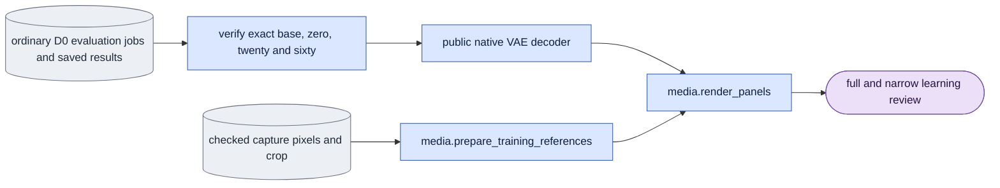

# `experiments/capacity_review.py` — saved D0 learning review

## Objective

Review a separately D0-trained adapter at updates 0, 20 and 60 against its
base. D0 uses the capture as the noising source. So it is a capacity test that
the capture makes possible, and product generation cannot use it. This review
never uses a same-adapter D0/D1 oracle in place of D0 training.

## Usage

Humans can use the foreground queue or run this module directly.
See [launch, output and stop commands](../usage.md). Agents use the queue.
The queue recipes below describe managed execution.

This module has no selector of its own. Run it as a queue `experiment` job
with selector `conditioning_check` and operation `capacity_review`. See
[run guide §9, E5](../../configs/README.md#e5--bounded-learning-pilots).

1. Queue four one-state ordinary D0 [evaluation](../evaluate.md#usage) jobs for
   each case, in this order: base, update 0, update 20, update 60. Use the
   fixed seven-frame direct `[0.725, 0]` setup. The four jobs differ only in
   `--checkpoint` (none for the base) and `--output`.
2. Write those evaluation jobs in a list file (`d0_evaluation_jobs.json`).
3. Queue the review. Declare all the evaluation jobs as dependencies:

```json
{"schema_version": 1, "protocol": "conditioning_check", "operation": "capacity_review",
 "arguments": ["--mode", "causal", "--evaluation-list", "/abs/d0_evaluation_jobs.json"]}
```

| Scientific argument | Meaning |
|---|---|
| `--mode {bidirectional,causal}` | The mode of the evaluations. |
| `--evaluation-list` | The list of ordinary evaluation jobs, four for each case. |

The operation loads only the decoder. It makes matched RGB and VAE reviews from
saved outputs. It never fills missing evaluations. Outputs: one
base-versus-update-20 review and one base-versus-update-60 review for each
case, in full and narrow layouts.

## Data flow



## Organization logic

### Job list

The spec names a frozen list of ordinary evaluation jobs and one mode. The
list contains data only. This module loads no transformer, text encoder or
adapter and does not generate missing results.

The list holds four one-state jobs for each case. Each model state runs in its
own process, because one evaluation process cannot hold four 22B model states
on a 48 GB GPU
([known gap](../known_gaps.md#several-model-states-in-one-evaluation-process)).
The review reads the list four jobs at a time. Within a case:

- the arguments of the four jobs must be equal after `--checkpoint` and
  `--output` are removed;
- the base job has no checkpoint and no `--include-base`;
- each other job selects exactly one adapter.

### Checks before decoding

1. Normalize the ordinary jobs. Verify the one
   `case_0000/variant_000/result.json` of each job through the public
   evaluation verifier.
2. Require D0, `white`, dev LTX-2.5, direct `[0.725, 0]`, seven encoded frames,
   one source, the base first and then same-lineage checkpoints 0, 20 and 60.
3. Inspect the actual contracts, output tensors and consumed input hashes. The
   four records must share one producer software identity.
4. The zero output must equal the base bit for bit.
5. Check the exact native call counts: one denoise and one forward for
   bidirectional, or three denoises, three refreshes and six forwards for
   causal, with no priming.
6. Recompute each saved metric.

Within a case, only the adapter changes. The capture, clean first image,
noise, text, geometry, history and schedule stay fixed.

### Software profile

The review software profile pins this owner, the conditioning selector, the
reference adapter, the spec protocol and the checkpoint-selection helper of the
adapter-effect owner. A change to that helper invalidates the capacity review
profile. It does not change ordinary training or the other control profiles.

### Rendering

1. Prepare the matched capture RGB and VAE reconstruction with the public media
   owner, in the recorded `white` objective and crop. Keep the reference
   provenance and the full RGB pixel tensors.
2. Decode base, zero, twenty and sixty with equal fresh seeded generators.
3. Save one base-versus-twenty review and one base-versus-sixty review. Each has
   capture RGB, capture VAE, zero output, base output and changed output.

- The full layout has three columns.
- The narrow layout has two columns and an explicit unused slot. The base and
  changed outputs are next to each other.
- Display heights are equal, with aspect-preserving padding.
- All panels cover recorded RGB frames 0 through 48 at the original fps.

The [reference input owner](reference_inputs.md) derives a copied source row
from the saved capture manifest and the original capture and guide encode
records before public RGB replay. It keeps the original membership bytes and
content identity, and records the derivation with the saved reference
provenance.

### Completion

Completion repeats the ordinary scientific verification and reads saved pixels
only. It checks the source, reference, VAE and decoder identities, the panel
tensors, labels, positions and padding, synchronized coverage, the actual video
dimensions, fps and frame count, and rebuilt posters. The original capture and
guide videos stay in the corpus. Publication uses the conditioning selector's
byte-pinned manifest. The queue's generic runtime limits the complete decoder
job. The decoder cost keeps the cumulative allocated and reserved peaks
without a reset of the queue's peak.

Worked check: the D0 base and zero outputs both equal 2. Twenty equals 3 and
sixty equals 4, with identical input hashes. Zero is a no-op, and the trained
correction is measurable. This proves an effect. It does not prove correct
identity or action. Inspect the matched videos separately.

Worked list check: eight jobs make two cases, read as jobs 1–4 and 5–8.

- A seven-job list fails before any file read.
- If the update-20 job of the first case names a different `--source` or
  `--noise-file`, the case fails with "changes more than the selected adapter".
- If jobs 3 and 4 are swapped, the selected adapters read 0, 60, 20, and the
  case fails on checkpoint order.

## Invariants

- No missing evaluation is rebuilt and no model training runs here.
- One case is four one-state jobs with equal fixed arguments. Their records
  share one producer software identity.
- D0-trained contracts must actually record D0. A research override cannot turn
  a D1-trained adapter into learning-capacity evidence.
- The exact checkpoint list, source pins and consumed inputs are checked.
- Native source attribution is kept. The review software has its own identity.
- Numerical sensitivity and reduced MSE alone never pass visual quality.

## Gotchas

- A seven-frame pilot makes 49 RGB frames. Do not claim more coverage in a
  caption.
- Unused guide pixels can stay in the prepared reference bundle, but the D0
  comparison omits them.
- A missing update-20 or update-60 checkpoint is incomplete coverage. It is not
  permission to use a shorter update.

## Tests

Focused tests check:

- source selection and the exact four-state list;
- grouping of one-state jobs in list order;
- refusal of a four-state job, a base that is not first, a changed source or
  noise file, mixed producer software and an incomplete case;
- fixed input comparisons, the zero no-op, native counts and recomputed
  metrics;
- adjacent base and changed output positions and explicit empty narrow slots
  in saved rendering;
- refusal of a changed checkpoint-selection helper, while the unrelated
  training, conditioning and reference profiles stay equal.

Native results, the visual identity and action review and the cost stay
separate acceptance evidence.
