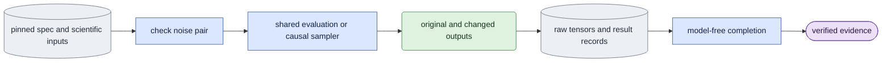

# `experiments/causality.py` — saved-noise interventions and eight-block control

This module is one of the E3 checkers. It tests that earlier causal output does
not depend on later noise.

## Objective

Own where noise changes and how the two outputs are compared. The other parts
have their own owners:

- Ordinary evaluation owns the checked preparation, native sessions, adapter
  loading and publication.
- `model/causal.py` owns sampling and caches.

This owner adds no sampler, decoder or launcher. Model work uses the queue's
`experiment` kind with selector `causality`. The module has no other CLI form.
Ordinary evaluation accepts no study flags.

The module entry calls the shared queue runtime helper. Outside a queue, the
helper calls the public operation unchanged. In a queued child, it measures one
local resource phase and records any declared numerical policy. The queue owns
the launch, the supervision and the proof that no worker remains. See
[runtime](../execution/runtime.md).

## Usage

Humans can use the foreground queue or run this module directly.
See [launch, output and stop commands](../usage.md). Agents use the queue.
The queue recipes below describe managed execution.

Start the check as a queue `experiment` job with selector `causality`. The
queue supplies the device. See
[run guide §9, E3](../../configs/README.md#e3--causal-continuation-continuation_check-continuation_identity_check-causality).

This is the agent path. A person can also run the same module directly, or start the queue in the foreground; see [usage](../usage.md).

The module has two protocols.

**`future_noise`.** The arguments are causal
[evaluation arguments](../evaluate.md#usage) plus three intervention options.
All scientific paths are absolute:

```json
{"schema_version": 1, "protocol": "future_noise",
 "arguments": ["--mode", "causal", "--subset", "/abs/membership.json", "--source", "<VIEW_ID>",
               "--variant", "dev", "--guide-mode", "d1", "--schedule", "0.725", "0",
               "--block-latent-frames", "2", "--blocks-per-sample", "3", "--context-latent-frames", "8",
               "--noise-file", "/abs/noise.pt", "--changed-noise-file", "/abs/noise_changed.pt",
               "--future-noise-start", "3"]}
```

| Option | Meaning |
|---|---|
| `--noise-file` | The original saved noise. Required. |
| `--changed-noise-file` | The changed saved noise. Earlier bytes equal the original. |
| `--future-noise-start N` | The first changed encoded frame. It must lie on a block boundary. |

**`eight_block`.** The spec has fixed fields, not an argument list:

```json
{"schema_version": 1, "protocol": "eight_block",
 "checkpoint": "/abs/adapter.safetensors", "view": "/abs/corpus/Part_1/0008_01/views/view00_cam51",
 "sigma": 0.725}
```

The adapter's recorded conditions must match eight causal blocks over 17
encoded frames. A shorter trained span needs its own protocol, not an override.

Both protocols use the queue arguments `--spec` and `--output`. Check a spec on
CPU with `--dry-run` first.

## Data flow



**Spec rules.** A `future_noise` spec has exactly `schema_version: 1`,
`protocol` and a string-list `arguments`. The arguments hold scientific
settings. Output, device, dry-run, spec and help overrides are refused. An
`eight_block` spec has exactly `schema_version`, `protocol`, `checkpoint`,
`view` and `sigma`. The spec SHA and an evaluation software profile with
`EXTRA_SOURCES` bind the producer.

**Future-noise inputs.** The inputs use the evaluator's checked mode, source,
adapters, conditioning, exact schedule, text and original saved noise. The
intervention adds the changed saved noise and its first changed encoded frame.
Noise has the shape `[1,F*H*W,C]`, in shared patchifier order. Published
encodings have the shape `[1,C,F,H,W]`. Saved noise is read, never rebuilt.

**Eight-block inputs.**

- Full `white` capture and guide masters `[C,F,H,W]` with equal geometry and
  fps, and `F >= 17`.
- LTX-2.5 dev, a checked D1 adapter, generated history, B2/D8/sink1 geometry
  and direct `[sigma,0]`.
- The full masters set the global seed-42 and seed-99 noise arrays. Execution
  covers only the first eight complete blocks.
- Each rollout starts with an empty cache. It uses the clean capture `c0`,
  refreshed generated history and fixed text.

## Organization logic

### Future-noise protocol

1. `parse_future_args` reads the two intervention options and passes the rest
   to the public evaluation parser. Either both options are present or
   neither. An intervention requires saved original noise and a positive
   boundary.
2. `prepare_evaluation` calls the shared checks before a session opens. The
   changed noise must be finite native bf16, match the complete selected token
   shape, keep all earlier bytes and differ later. Causal boundaries must
   separate completed blocks and leave a later complete block.
3. `probe_future_noise` repeats the pair checks at the sampling boundary. Then
   it calls the public `evaluate.sample_case` twice with identical settings. It
   returns both outputs and records, the exact earlier equality and the fp32
   maximum absolute differences before and after the boundary.
4. `execute_evaluation` gives explicit `sample_runner`, `result_publisher` and
   `extra_sources` hooks to the one shared evaluator. The runner keeps both
   outputs and returns the first ordinary pair. Publication saves the changed
   noise, calls the public `save_case` for `original/` and `changed/`, and then
   writes `future_noise.json`. Each branch keeps its own noise digest and the
   shared provenance.
5. Saved verification gives `branch_provider`, `records_validator` and
   `extra_sources` to the public `evaluate.verify_evaluation_conditions`. The
   ordinary checks cover every expected case, variant and result. The branch
   hook checks the saved changed noise. The validator recomputes all five pair
   fields from the saved outputs. Neither hook opens weights or repairs
   results.

The evidence includes the text, the optional negative text, every raw encoding
and result, the original and changed noise and the pair diagnostics. The case
and variant coverage comes from the checked shared preparation, not from the
list that the manifest claims.

### Eight-block protocol

The shared planner covers `[0,3)`, `[3,5)`, ..., `[15,17)`. Block three ends at
encoded frame nine. The mixed noise takes seed 42 before token `9*H*W` and seed
99 after it. Drawing full arrays keeps the original map for masters longer than
17 frames. Each finite output records eight denoise calls, eight refresh calls
and sixteen model calls in total.

Observers copy the actual native inputs and outputs. They replace no model
call. Queue execution publishes `result.json`, `raw_outputs.pt` and
`raw_inputs.pt`. The raw inputs contain exactly `capture`, `guide`, `text`,
`original_noise` and `mixed_noise`: CPU copies of the full native tensors of
the forward. Completion does not draw noise again on CPU, because the CPU
generator map can differ from CUDA.

`_verify_eight_block_inputs` reloads the full masters. It uses the native
patchifier and content hashes to check the exact saved bf16 capture and guide
bytes. It requires:

- finite nonempty tensors with matching shapes;
- `[1,text_tokens,context_channels]` text;
- unchanged earlier noise bytes and changed later noise;
- capture, guide and text digests, and both noise digests of the record, that
  match these saved tensors.

`_verify_eight_block_outputs` then requires:

- two finite fp32 `[1,C,17,H,W]` outputs and a clean `c0`;
- exact fixed settings and control fields;
- true earlier equality and a positive later difference;
- four input-file hashes and full call counts.

Saved master tokens must match the canonical master tensor hashes, including
signed-zero bytes. Saved rollout outputs must keep the producer's float32
dtype. Rehashed files still face these schema and conditioning gates.

**Adapter.** The eight-block protocol requires a typed causal DEV/D1/`white`
adapter at the exact direct schedule, with a clean `c0`, full-frame loss,
cache/refresh and the shared unmerged fp32 application. The module reads and
validates the contract and the tensor list before any native model session. It
binds and checks the file bytes again. Then it uses
`model.adapters.inference_transformer`. It keeps eight blocks, the shared first
four noise blocks, the changed last four, the global noise map and 16 model
calls per branch. The public kernel helpers stay usable by the short and
continuation owners.

### Completion

`verify_completion` first runs the selected saved scientific checks. Then it
compares the whole manifest with the rebuilt schema, kind, protocol, spec SHA,
software and file list, and checks the current software. `evidence_paths`
returns the manifest and every file to the generic queue receipt. The queue can
call `evidence_paths(..., verified=True)` only after it ran this verifier in the
same receipt check. Direct callers keep the default `verified=False`.

Missing files, changed inputs, extra manifest fields or rehashed false summary
fields fail.

Worked checks: a 17-frame B2 input with four tokens per frame and boundary
nine.

- The first 36 noise tokens are fixed.
- Valid cached outputs are exactly equal on `[0,9)` and differ on `[9,17)`.
- A zero later difference is an insensitive control and fails completion.
- An earlier signed-zero noise change keeps numerical equality but changes the
  hash, so it fails before sampling.
- A rehashed false earlier-equality summary still fails against the raw
  outputs.
- Without `raw_inputs.pt`, the queue result cannot complete.

## Invariants

- The public evaluation wrapper forwards an explicitly supplied fixed-input
  tensor validator to the ordinary evaluator, in both the single and the paired
  paths. The continuation checker supplies the canonical preview validator.
  Omitted validation for fixed inputs fails before the model loads. This hook
  changes only input verification. The future-noise sampler stays the owner.
- Keep the scientific settings, protocol tolerances and saved attribution.
  Never restamp a saved producer manifest.
- Ordinary evaluation imports no experiment. Explicit hooks carry behavior and
  source identity in one direction.
- Adapter conditions and fresh destinations come before the weights. The file
  identity is checked again before atomic publication.
- Public causal sampling owns cache, noise and model operations. This
  experiment owns the intervention list and the comparison.

## Gotchas

- Earlier-output invariance is a property of causal sampling. Whole-segment
  attention can depend on later noise.
- Latent differences do not measure perceptual similarity.
- Saved completion proves tensor consistency and control sensitivity.
  Full-weight E3, learning and long-video acceptance stay separate.

## Tests

- `tests/experiments/test_future_noise.py` checks native small-transformer
  invariance, invalid pairs before sampling, the saved-input checks, branch
  provenance and lists, recomputed pair fields and signed-zero byte identity.
- `test_causality_diagnostic.py` compares the original grid and noise
  trajectories and call counts on a real small transformer, including longer
  masters. It also checks refusal before sampling, and publication.
- `test_extracted_queue_protocols.py` checks normalized and pinned specs,
  receipts without a model, missing or rehashed outputs, raw input, text and
  noise digests and dtype, shape and intervention controls. This includes
  signed-zero byte mismatches in a master and wrong output precision.
