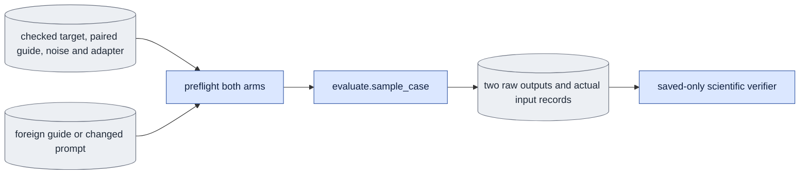

# `experiments/conditioning_check.py` — matched conditioning controls

## Objective

Run one fixed comparison through `evaluate.sample_case`: replace the checked
guide with a separately checked foreign guide, replace text, or compare D0 and
D1 at sigma one. The separate `capture_oracle` control compares D0 and D1 at
the pilot's sigma 0.725 with the same model and adapter. It measures access to
the supplied capture, which product generation cannot have. These controls do
not measure D0 learning capacity; that requires separate D0 training.

## Data flow

## Organization logic

The scientific specification names one control and one target source. Ordinary
evaluation preflight checks the target, base, exact seven-frame shape, noise and
adapter. The guide control loads its donor from the same content-pinned
membership. Target and donor must differ and have equal selected shape, timebase
and VAE identity. Their individual crop and producer records stay distinct.
No tensor is resized, relabeled as the target guide or written into the corpus.

Both arms keep capture, clean first-image input, complete saved noise, model,
adapter, schedule and history fixed. The guide control changes guide tensor
values and their explicit donor identity. The text control changes the actual
saved text tensor and prompt. Sigma-one changes only the D0/D1 source selection;
both branches preflight their actual adapter conditions under an explicit
research override. The selected adapter is never changed to pass this control.
`capture_oracle` also records the explicit D0 research override and keeps the
adapter fixed.

The explicit `prepare_references` operation dispatches the independent
[original membership reference owner](reference_inputs.md). It accepts
`--subset`, `--source`, `--encoded-frames`, `--seed`, optional `--guide-mode`
and `--model`. The existing queue selector owns GPU claims and supervision.
There are no model-output dependencies. It validates the saved crop manifest
and original encoding records before copying their exact crop into the public
RGB reader's in-memory source row. Original membership bytes and recorded
producer identity remain unchanged. The same checked source-row adapter is used
by conditioning and capacity reviews; a missing duplicate crop field is never
a reason to recompute a crop or relabel inputs.

The independent `past_influence` operation dispatches
[changed-past-frame checks](past_influence_check.md). It owns its own scientific
arguments, dependencies, source extras, native execution and saved verification.
Lazy operation routing keeps that owner outside the unrelated conditioning,
reference and capacity software profiles.

The explicit `capacity_review` operation reads a frozen list of completed
ordinary D0 evaluation jobs. It dispatches the independent saved-only
[capacity review owner](capacity_review.md). Its spec arguments are `--mode`
and `--evaluation-list`; every evaluation output is an in-list queue dependency.
The operation requires separately D0-trained updates 0, 20 and 60. It loads no
transformer and cannot regenerate a missing output. The ordinary `run`
operation keeps the two-arm conditioning comparison defined above.

The shared native session and unmerged adapter loader open once. Each arm calls
the ordinary sampler with a new cache. Save text, noise, raw outputs, actual
scientific settings, file hashes and software identity. The module does not
launch children or claim GPUs. With `--decode`, it uses the public media owner
and native VAE to prepare matched capture RGB, VAE-decoded capture and paired
guide RGB. It decodes both outputs with fresh equal-seed generators. A guide
review adds the donor's guide RGB in that donor's recorded crop. This is a
deliberately changed condition, not a target-coordinate overlay. The generic
queue phase bounds sampling, decoding and review together at 1,800 seconds and
48,000,000,000 allocated bytes unless the job declares its own bound.

The full review puts three equally high, padded panels in each row. The narrow
review uses the public readable-layout selector at 480 pixels. Keep the matched
and changed outputs beside each other. For a guide control, place the paired
and donor guide together above those outputs in the narrow review. For other
controls, use the shared compact-training layout, with the unused guide slot
explicitly labeled. Capture RGB,
capture VAE and paired guide appear first. Matched and changed VAE outputs
follow, with a donor guide last for the guide intervention. Titles state each
role; value lines state RGB versus VAE decoding and the donor's person. All
moving panels map to source frames 0 through 48 and recorded FPS. Save full
panel pixel tensors, reference provenance, MP4s and poster PNGs. Original
capture and guide videos remain in the corpus with their content pins. Save
exact prompts, noise, crops, objective, VAE bytes, decoder settings and runtime
cost. Cost reports the cumulative CUDA peak through decoding without resetting
the queue's peak. These records support a separate visual identity/action
judgment; sensitivity alone is never quality acceptance.

Saved completion repeats input and adapter preflight on CPU, checks source
software, exact arm inventory, text and noise identity, output shape, unchanged
first image and actual call counts. It recomputes all numerical summaries from
saved tensors, including each arm's encoded metrics against the unchanged
capture. Records use ordinary sampler schema two. The exact native call
inventory is `model_calls=1, denoise_calls=1, prime_calls=0, refresh_calls=0`
for bidirectional mode, and `model_calls=6, denoise_calls=3, prime_calls=0,
refresh_calls=3` for causal mode. Generation refreshes the final causal block;
training's skipped final refresh does not change this count. Missing, extra or
non-integer call fields fail completion. Sigma-one must be bit-identical. A changed guide or text that
leaves output unchanged is recorded as insensitive; it is not a failed
integrity check and is never labeled quality success. Completion loads no native
model, encoder, decoder, prompt-cache producer or GPU handle.
For a decoded review, completion loads saved RGB panels and replays recorded
capture/guide preprocessing on CPU to check exact pixels. It checks
VAE/crop/objective/source identities and decoder keys, synchronized coverage,
panel roles and titles, full and narrow placement, readable labels,
aspect-preserving padding, actual MP4 dimensions, frame count and FPS, and
poster pixels rebuilt from saved panels. Missing media or a changed review
record fails completion.

Recheck original raw/preprocessed input pins, selected checkpoint bytes and the
software profile after sampling and before publication. The software profile
includes the experiment marker and specification owner. `evidence_paths` accepts
`verified=True` only when its caller has already run scientific completion; it
still inspects the byte inventory and specification. This avoids a second
scientific verification inside one queue receipt check.

Worked control: paired guide values `[1,2]` and donor guide `[9,8]` share the
target first-image input `10` and noise. Both output first frames must be `10`.
Their guide hashes must differ, while their capture, noise and text hashes
agree. In a sigma-one control the two outputs must agree exactly, even when
capture and guide differ. Different adapters cannot prove that equality.

## Invariants

- Preserve original target and paired-guide provenance beside donor provenance.
- Reject empty/no-op controls, altered shape, timebase, noise or first image.
- Use unmerged fp32 adapters against the frozen bf16 base.
- Record research overrides; never reinterpret a D1 pilot as D0 training.
- Byte inventory and scientific checks are both required for completion.

## Gotchas

Foreign guide crops are deliberately mismatched conditions. Their geometric
records explain the intervention; a video must label the donor. Latent output
change measures sensitivity, not correct identity or motion. Judge those from
matched capture RGB and decoded videos. Wrong-text output change also does not
establish that the requested action is correct.

## Tests

`test_conditioning_check.py` checks one-factor records, changed input rejection,
clean first-image preservation, exact sigma-one equality, call counts, changed
summary and per-arm metric rejection, and saved completion with native loaders
blocked. Native sampler tests cover both modes and the schema-two call inventory.
Use the actual `EncodedVideo` dataclass in saved fixtures, so public corpus field
names remain checked. Media tests check adjacent matched/changed panels in both
reading widths, and reject changed donor pixels, references, decoder keys,
prompts, labels, poster pixels and cost. Controlled decoder/video doubles test
saved verification and layout; they do not establish native appearance or cost.
