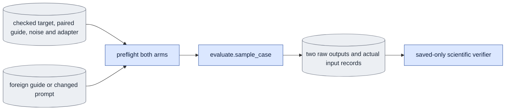
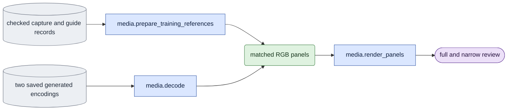

# `experiments/conditioning_check.py` — matched conditioning controls

## Objective

Run one fixed comparison through `evaluate.sample_case`. The `run` operation
has four controls:

- `guide`: replace the checked guide with a separately checked guide of another
  person;
- `text`: replace the text;
- `sigma_one`: compare D0 and D1 at sigma one;
- `capture_oracle`: compare D0 and D1 at the pilot's sigma 0.725, with the
  same model and adapter. It measures access to the supplied capture, which
  product generation cannot have.

These controls do not measure the D0 learning capacity. That needs separate D0
training.

The same selector has three more operations. Each operation sends the work to
its own owner:

- `prepare_references` → [reference_inputs](reference_inputs.md);
- `past_influence` → [past_influence_check](past_influence_check.md);
- `capacity_review` → [capacity_review](capacity_review.md).

## Usage

Humans can use the foreground queue or run this module directly.
See [launch, output and stop commands](../usage.md). Agents use the queue.
The queue recipes below describe managed execution.

Start each control as a queue `experiment` job with selector
`conditioning_check`. See
[run guide §9, E5](../../configs/README.md#e5--bounded-learning-pilots) and the
[spec format](spec_protocol.md).

This is the agent path. A person can also run the same module directly, or start the queue in the foreground; see [usage](../usage.md).

```json
{"schema_version": 1, "protocol": "conditioning_check", "operation": "run",
 "arguments": ["--control", "guide", "--mode", "causal", "--subset", "/abs/membership.json",
               "--source", "<TARGET_VIEW>", "--donor-source", "<OTHER_PERSON_VIEW>",
               "--noise-file", "/abs/seven_frame_noise.pt", "--seed", "42", "--decode"]}
```

| Scientific argument | Meaning |
|---|---|
| `--control {guide,text,sigma_one,capture_oracle}` | Required. The control. |
| `--mode {bidirectional,causal}` | Required. The attention mode. |
| `--subset`, `--source` | Required. The checked membership and the target view. |
| `--noise-file` | Required. Saved noise for seven encoded frames. |
| `--checkpoint` | The selected saved adapter. Omit it for the base. |
| `--donor-source` | `guide` only: a view of another person in the same membership. |
| `--prompt`, `--wrong-prompt` | `text` only: the prompt and a different, nonempty wrong prompt. |
| `--research-override` | Required for `sigma_one` and `capture_oracle`. |
| `--decode` | Also make matched references, decoded outputs and full and narrow reviews. |
| `--split`, `--seed` | The data group and the seed. |

All controls use seven encoded frames and `white` dev LTX-2.5. The guide and
text controls use D1. `sigma_one` and `capture_oracle` compare D0 with D1. The
schedule is direct `[0.725, 0]`, except `sigma_one`, which uses `[1, 0]`.

For the other operations, see the Usage section of their owner.

## Data flow



## Organization logic

### Inputs

The spec names one control and one target source. The ordinary evaluation
checks verify the target, the base, the exact seven-frame shape, the noise and
the adapter.

The guide control loads its donor from the same content-pinned membership.

- The target and the donor must differ.
- They must have equal selected shape, time base and VAE identity.
- Their individual crop and producer records stay separate.
- No tensor is resized, relabeled as the target guide or written into the
  corpus.

### What changes

Both arms keep fixed: the capture, the clean first-image input, the complete
saved noise, the model, the adapter, the schedule and the history.

| Control | Changes |
|---|---|
| `guide` | The guide tensor values and their explicit donor identity. |
| `text` | The actual saved text tensor and the prompt. |
| `sigma_one` | Only the D0/D1 source selection. |
| `capture_oracle` | Only the D0/D1 source selection, at sigma 0.725. |

For `sigma_one`, both branches check their actual adapter conditions under an
explicit research override. `capture_oracle` also records the explicit D0
research override and keeps the adapter fixed. The selected adapter is never
changed to pass a control.

### Execution

The shared native session and the unmerged adapter loader open once. Each arm
calls the ordinary sampler with a new cache. The module saves the text, the
noise, the raw outputs, the actual scientific settings, the file hashes and the
software identity. It starts no children and claims no GPUs.

### Decoded review

With `--decode`, the module uses the public media owner and the native VAE:

1. Prepare the matched capture RGB, the VAE-decoded capture and the paired
   guide RGB.
2. Decode both outputs with fresh generators with the same seed.
3. For a guide control, add the donor's guide RGB in the donor's recorded crop.
   This is a deliberately changed condition, not an overlay in target
   coordinates.

The generic queue phase limits sampling, decoding and review together to
1,800 seconds and 48,000,000,000 allocated bytes, unless the job declares its
own limit.

**Layout.**

- The full review puts three padded panels of equal height in each row.
- The narrow review uses the public readable-layout selector at 480 pixels.
- The matched and changed outputs stay next to each other.
- For a guide control, the narrow review puts the paired guide and the donor
  guide together above those outputs. For other controls, it uses the shared
  compact-training layout, with the unused guide slot labeled.

**Panel order.** Capture RGB, capture VAE and paired guide come first. The
matched and changed VAE outputs follow. For the guide control, the donor guide
is last. The titles state each role. The value lines state RGB or VAE decoding
and the donor's person. All moving panels map to source frames 0 through 48 at
the recorded fps.

**Saved files.** Full panel pixel tensors, reference provenance, MP4s and
poster PNGs. The original capture and guide videos stay in the corpus with
their content pins. The record also has the exact prompts, noise, crops,
objective, VAE bytes, decoder settings and runtime cost. The cost is the
cumulative CUDA peak through decoding. It does not reset the queue's peak.

These records support a separate visual judgment of identity and action.
Sensitivity alone is never quality acceptance.



### Other operations

- **`prepare_references`** sends the work to the independent
  [original membership reference owner](reference_inputs.md). It accepts
  `--subset`, `--source`, `--encoded-frames`, `--seed` and the optional
  `--guide-mode` and `--model`. It has no model-output dependencies. It
  validates the saved crop manifest and the original encoding records before
  it copies their exact crop into the public RGB reader's in-memory source
  row. The original membership bytes and the recorded producer identity stay
  unchanged. Conditioning and capacity reviews use the same checked source-row
  adapter. A missing duplicate crop field is never a reason to compute a crop
  again or relabel inputs.
- **`past_influence`** sends the work to the
  [changed-past-frame checks](past_influence_check.md). That owner has its own
  scientific arguments, dependencies, source extras, native execution and saved
  verification. Lazy operation routing keeps it outside the software profiles
  of the conditioning, reference and capacity operations.
- **`capacity_review`** reads a frozen list of completed ordinary D0
  evaluation jobs and sends it to the saved-only
  [capacity review owner](capacity_review.md). Its arguments are `--mode` and
  `--evaluation-list`. Every evaluation output in the list is a queue
  dependency. It requires separately D0-trained updates 0, 20 and 60. It loads
  no transformer and cannot generate a missing output again.

### Saved completion

Saved completion repeats the input and adapter checks on CPU. It checks the
source software, the exact arm list, the text and noise identity, the output
shape, the unchanged first image and the actual call counts. It recomputes all
numerical summaries from the saved tensors, including each arm's encoded
metrics against the unchanged capture.

Records use ordinary sampler schema two. The exact native call counts are:

| Mode | `model_calls` | `denoise_calls` | `prime_calls` | `refresh_calls` |
|---|---:|---:|---:|---:|
| bidirectional | 1 | 1 | 0 | 0 |
| causal | 6 | 3 | 0 | 3 |

Generation refreshes the final causal block. Training skips its final refresh,
but that does not change this count. Missing, extra or non-integer call fields
fail completion.

- `sigma_one` must be bit-identical.
- A changed guide or text that leaves the output unchanged is recorded as
  insensitive. It is not a failed integrity check, and it is never called a
  quality success.

Completion loads no native model, encoder, decoder, prompt-cache producer or
GPU handle. For a decoded review, completion loads the saved RGB panels and
replays the recorded capture and guide preprocessing on CPU to check exact
pixels. It also checks:

- the VAE, crop, objective and source identities and the decoder keys;
- synchronized coverage, panel roles and titles;
- full and narrow placement, readable labels and aspect-preserving padding;
- the actual MP4 dimensions, frame count and fps;
- poster pixels rebuilt from the saved panels.

Missing media or a changed review record fails completion.

The module checks again the original raw and preprocessed input pins, the
selected checkpoint bytes and the software profile, after sampling and before
publication. The software profile includes the experiment marker and the spec
owner. `evidence_paths` accepts `verified=True` only when its caller already ran
the scientific completion. It still inspects the byte list and the spec. This
avoids a second scientific verification in one queue receipt check.

Worked control: the paired guide values `[1,2]` and the donor guide `[9,8]`
share the target first-image input `10` and the noise.

- Both output first frames must be `10`.
- Their guide hashes must differ. Their capture, noise and text hashes must
  agree.
- In a `sigma_one` control, the two outputs must agree exactly, even when the
  capture and the guide differ. Different adapters cannot prove that equality.

## Invariants

- Keep the original target and paired-guide provenance beside the donor
  provenance.
- Refuse empty or no-op controls, and changed shape, time base, noise or first
  image.
- Use unmerged fp32 adapters with the frozen bf16 base.
- Record research overrides. Never treat a D1 pilot as D0 training.
- Completion requires both the byte list and the scientific checks.

## Gotchas

- Foreign guide crops are deliberately mismatched conditions. Their geometry
  records explain the intervention. A video must label the donor.
- A change of the latent output measures sensitivity, not correct identity or
  motion. Judge those from the matched capture RGB and the decoded videos.
- A change of the output for the wrong text also does not prove that the
  requested action is correct.

## Tests

`test_conditioning_check.py` checks one-factor records, refusal of changed
inputs, preservation of the clean first image, exact `sigma_one` equality, call
counts, refusal of changed summaries and per-arm metrics and saved completion
with the native loaders blocked. Native sampler tests cover both modes and the
schema-two call counts. Saved fixtures use the actual `EncodedVideo`
dataclass, so the public corpus field names stay checked.

Media tests check adjacent matched and changed panels at both reading widths.
They refuse changed donor pixels, references, decoder keys, prompts, labels,
poster pixels and cost. Controlled decoder and video doubles test saved
verification and layout. They do not prove native appearance or cost.
