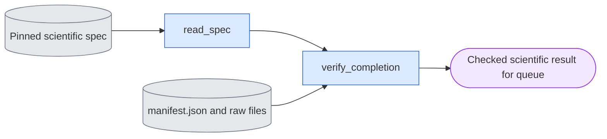

# `experiments/continuation_check.py` — bounded native history observations

Status: Tiny native CPU attention/cache checks pass. Full-weight before/after-eviction E3 acceptance remains pending.

The implemented source owner is `experiments/continuation_check.py`.
Original native evidence keeps its original producer hashes and scope.
Fresh affected native checks follow the complete code gate. Read
[current acceptance](../known_gaps.md#current-acceptance-and-next-step).

## Objective

Measure the selected causal cache against a current-sigma reference using the
same cached trajectory's clean history. Keep ordinary model owners unchanged.
Observe native self-attention keys after normalization and RoPE, and native
values. Do not implement another forward, cache, noise or eviction algorithm.

The same experiment selector accepts `--phase short_controls` for nine exact
seven-frame controls after the one-update causal adapter. Its scientific parser,
eight resource phases, execution and CPU saved-array verifier delegate to
[`short_causal_check`](short_causal_check.md). The 17-frame capture, reference
and control phases retain their own original protocol and acceptance meanings.

## Data flow


All diagnostic forwards run without gradients. The saved arrays contain
`[1,tokens,channels]` clean/noisy values, context and global positions. Native
layer keys/values have shape `[1,retained_tokens,inner_channels]`.

Read the original E3 protocol and original saved result. Reuse its exact source,
base, first image, text, noise, one-step schedule and B=2/D=8 geometry. Check
current masters and saved text against the original tensor/file identities
before weights. Use the existing checked `execute_evaluation` input path and
`sample_case` runner. Capture a current software profile with this diagnostic
and resource owner included. Never restamp the historical producer manifest.
The native `ltx_core.components.patchifiers.VideoLatentPatchifier` converts
capture and guide arrays to tokens. Import it from its owner; the evaluator
does not publish that class. Check these converted values against the saved
baseline hashes before any model call.

Capture and reference use separate queue experiment jobs. Their strict pinned
specifications keep the original scientific arguments. Scientific paths must be
absolute. The output and local GPU options come from the queue:

```json
{"schema_version":1,"protocol":"continuation_check","arguments":["--phase","capture","--protocol","/absolute/original_e3_protocol.json","--sigma","1.0","--history","generated"]}
```

```json
{"schema_version":1,"protocol":"continuation_check","arguments":["--phase","reference","--snapshot","/absolute/fresh_capture/continuation.json"]}
```

The reference job depends on the capture receipt. CPU `--dry-run` uses
`--spec /absolute/spec.json --output /absolute/fresh_output` with
`CUDA_VISIBLE_DEVICES=''`. It performs preparation only.

The short-controls specification uses protocol `continuation_check` and the
default `run` operation. Its scientific arguments are `--phase short_controls`,
`--job`, `--inputs`, `--update-check`, two `--checkpoints`, and
`--changed-noise-3`/`--changed-noise-5`, all with absolute paths. The update-check
is the passed serial update producer result. The job depends on that producer;
the accepted queue plan also depends on the matching four-rank comparison.
Its queue runtime adopts the unchanged explicit E4 budget and reports all eight
phase names. Completion dispatches before the 17-frame preparation and reads
the nine raw arrays without constructing a model. No ordinary software profile
or experiment selector table changes for this route.

The `control` phase consumes one ID from the existing data-only 12-control plan:

```json
{"schema_version":1,"protocol":"continuation_check","arguments":["--phase","control","--protocol","/absolute/original_e3_protocol.json","--control-plan","/absolute/12_control_plan.json","--control-id","sigma_1.0_cached_future_before_eviction"]}
```

It wraps `execute_evaluation` in the original resource measurement, without a
custom runner. The public owner supplies both future-noise trajectories. Bind
the exact control plan, changed-noise bytes and tensor values, original saved
text, current inputs and software. Validate saved public results and require
true earlier-output invariance. Keep ordinary calls separate from zero
diagnostic extra calls. No 12-control job has been run by this implementation.

Native execution uses a queue experiment job with a pinned specification.
The queue owns the process ledger, launch binding, selected device, deadline and
supervisor. The checker has no self-launch path or launch-only flags.
It emits the unchanged `continuation-case` phase. The phase adopts the effective
queue budget when present. The original 1800-second case limit and sampled
48800-MiB device limit also remain scientific checks.

## Organization logic

The queue uses the package root as the child's working directory. It launches
capture and reference as separate dependency-bound jobs.

Capture delegates the entire cached rollout to `sample_case`. Its denoiser
wrapper passes each modality unchanged to the original denoiser once. It records
the clean tokens that the shared rollout supplies to refresh. At denoise blocks
`[3,5)` and `[11,13)`, it saves exact CPU inputs and reads each actual native
`LayerKVCache`. Save one layer at a time; never retain all cached layers on CPU.
The cache already contains keys after native normalization/RoPE and its storage
cast. Save the actual cached prediction after the original denoise returns.

Reference first delegates a full ordinary recomputed trajectory to `sample_case`.
That path allocates no `BlockCache`. It then calls the existing
`causal.denoise_with_clean_history` once for each saved target block, with the
capture command's exact clean history, current noisy tokens, context and global
positions. These two diagnostic calls use the original denoiser. They neither
refresh a cache nor change the ordinary recomputed output.

Temporarily wrap each native video block's `attn1.attention_function` and
`masked_attention_function`. Call the original operation with its original
arguments and return its original output. During the two diagnostic calls,
compare the history prefix of the actual kernel K/V inputs with the corresponding
saved cached layer. This observes real post-normalization/RoPE K and projected V.
Process bounded CPU chunks; record full-value hashes, exact-equality flags, RMS,
maximum absolute difference and relative L2. A zero reference norm yields null
relative L2. Require exactly one observation per layer per target. Restore both
callables on success and failure.

Save each observed reference K/V prefix beside its metric record. Completion
loads one saved layer at a time and recomputes each comparison against the
capture's original K/V bytes. It requires both targets and all native layers,
the ordinary output, c0 and call controls, and the original resource checks.
A metric summary without its actual reference arrays cannot complete a job.

Worked case: before eviction, the retained frames are `[0,1,2]`. After eviction,
they are `[0,3,4,5,6,7,8,9,10]`. Use `retained_prefix_spans` to derive this order.
Do not compare the independently generated histories of the two ordinary arms
as if they isolated K/V calculation. The saved clean tokens are the same for both
sides of each diagnostic comparison. Separate generated and capture history.
Before eviction, retained past-frame inputs and context match; refresh uses
global sigma zero and reference uses the active sigma. After eviction, reference
also removes older frames from the context available to retained history. Those
deltas cannot be attributed to global sigma alone, even with identical clean
tokens. Report the before/after cases separately.

Record ordinary and diagnostic model calls separately and count actual native
forwards. Capture has 16 ordinary calls and no extra forward. Reference has eight
ordinary calls and two diagnostic calls for these fixed schedules.

## Invariants

Require D1/dev/LTX-2.5, 17 encoded frames, 30 fps, B=2/D=8, direct `[sigma,0]`,
base-only weights, CFG=1 and STG=0. Sigma is either 1.0 or 0.909375. Capture
history changes only the teacher-forcing flag. Current cached/recomputed output
records remain ordinary results; isolated reference block outputs are separate.
Verify c0 preservation, noise, context, clean history, positions, every snapshot
file, complete layer coverage, current source/runtime and fixed input bytes.
Incomplete observations cannot publish a complete diagnostic manifest.

Keep the original E3 budget meanings: 1800 seconds per case and 48800 MiB sampled
total-device occupancy. The original protocol has no allocated-byte threshold.
Measure synchronized local Torch allocated/reserved peaks with the shared Phase
owner. The effective queue phase budget is recorded separately from these
original E3 scientific meanings. The external supervisor enforces the original
deadline and sampled device guard. Save failed resource/evidence
records before returning an error. Child exit zero alone does not accept a run.

## Gotchas

At 48 layers, 4096 inner channels, 1024 tokens/frame and bf16, cached snapshots
for three plus nine history frames contain about 9 GiB. The actual capacity
comes from `cache_latent_frames_for`; its extra live-block/keyframe headroom must
not be omitted. Estimate disk need before weights. A single saved after-eviction
layer contains 144 MiB of K/V. Reference holds one such CPU layer and bounded
comparison chunks. It allocates no second GPU cache. The native dense causal mask
for eleven frames is about 484 MiB; that is shared reference behavior, not a new
diagnostic approximation. Do not lower geometry, drop layers or relax limits to
fit. A failure preserves partial evidence in the fresh attempt directory.

Snapshot serialization and CPU transfers change observed cost. The 12 existing
future/capture controls supply ordinary latency/resources; this diagnostic's
cost includes observation overhead. Their eight future-noise jobs each execute
original and changed noise. Their originals at boundaries 3/11 provide fresh
repeat controls. Four other jobs compare capture history separately. They do not
replace K/V observations or the later three-person/two-seed extension. The two
fixed membership records contain actor 7 only. Prepare a successor held-out
membership after the one-view control gates pass.

## Tests

Use the real tiny LTX model and native attention/cache on CPU. Check exact output
equality with an unobserved cached run, real cached K/V snapshots, before/after
retained frame IDs, native reference K/V observations, complete layer inventory,
separate call counts and callable restoration on failure. Reject changed snapshot
bytes and input hashes before a reference forward. Check bounded chunk metrics
against direct float64 calculations, including a zero denominator. Do not infer
full-weight acceptance or perceptual quality from CPU controls.
The eight tiny native future-noise controls also exercise the public sampler at
both noise levels, both history calculations and both exact boundaries.
CPU-only preparation also checked
the actual original one-view capture and a future-noise job, with all source,
base checkpoint, master, c0, text and noise hashes retained. Full native 17-frame
commands remain a separate acceptance requirement; short seven-frame controls
from another owner cannot replace these observations.

## Experiment package provenance

The public `EXTRA_SOURCES` tuple retains every pre-move extra owner and
binds the empty `experiments/__init__.py` marker along with the checker.
These files are explicit experiment extras; ordinary profiles do not
include the experiment marker. Existing results retain their original
source attribution, and affected native checks run again after the code gate.

### Shared intervention owner

E3 reads ordinary settings and future-noise choices through the public `experiments.causality.parse_future_args`, `prepare_evaluation`, `execute_evaluation` and `verify_evaluation_conditions` entrypoints. Those methods complete the unchanged pair preflight and full saved scientific checks, then use ordinary evaluation once for loading and shared sampling. The checker adds causality to its explicit software source owners. Observed-prefix callbacks still use ordinary evaluation directly. Historical original records keep their attribution.

## G8 queue interface and completion




The queue owns launch, device selection, process records and bounded supervision.
The checker accepts a pinned schema-one specification with its literal protocol
and original scientific `arguments`, plus queue-owned `--output` and local
`--gpu-id`. Execution flags in the scientific arguments fail before writes.
Public `parse_args`, `read_spec`, `runtime_profile`, `verify_completion` and
`evidence_paths` provide normalization, phase/topology data and saved-only
completion. The manifest binds exact spec bytes, normalized scientific settings
and the complete local artifact inventory. Original producer hashes stay intact;
new runs bind the spec helper as an explicit experiment extra.

`dependency_outputs(spec)` identifies the saved result directories that need
earlier queue receipts. An optional stock reference, the E2 update comparison,
or an E3 capture snapshot must be an explicit dependency. A missing dependency
fails CPU queue preparation, before claims or launch.

Completion verifies the original scientific controls from actual saved artifacts.
It loads no model or decoder, starts no child, and never repairs missing output.
A missing, changed or escaped artifact prevents completion. CPU fixtures prove
these refusals; final-source native acceptance still requires fresh queue jobs.
