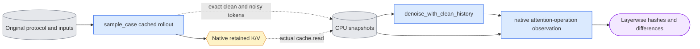

# `experiments/continuation_check.py` — bounded native history observations

This module is one of the E3 checkers. It compares the selected causal cache
with a reference that recomputes history at the current sigma.

## Objective

Measure the selected causal cache against a current-sigma reference. Both sides
use the same clean history from the same cached trajectory. The ordinary model
owners do not change. The module observes the native self-attention keys after
normalization and RoPE, and the native values. It adds no other forward,
cache, noise or eviction algorithm.

The module has four phases:

- `capture`: run the cached generation and save the layerwise K/V;
- `reference`: recompute from the snapshot of that capture;
- `control`: run one named control from a control plan;
- `short_controls`: nine exact seven-frame controls after the one-update
  causal adapter. Its parser, eight resource phases, execution and CPU
  saved-array verifier are in [`short_causal_check`](short_causal_check.md).

The 17-frame `capture`, `reference` and `control` phases keep their own
original protocol and acceptance meanings.

## Usage

Humans can use the foreground queue or run this module directly.
See [launch, output and stop commands](../usage.md). Agents use the queue.
The queue recipes below describe managed execution.

Run each phase as a separate queue `experiment` job with selector
`continuation_check`. The queue owns the output and the GPU. Scientific paths
must be absolute. See
[run guide §9, E3](../../configs/README.md#e3--causal-continuation-continuation_check-continuation_identity_check-causality)
and the [spec format](spec_protocol.md). Prepare the inputs first with
[prepare_continuation](prepare_continuation.md#usage).

This is the agent path. A person can also run the same module directly, or start the queue in the foreground; see [usage](../usage.md).

Capture:

```json
{"schema_version": 1, "protocol": "continuation_check",
 "arguments": ["--phase", "capture", "--protocol", "/abs/original_e3_protocol.json",
               "--sigma", "1.0", "--history", "generated"]}
```

Reference (depends on the capture job):

```json
{"schema_version": 1, "protocol": "continuation_check",
 "arguments": ["--phase", "reference", "--snapshot", "/abs/fresh_capture/continuation.json"]}
```

Control (one ID from the 12-control plan):

```json
{"schema_version": 1, "protocol": "continuation_check",
 "arguments": ["--phase", "control", "--protocol", "/abs/original_e3_protocol.json",
               "--control-plan", "/abs/12_control_plan.json",
               "--control-id", "sigma_1.0_cached_future_before_eviction"]}
```

Short controls: see [short_causal_check](short_causal_check.md#usage).

| Scientific argument | Meaning |
|---|---|
| `--phase {capture,reference,control,short_controls}` | Required. The phase. |
| `--protocol` | `capture` and `control`: the original E3 protocol. |
| `--sigma {1.0,0.909375}` | The direct schedule `[sigma, 0]`. |
| `--history {generated,capture}` | The history of the cached run. Default `generated`. |
| `--snapshot` | `reference`: the capture's `continuation.json`. |
| `--control-plan`, `--control-id` | `control`: the plan file and one control ID. |

Check a spec on CPU first. This does preparation only:

```bash
cd LTX-2
CUDA_VISIBLE_DEVICES= "$PY" -m scripts.onestep_avatar.experiments.continuation_check \
  --spec <SPEC.json> --output <FRESH_OUT> --dry-run
```

## Data flow



All diagnostic forwards run without gradients. The saved arrays hold the clean
and noisy values `[1,tokens,channels]`, the context and the global positions.
Native layer keys and values have the shape `[1,retained_tokens,inner_channels]`.

## Organization logic

### Inputs

The module reads the original E3 protocol and the original saved result. It
reuses their exact source, base, first image, text, noise, one-step schedule
and B=2/D=8 geometry.

1. Check the current masters and the saved text against the original tensor
   and file identities before the weights load.
2. Use the checked `execute_evaluation` input path and the `sample_case` runner.
3. Record a current software profile that includes this diagnostic and the
   resource owner. Never restamp a saved producer manifest.
4. Convert the capture and guide arrays to tokens with the native
   `ltx_core.components.patchifiers.VideoLatentPatchifier`. Import it from its
   owner, because the evaluator does not publish it. Check these values
   against the saved baseline hashes before any model call.
5. Pass `previews.verify_preview_tensors` explicitly to the public evaluator.
   The same validator reaches both future-noise branches through the causality
   owner. It compares the consumed capture, guide, first image, text and noise
   with their saved tensor hashes before the transformer opens. A changed text
   tensor fails here. A matching input keeps the shared sampler.

E3 reads the ordinary settings and the future-noise choices through the public
`experiments.causality.parse_future_args`, `prepare_evaluation`,
`execute_evaluation` and `verify_evaluation_conditions`. These do the unchanged
pair checks and the full saved scientific checks. Then they use ordinary
evaluation once for loading and shared sampling. The checker adds `causality`
to its explicit software source owners. Observed-prefix callbacks use ordinary
evaluation directly. Saved records keep their attribution.

### Capture

Capture gives the entire cached rollout to `sample_case`. Its denoiser wrapper
passes each modality unchanged to the original denoiser once. It records the
clean tokens that the shared rollout gives to refresh.

- At denoise blocks `[3,5)` and `[11,13)`, it saves exact CPU inputs and reads
  each actual native `LayerKVCache`.
- It saves one layer at a time. It never keeps all cached layers on CPU.
- The cache already contains keys after native normalization and RoPE, and
  after its storage cast.
- It saves the actual cached prediction after the original denoise returns.

### Reference

1. Give a full ordinary recomputed trajectory to `sample_case`. That path
   allocates no `BlockCache`.
2. Call `causal.denoise_with_clean_history` once for each saved target block.
   Use the capture's exact clean history, current noisy tokens, context and
   global positions.

These two diagnostic calls use the original denoiser. They do not refresh a
cache and do not change the ordinary recomputed output.

### Attention observation

The module temporarily wraps `attn1.attention_function` and
`masked_attention_function` of each native video block. Each wrapper calls the
original operation with its original arguments and returns its original
output. During the two diagnostic calls, it compares the history prefix of the
actual kernel K/V inputs with the matching saved cached layer. So it observes
the real K after normalization and RoPE, and the projected V.

- It processes bounded CPU chunks.
- It records full-value hashes, exact-equality flags, RMS, the maximum absolute
  difference and relative L2. A zero reference norm gives a null relative L2.
- It requires exactly one observation for each layer and target.
- It restores both callables after success and after failure.

The module saves each observed reference K/V prefix beside its metric record.
Completion loads one saved layer at a time and recomputes each comparison
against the capture's original K/V bytes. It requires both targets, all native
layers, the ordinary output, the `c0` and call controls and the original
resource checks. A metric summary without its reference arrays cannot complete
a job.

### Before and after eviction

Worked case: before eviction, the retained frames are `[0,1,2]`. After
eviction, they are `[0,3,4,5,6,7,8,9,10]`. `retained_prefix_spans` derives this
order.

- Do not compare the independently generated histories of the two ordinary
  arms as if they isolated the K/V calculation. The saved clean tokens are the
  same for both sides of each diagnostic comparison.
- Keep generated history and capture history separate.
- Before eviction, the retained past-frame inputs and the context match.
  Refresh uses global sigma zero, and the reference uses the active sigma.
- After eviction, the reference also removes older frames from the context of
  retained history. Those differences cannot be explained by global sigma
  alone, even with identical clean tokens.

Report the cases before and after eviction separately.

### Call counts

Ordinary and diagnostic model calls are recorded separately, and actual native
forwards are counted. For these fixed schedules:

- capture has 16 ordinary calls and no extra forward;
- reference has eight ordinary calls and two diagnostic calls.

### Control phase

The `control` phase reads one ID from the existing data-only 12-control plan.
It wraps `execute_evaluation` in the original resource measurement, with no
custom runner. The public owner supplies both future-noise trajectories.

- It binds the exact control plan, the changed-noise bytes and tensor values,
  the original saved text, the current inputs and the software.
- It validates the saved public results and requires the earlier output to be
  truly unchanged.
- It keeps ordinary calls separate from zero extra diagnostic calls.

No 12-control job has been run by this implementation.

### Short-controls phase

The short-controls spec uses protocol `continuation_check` and the default
`run` operation. Its scientific arguments are `--phase short_controls`, `--job`,
`--inputs`, `--update-check`, two `--checkpoints`, `--changed-noise-3` and
`--changed-noise-5`, all as absolute paths. The update check is the passed
serial update producer result. The job depends on that producer. The accepted
queue plan also depends on the matching four-rank comparison. Its queue runtime
uses the unchanged explicit E4 budget and reports all eight phase names.
Completion dispatches before the 17-frame preparation and reads the nine raw
arrays without a model. No ordinary software profile or selector table changes
for this route.

### Queue and resources

Native execution uses a queue `experiment` job with a pinned spec. The queue
owns the process ledger, the launch binding, the selected device, the deadline
and the supervisor. The checker has no self-launch path or launch-only flags.
The queue uses the package root as the child's working directory. It starts
capture and reference as separate dependency-bound jobs.

The checker emits the unchanged `continuation-case` phase. The phase uses the
effective queue budget when there is one. The original 1,800-second case limit
and the sampled 48,800-MiB device limit stay scientific checks.

`dependency_outputs(spec)` names the saved result directories that need earlier
queue receipts. An E3 capture snapshot must be an explicit dependency. A
missing dependency fails CPU queue preparation, before claims or launch.
Completion verifies the original scientific controls from the saved files. It
loads no model or decoder, starts no child and never repairs missing output.
The public `EXTRA_SOURCES` tuple binds the checker, its spec helper and the
empty `experiments/__init__.py` marker as explicit experiment extras. The queue
can call `evidence_paths(..., verified=True)` only after it ran this verifier in
the same receipt check. Direct callers keep the default `verified=False`.

## Invariants

- Required settings: D1, dev, LTX-2.5, 17 encoded frames, 30 fps, B=2/D=8,
  direct `[sigma,0]`, base-only weights, CFG=1 and STG=0. Sigma is 1.0 or
  0.909375.
- Capture history changes only the teacher-forcing flag.
- The current cached and recomputed output records stay ordinary results. The
  isolated reference block outputs are separate.
- The module verifies `c0` preservation, noise, context, clean history,
  positions, every snapshot file, complete layer coverage, the current source
  and runtime and the fixed input bytes. Incomplete observations cannot publish
  a complete diagnostic manifest.

**Budget meanings.** The original E3 budget is 1,800 seconds per case and
48,800 MiB of sampled total-device occupancy. The original protocol has no
allocated-byte threshold.

- The shared Phase owner measures the synchronized local Torch allocated and
  reserved peaks.
- The effective queue phase budget is recorded separately from the original E3
  meanings.
- The external supervisor enforces the original deadline and the sampled
  device guard.
- Failed resource and evidence records are saved before an error returns. A
  child exit code of zero alone does not accept a run.

## Gotchas

- **Snapshot size.** At 48 layers, 4,096 inner channels, 1,024 tokens per frame
  and bf16, the cached snapshots for three and nine history frames hold about
  9 GiB. The actual capacity comes from `cache_latent_frames_for`. Do not leave
  out its extra headroom for the live block and the keyframe. Estimate the disk
  need before the weights load.
- One saved after-eviction layer holds 144 MiB of K/V. The reference holds one
  such CPU layer and bounded comparison chunks. It allocates no second GPU
  cache.
- The native dense causal mask for eleven frames is about 484 MiB. This is
  shared reference behavior, not a new diagnostic approximation.
- Do not lower the geometry, drop layers or relax limits to fit. A failure keeps
  partial evidence in the fresh attempt directory.
- Snapshot serialization and CPU transfers change the observed cost. The 12
  future and capture controls give ordinary latency and resources. This
  diagnostic's cost includes the observation overhead.
- The eight future-noise jobs of the control plan each run the original and the
  changed noise. Their originals at boundaries 3 and 11 give fresh repeat
  controls. Four other jobs compare capture history separately. They do not
  replace the K/V observations or the later three-person, two-seed extension.
- The two fixed membership records contain actor 7 only. Prepare a successor
  held-out membership after the one-view control gates pass.

## Tests

CPU tests use the real tiny LTX model and the native attention and cache. They
check:

- exact output equality with an unobserved cached run;
- real cached K/V snapshots and the retained frame IDs before and after
  eviction;
- native reference K/V observations and the complete layer list;
- separate call counts and callable restoration after a failure;
- refusal of changed snapshot bytes and input hashes before a reference
  forward;
- bounded chunk metrics against direct float64 calculations, including a zero
  denominator.

The eight tiny native future-noise controls also run the public sampler at both
noise levels, both history calculations and both exact boundaries. CPU-only
preparation also checked the actual original one-view capture and a
future-noise job, with all source, base checkpoint, master, `c0`, text and
noise hashes kept.

Do not infer full-weight acceptance or perceptual quality from CPU tests. Full
native 17-frame commands are a separate acceptance requirement. The short
seven-frame controls of another owner cannot replace these observations.
