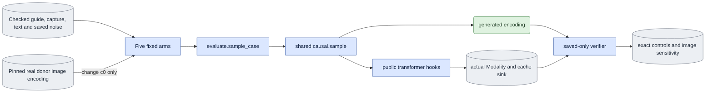

# `experiments/continuation_identity_check.py` — independent E3 controls

## Objective

Prove two things through the shared sampler:

- causal prefix invariance: a shorter run gives the same frames as the start of
  a longer run;
- clean first-image use: the model reads `c0` as an input.

Also measure whether the first image of a different person changes the
generated frames after frame zero. This experiment adds no sampler, cache
algorithm, decoder, model loader or process controller.

## Usage

Humans can use the foreground queue or run this module directly.
See [launch, output and stop commands](../usage.md). Agents use the queue.
The queue recipes below describe managed execution.

Start one queue `experiment` job with selector `continuation_identity_check`
for each sigma and each history (`cache`, `recompute`). See
[run guide §9, E3](../../configs/README.md#e3--causal-continuation-continuation_check-continuation_identity_check-causality).

This is the agent path. A person can also run the same module directly, or start the queue in the foreground; see [usage](../usage.md).

```json
{"schema_version": 1, "protocol": "continuation_identity_check",
 "arguments": ["--subset", "/abs/current_membership.json", "--source", "<VIEW_ID>",
               "--noise-file", "/abs/full_17_frame_noise.pt", "--sigma", "0.909375", "--history", "cache",
               "--donor-image", "/abs/independent_image/image.pt", "--donor-image-sha256", "<SHA256>",
               "--donor-export", "/abs/image_export.json", "--donor-export-sha256", "<SHA256>",
               "--donor-view", "/abs/corpus/Part_1/0097_04/views/view00_cam51", "--seed", "42"]}
```

| Scientific argument | Meaning |
|---|---|
| `--subset`, `--source` | The checked membership and the target view. |
| `--noise-file` | Saved noise for all 17 encoded frames. |
| `--sigma {1.0,0.909375}` | The direct schedule `[sigma, 0]`. |
| `--history {cache,recompute}` | Cached refresh or block-causal recomputation. |
| `--donor-image`, `--donor-image-sha256` | The pinned real first-image encoding of another person. |
| `--donor-export`, `--donor-export-sha256` | The export record of that image. |
| `--donor-view` | The donor's source view. |
| `--split`, `--prompt`, `--seed` | The data group, the prompt and the seed. |

Check the spec on CPU with `--dry-run` first. Outputs: the five arms' encodings
and records, the saved traces and `manifest.json`.

## Data flow



Each job fixes one person and view, the seed, the direct schedule `[1,0]` or
`[0.909375,0]`, the base LTX-2.5 dev model, D1, `white`, B2/D8 and generated
history. It selects cached refresh or block-causal recomputation. The inputs
have 17 encoded frames at 1024 pixels square and 30 fps. `c0` is the first
image encoding with no added noise.

## Organization logic

### Checks

1. Call the public preflight of the ordinary evaluator. Require one base-only
   case and the complete saved noise.
2. Check the independent image bundle: its hash, the supplied-image role, the
   one-image shape, the VAE and the encoding contract.
3. The pinned export record identifies the donor view and source frame zero.
   Check all export and preparation input and output hashes again.
4. The donor clip's metadata must identify another person.

The donor's recorded crop stays its own. This is a deliberate identity
intervention, not a crop-alignment comparison.

### Five arms

The arms run in this order:

1. original, 17 frames;
2. exact repeat, 17 frames;
3. prefix, 5 frames;
4. prefix, 13 frames;
5. changed `c0`, 17 frames.

The prefix arms slice the source and the saved noise at complete block
boundaries. Their grids come from the same original frame-zero time base. The
changed-image arm replaces only the capture frame-zero tokens. The D1 guide,
text, saved noise, schedule, positions and model stay fixed. All arms call
`evaluate.sample_case`.

### Position grid

The owner saves the original native full grid before any model call. The
freshly built native positions of every arm must equal the matching prefix of
the saved grid bit for bit. Saved verification checks that this grid equals one
of two exact results from the public integer patch bounds:

- the public CPU timestamp division;
- the exact CUDA float32 reciprocal multiplication.

It accepts no numerical tolerance. Then it slices the saved native grid for
every observed call.

### Observation hooks

Public PyTorch forward pre- and post-hooks observe the actual transformer.

- The pre-hook copies each native Modality's latent, sigma, token timesteps,
  positions, keyframe marks, text hash and cache metadata.
- The post-hook saves the first layer's first-frame K/V immediately after the
  block-zero refresh.
- Later pre-hooks save the same sink before blocks `[11,13)` and `[15,17)`.

The hooks return no replacement tensors and do not write to the cache.

### Saved verification

Saved verification rebuilds the expected native input from the fixed guide,
the saved noise, the clean image and the saved earlier outputs. It uses the
model owner's public noising and retained-frame functions.

- Every tensor must match exactly, including the original positions, the
  float32 sigma and timesteps, the clean first-image tokens and the zero history
  timesteps.
- Cached calls alternate denoise and sigma-zero refresh. Refresh consumes the
  generated block. All layer lengths must agree. The first-layer sink must stay
  identical after eviction.
- Recompute calls have no cache and include the exact retained generated
  history.

### Pass rules

- The original and repeat outputs are bit-identical.
- Each prefix output equals the matching prefix of the original.
- The first-image output equals that arm's supplied image exactly.
- The changed-image summary excludes frame zero. It records the RMS, the
  maximum absolute difference and bit identity for frames 1–16.

Sensitivity is supporting evidence, not an identity-quality score. A zero
effect fails the independent input-use check. A nonzero effect supports no
perceptual claim.

Worked check: with B2, the original 17 frames give eight blocks. Cache mode
makes 16 native calls. Recompute makes eight. Prefix 5 covers two blocks.
Prefix 13 covers six. The cached sink data from the first refresh must equal
the sink observed before block six, although frames 1 and 2 were evicted.

## Invariants

- All outputs are fresh.
- The spec pins the donor bundle, the export and the source view.
- Preprocessed input bytes can be reused only after their contracts and hashes
  pass.
- Experimental results cannot be imported.
- The public observer touches no numerical input.
- Each job runs only under the existing queue, with its 1,800-second and
  allocated-memory limits.
- The software evidence includes the experiment marker, this owner, the spec
  owner and ordinary evaluation.

## Gotchas

- Saved traces add CPU copies, output size and timing overhead. Their duration
  is not warmed deployment latency.
- First-layer sink checks prove only the retained data of that layer. The E3
  continuation owner checks the layerwise K/V separately.
- A donor's RGB image has its own matte and crop. Do not call it target capture
  RGB.
- Prefix 5 is before eviction. Prefix 13 includes `[11,13)` after eviction.
  Seven-frame short controls do not replace this check.
- CPU and CUDA timestamp division can differ by one float32 ULP. A rebuilt CPU
  grid does not prove that the native CUDA coordinates changed. The saved
  native grid and the exact cross-arm comparisons own that evidence.

## Tests

- Tiny real-transformer tests cover both schedules and both history paths,
  repeat and prefix exactness, clean first-image input and output and cache
  refresh.
- Negative trace tests change `c0`, timesteps, original positions, the refresh
  payload, cache lengths and sink values.
- Donor tests refuse an unchanged identity or changed preprocessing bytes.
- Saved verification tests block native loaders. They refuse changed output,
  fixed-input provenance, position grid and summary.
- Exact CPU and CUDA coordinate candidates pass. Changed coordinates fail.

CPU checks do not prove native numerical or perceptual acceptance.
