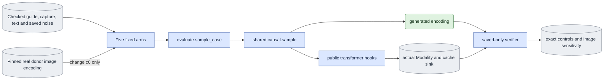

# `experiments/continuation_identity_check.py` — independent E3 controls

## Objective

Prove causal prefix invariance and clean first-image use through the shared
sampler. Measure whether a different person's first image changes generated
frames after frame zero. This experiment adds no sampler, cache algorithm,
decoder, model loader or process controller.

## Data flow

Each job fixes one person/view, seed, direct schedule `[1,0]` or
`[0.909375,0]`, base LTX-2.5 dev model, D1, white, B2/D8 and generated
history. It chooses either cached refresh or block-causal recomputation.
Inputs have 17 encoded frames at 1024 square and 30 fps. `c0` is the first
image encoding with no added noise.

## Organization logic

Preflight calls the ordinary evaluator's public preflight. It requires one
base-only case and the complete saved noise. It checks the independent image
bundle's hash, supplied-image role, one-image shape, VAE and encoding contract.
The pinned export record identifies the donor view and source frame zero.
All export and preparation input/output hashes are rechecked. The donor clip's
metadata must identify another person. Its recorded crop remains its own;
this is a deliberate identity intervention, not a crop-alignment comparison.

The five arms run in this order: original 17 frames, exact repeat 17 frames,
prefix 5 frames, prefix 13 frames, and changed `c0` over 17 frames. Prefix
arms slice source and saved noise at complete block boundaries. Their grids
are built from the same original frame-zero timebase. The changed-image arm
replaces only capture frame-zero tokens; D1 guide, text, saved noise, schedule,
positions and model stay fixed. All arms call `evaluate.sample_case`.

The owner saves the original native full grid before any model call. Every
arm's freshly built native positions must equal the corresponding saved grid
prefix bit for bit. Saved verification checks that this grid equals either
the public CPU timestamp division or the exact CUDA float32 reciprocal
multiplication from the public integer patch bounds. It accepts no numerical
tolerance. It then slices the saved native grid for every observed call.

Public PyTorch forward pre/post hooks observe the actual transformer. The
pre-hook copies each native Modality's latent, sigma, token timesteps,
positions, keyframe marks, text hash and cache metadata. The post-hook saves
the first layer's first-frame K/V immediately after block-zero refresh.
Later pre-hooks save the same sink before blocks `[11,13)` and `[15,17)`.
Hooks return no replacement tensors and do not write to the cache.

Saved verification reconstructs expected native input from the fixed guide,
saved noise, clean image and saved earlier outputs. It uses the model owner's
public noising and retained-frame functions. Every tensor must match exactly,
including original positions, float32 sigma/timesteps, clean first-image
tokens and zero history timesteps. Cached calls alternate denoise and sigma-zero
refresh; refresh consumes the generated block. All layer lengths must agree.
The first-layer sink must remain identical after eviction. Recompute calls
have no cache and include the exact retained generated history.

The original and repeat outputs must be bit-identical. Prefix outputs must
equal the corresponding original prefix. First-image output must equal that
arm's supplied image exactly. The changed-image summary excludes frame zero;
it records RMS, maximum absolute difference and bit identity for frames 1–16.
Sensitivity is supporting evidence, not an identity-quality score. A zero
effect fails the independent input-use check, but no perceptual claim follows
from a nonzero effect.

Worked check: with B2, original 17 frames produces eight blocks. Cache mode
makes 16 native calls; recompute makes eight. Prefix 5 covers two blocks;
prefix 13 covers six. Cached sink data from first refresh must equal the
sink observed before block six, even though frames 1 and 2 were evicted.

## Invariants

All outputs are fresh. The spec pins donor bundle, export, and source view.
Preprocessed input bytes can be reused only after their contracts and hashes
pass. Experimental results cannot be imported. The public observer touches no
numerical input. Each job runs only under the existing queue and its existing
1,800-second and allocated-memory bounds. Software evidence includes the
experiment marker, this owner and the spec owner, plus ordinary evaluation.

## Gotchas

Saved traces add CPU copies, output size and timing overhead. Their duration
is not warmed deployment latency. First-layer sink checks prove that observed
layer's retained data; E3's continuation owner separately checks layerwise K/V.
A donor's RGB image has its own matte and crop. Do not describe it as target
capture RGB. Prefix 5 is before eviction; prefix 13 includes `[11,13)` after
eviction. Seven-frame short controls do not substitute for this check.
CPU and CUDA timestamp division can differ by one float32 ULP. Rebuilding a
CPU grid does not prove that native CUDA coordinates changed. The saved native
grid and exact cross-arm comparisons own that evidence.

## Tests

Tiny real-transformer tests cover both schedules and both history paths,
repeat and prefix exactness, clean first-image input/output and cache refresh.
Negative trace tests alter c0, timesteps, original positions, refresh payload,
cache lengths and sink values. Donor tests reject unchanged identity or changed
preprocessing bytes. Saved verification tests block native loaders and reject
changed output, fixed-input provenance, position grid and summary. Exact CPU
and CUDA coordinate candidates pass; altered coordinates fail. CPU checks do not prove
native numerical or perceptual acceptance.
