# `experiments/fusion_parity.py` — five-case fused versus unmerged adapter comparison

## Objective

Keep the D1 block-zero comparison of fused x0 against unmerged PEFT velocity.
This owner owns the five scientific cases and the effect calculation. It calls
the shared adapter, grid and causal diagnostic primitives. No decoder or
launcher belongs here. Queue model work selects `fusion_parity` through the
literal experiment table. Ordinary evaluation has no fusion-study parser.

The module entry calls the shared queue runtime helper. Outside a queue, the
helper calls the public operation unchanged. In a queued child, it measures one
local resource phase and records any declared numerical policy. The queue owns
the launch, the supervision and the proof that no worker remains. See
[runtime](../execution/runtime.md).

## Usage

Humans can use the foreground queue or run this module directly.
See [launch, output and stop commands](../usage.md). Agents use the queue.
The queue recipes below describe managed execution.

Start the comparison as a queue `experiment` job with selector
`fusion_parity`. The queue supplies the device. The module has no other CLI
form and no `--dry-run`. See
[run guide §9, other studies](../../configs/README.md#other-studies).

This is the agent path. A person can also run the same module directly, or start the queue in the foreground; see [usage](../usage.md).

The spec has fixed fields, not an argument list:

```json
{"schema_version": 1, "protocol": "fusion_parity",
 "run": "/abs/run", "view": "/abs/corpus/Part_1/0008_01/views/view00_cam51", "step": 1}
```

| Spec field | Meaning |
|---|---|
| `run` | The absolute training run directory (with `config.json` and checkpoints). |
| `view` | The absolute view directory with paired `white` capture and guide masters. |
| `step` | A positive integer. The trained adapter step. |

The queue arguments are `--spec` and a fresh `--output`. Outputs:
`result.json`, `raw_outputs.pt` and `manifest.json`.

## Data flow

```mermaid
flowchart LR
  S[("pinned spec and run config")] --> P["check adapters and masters"]
  P --> F["three fused x0 cases"] --> U["two unmerged velocity cases"]
  U --> O("five raw block outputs") --> M["adapter-effect calculation"]
  M --> W[("raw outputs, result and manifest")] --> V(["verified evidence"])
  classDef proc fill:#dbe7ff,stroke:#3b5ea8,color:#10203f;
  classDef disk fill:#eceff3,stroke:#6b7280,color:#1f2937;
  classDef tensor fill:#dff2e0,stroke:#43834a,color:#16341b;
  classDef out fill:#ece0f8,stroke:#7048a0,color:#26123f;
  class P,F,U,M proc;
  class S,W disk;
  class O tensor;
  class V out;
```



The inputs are the run's `config.json`, LTX-2.5 dev, the step-zero and trained
adapters and the paired `white` capture and guide masters. The fixed settings
are seed 42, sigma 0.421875, D1, block zero, an empty cache and the clean
capture `c0`. Masters are `[C,F,H,W]` with `F >= 3`. Each saved fp32 output is
`[1,3*H*W,C]`, in native patchifier order.

## Organization logic

### Checks and five cases

Before the weights load, the module requires:

- a fresh output;
- a valid LoRA target and rank, and a positive finite alpha that equals the
  rank. Alpha equals rank, so the fused loader applies the same scale as the
  unmerged adapter;
- all six scientific files, paired geometry and fps, and block-zero coverage.

It hashes all input files before execution. Then it runs the five cases:

1. `bare`, `step0` and `fused1` through the shared fused x0 session loader.
   Each model is released before the next opens.
2. All fused models are released. Then the frozen base and the public PEFT
   configuration load, and the saved step-zero and trained weights are applied
   for `peft0` and `peft1`.

`fusion_probe_block` builds the shared grid and allocates a fresh native
cache. It noises guide block zero at the fixed sigma and seed, restores the
clean `c0` and calls the public `causal.fusion_parity_block`. Each case does
one diagnostic denoise and returns fp32 CPU tokens. No VAE opens.

The module checks the input hashes again before atomic publication.
`raw_outputs.pt` holds all five tensors. `result.json` keeps the protocol's
metric and settings fields and the input-file hashes. Queue execution binds
both files, the spec SHA and the current evaluation software, with
`EXTRA_SOURCES`, in `manifest.json`. Then it runs saved completion.

### Adapter-effect arithmetic

Exactly five named cases with finite, nonempty, equal shapes are required.

- `effect_peft = peft1 - peft0`
- `effect_fused = fused1 - bare`
- effect gap = `norm(effect_fused - effect_peft) / norm(effect_peft)`

The effect gap is separate from the raw differences of the trained outputs,
and from each effect relative to its own no-adapter output. The module also
records whether fused step zero equals bare bitwise.

The protocol's effect tolerance is 0.2. A zero denominator gives JSON null. A
zero PEFT effect gives `effect_ratio_status: undefined_zero_peft_effect` and a
false tolerance flag, never NaN or a false pass. This tolerance differs from
the tighter adapter-effect acceptance gate (E2).

### Completion

`verify_completion` does these steps:

1. Read the saved tensors with `weights_only=True`.
2. Reload the paired masters. Patchify the first three capture frames to bf16,
   then to fp32.
3. Every output must have that exact shape, fp32 dtype, finite values and
   capture first-frame tokens that match exactly.
4. Recompute every metric. Compare the fixed view, step, sigma, block and seed
   fields. Check all six scientific file hashes.
5. Rebuild the whole manifest and check the current software.

No weights, decoder or repair runs. `evidence_paths` returns the manifest, the
raw outputs and the result to the queue receipt. The queue can call
`evidence_paths(..., verified=True)` only after it ran this verifier in the same
receipt check. Direct callers keep the default `verified=False`.

A failed tolerance can still be a completed scientific observation. Completion
does not make it an accepted parity result.

Worked checks: let `bare = step0 = peft0` for nonzero references. Give each
generated token a fused effect of 0.18 and a PEFT effect of 0.20.

- The effect gap is `abs(0.18-0.20)/0.20 = 0.1`. The tolerance flag and the
  step-zero equality are true.
- If both PEFT cases are equal, the effect gap is undefined and its tolerance
  flag is false.
- A reported gap changed to zero, with a rehashed file, fails against the raw
  outputs.
- A change of `c0` in all five cases together also fails against the actual
  capture master, even when the pairwise metrics still agree.

## Invariants

- Keep all five roles, the original noise and grid map, the fixed sigma, the
  adapter scale, the metric names and the tolerance.
- Each case has a new cache. Fused residency ends before unmerged residency.
- Shared owners keep adapter loading, targets, layout and model operations.
- Each run binds its current producer bytes. Saved results keep their own
  attribution.

## Gotchas

- A small raw-output gap can hide a large adapter-effect gap when the effect
  itself is small.
- Undefined denominators need an explicit status.
- Completion checks tensor and control consistency. Real-weight native parity,
  visual quality, learning and final architecture acceptance stay separate.

## Tests

- `tests/experiments/test_fusion_diagnostic.py` checks the original grid and
  noise on a real small transformer, the exact five-case orchestration, the
  metric values, zero-effect handling and fresh-output refusal.
- `test_extracted_queue_protocols.py` checks pinned and normalized specs,
  completion without a model, missing outputs, changed inputs, rehashed false
  metrics and joint changes of raw-output shape, `c0` and precision.
