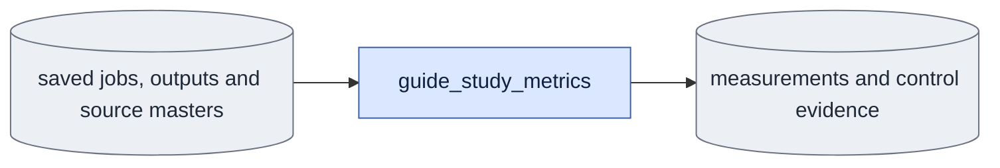

# `experiments/guide_study_metrics.py` — measure saved guide-study outputs

## Objective

Measure saved outputs on CPU and check matched-input controls. Never generate missing data.

## Usage

Humans and agents run directly in the `ltx` environment, from the LTX-2 root.
See [Other studies](../../configs/README.md#other-studies).

```bash
OMP_NUM_THREADS=8 MKL_NUM_THREADS=8 python -m scripts.onestep_avatar.experiments.guide_study_metrics \
  measure --root ../expr/onestep_avatar/ar_sigma_rollouts_rerun_20261012 --dry-run
```

Use `controls` for proofs. Remove `--dry-run` to write analysis JSON.
`--root` is required. `--allow-partial` checks completed smoke cases and records missing cases.
Partial evidence cannot pass the full-study completion gate.
Outputs are `latent_metrics.json`, or `controls.json`, `matched_inputs.json` and
`executed_schedules.json`, under `analysis/`.

## Data flow



## Organization logic

Verify saved output hashes before reading tensors. Verify source masters through
current membership. Check requested schedules and measured calls. Then measure
capture and guide differences on encoded frames 1 onward, excluding clean `c0`.

Capture MSE is the mean squared output-minus-capture value. Guide MSE uses the guide.
Per-frame capture MSE reduces channel and spatial axes. Guide error uses guide minus capture.
For output `[0, 2, 4]` and capture `[0, 1, 2]`, capture MSE excluding `c0` is 2.5.

The user approved reconstructing causal boundaries on 2026-10-12. Call the public
`CausalGeometry.plan` with saved mode settings and saved frame count. Verify complete
coverage and denoise/refresh counts. Label these ranges `canonical_planner_reconstruction`.
They are not saved executed ranges. The producer does not record such ranges.
Seam residual averages `|(o_t-o_(t-1))-(y_t-y_(t-1))|` over block starts after block zero.
For boundary 2 in the worked example, the residual is 1.

Controls pair D0 and D1 at sigma one. Pair GT and generated history for each S3 arm.
The first-block comparison uses the reconstructed first range. Compare tensors bit for bit.
Check fixed noise, source, c0 and input file hashes within matching case groups.
Text matches except in declared prompt comparisons. Weights match except in declared model comparisons.
Every dev guidance step measures three denoise forwards; causal refresh uses the same guidance passes per block. Dev refresh therefore adds three forwards per block.

## Invariants

Missing results fail unless explicitly checking partial smoke evidence.
Hash mismatch always fails. No missing outputs are produced or repaired.
Only current study jobs supply evidence. Controls preserve every compared result path and hash.

## Gotchas

Latent errors measure distances, not correctness of motion or identity.
The first-block control does not prove the entire continuation is equivalent.
Reconstructed boundaries provide weaker execution evidence than saved ranges.
Use the same eight-thread limit for all measurements and saved completion checks.

## Tests

Known tensors establish MSE and seam calculations. Corrupt output hashes fail.
Controls distinguish exact equality from a changed tensor. Recorded frame counts
and calls must agree with the public block planner.
