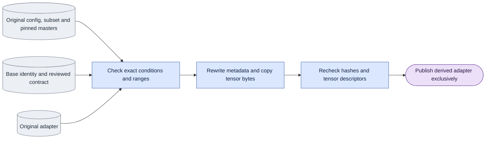

# `experiments/legacy_adapters.py` — checked legacy adapter conversion

## Objective

Derive a version-two adapter record from complete original evidence. Preserve
all safetensors tensor descriptors and payload bytes, source metadata and source
files. Conversion is explicit CPU work; it is not training or model inference.
Normal contract/tensor validation and public `require_digest` stay in
[training/checkpoints](../training/checkpoints.md). The historical subset digest
is implemented once in [corpus/subset](../corpus/subset.md).

## Data flow

Read the original adapter, config, subset, converted membership/frame plan,
base identity and reviewed version-two contract. Validate original identity,
condition and coverage facts before creating output directories. Stream-copy
the original payload with a changed metadata header, recheck all source hashes,
validate the result, then link it exclusively to the fresh derived destination.
No input is repaired or replaced; failed work removes only its temporary file.

## Organization logic

`convert_legacy_adapter` accepts an explicit version-two contract and the
original config/subset, converted membership/frame plan and base checkpoint.
It checks file hashes before writing. The original config and adapter store
`corpus.subset.subset_sha256`: the exact original canonical digest of objective, sources, chains,
splits, span, clip-start policy and chain length. Keep the saved historical
`canonical_rule: "windows.subset_sha256"` attribution unchanged. Compare that digest with the
saved values; it is not the JSON file byte hash. Pin the original JSON's byte
hash separately in the converted list/plan and evidence record. Geometry is
checked against original config/adapter fields because it is outside that
legacy digest. Require converted records to name the same original subset and
have valid content hashes.
Read each selected capture master (and guide for D1), verify its original
content hash, actual encoded shape and fps, and include these files in the
unchanged-evidence check. Do not repair or re-encode an original producer output.
Match task, loss, c0, LoRA settings, step, exact sigma levels, seeds and noise policy to original
records. Before hashing the large base, require the original config and adapter
to explicitly agree with the requested sigma draw rule. Missing stamps cannot
prove uniform sampling: historical mixed-level runs used a different rotation.
Even step zero does not establish the claimed training conditions. Refuse these
records until separate original implementation evidence is supported.
Check the original direct schedule, attention, history computation, parent and
window stamps too. A missing or contradictory stamp fails before publication.
Match the base's filename/version/variant and historical fingerprint,
then compute its full SHA-256 for the new record. A historical fingerprint
match is the available original identity evidence; conversion cannot invent
an original full-file SHA-256 that was never saved.

One-block bidirectional classification additionally requires all selected
original chains to contain only block zero, exact corresponding frame ranges,
and verified independent-window selection when random starts are used.
These facts prove there is no preceding
history to read or later training block to refresh. The matched prediction,
loss and gradient tests establish the one-block equivalence. A block-causal
label alone does not pass. Causal conversion keeps the original geometry,
forcing and block count. Random-window conversion requires the original config
window length to equal block length plus one, the adapter's exact
`random_start_v1:<length>` stamp, only clip-start block-zero chains, a matching
plan `start_draw`, and window templates plus `segment_selection` in the reviewed
contract. Verify its source lengths and allowed starts against the checked
masters. Record that c0 is the selected capture master frame and positions
restart at zero. For a 25-frame master and a 17-frame window, allowed starts are
0 through 8; coverage `[0,17]` is a template, not the executed-window history.
The legacy and new samplers must draw identical starts for the same seed,
step, rank and slot. Parent-initialized runs remain refused pending extra
evidence. Fixed-range plans cannot carry an unexplained random draw record.

Require a fresh derived output path. Validate the contract against every
original LoRA key/shape/rank. Preserve the safetensors data section byte-for-byte:
rewrite only the JSON header metadata, with the same tensor descriptors and
offsets, then stream-copy the original payload. Preserve original metadata and
all evidence hashes inside the new contract's `conversion` field. Recheck
source/evidence files after copying, validate the derived header, then publish
atomically. Failure removes the temporary file and leaves originals unchanged.
This is a metadata conversion, not training, optimizer resume or recalibration.

## Invariants

- Tensor descriptor offsets and every payload byte remain unchanged.
- Original files, metadata and historical canonical_rule attribution stay intact.
- Missing original execution/precision stamps cannot receive current defaults.
- Source/subset canonical identity and source-file byte identity are distinct.
- Public checkpoint and corpus helpers own shared validation/hash rules.
- Recheck source/evidence bytes before exclusive publication.

## Gotchas

A `block_causal` label alone cannot establish a bidirectional adapter. The
legacy digest excludes geometry and uses default JSON spacing and Unicode
escaping; the modern membership/frame-plan digest cannot replace it. Base fast
fingerprints retain their original limited scope. Unsupported parent evidence
remains refused; conversion neither resumes an optimizer nor recalibrates it.
The CLI is `python -m scripts.onestep_avatar.experiments.legacy_adapters` in
`ltx` from the LTX-2 root; use the [checked recipe](../../configs/README.md).

## Tests

`tests/experiments/test_legacy_adapter_conversion.py` checks both modes and D0/D1 using real
safetensors files and checked master bundles. Derived payloads equal original
payloads byte-for-byte; originals and their metadata remain unchanged. Tests
reject differing exact sigma, subset hash, encoded geometry or chain mapping,
unsupported parent selection and existing outputs. Both modes and D0/D1 cover
random windows with masters longer than the template, exact allowed-start
bounds, unchanged payloads, and explicit G9 records. Tests reject changed draw
keys/seeds, clip-start relabeling, mismatched window lengths and master lengths.
New random-start saves require the same selection record. The public CLI is
exercised. Missing or different sigma draw rules, schedule, attention, history,
parent and window stamps fail; rejected metadata performs no base hash or
output-directory creation. Original clip-start seed flags must agree with the
reproduction plan and bidirectional classification.
An exclusive-publication race preserves a competing result and
removes the temporary file. Native real-adapter classification is separate.

The corpus tests preserve fixed original seven-key digest values, default JSON
spacing/Unicode escaping, missing-key nulls and excluded geometry. The existing
subset hash test moves from the retired windows interface to that true owner.
Native real-adapter classification remains a separate acceptance task.
