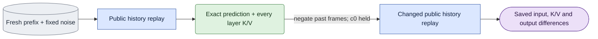

# Independent changed-past observations

## Objective

The `conditioning_check` selector's explicit `past_influence` operation checks
whether independently changed generated-past frames reach the native history
and affect the next block. A future-noise control cannot answer this question.
This owner calls the public causal operations and does not define a sampler.
Its saved measurements establish input use, not identity or action quality.

## Data flow

Require a fresh, complete generated-history `continuation_check` capture and
its exact reference. Run both public saved scientific verifiers. Their sigma,
protocol, source snapshot, fixed inputs and current software must match.
Both contain the pre-eviction block `[3,5)` and after-eviction block `[11,13)`
within the same 17-frame B2/D8 case. Source manifests, specs and records remain
byte-pinned dependencies. Original corpus and producer data are unchanged.

Each source snapshot contains the full generated clean history, current noisy
block, capture, guide, full noise, c0, text, native positions, timesteps and
every retained layer's K/V. For each target, first reconstruct the original
calculation. Cache mode starts empty and calls `causal.refresh_block` on every
completed block in chronological order. Every refresh uses the saved generated
clean block, writes at sigma zero, and invokes the public eviction policy.
The original denoise forwards were read-only and contributed no cache writes.
Consequently this replay preserves the cache transaction order exactly.
It never calls the approximate `prime_cache` operation.

The snapshot recorder copies token values into one full-span history buffer;
its narrow views do not retain the original refresh block's memory layout.
Replay restores the first block as contiguous, matching the rollout's clean-c0
`torch.cat`. Later blocks use a preserve-format clone, which packs the saved
buffer's channel-major slices into the original dense channel-major blocks
(or retains dense row-major blocks in the tiny fixture). This restoration
preserves every value exactly and applies equally to original and changed
arms. Native GEMM rounding can depend on strides, so equal values alone do
not justify replaying a padded view. All-layer K/V and prediction equality
remain mandatory; no tolerance is introduced.

Before denoising, stream and compare every reconstructed layer's actual cache
against the capture's saved K/V, bit-for-bit. `causal.denoise_block` must also
reproduce the saved cached prediction exactly. Original cache tensors reuse
that current verified source file only after the live all-layer comparison;
the new record includes the independently observed tensor hashes.

Recompute mode calls `causal.denoise_with_clean_history` with the saved original
history and current noisy block. Its original prediction and every layer's
native history K/V must equal the fresh reference producer exactly. The frozen
continuation owner's `ReferenceObserver` transparently delegates each native
attention function, observing history K after normalization/RoPE and native V.
It does not alter q, k, v, masks, or the attention result.

Only after the original prediction and all-layer reconstruction pass does the
changed arm run. It negates completed history frames `[1, target_start)` and
preserves frame zero, all current/future bytes, guide, current noise, text,
positions, schedule and geometry. The same public cache/recompute operations
consume this deliberately mismatched past. Save its actual all-layer K/V and
current-block prediction. Record differences separately for each computation
and each target; do not compare cache and recompute as this intervention's
changed factor.

## Organization logic

`source_records` verifies both producers and their exact lineage before any
native work. `changed_history` owns the single data intervention. `run_arm`
calls the public causal operations and records native inputs through a public
PyTorch transformer pre-hook. Cached K/V is streamed through public cache
reads; recomputed K/V uses the existing transparent continuation observer.
No numerical input is modified by an observer.

Each target/arm saves prediction, input trace and all-layer observations.
The trace records actual latent, global sigma, token timesteps, positions,
keyframe mask, causal mask, text hash, cache read/write boundary and all layer
lengths. `verify_trace` reconstructs every expected refresh and denoise input
from the saved source. It checks the full transaction order, including the
sigma-zero refresh payload and the retained context after eviction.

`verify` reads saved bytes only. It repeats source scientific verification,
checks native coordinate constructions without tolerances, verifies both
original predictions and every original layer against their saved producers,
and recomputes every difference. Every observed history layer and the current
prediction must change in the intervention. A missing boundary or layer,
unchanged intervention, source/profile drift or corrupted input fails.
`execute` opens one base dev LTX-2.5 native session, supplies the saved text
directly, and checks free disk before writing full layer observations.
The existing selector publishes its manifest only after saved verification.

Worked example: before `[3,5)`, replay refreshes `[0,3)` then denoises the
fixed current block. After `[11,13)`, replay refreshes five completed blocks,
retaining c0 and eight later frames before the fixed current block. Per arm,
cache makes two and six forwards respectively; recompute makes one per target.
Thus one operation makes 16 actual cache forwards or four recompute forwards.
Original byte equality is a prerequisite; a large changed-arm difference
cannot compensate for a failed original reconstruction.

The optional `--review-of <completed-past-output>` selects a separate
decoder-only attempt through this same frozen operation. Its dependency list
adds the exact past producer. Saved native verification must pass first;
the review pins its result and queue manifest. Its decoding profile includes
the frozen `reference_inputs` helper as an operation-specific source.
It checks the original membership through the full native source verifier and
public `ClipStore.verify`, then derives a copied RGB source descriptor through
`reference_inputs.checked_source`. Original membership and crop bytes remain
immutable. Current VAE fingerprint must equal the original capture encoder.

`execute_review` obtains one fresh `review_preparation` before opening the
decoder. It keeps that verified input object within the same invocation, then
calls the private `_verify_review_prepared` to check the saved decoder outputs.
This private function checks all presentation latents, RGB identities, reference
attribution, labels, layouts, frame maps, videos and posters. It does not repeat
the already completed native prerequisite calculation inside that child.
The prepared object is not saved or exposed as a verification option.

The public `verify_review(args)` always obtains a new `review_preparation`
before calling the same private output checker. Standalone and queue completion
checks therefore repeat the full native prerequisite verification independently
of the child. They cannot reuse its prepared object. Source software checks,
exact original replay, all-layer checks and declared budgets remain unchanged.

For each boundary, concatenate the saved supplied generated prefix with that
arm's exact current prediction, unpatchify through the public grid, and save
the exact presentation latent. Fresh public VAE decoding produces lossless
RGB tensors. Public reference preparation also runs fresh at each exact
prefix length, five or thirteen encoded frames; it does not slice a longer
VAE decode. Recompute uses the saved cached generated prefix with a recomputed
current prediction, and its caption states this origin.

Each synchronized video shows Capture RGB, Capture VAE, Guide RGB, original
current-block diagnostic, and changed current-block diagnostic. Full view has
five equally high panels in two rows of three. Narrow view uses the shared
compact layout with original/changed adjacent. Titles give the actual encoded
current interval; the caption records its RGB start, schedule, history, fixed
current noise and artificial negated past. Source mapping is exactly zero
through 32 before eviction or zero through 96 after eviction, at 30 fps.
The original value line is `Diagnostic; VAE decoded`; the changed value line
is `Negated past; VAE decoded`. Both must fit the actual public full and
narrow layout geometry. Narrow selection may stack panels to preserve readable
exact labels, with original and changed immediately adjacent.
The poster is the final current-block frame. Public scaling preserves aspect
ratio. Saved verification reconstructs presentation latents, reference crop
and pixels, all decode keys, labels, frame maps, full/narrow layouts, video
dimensions and poster pixels without opening a model or decoder.

## Invariants

- Source members, source images and baseline results are immutable.
- Current noise, guide, text, c0, positions, sigma and B2/D8 stay fixed.
- Original prediction and every original layer require exact equality.
- Cache replay keeps every original refresh/eviction transaction; no priming.
- Both targets and every native layer are required.
- A decoder verifies native prerequisites before opening its session. Prepared
  input reuse stays within one child; public saved verification prepares afresh.
- Source and owner pins are operation-specific. Other conditioning,
  reference and capacity profiles do not include this helper.
- Generic queue supervision bounds the whole operation; observations are
  diagnostic cost, not warmed deployment latency.

## Gotchas

Negated past latents are a mismatched input control, not a real second action
or a perceptual-quality reference. Before and after eviction use different
retained histories, but each arm pair holds its current block fixed. Cache
history was written at sigma zero; recomputed history uses zero token times
and current global sigma. These remain separate computations.
Full native K/V can occupy many gigabytes. Layers are read and compared one at
a time; only one GPU cache is resident. Native CUDA and CPU timestamp division
may differ by one float32 ULP. Save the actual native full grid, require exact
public CPU or CUDA arithmetic, and bind every observed call to that saved grid.
The whole-attempt deadline includes the queue's saved completion checks after
the decoder exits. Removing repeated child preparation does not establish that
the full attempt meets its bound; fresh native and decoder evidence must prove it.

## Tests

Tiny real-transformer tests cover both sigmas, both history computations,
both eviction targets, original all-layer/prediction equality and changed-past
effects. Channel-major saved histories additionally exercise original
c0-concatenation and packed later-refresh strides, and bind the original
replay to those operation-specific layouts without changing token values.
Negative tests change c0, past content, current noise, positions,
timesteps, text, cache lengths, transaction order and an original layer.
Source tests reject different sigma/history/snapshot or missing targets.
Saved-only checks block model/session loading and reject changed predictions,
actual inputs, K/V bytes, measurements and position grids. Dispatcher tests
check the literal operation and exact two producer dependencies. CPU checks
do not establish native or perceptual acceptance.
Decoder tests require separate five/thirteen-frame reference requests and
matching native decode calls; verify exact supplied-past/current latents and
reject changed latent, RGB bytes, source mapping, crop or poster. The shared
media owner supplies real layout tests; local decoder tests use a bounded
pixel fixture and never initialize CUDA.
Decoder lifecycle tests reject failed native preparation before a decoder can
open, require one preparation per child, and reject corrupt saved outputs even
with that prepared input. Standalone verification must reject a changed native
prediction after decoding; an earlier child check cannot supply that proof.
Real public geometry tests also cover the complete reference/diagnostic labels
at both boundaries, five panels in the full two-by-three grid, readable narrow
titles, unchanged frame maps and original/changed adjacency.
