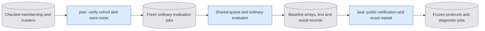

# `experiments/prepare_continuation.py` — fixed E3 inputs and protocols

## Objective

Prepare fresh E3 jobs on CPU. The ordinary evaluator makes each baseline. This
owner then checks those saved results and seals the protocol that
`continuation_check` reads. It loads no model, starts no child and claims no
GPU. It changes no ordinary software profile or experiment selector.

## Usage

Run both operations directly on CPU, from `LTX-2` in the `ltx` environment.
The shared queue runs all the jobs that they write. See
[run guide §9, E3](../../configs/README.md#e3--causal-continuation-continuation_check-continuation_identity_check-causality).

1. **Plan.** Prepare the noise and the baseline jobs:

   ```bash
   cd LTX-2
   "$PY" -m scripts.onestep_avatar.experiments.prepare_continuation plan \
     --membership <CHECKED_MEMBERSHIP.json> --source <VIEW_ID> --seeds 42 \
     --cohort first_view --resource-budget <E3_BUDGET.json> --output <FRESH_PREPARATION>
   ```

2. Run `<FRESH_PREPARATION>/baseline_jobs.json` with the queue.
3. **Seal.** After all six baseline jobs of each case pass, seal the protocols:

   ```bash
   "$PY" -m scripts.onestep_avatar.experiments.prepare_continuation seal \
     --plan <FRESH_PREPARATION>/plan.json --output <FRESH_SEALED_PROTOCOLS>
   ```

4. Run `<FRESH_SEALED_PROTOCOLS>/continuation_jobs.json` with the queue. It
   contains the unchanged baseline jobs and their dependent diagnostic jobs.
   Keep the baseline receipts when you use the same list and state.

| `plan` argument | Meaning |
|---|---|
| `--membership` | Required. A checked membership. |
| `--source` | Required. One view. For `held_out`, give three views of three held-out people. |
| `--seeds` | Required. One seed for `first_view`, exactly two for `held_out`. |
| `--cohort {first_view,held_out}` | Required. The cohort. |
| `--resource-budget` | Required. The queue budget of the jobs. |
| `--prompt` | The text prompt. |
| `--output` | Required. A new output directory. |

| `seal` argument | Meaning |
|---|---|
| `--plan` | Required. The `plan.json` of the preparation. |
| `--output` | Required. A new output directory. |

## Data flow



The plan records the exact membership bytes, the source identity, the capture
and guide token hashes, the clean first-image hash, the software, the budgets
and the saved noise.

- The noise has the shape `[1,17*32*32,128]`, native bf16 precision and a CPU
  generator.
- Each seed has one original noise array.
- The arrays for boundaries 3 and 11 keep all earlier bytes and negate only the
  later values. Their provenance is saved too.

## Organization logic

### Plan

`plan` checks the selected cohort before it writes.

- `held_out` requires three different people, one view each in the held-out
  split, and two different seeds.
- `first_view` requires one view and one seed. It can use any recorded split.

Both require `white` paired masters, 30 fps, at least 17 encoded frames, 128
channels and a 32 × 32 encoded image grid. The corpus reader verifies the
current producer bytes, the crop agreement and the guide compositing. The
registered LTX-2.5 dev VAE must match both producer records.

The owner saves one fresh case directory for each source and seed. Each
directory has the noise and three ordinary evaluation jobs for each sigma:

- cached;
- an identical cached repeat;
- recomputed history.

Both sigmas use direct `[1,0]` or `[0.909375,0]`, B2/D8, base-only dev weights
and generated history. The owner writes `plan.json` and `baseline_jobs.json`
only after source validation passes.

### Seal

`seal` does these checks:

1. Validate the unchanged plan, software, budget, membership and saved noise.
2. Call `evaluate.verify_evaluation_conditions` on every baseline.
3. Check the fixed token identities across all roles and sigmas.
4. Load the two cached outputs and prove a bit-identical repeat.

A missing output, a changed input or a failed repeat stops publication. The
baseline arrays and their records never change.

The sealed protocol records the ordinary jobs and the noise in the exact
format that `continuation_check` accepts. For each case:

- two generated-history captures and their references give the layerwise
  observations;
- eight future-noise jobs cover both sigmas, both history calculations and
  both boundaries.

References depend on capture jobs. All captures and controls also depend on
their ordinary baseline job. The full queue list includes the unchanged
baseline entries, so those dependencies keep one spelling.

Worked case: three people and seeds 42 and 43 give six case directories, 36
baseline jobs and 72 later diagnostic jobs. The first-view cohort gives six
baseline jobs and 12 diagnostic jobs. No field claims that those jobs ran.
Capture-history observations stay a separate diagnostic. Independent
changed-first-image and shortened-prefix controls have their own owner.

## Invariants

- The source, text, noise, geometry, schedule, base and history stay the same
  across each comparison.
- The original E3 limits stay: 1,800 seconds per case and 48,800 MiB of sampled
  total-device occupancy. The explicit queue budget is separate.
- Destination directories must be fresh.
- This owner never repairs missing evidence, never changes existing records and
  never uses seven-frame pilot noise instead.

## Gotchas

- The continuation checker requires complete ordinary baseline results and
  saved text. A protocol cannot be sealed before those jobs finish.
- The 17-frame noise does not fit seven-frame training or E5 jobs.
- A full layerwise capture needs about 9 GiB at the required geometry.
- The cost of those jobs includes observation overhead. Ordinary cost needs
  separate warmed measurements.

## Tests

Tests cover cohort exclusions, exact seed and prefix noise behavior, fixed job
conditions, refusal of a changed plan or noise, refusal of an inexact cached
repeat and the protocol and control lists. Public evaluator verification is
mandatory. CPU preparation and saved verification do not prove native
appearance or resource acceptance.
