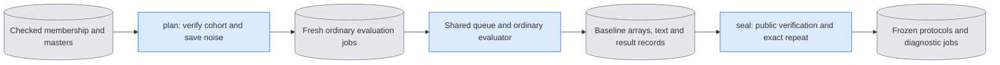

# `experiments/prepare_continuation.py` — fixed E3 inputs and protocols

## Objective

Prepare fresh E3 jobs on CPU. The ordinary evaluator produces each baseline.
This owner then checks those saved results and seals the protocol consumed by
`continuation_check`. It loads no model, starts no child and claims no GPU.
It changes no ordinary software profile or experiment selector.

## Data flow

The plan records exact membership bytes, source identity, capture/guide token
hashes, clean first-image hash, software, budgets and saved noise. Noise has
shape `[1,17*32*32,128]`, native bf16 precision and a CPU generator. Each seed
has one original noise array. The arrays for boundaries 3 and 11 preserve all
earlier bytes and negate only later values. Their provenance is saved too.

## Organization logic

`plan` checks a selected cohort before writing. `held_out` requires three
different people, one view each in the held-out split, and two distinct seeds.
`first_view` requires one view and one seed and can use any recorded split.
Both require white paired masters, 30 fps, at least 17 encoded frames, 128
channels and a 32 by 32 encoded image grid. The corpus reader verifies current
producer bytes, crop agreement and guide compositing. The registered LTX-2.5
dev VAE must match both producer records.

The owner saves one fresh case directory per source and seed. Each contains
noise and three ordinary evaluation jobs per sigma: cached, identical cached
repeat and recomputed history. Both sigmas use direct `[1,0]` or
`[0.909375,0]`, B2/D8, base-only dev weights and generated history. It writes
`plan.json` and `baseline_jobs.json` only after source validation succeeds.

`seal` validates the unchanged plan, software, budget, membership and saved
noise. It calls `evaluate.verify_evaluation_conditions` on every baseline.
It also checks the fixed token identities across all roles and sigmas and
loads the two cached outputs to prove bit-identical repeat. A missing output,
changed input or failed repeat prevents publication. Baseline arrays and their
records are never changed.

The sealed protocol records the ordinary jobs and noise in the exact format
accepted by `continuation_check`. Per case, two generated-history captures and
their references supply the layerwise observations. Eight future-noise jobs
cover both sigmas, both history calculations and both boundaries. References
depend on capture jobs; all captures and controls also depend on their
ordinary baseline job. The full queue list includes the unchanged baseline
entries so those dependencies retain one spelling.

Worked case: three people and seeds 42/43 produce six case directories,
36 baseline jobs and 72 later diagnostic jobs. The first-view cohort produces
six baseline jobs and 12 diagnostic jobs. No field claims that those jobs ran.
Capture-history observations remain a separate diagnostic. Independent
changed-first-image and shortened-prefix controls have their own owner.

## Invariants

Preserve source, text, noise, geometry, schedule, base and history across each
comparison. Keep the original E3 limits: 1,800 seconds per case and 48,800 MiB
sampled total-device occupancy. The explicit queue budget remains separate.
Destination directories must be fresh. This owner never repairs missing
evidence, changes existing records or substitutes seven-frame pilot noise.

## Gotchas

The continuation checker requires complete ordinary baseline results and saved
text. A protocol cannot be sealed before those jobs finish. The 17-frame noise
does not fit seven-frame training or E5 jobs. Full layerwise captures need about
9 GiB each at the required geometry. Cost from those jobs includes observation
overhead; ordinary cost needs separate warmed measurements.

## Tests

Tests cover cohort exclusions, exact seed and prefix noise behavior, immutable
job conditions, changed plan/noise refusal, exact cached-repeat refusal and
protocol/control inventories. Public evaluator verification is mandatory.
CPU preparation and saved verification do not establish native appearance or
resource acceptance.
