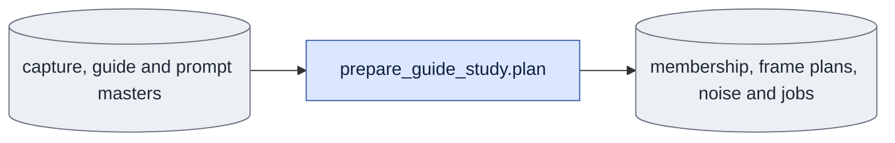

# `experiments/prepare_guide_study.py` — prepare the guide study

## Objective

Prepare fresh S1–S3 inputs and ordinary queue jobs on CPU. Reuse verified capture,
guide and prompt masters. Never start a model, decoder or queue owner.

## Usage

Humans and agents run this CPU command directly in the `ltx` environment.
Run from the LTX-2 root. See [Other studies](../../configs/README.md#other-studies).

```bash
python -m scripts.onestep_avatar.experiments.prepare_guide_study plan \
  --root ../expr/onestep_avatar/ar_sigma_rollouts_rerun_20261012 \
  --prompts ../expr/onestep_avatar/d1_diagnostic/ar_sigma_rollouts/configs/prompts.json \
  --owners 2 --dry-run
```

Remove `--dry-run` to write inputs and jobs. `--root` selects the study directory.
`--prompts` names the checked predecessor prompt record. `--owners` sets the
number of balanced owner lists. `--corpus-root` defaults to the public corpus root.
The command refuses existing `inputs` or `queues`, including during a dry run.
Outputs are membership, frame plans, saved noise, prompt records and queue specifications.
The study root may already contain report and provenance directories.

## Data flow



## Organization logic

1. Verify prompt text hashes and exact three-actor membership through `corpus.subset`.
2. Select both frame plans through `training.config.build_frame_plan`.
3. Draw one native bf16 token array per actor with CPU seed 42.
4. Save all 18 frames and a cloned first-17-frame slice for causal jobs.
5. Build exact schedules through the registered distilled grid and public sampling functions.
6. Deduplicate jobs by actor, arm, schedule, prompt text and history.
7. Make capture-first comparison groups. Cover every evaluation output for decoded metrics.
8. Split each production phase into balanced owner lists. Keep render dependencies local.

Worked example: distilled D1 at sigma .725 has one direct job and one tail job.
The tail is `[.725, .421875, 0]`. P0 reuses these jobs in the prompt comparison.
For actor 0012_09, identical P2 and P3 texts share one job. Role aliases remain recorded.
The inventory is S1 142, S2 338 including five benchmarks, and S3 84.

## Invariants

Every evaluation process loads base only. All jobs pin exact noise, membership,
frame plan and prompt paths. No shared producer changes. Render panels have one
encoded length, 30 fps, capture first and an explicit view for decoded metrics.
Queue jobs use deterministic policy. Bench and render jobs use a saved 7200-second
phase budget with the unchanged 48-billion-byte allocated-memory limit.
Bench repeats full sampling four times; large render groups decode many panels. Owner lists contain no duplicate execution outputs.
Every render list embeds its dependencies; use imported terminal receipts when running it.

## Gotchas

Causal noise has token layout `1, F*H*W, C`, not video layout.
The seed draw is fresh study evidence even though the seed is fixed.
A render specification reads raw saved latents. Study controls separately verify result records.
Prompt comparisons intentionally vary text; model comparisons intentionally vary weights.
Do not claim these fields match across those specific comparisons.

## Tests

Check exact inventory, deduplication, schedule tails, guidance, empty prompts,
causal slicing, fresh-output refusal, capture-first panels and balanced owner assignments.
