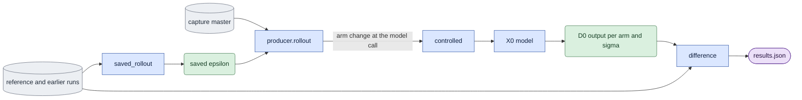

# `experiments/prune_reproduction.py` — test why the pruning baseline differs

## Objective

The current whole-clip D0 producer reproduces the saved noise and `c0` of the
saved pruning reference, but not its D0 outputs. This experiment tests the
recorded differences between the old and the current producer. Each control
changes one factor. All controls use the same session, inputs and saved noise.
The experiment compares every output with the saved runs and with its own first
current output. It does not change the producer or any shared owner.

Terms used below:

- **reference** — the saved pruning reference run (its directory holds the
  producer's `manifest.json`, one epsilon file and one D0 output per sigma).
- **earlier** — an earlier run of the current producer on the same case.
- **arm** — one pass over all requested sigmas with one setting.
- **control** — an arm that changes one named factor, or the named pair in
  `historical_inputs`.

## Data flow

`producer` is `scripts.prune.evaluate.whole_clip_baseline`. Its `rollout`
calls the causal owner with one whole-clip block, so each sigma makes one model
call. `controlled` wraps the model call: it receives the `Modality` that the
current owner built, applies the arm's input change and records the actual input.

## Organization logic

**Specification.** A schema-one spec with `"protocol": "prune_reproduction"`.
The arguments are the `prune_baseline` arguments, with the same restrictions
(one view, one seed, raw output, white distilled weights, no guidance, context
eight), and the D0 arm only. Three more options are required:
`--reference <dir>`, `--earlier <dir>` and `--controls <name> ...` with distinct
names from the table below.

**Arms.** The order is `current_first`, the controls in the requested order,
then `current_last`. The two current arms change nothing.

| Control | Change | Kept fixed |
|---|---|---|
| `sigma_bf16` | Cast the global sigma and per-token timesteps to BF16 at the model call: 0.725 → 0.7265625, 0.909375 → 0.91015625, 1.0 → 1.0. The old producer built both in the BF16 token dtype. | mask, flags |
| `dense_mask` | Add the old all-visible `(1, T, T)` float32 mask from `causal.block_causal_mask` with one block index. The current owner passes no mask for one block. | schedule precision, flags |
| `historical_inputs` | Both changes above, as the old producer had them. | flags |
| `deterministic_off` | `torch.use_deterministic_algorithms(False)`. | cuBLAS workspace, cuDNN flags, model inputs |
| `cudnn_deterministic_off` | `torch.backends.cudnn.deterministic = False`. | other flags, model inputs |
| `bf16_reduction_off` | `torch.backends.cuda.matmul.allow_bf16_reduced_precision_reduction = False`. | other flags, model inputs |

**Ordered operations.**

1. Read the spec. Pin full SHA-256 hashes of the spec, capture, guide,
   transformer, text encoder, VAE, prompt cache, both saved manifests, their
   epsilon files and their requested D0 outputs. Capture the evaluation/causal
   software record with this module, `prune_baseline` and the producer as
   extra owners.
2. Read each saved run through its own manifest. The seed, objective, variant,
   context frames and whole-clip flag must match the spec. The run must list
   one epsilon and one D0 output for each requested sigma. Each file must match
   its recorded hash and stay inside the run directory. The two saved epsilons
   must be equal.
3. Open the session. The prompt context bytes must match the context hash of
   both saved runs. The transformer fingerprint and path must match the pinned
   identity.
4. Build the producer's grid and one-block plan. Draw the seeded epsilon again
   and record whether it equals the saved one. Every arm uses the saved epsilon.
5. For each arm: change the process flag, if any. Refuse the arm when its
   starting flag does not have the required value. Run every sigma. Then run
   the first sigma again under the profiler. Record for each call the sigma and
   timestep dtypes and values, the mask shape, dtype, minimum and maximum, and
   the latent hash. Record the flags before and during the arm, the counted
   attention operator and kernel names, whether the profiled output equals the
   first output, the time and the peak CUDA memory. Restore the flags and
   prove that they returned to the start values.
6. Compare each arm and sigma with the reference, the earlier run and
   `current_first`: exact equality, unequal elements, float64 RMS and maximum
   absolute difference, overall and per latent frame. No tolerance is fitted.
7. Write the summary: `current_repeats_earlier`, `current_first_equals_last`,
   `arms_reproducing_reference`, `arms_changing_current` and
   `rms_to_reference`.
8. Save `<arm>/sigma_<sigma>_d0.pt` and `results.json`. Check the software
   record and the input pins again, then write `acceptance.json` and the queue
   `manifest.json`.

**Completion.** `verify_completion` loads no model. It checks the manifest
inventory, the acceptance record, the current software, the arm and sigma
lists, the output hashes, and then recalculates every comparison and the
summary from the saved tensors. Any difference raises.

**How to read the result.**

1. `current_repeats_earlier` is false: the current producer does not repeat
   across processes. Stop; no control can be read.
2. `current_first_equals_last` is false: an arm left changed state. The run is
   invalid.
3. An arm in `arms_reproducing_reference` reproduces the reference exactly at
   every sigma. Its change is sufficient in this environment.
4. An arm in `arms_changing_current` that does not reproduce the reference is a
   factor with an effect. Compare its `rms_to_reference` with `current_first`.
5. No arm reproduces the reference: the cause is outside these factors. Check
   the job without the deterministic policy (below) and the remaining source
   differences between the two producers.

**Two jobs.** The cuBLAS workspace is fixed when CUDA starts, so one process
cannot change it. Run one job with `"numerical_policy": "deterministic"` and all
controls. Run a second job with no numerical policy. PyTorch defaults then
apply, as in the reference run; leave out `deterministic_off` and
`cudnn_deterministic_off` there, because they need the deterministic policy.

## Invariants

- Every arm uses the same session, capture, saved epsilon, prompt context,
  geometry and sigmas. The recorded latent hash of each call proves equal inputs.
- Changes enter only at the model call or through process flags. The producer
  and the shared model owners stay unchanged.
- The saved runs are read-only inputs, pinned by hash.

## Gotchas

- The dense mask costs `T × T × 4` bytes per call: 18 latent frames of 1,024
  tokens give 18,432 tokens and 1.36 GB.
- A mask can select a different attention kernel. The profiler names show the
  operators and kernels that ran; the names depend on the PyTorch build.
- Profiling does not change the output; `profiled_equals_unprofiled` checks it.
- The deterministic policy also fixes cuBLAS workspace and cuDNN flags, so
  `deterministic_off` changes one flag, not the whole policy.

## Tests

`tests/experiments/test_prune_reproduction.py` runs the real tiny CPU producer
twice to make the saved reference and earlier runs, then runs four controls.

Worked check: at sigma 0.725 the `current_first` call has float32 sigma
0.725 and no mask. The `sigma_bf16` call has BF16 sigma 0.7265625 and timesteps
{0, 0.7265625}. The `dense_mask` call has a float32 mask of ones. All calls
have the same latent hash. On CPU, `current_first`, `current_last`, the
reference and the earlier run are equal, and `sigma_bf16` changes the output.

The tests also check that completion loads no model, that the queue routes the
selector, that a rewritten RMS in `results.json` fails completion even with a
rebuilt inventory, that changed saved tensors fail, that each flag control
changes one flag and restores it, and the argument and saved-run refusals.
