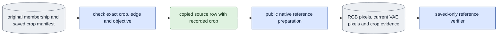

# `experiments/reference_inputs.py` — original membership reference pixels

## Objective

Prepare fresh current-VAE capture references while preserving the exact original
membership consumed by model results. The current membership owner records the
crop inside capture and guide encoding records. Public RGB replay also requires
that crop at the top level of a source row. This experiment owner supplies a
checked in-memory copy; it changes no membership file, source pixel or encoding.

## Data flow

## Organization logic

`checked_source` verifies the saved `CaptureManifest` byte hash against the
original membership. The manifest's crop must equal the original capture and,
when present, guide encoding crop. Edge and objective must also agree. An
existing top-level crop must equal that same recorded crop. Only then does a
deep copy gain the top-level field consumed by public RGB replay. The original
row and membership content identity remain unchanged. Never compute a new box,
substitute a donor crop or silently accept a contradictory top-level field.

The `prepare_references` operation is dispatched by the existing
`conditioning_check` queue selector. Scientific arguments are `--subset`,
`--source`, `--encoded-frames`, `--seed`, optional `--guide-mode` (default D1)
and `--model` (2.5). The queue owns output, GPU assignment, claim, supervision
and phase budgets. There is no child launcher or expression-directory model
code. This operation has no model-output dependencies: it prepares inputs only.
The generic 1,800-second phase bound covers all native VAE work.

Before decoding, publication verification checks the original corpus hashes and
loads the checked source through `ClipStore`. Frame coverage must fit the saved
continuous master; D1 requires a checked guide. The current VAE fingerprint must
match the original capture encoder. Pin original membership, crop manifest,
VAE, capture encoding, RGB, bbox, white matte and any guide artifacts through
publication. Native work uses only `media.prepare_training_references` and
`media.save_training_references`; no transformer or text encoder is loaded.

Save `references.json` with recorded RGB, current VAE-decoded capture and paired
guide RGB. Its producer retains truthful original membership file and content
hashes and adds `source_crop_adapter` evidence. `source_crop.json` independently
pins that derivation, inputs and current decoder software, including this
experiment owner and the specification owner. Generic experiment completion
`manifest.json` can coexist with these reference assets.

Saved verification rechecks original input pins and derivation, current software,
current VAE and decoder key, selected span and original membership identity. It
loads saved panel tensors and replays capture/guide RGB preprocessing on CPU to
check exact source crop and white objective. Native decoding is never repeated
in completion. The VAE output is bound by current decoder identity and saved
pixel/file hashes, rather than a fabricated second decoding result.

The same crop adapter is used by conditioning and separately D0-trained capacity
reviews before public RGB replay. Their references therefore remain compatible
with the exact membership identity recorded in ordinary evaluation outputs.

## Invariants and gotchas

- Original membership, corpus producer records and preprocessed tensors remain
  unchanged; the copied row serves only the public RGB-reader schema.
- All compared references retain the actual source, crop, objective and timebase.
- A D0 guide may be absent; a present guide still must agree with capture crop.
- Queue integrity completion is not visual identity or action acceptance.
- Reference preparation covers its requested span and seed; a 17-frame or
  differently seeded reference cannot replace a seven-frame matching bundle.

## Tests

`test_reference_inputs.py` reads a real saved crop manifest and checks deep-copy
behavior. It rejects changed manifest bytes, capture/guide crops, edge, objective
and existing top-level crop. It covers an unused D0 guide and the queue selector's
scientific parser and saved-only operation dispatch. Saved reference tests reject changed crop
derivation, original membership identity, decoder keys and replayed capture
pixels without opening the VAE. Conditioning review tests
exercise matched references, donor identity, readable full/narrow presentation
and tamper rejection; native appearance and GPU cost require fresh queue runs.
