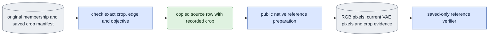

# `experiments/reference_inputs.py` — original membership reference pixels

## Objective

Prepare fresh capture references with the current VAE, and keep the exact
original membership that the model results used.

The current membership owner records the crop inside the capture and guide
encoding records. Public RGB replay also needs that crop at the top level of a
source row. This experiment owner supplies a checked copy in memory. It changes
no membership file, source pixel or encoding.

## Usage

This module has no selector of its own. Run it as a queue `experiment` job
with selector `conditioning_check` and operation `prepare_references`. It loads
only the current decoder and the public recorded RGB readers. See
[run guide §9, E5](../../configs/README.md#e5--bounded-learning-pilots).

```json
{"schema_version": 1, "protocol": "conditioning_check", "operation": "prepare_references",
 "arguments": ["--subset", "/abs/original_membership.json", "--source", "<VIEW_ID>",
               "--encoded-frames", "17", "--seed", "42", "--guide-mode", "d1"]}
```

| Scientific argument | Meaning |
|---|---|
| `--subset` | The original membership. Its bytes stay unchanged. |
| `--source` | One view ID. |
| `--encoded-frames N` | The number of encoded frames. |
| `--seed` | The decode seed. |
| `--guide-mode {d0,d1}` | Default D1. D1 requires a checked guide. |
| `--model` | The VAE version. Default 2.5. |

This operation has no model-output dependencies. Outputs: `references.json`,
the pixel tensors, `source_crop.json` and `manifest.json`.

## Data flow



## Organization logic

### Source row

`checked_source` does these checks:

1. Verify the byte hash of the saved `CaptureManifest` against the original
   membership.
2. The manifest's crop must equal the crop of the original capture encoding
   and, when present, of the guide encoding.
3. The edge and the objective must also agree.
4. An existing top-level crop must equal the same recorded crop.

Only then does a deep copy get the top-level field that public RGB replay
reads. The original row and the membership content identity stay unchanged.
Never compute a new box, use a donor crop or accept a contradictory top-level
field.

### Queue

The queue owns the output, GPU assignment, claim, supervision and phase
budgets. There is no child launcher and no model code in an expression
directory. The operation prepares inputs only. The generic 1,800-second phase
limit covers all native VAE work.

### Preparation

1. Before decoding, check the original corpus hashes. Load the checked source
   through `ClipStore`.
2. The frame coverage must fit the saved continuous master. D1 requires a
   checked guide.
3. The current VAE fingerprint must match the original capture encoder.
4. Pin, through publication: the original membership, crop manifest, VAE,
   capture encoding, RGB, bbox, `white` matte and any guide files.
5. Run only `media.prepare_training_references` and
   `media.save_training_references`. No transformer or text encoder loads.

`references.json` holds the recorded RGB, the current VAE-decoded capture and
the paired guide RGB. Its producer keeps the true original membership file and
content hashes, and adds `source_crop_adapter` evidence. `source_crop.json`
pins that derivation independently, with its inputs and the current decoder
software, including this experiment owner and the spec owner. A generic
experiment completion `manifest.json` can exist beside these files.

### Saved verification

Saved verification checks again the original input pins and the derivation,
the current software, the current VAE and decoder key, the selected span and
the original membership identity. It loads the saved panel tensors and replays
the capture and guide RGB preprocessing on CPU, to check the exact source crop
and the `white` objective. Completion never repeats native decoding. The
current decoder identity and the saved pixel and file hashes bind the VAE
output. No second decoding result is made up.

Conditioning reviews and separately D0-trained capacity reviews use the same
crop adapter before public RGB replay. So their references stay compatible
with the exact membership identity in ordinary evaluation outputs.

## Invariants and gotchas

- The original membership, the corpus producer records and the preprocessed
  tensors stay unchanged. The copied row serves only the schema of the public
  RGB reader.
- All compared references keep the actual source, crop, objective and time
  base.
- A D0 guide can be absent. A present guide still must agree with the capture
  crop.
- Queue integrity completion is not acceptance of visual identity or action.
- Reference preparation covers its requested span and seed. A 17-frame
  reference, or one with another seed, cannot replace a matching seven-frame
  bundle.

## Tests

`test_reference_inputs.py` reads a real saved crop manifest and checks the
deep-copy behavior. It refuses changed manifest bytes, capture or guide crops,
edge, objective and an existing top-level crop. It covers an unused D0 guide,
the selector's scientific parser and the saved-only operation dispatch.

Saved reference tests refuse a changed crop derivation, original membership
identity, decoder keys and replayed capture pixels without opening the VAE.
Conditioning review tests cover matched references, donor identity, readable
full and narrow presentation and tamper refusal. Native appearance and GPU cost
need fresh queue runs.
