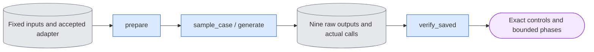

# `experiments/short_causal_check.py` — exact short causal controls

## Objective

Check repeated generation, the supplied first image and future-noise independence
through the shared causal evaluation and product functions. Use one accepted
E4 step-one adapter, seven encoded frames and generated cache history.
These checks establish numerical agreement. They establish no video quality or
behavior after cache eviction.

## Data flow

The existing `continuation_check` queue selector accepts `--phase short_controls`.
Its strict specification names the original training job, accepted serial update
result, fixed E2 inputs, zero and step-one checkpoints, and changed noise for
boundaries three and five. The ordinary queue owns the device, process ledger,
runtime contract and supervision. This module launches no process.
The continuation owner loads this module only for the selected short phase.
The larger continuation phases keep their original import and source closure.

The public E2 preparation checks calibration, checkpoint lineage, actual saved
training context, independently supplied image, continuous guide and exact saved
noise before weights. This module adds its fixed short-control restrictions and
binds both experiment owners to the current software manifest.

The shared grid, adapter loader, `evaluate.sample_case`,
`causality.probe_future_noise` and `infer.generate` produce all outputs.
The shared saved-case and manifest owners publish artifacts. Completion reads
CPU tensors and checks their relationships. It opens no model or decoder.

## Organization logic

Require D1, white, LTX-2.5 dev, seed 42, direct `[0.725, 0]`, B=2, K=3,
D=8 and generated history. Preserve the training span as null. Select seven
encoded frames at 30 fps and 1024 square RGB geometry. Read the actual training
context; never reconstruct it from a prompt. Use the independent supplied image
for `c0`, including the capture tokens passed to evaluation.

Require BF16 saved noise. At boundary three or five, its earlier values stay
exact and all later values equal the negated original noise. Validate this
relationship before any transformer load. The two changed arrays are inputs,
not noise regenerated by this module.

Load the checked unmerged FP32 step-one adapter once. Run two independent
evaluation rollouts and one product rollout with the original noise. For each
boundary, run the public two-output future-noise probe and one product rollout
with the same changed noise. This produces nine outputs and 54 measured native
forwards. Every rollout starts a fresh shared cache and has three denoises,
zero primes and three refreshes.

Require finite BF16 arrays with the exact source geometry and supplied `c0`.
The repeated arrays and matching evaluation/product arrays must be bit-identical.
Each intervention's original branch equals the first repeat. Before its
boundary, the changed output is exact with maximum delta zero. Record later
differences without fitting an acceptance tolerance.

Measure eight phases: load, repeat_a, repeat_b, product_original,
future_noise_3, product_changed_3, future_noise_5 and product_changed_5.
Keep the accepted E4 budget: 1800 seconds per phase and 48 billion allocated
bytes. The module uses the shared Phase owner and retains failed records.
Recheck all pinned bytes, source identity and numerical policy before the final
result and strict spec manifest. Partial failures cannot complete.

## Invariants

- One numerical owner for conditioning, noising, generation, adapters and caches.
- The same actual saved context, supplied image, guide and matrices enter every path.
- Full-value exact controls; E4 calibration tolerances do not relax these checks.
- Both zero and step-one exports prove accepted lineage; rollouts use step one.
- Every raw record binds its consumed noise, guide, text, image, calls and producer.
- CPU completion checks all nine arrays, resource phases and local artifact paths.

## Gotchas

Seven encoded frames cover 49 RGB frames. This check has no cache eviction.
The independently supplied image can differ from capture frame zero; replacing
only the output first frame does not satisfy the input rule.
Two future-noise phases each contain two rollouts. Count actual forwards through
the shared measurement hook as well as checking each rollout's call record.
Do not retain a model reference after leaving its adapter lifecycle.

The larger 17-frame continuation phases retain their separate scientific
preparation, sampled device guard and completion checks. This module does not
change their geometry, history, sigma or artifact requirements.

## Tests

Use a real small causal transformer with the shared evaluation, product and
future-noise APIs. Require all nine outputs, supplied-image preservation, exact
repeat/product/future controls and 54 actual forwards. Check parser isolation
and existing continuation profiles. Saved-only controls block model loading and
reject rehashed output changes, incorrect calls, changed source/input identity,
redirected artifacts and missing resource phases. Native acceptance needs the
same fixed full-weight inputs and completed E4 calibration.
