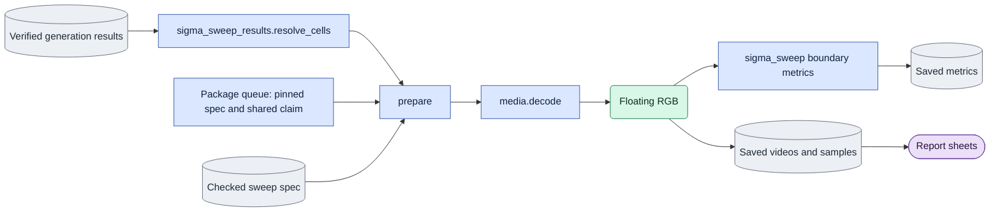

# `experiments/sigma_sweep.py` — decode and score a sigma sweep

## Objective

Decode and score the generated outputs of a result-bound sigma sweep: four
sigma levels by two arms (D0, D1), plus the capture and guide masters. Open
one decoder-only session after all inputs are checked. Never generate a
rollout or prompt again. Report sheets are assembled separately from the saved
samples.

The queue runs this module as the `sigma_sweep` experiment. `parse_args` is the
shared argument owner for the CLI and the queue. Parsing alone does no decoding
and no GPU discovery. The module entry calls the shared
[runtime](../execution/runtime.md) helper.

## Usage

Humans can use the foreground queue or run this module directly.
See [launch, output and stop commands](../usage.md). Agents use the queue.
The queue recipes below describe managed execution.

Start the decode as a queue `experiment` job with selector `sigma_sweep`. See
[run guide §9, other studies](../../configs/README.md#other-studies).

This is the agent path. A person can also run the same module directly, or start the queue in the foreground; see [usage](../usage.md).

The spec embeds the eight evaluation jobs whose verified results it decodes
(see [data flow](#data-flow)). Run those eight evaluation jobs first, and
declare them as dependencies.

Check a finished sweep. This opens no session:

```bash
cd LTX-2
"$PY" -m scripts.onestep_avatar.experiments.sigma_sweep --spec <SPEC> --output <OUT> --verify
```

| Argument | Meaning |
|---|---|
| `--spec` | Required. The schema-two sweep spec. |
| `--output` | Required. A new output directory (or the saved one, with `--verify`). |
| `--gpu-id` | Local GPU for direct CLI; assigned by the queue. `--verify` refuses it. |
| `--verify` | Run the saved-output verifier only. |

Outputs: ten videos, selected PNG frames, `metrics.json` and `manifest.json`.

## Data flow

The input spec (`schema_version: 2`) names:

- the capture and guide masters with their hashes;
- model `2.5`, decode seed 42 and fps 30;
- the VAE path and hash;
- eight cells. Each cell embeds its evaluation job as `evaluation_job`.

`sigma_sweep_results.resolve_cells` does these checks:

1. Require the exact causal, distilled, cached-refresh, unguided 17-frame setup,
   and the same source, prompt, seed and saved noise in all eight jobs. The job
   arguments must name the pinned masters of the spec.
2. Verify the queue scientific completion of each job.
3. Resolve `generated.pt` and its hash. A missing result fails. It is never
   generated again.

The result, text, noise, membership and original noise-file bytes are bound
before verification, checked again after it and included in the decoder's
input binding. The output manifest keeps the embedded jobs and adds the
resolved tensor identities. It does not rewrite the source spec.

The module decodes ten matched 17-frame tensors, 129 RGB frames each. It saves
ten videos, selected PNG frames, `metrics.json` and a final manifest. A report
reads those files.



## Organization logic

### Arguments and software

`parse_args(argv)` returns the parsed values and the queue completion
descriptor `{"manifest": "<output>/manifest.json"}`. The decoding software
profile stays ordinary. This experiment adds its own module, the experiment
package marker and `sigma_sweep_results.py` through `extra_sources`. The shared
decoding software manifest is recorded before input preparation. It is
checked again before the VAE opens, before media writes and before final
publication, and saved in the manifest.

### Cells

The cells, in this order, each with D0 and D1:

| Sigma | Tag | Calls |
|---|---|---:|
| 0.421875 | `one_step` | 1 |
| 0.725 | official | 2 |
| 0.909375 | official | 3 |
| 1 | official | 8 |

Masters can be longer than 17 frames. Generated tensors have exactly 17. The
module requires matching finite bf16 `B,C,F,H,W` shapes after master selection,
and matching recorded fps. Before a decoder opens, it requires a fresh output,
checked input hashes and the registered VAE path and hash. Each input decodes
through `media.decode` with a new seed-42 generator. No text context or
transformer is created.

### Scores

1. Convert the decoded FCHW to floating FHWC. Divide byte-range pixels by 255.
   Require exactly 129 aligned RGB frames.
2. Form one mask: the union of "minimum channel below 0.9" over the capture,
   the guide and all eight outputs.
3. Call `sigma_sweep_boundary_metrics` and
   `metrics.masked_rgb_transition_steps` on the uncompressed floats.
4. Record the tag, the boundary and eviction metadata, the `c0` equality
   against sigma-one D0, and the sigma-one D0/D1 equality and maximum
   difference.

`sigma_sweep_boundary_metrics` is in this module, because its fixed 129-frame
list, seven boundary locations, four-neighbor references and post-eviction
attribution belong to this study. The general aligned-mask transition operation
stays in `metrics.py`. Zero denominators give explicit undefined statuses.
Arrays use four decimals.

### Media

Each video is saved at 30 fps. PNG samples are saved at frames 0, 16, 17, 48,
49, 63, 64, 65, 66, 96, 97 and 128. PNGs use the rounded quantization of
`media.frame`. Scores are calculated before any quantization. The manifest
records the sample indices, media hashes, pixel digests, decode settings, input
and spec hashes and source hashes. The module checks the inputs, the VAE and
the sources again before it publishes the manifest atomically. A partial
directory is not complete and is never reused.

### Completion

Before publication, the module probes each MP4 for 129 frames at 30 fps and the
declared size, and checks the size of all twelve PNGs of each role.

`verify_completion` rebuilds the expected spec, input, VAE and source
identities without a model. It requires:

- the exact ten-role list and contained paths;
- the video and PNG hashes and the sample order;
- the actual frame counts, time base and size, and the pixel digest syntax;
- the hash of the metrics file;
- the cell identities and the call labels.

It recalculates the `c0` and sigma-one controls from the saved tensors. Scores
stay producer measurements and are not recomputed from MP4 or PNG. The report
reader calls this verifier before it loads samples.

## Invariants

- All inputs decode in one session with the same settings and seed.
- Missing, changed, short, nonfinite or mismatched inputs fail before a session
  or output exists.
- Old outputs are kept. A rerun uses a fresh destination.
- A report rebuild cannot start decoding or repair missing samples.
- This is saved decoding only. Generation, adapter quality and native parity
  need separate evidence.

## Gotchas

- Capture and guide paths come from saved producer manifests, not from actor
  names or guessed corpus roots. A spec must match their recorded hashes.
- A VAE mismatch refuses the comparison.
- A spec without embedded evaluation jobs is refused.

## Tests

- Eight real small CPU causal evaluations over all levels and arms verify
  sigma-one equality and resolve ten tensors without sessions or writes. A
  changed seed, arm, paired master, noise, result metadata, saved text or late
  evidence fails. Decoder readiness requires all eight unchanged receipts.
- A controlled decoder with real small media writes checks the seed reset, raw
  scores, cell identities, `c0` controls and output hashes. Missing or changed
  cells, geometry, fps, VAE, nonfinite tensors and used outputs fail before
  model work. A changed input during decoding blocks publication.
- The complete-movie change control changes the saved movie bytes while every
  poster PNG stays identical, and requires refusal. Restoring the movie passes.
- A schema-one tensor spec fails before a decoder opens.
