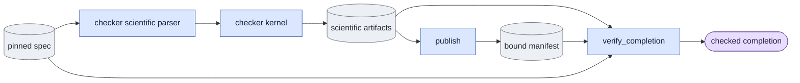

# `experiments/spec_protocol.py` — pinned checker specifications

## Objective

Give all queued checkers one strict interface that contains data only. Each
checker keeps its own scientific argument parser. This helper owns no model,
GPU claim, child process, supervisor or numerical comparison.

## Usage

This module has no command line of its own. It defines the spec file and the
outer arguments used by queued and direct experiment commands.
Humans can use [direct CLI or foreground queue execution](../usage.md).

**Spec file.** A spec is one JSON object with exactly these fields:

```json
{"schema_version": 1, "protocol": "<selector>", "operation": "<optional operation>",
 "arguments": ["--scientific", "arguments"]}
```

- `schema_version` must be the integer 1.
- `protocol` must be the exact selector of the checker, for example
  `stock_parity`.
- `operation` is optional. It must be in the checker's fixed set of operations,
  for example `reference` or `compare`.
- `arguments` is a list of strings. All paths must be absolute. It must not
  contain `--output`, `--gpu-id`, `--dry-run` or other execution flags.

**Outer arguments.** Every checker accepts the same outer arguments:

| Argument | Meaning |
|---|---|
| `--spec` | Required. The spec file. |
| `--output` | Required. A new output directory. |
| `--gpu-id` | The local GPU. Set it for direct CLI; the queue assigns it. Default 0. |
| `--dry-run` | Check the spec on CPU only. Publishes no manifest. |

Check a spec on CPU before you queue it:

```bash
cd LTX-2
"$PY" -m scripts.onestep_avatar.experiments.<selector> --spec <SPEC.json> --output <FRESH_OUT> --dry-run
```

Each checker writes `<FRESH_OUT>/manifest.json`. See
[run guide §9](../../configs/README.md#9-experiments).

## Data flow

The queue normalizes the spec and the output. They go to the checker's parser.
The exact spec selects the scientific arguments. The checker writes its
original scientific files, then publishes a manifest. Completion, which loads
no model, checks the spec, the settings, the complete local file list and the
checker's scientific verifier.



## Organization logic

### Parsing

1. Parse only `--spec`, `--output`, the local `--gpu-id` and `--dry-run`. In
   the first pass, relative paths stay unopened for queue normalization.
2. When the spec path is absolute, parse its scientific fields. Load no inputs
   and no model.
3. Require `schema_version: 1`, the exact literal protocol and a list of
   strings.
4. Refuse duplicate JSON fields, unknown fields, duplicate flags, execution
   overrides and scientific paths that are not absolute.

The checker's original scientific parser decides the valid settings and the
defaults.

### Publication and inspection

`publish` checks the pinned spec bytes again. It records the scientific
settings and all local output files. It refuses files that escape the output
or are symbolic links. `inspect` repeats this exact list and hash check. It
never recreates a missing result.

Each checker then verifies its actual tensors, controls or metrics. A manifest
hash alone does not prove a scientific pass. Completion evidence includes the
manifest and every bound file, so queue dependency receipts bind the full
result. Keep the original producer source manifests. Add this helper only to
the extras of new experiments.

Worked refusals:

- A spec that contains `--output /other/path` fails before any output or native
  loader.
- A changed tensor with a rewritten file digest must still fail the checker's
  comparison when the tensor violates the control.

## Invariants

- The spec byte identity covers the scientific settings.
- The output and the GPU come only from the queue interface.
- No checker starts another process.
- Native measurements and fixed tolerances stay in the original scientific
  owners.

## Gotchas

- Relative spec arguments cannot depend on a launch directory. All scientific
  paths are absolute.
- Runtime and notification files outside the output are queue evidence, not
  checker files.
- A dry run publishes no manifest.

## Tests

Tests cover the first and second parser passes, overrides, changed specs,
missing or escaped files, exact evidence lists and rehashed scientific negative
controls. They verify completion with model loaders and process launches
forbidden.
