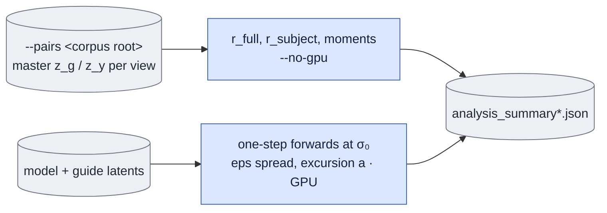

# `experiments/stats.py` — measurement, no training

## Objective

Measure four numbers. Without them, the design would have to guess:

| | What | Decides |
|---|---|---|
| **(a)** | ε-sensitivity: the spread of one-step outputs from one `z_g` over N seeds | whether ε is a sampling variable here at all |
| **(b)** | the excursion `a = ‖Φ(x_σ₀) − z_g‖/√d` | how far the base model moves its own input, in the same per-dimension RMS units as `r` |
| **(c)** | the latent moments of `z_g` and `z_y` | whether an affine correction is needed (answer: no) |
| **(d)** | the gap `r = ‖z_y − z_g‖/√d`, full-frame **and** inside the subject | how much a plain blend has to do |

## Usage

Humans can use the foreground queue or run this module directly.
See [launch, output and stop commands](../usage.md). Agents use the queue.
The queue recipes below describe managed execution.

Start the measurement as a queue `experiment` job with selector `stats`. See
[run guide §9, other studies](../../configs/README.md#other-studies) and the
[spec format](spec_protocol.md).

This is the agent path. A person can also run the same module directly, or start the queue in the foreground; see [usage](../usage.md).

```json
{"schema_version": 1, "protocol": "stats",
 "arguments": ["--model", "2.5", "--pairs", "/abs/corpus", "--objective", "white",
               "--renders", "/abs/corpus", "--render-glob", "argavatar_render_white.mp4",
               "--max-videos", "4", "--eps-samples", "8"]}
```

| Scientific argument | Meaning |
|---|---|
| `--pairs <CORPUS_ROOT>` | Measure the gap `r` and the moments over the per-view master latents. |
| `--renders <DIR>`, `--render-glob` | Guide MP4s for the GPU measurements (a) and (b). Point the glob at the real corpus guides, so `a` and `r` have the same token count. |
| `--objective {bg,white}` | The objective of the `(z_g, z_y)` pairs. |
| `--subject-mask {render,capture,union,intersection}` | The coverage grid for `r_subject`. Default `union`. |
| `--model`, `--sigma0`, `--seed` | The base model, the sigma and the first seed. |
| `--eps-samples N` | Seeds per guide for the spread. |
| `--max-videos N`, `--max-sources N` | Limit the guide videos and the pair scan. |
| `--no-gpu` | Run only the pair measurements. |

The spec cannot contain `--out`, a GPU, process or supervision setting. The
queue writes `analysis_summary.json` inside the output directory. Check the
spec on CPU with `--dry-run` first.

## Data flow



## Organization logic

Everything here is measurement. It writes only JSON: no checkpoints and no
training state. The GPU half and the `--no-gpu` half are one module, because
they report into one summary and share the latent-loading path. `r` is measured
over **whole clips**, not over overlapping windows that counted every second
latent frame twice.

### Gap

For arrays `a` and `b` with `d` values, `rms_gap` is `sqrt(sum((a-b)^2)/d)`, in
fp32. For encoded coverage weights `w[F,H,W]`, expand the weights over channels
and batch, and use `sqrt(sum(w*(a-b)^2)/sum(w))`. The code returns NaN for a
zero total weight. Treat that as an invalid measurement, not as zero error.
These weights are measurement inputs. They do not change the training loss.

### Pairs

`measure_pairs` reads the capture and the guide for the same relative video,
view and background.

1. Cut both to the smaller encoded frame count. Record that common coverage.
2. Calculate a full-frame gap for each view.
3. When both masks exist, weight the subject gap by the declared mask choice:
   render coverage, capture coverage, their maximum (union) or their minimum
   (intersection).
4. Save the values of each view and the count of views with subject
   measurements.

Do not call a missing subject score a full-frame score.

### Moments

The per-channel moments flatten the frame and spatial values of each channel
and calculate the mean and the sample standard deviation.

- The global summaries average the per-view means and standard deviations,
  with equal weight for each view.
- The per-channel moments use the first loaded pair, not every corpus frame.
- `_summary` reports the count, mean, p10, p50, p90 and maximum over the
  supplied per-view values.

### Guide-only map measurement

`measure_map` keeps one guide encoding, the prompt, the first guide frame and
sigma fixed. It encodes the complete VAE-aligned guide prefix and keeps its
first latent frame clean. It runs one full-bidirectional `[sigma0, 0]` forward
for each seed `seed+k`, `k=0,...,N-1`, and gets one output `o_k` for each seed.

- **Excursion** is the mean `rms_gap(o_k, z_g)`.
- **Noise spread** is the mean `rms_gap(o_i, o_j)` over all `i<j`. With one
  output, it is zero by construction.
- The recorded heuristic compares the median of spread/excursion with 0.1.
- The code gives ratio zero for zero excursion. That special case, or one
  output, does not prove that noise is irrelevant.

Excursion and spread cover the complete clip. There is no 25-frame window
baseline. Regenerate the numbers with this coverage before you compare them
with newly encoded capture and guide pairs.

This unpaired diagnostic keeps the guide's first encoded frame unchanged. It is
not a product input with a real supplied first image, and it has no capture
target. Label this when you report its values. Use relative video paths for the
output keys of each video, because corpus guide file names repeat.

### Saved files and completion

The strict outer output is a directory. The scientific `--out` setting is
injected as `analysis_summary.json` inside it. The queue records one generic
`runtime` phase.

New map runs also save `map_raw.pt`: each exact guide latent and its ordered
outputs, keyed by the source-relative video name. Source path and hash records
bind these tensors to the selected video list. `inputs.json` binds the exact
selected masters, masks and videos, and the producer software.

Completion does these checks:

- Map: the saved output count, shape, finite values and unchanged clean first
  frame. It recomputes the excursion, the pairwise spread, the quantiles and
  the original 0.1 heuristic from the actual tensors.
- Pairs: it reuses the original CPU paired-master reader and metric function.
- Extra files, escaped links, missing sources, changed inputs and rehashed false
  measurements fail.

Float32 GPU and CPU reductions can differ in the last bits. Completion uses the
fixed `rel_tol=1e-5` and `abs_tol=1e-6` for numerical metric readback only.
This does not change the original 0.1 and 0.6 heuristic thresholds. A zero
weight gives an invalid nonfinite measurement and cannot pass. The saved
verifier never calls the source decoder or the transformer. It starts no child
and never repairs missing output.

The public `parse_args`, `read_spec`, `resource_phases`, `verify_completion` and
`evidence_paths` give normalization, phase data and saved-only completion. The
queue can call `evidence_paths(..., verified=True)` only after it ran this
verifier in the same receipt check. Direct callers keep the default
`verified=False`.

## Reading the numbers

The numbers below are observations from one set of encoded inputs. They are
context, not corpus acceptance rules. Check the original measurement records
and regenerate matched coverage before you reuse them.

- `r_subject` ≈ 0.89–0.93, against a "comfort" threshold of 0.6. A plain blend
  asks the LoRA to move the output by about 90% of its natural scale. This is
  substantial, **not** a rejection. The base model's own excursion
  `a` = 0.247 is only a quarter of that, so it is open whether a LoRA closes
  the gap.
- Moments: the per-channel std ratio p50 is 1.002. The worst mean offset
  reaches the transformer as an 8% perturbation on 1 channel of 128. No
  correction is worth building.
- Mind the reference: under the linear interpolant,
  `Var(x_σ) = (1−σ)² + σ² = 0.60` at σ₀ **by design**. A match to unit variance
  would be the wrong correction.

## Invariants

- Gap units are RMS per encoded value, not a vector norm without
  normalization.
- Full-frame and subject scores stay separate.
- Saved records identify the background, the coverage, the mask choice, sigma
  and the seed count.
- A guide-only diagnostic is never described as product or capture fidelity.

## Gotchas

- The module reports `r_full` *and* `r_subject`, and they move very
  differently. The pixel composite moved `r_full` from 1.39 to 0.53, but
  `r_subject` only from 0.89–0.93 to 0.80–0.91. Quoting the wrong one
  overstates what compositing gave.
- The per-channel moments use the first loaded pair. The global summaries
  aggregate view statistics. State those scopes before a corpus-wide claim
  about unusual channels.

## Tests

Worked gap checks:

- Differences `[0,2]` give RMS `sqrt(2)`.
- Weights `[0,1]` give weighted RMS `2`.
- For scalar non-first-frame outputs `0` and `2` around the guide value `1`,
  the excursion is `1` and the spread is `2`.

These are arithmetic examples, not observed corpus results. After code
changes, check zero-weight and missing-mask records, coverage counts, repeated
file names and the exact scope of the moment summaries before you interpret
results.
