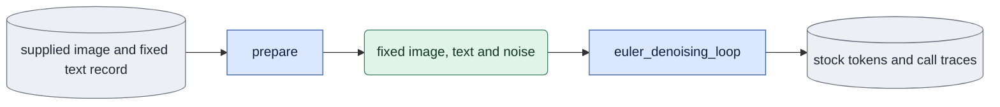
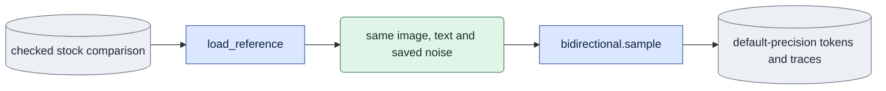
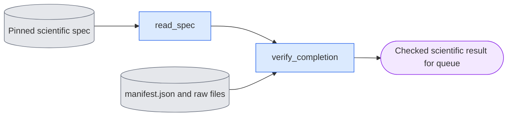

# `experiments/stock_parity.py` — compare the stock video sampling path

This module is the E1 checker. It compares the stock LTX video sampler with the
package's bidirectional sampler.

## Objective

Run the actual stock video state builder, the factory denoiser and the Euler
loop against the bidirectional sampler. Use one resident native video-only
transformer and fixed inputs. Keep a repeated stock control and the
intermediate calls. Then a final difference can be traced. A loose tolerance
does not hide it.

## Usage

Humans can use the foreground queue or run this module directly.
See [launch, output and stop commands](../usage.md). Agents use the queue.
The queue recipes below describe managed execution.

Start the check as a queue `experiment` job with selector `stock_parity`. The
queue selects the GPU. See
[run guide §9, E1](../../configs/README.md#e1--stock-sampler-parity-stock_parity)
and the [spec format](spec_protocol.md).

This is the agent path. A person can also run the same module directly, or start the queue in the foreground; see [usage](../usage.md).

1. Write a spec file:

   ```json
   {"schema_version": 1, "protocol": "stock_parity",
    "arguments": ["--first-image", "/abs/image.pt", "--text-record", "/abs/text.json",
                  "--frames", "17", "--steps", "4", "--seed", "42"]}
   ```

2. Check the spec on CPU. This loads no model:

   ```bash
   cd LTX-2
   "$PY" -m scripts.onestep_avatar.experiments.stock_parity \
     --spec <SPEC.json> --output <FRESH_OUT> --dry-run
   ```

3. Queue it with `"experiment": "stock_parity"`, the spec path, its
   `spec_sha256` and `"numerical_policy": "deterministic"`.

| Scientific argument | Meaning |
|---|---|
| `--first-image` | Required. A supplied-image bundle with one encoded frame. |
| `--text-record` | Required. A fixed preview record that pins the text tensor. |
| `--frames N` | Encoded frames. Default 17. At least 2. |
| `--steps N` | Scheduler steps. Default 4. At least 2. |
| `--seed`, `--model` | The noise seed and the model version. |
| `--reference-run <DIR>` | Reuse a verified stock run. Generate only the ordinary-precision arm. |

Outputs in `<FRESH_OUT>`: the raw encodings and call traces of each branch,
the decoded comparison media, `result.json` and `manifest.json`.

## Data flow



The bidirectional branch reads the same image, text and noise from memory. It
writes its own tokens and traces. Each branch uses the same native x0 model.
The decoder reads saved encodings only after the transformer is released.



The optional reference branch checks the ordinary global-sigma precision
against a verified stock comparison. It generates only the missing ordinary
arm. The ordinary default (float32 global sigma) must match the explicit
float32 branch.

## Organization logic

### Software binding

The checker binds its own `ENTRY` through
`software.capture(..., extra_sources=(ENTRY,))`. The public `EXTRA_SOURCES`
tuple binds the checker, its spec helper and the empty
`experiments/__init__.py` marker as explicit experiment extras. Ordinary
profiles do not include them. Ordinary evaluation does not bind or import this
study. Original native results keep their original manifests. Moving the owner
does not restamp them.

### Checks before GPU work

1. Refuse an existing output directory, invalid steps or frame counts,
   malformed image metadata and changed fixed text files.
2. Read the actual one-image master through the shared dataset reader. Require
   one RGB frame, `input_role=supplied_image`, the native channel count and the
   current VAE fingerprint.
3. Read the fixed preview record as saved input evidence. Validate its saved
   software integrity, its text file hash and the actual tensor hash. Do not
   restamp the original record. Take the literal prompt from its evaluation
   arguments.
4. Resolve the real dev checkpoint. Build the exact schedule with
   `LTX2Scheduler().execute(steps=N)` and no latent argument. At least two
   intervals are required. Do not use the one-step special case.
5. Record the current source and runtime, and the input and weight hashes.
6. Publish a declared protocol before the native model calls.

### Pass rules

- The repeated stock control must be exactly equal.
- The inputs and predictions of positive intervals must be exactly equal when
  all modality fields match.
- The terminal endpoint is reported separately. The package returns the
  prediction. Stock rebuilds the endpoint with rounded velocity.
- No guessed final-output tolerance makes a difference pass.

### Noise and state

1. Build the native grid for the requested encoded frames and the image's
   spatial shape.
2. Draw one bf16 token noise tensor with the native Gaussian noiser on an empty
   state.
3. Replay the same seed through `create_noised_state`, with
   `VideoConditionByLatentIndex(image,strength=1,latent_idx=0)`.
4. Assert that the assembled state equals the saved noise exactly, with the
   image tokens restored.

This is pure-noise D0 sampling. There is no guide mixing.

### Four branches in one session

One resident model session runs four branches: stock, repeated stock,
explicit-float32 bidirectional and ordinary-default bidirectional.

- Stock uses `FactoryGuidedDenoiser` with cfg one, STG zero, modality scale one
  and no rescale, `BatchSplitAdapter(max_batch_size=1)`, the native
  `EulerDiffusionStep` and `euler_denoising_loop`.
- The custom branch uses the ordinary bidirectional sampler with float32 global
  sigma, which matches stock.

For each call, the module saves the input, the prediction, the sigma, the token
timesteps, the positions and the image marks. It records the actual forward
counts, the elapsed time and the peak CUDA memory. Trace copying is part of the
elapsed time. So these timings are diagnostic, not a deployment benchmark.

Then the module does these steps:

1. Release the model.
2. Decode all four encodings with identical fresh decoder seeds.
3. Compare the raw tensors and the decoded float pixels numerically.
4. Save synchronized readable media through the shared renderer. Use
   448-pixel square panels. Select the compact layout with the exact titles
   before rendering. A one-column result is 464 pixels wide and has text of at
   least 16 pixels at its natural width. It must not depend on browser
   upscaling.
5. Check the input and software hashes again. Write the final record last.

### Check ordinary global-sigma precision

With `--reference-run`, the module loads a saved, checked stock comparison.

1. Require the exact schedule, image and text tensor hashes, seed, geometry and
   fps.
2. Verify every saved raw file hash and the original exact raw and RGB repeated
   controls.
3. Require the same installed runtime and the same declared source list and
   hashes, except this diagnostic entry file. The entry file can add a new
   comparison. It cannot restamp the old reference. A changed model, sampling,
   loader, conditioning, decoder or other computation owner refuses reuse.
4. Pin the reference result and raw files as inputs of the new run. Keep its
   original software record nested in the reference identity, separate from
   the new producer identity.

Then:

1. Use the reference's actual saved noise. Do not draw noise again.
2. Call the public bidirectional sampler without `sigma_dtype`, as ordinary
   evaluation and the product do. This keeps float32 token timesteps and
   float32 global sigma.
3. Save the actual sigma dtype and values, and the paired call differences
   against the reference's float32-global-sigma bidirectional branch. These two
   custom outputs share the exact terminal prediction rule.
4. Decode only the saved reference custom encoding and the new default
   encoding, with the same VAE and a fresh seed. Do not generate the verified
   stock arms again. Give each panel its precision, and label both as RGB
   decoding. Record that the stock controls are reused saved evidence, not
   fresh calls.

A precision difference is an experimental result. It is not a failed repeated
control or a tolerance to fit.

### Queue interface and completion



The queue owns the launch, device selection, process records and bounded
supervision. The checker accepts a pinned `schema_version: 1` spec with its
literal protocol and scientific `arguments`, plus the queue-owned `--output`
and local `--gpu-id`. Execution flags in the scientific arguments fail before
writes. The public `parse_args`, `read_spec`, `runtime_profile`,
`verify_completion` and `evidence_paths` give normalization, phase and topology
data and saved-only completion. The manifest binds the exact spec bytes, the
normalized scientific settings and the complete local file list.

`dependency_outputs(spec)` names the saved result directories that need
earlier queue receipts. An optional stock reference must be an explicit
dependency. A missing dependency fails CPU queue preparation, before claims or
launch.

Completion verifies the original scientific controls from the saved files:

1. Repeat the CPU input checks without the fresh-output refusal.
2. Load all four saved latents, the noise and the traces.
3. Recompute `compare_paths`. Check the clean `c0` in every latent, the exact
   scheduler levels and the declared forward counts.
4. Check the RGB comparison record and every local byte, without a decoder.

The saved manifest is excluded from the producer's older raw list. Completion
loads no model or decoder, starts no child and never repairs missing output. A
missing, changed or escaped file prevents completion. CPU fixtures prove these
refusals.

The queue can call `evidence_paths(..., verified=True)` only after it ran this
verifier in the same receipt check. Direct callers keep the default
`verified=False`, which runs the verifier first.

## Invariants

- One transformer load supplies all compared paths. There are no adapter or
  fused weights.
- The first image, prompt context, noise, grid, fps and schedule stay fixed.
- A repeated stock disagreement is a failed control, never a tolerance
  estimate.
- The actual stock loop runs. The module does not rebuild the stock arithmetic.
- Saved text preparation keeps its original software attribution.
- Exact intermediate equality is separate from terminal endpoint agreement.

## Gotchas

- The outer `TI2VidOneStagePipeline` always creates audio. This check uses its
  public stock video sampling components with no audio, and the same
  video-only loader as the renderer. It does not certify joint audio-video
  execution or the outer pipeline's RGB and text preparation.
- The stock pipeline source is in the manifest, to bind the reviewed calls.
- A seven-frame trained product pilot is separate from this 17-frame base
  diagnostic.
- The reference branch measures the ordinary product global-sigma precision.
  The adapter effect needs its own check.
- The matched stock branch uses float32 global sigma explicitly.
- Numerical agreement in this scope does not prove video quality or full E1.

## Tests

CPU tests use the real stock builder, denoiser and loop with a deterministic x0
model. They require:

- identical initial noise and `c0`;
- equal repeated outputs;
- matched calls before the terminal step;
- an explicitly measured terminal difference.

They refuse changed text, video-prefix image bundles, invalid schedule requests
and changed software before publication. Reference checks refuse changed
kernels or runtime, missing or changed raw files, failed controls and a
different image, text or schedule. With sigma-sensitive predictions on CPU, the
ordinary default must be byte-identical to the explicit float32 custom branch.

Native acceptance uses 17 encoded frames, 129 decoded RGB frames and the same
saved input hashes. Full fresh runs include both custom branches beside stock
and the stock repeat.
