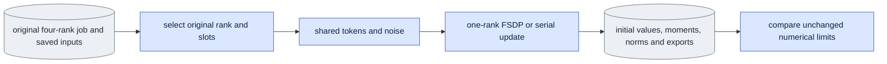

# `experiments/training_slice_check.py` — localize one native update

This module helps find where an E4 mismatch starts. It cannot pass E4 itself.

## Objective

Compare one exact original visit in one-rank FSDP with serial execution,
before accumulation and four-rank averaging are tested. Keep the original data,
model, adapter initialization, sigma, noise keys and resource limits. This
owner calls the shared builder, token calculation, mode training function and
Adam-state collector. It owns no second model algorithm.

## Usage

Humans can use the foreground queue or run this module directly.
See [launch, output and stop commands](../usage.md). Agents use the queue.
The queue recipes below describe managed execution.

Run each arm as a queue `experiment` job with selector `training_slice_check`
and operation `run`. Then queue one `compare` job that depends on both arms.
See [run guide §9, E4](../../configs/README.md#e4--distributed-training-update-training_update_check)
and the [spec format](spec_protocol.md).

This is the agent path. A person can also run the same module directly, or start the queue in the foreground; see [usage](../usage.md).

FSDP arm (the queue starts it with one-rank Accelerate FSDP):

```json
{"schema_version": 1, "protocol": "training_slice_check", "operation": "run",
 "arguments": ["--job", "/abs/update_job.json", "--execution", "fsdp",
               "--rank-key", "0", "--slots", "1", "--deterministic"]}
```

Serial arm: the same spec with `"--execution", "serial"`.

Comparison:

```json
{"schema_version": 1, "protocol": "training_slice_check", "operation": "compare",
 "arguments": ["--compare", "/abs/fsdp_arm_out", "/abs/serial_arm_out"]}
```

| Scientific argument | Meaning |
|---|---|
| `--job` | `run` only: the original four-rank one-update training job. |
| `--execution {fsdp,serial}` | `run` only: the arm. |
| `--rank-key {0,1,2,3}` | The original rank whose visits are used. Default 0. |
| `--slots {1,2}` | 1: the original first slot. 2: that rank's original accumulation group. |
| `--deterministic` | Apply the declared deterministic numerical-kernel control. |
| `--compare A B` | `compare` only: the two saved arm outputs, one FSDP and one serial. |

Check each spec on CPU with `--dry-run` first.

## Data flow



## Organization logic

### Original job and source

1. Rebuild the original job and its launch binding.
2. Read its actual four-rank runtime and its original budget. Keep the original
   source manifests unchanged.
3. Refuse changed computation owners. Record explicitly any change that is
   limited to observational supervision, tracing or the separately declared
   adapter-only export repair. The old hashes stay in the original record. The
   repaired exporter must match the original zero tensor list and values before
   the update.

### Visits

The module uses the original saved text and visits.

- `--slots 1` selects the original first slot.
- `--slots 2` selects that rank's original accumulation group.

In both arms, the diagnostic averaging denominator is the selected slot count,
and the actual world is one. The result is never relabeled as the original
four-rank update.

### Input checks

1. Check the saved text file hash, the complete tensor hash, the shape, the
   dtype and finite values against the original config.
2. Recreate the frame plan and the full base identity through shared
   preparation. Require exact agreement with the original saved plan and
   config.
3. Both original checkpoint contracts must equal the fresh expected contract
   for their steps. Their completion markers must bind the same original
   producer profile, launch, runtime, budget and config and plan bytes.
4. Compare the rebuilt original visits with the actual rank metric records.
5. Pin both checkpoints, both markers, the original launch and YAML, the rank
   metrics, the text, the resource and trace evidence, the selected producer
   bundles and the base bytes. Check all pins again before publication.

### One arm

The FSDP arm uses the original Accelerate YAML with one process. The serial arm
uses the same explicit bf16 setting. Each arm does these steps:

1. Verify the actual world and distribution type before loading.
2. Hash the complete initial fp32 adapter values before wrapping. Bind the
   trace values at the actual adapter consumers.
3. Save an exact zero export.
4. Run the original shared forward and backward function with the original
   rank and slot noise keys.
5. Clip once. Pass the prepared model's complete parameter list through the
   same Accelerator call as the engine, so it selects native FSDP clipping.
6. Step Adam once. Save the fp32 moments and the actual exports.

Resource journals own the allocated and reserved peaks. No limit or tolerance
is inferred from old results.

Every run requires a fresh output. The protocol is published before the
weights load. The result is published after the source and input checks. Both
arms must record the same kernel control and source profile, and identical
scientific settings. Failed numerical evidence stays failed. This diagnostic
does not prove preview, product, quality or four-rank acceptance.

### Deterministic control

`--deterministic` is a declared numerical-kernel control. It sets
deterministic Torch algorithms and cuDNN mode, and disables cuDNN benchmarking
and TF32. The child launch must bind `CUBLAS_WORKSPACE_CONFIG=:4096:8`. The
actual flags are recorded. First compare an unchanged serial repeat. Then
repeat with this control. Do not change the tolerances to accept an unstable
baseline.

### Saved comparison

The saved comparison uses the original fixed `compare_update`. Before it reads
tensors, it does these checks:

1. Require the complete local file list. Verify every recorded byte hash.
2. The checkpoint path must name the local step-one export. Its dedicated hash
   must equal the hash in the list.
3. The embedded protocol and initial-value record must equal their local JSON
   files.
4. The resource records must equal the actual rank-zero journal and pass the
   original limits.
5. The trace evidence must bind the local trace file.
6. Read adapter tensors only through the verified local path.

Changed, missing or escaped files are refused before the numerical comparison.

### Queue topology

- The `run` operation keeps the serial and one-rank FSDP arms. FSDP launch
  data requires the fixed, hash-pinned
  `packages/ltx-trainer/configs/accelerate/fsdp.yaml`, explicit bf16 and one
  process. The queue does that launch. A plain `python -m` cannot replace the
  FSDP arm.
- `launch_requirements` selects one-rank Accelerate FSDP for the FSDP arm and
  Python for the serial arm. `resource_phases`, `resource_budget` and
  `launch_requirements` must give this topology before launch.
- `resource_budget` gives the original absolute budget path. Both arms keep the
  `load`, `update` and `export` phases.
- A compare spec gives exactly two saved arms. `dependency_outputs` gives both
  directories, and the queue requires their receipts. Queued comparisons also
  require one FSDP arm and one serial arm. Their first moments and all adapter
  matrices must pass the unchanged E4 tolerances. A missing, rehashed,
  nonfinite or mismatched file prevents completion. The compare job records
  the generic `runtime` phase.

Completion verifies the original scientific controls from the saved files. It
loads no model or decoder, starts no child and never repairs missing output.
The public `EXTRA_SOURCES` tuple binds the checker, its spec helper and the
empty `experiments/__init__.py` marker as explicit experiment extras. The queue
can call `evidence_paths(..., verified=True)` only after it ran this verifier in
the same receipt check. Direct callers keep the default `verified=False`.

## Invariants

- The original visits, fp32 initialization, text, noise keys and budget bytes
  are exact.
- One-process FSDP is compared with one-process serial. No world is
  substituted.
- There is one shared training calculation and one named optimizer collector.
- No tolerance fitting, no restamping of old results and no dependency of the
  ordinary runtime.

## Gotchas

- A zero export records bf16 rounded matrices. It cannot prove that the working
  fp32 A values agree. Save their full byte hashes separately before wrapping.
- A small loss or norm gap can hide changes in a matrix or in an Adam sign.
  Compare every named moment and exported matrix.
- The full native result stays failed if any limit fails.

## Tests

The shared update, resource, runtime and trace controls validate the reused
owners. Native one-slot, repeated serial, two-slot and four-rank controls find
the first actual divergence. CPU presence and source hashes are not that
evidence.

Focused CPU controls use real saved tensors and adapter files. They refuse:

- changed original text values, dtype, shape, frame plan or base identity;
- a changed producer or marker binding;
- redirected checkpoint paths and missing list entries;
- a changed embedded protocol, initial values or resource records.

A complete matched saved pair reaches the unchanged numerical comparator.
