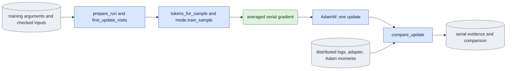

# `experiments/training_update_check.py` — replay one distributed update in serial

This module is the E4 checker. It compares the first distributed training
update with a serial calculation of the same update.

## Objective

Check the averaged gradient and the first Adam update of each normal mode
against a serial calculation on the same visits. This is one diagnostic update,
not a second trainer. It calls the shared preparation, native loading, token
construction, mode training functions, adapter export and named Adam-state
collection. Ordinary training imports no experiment owner.

The queue owns device selection, launch, bounded supervision and process
records. The checker accepts no `--supervise` or `--process-ledger` flag. A
serial reference is one queue job. Its saved comparison is another, dependent
job. The replay keeps the original `load`, `update` and `export` measurements
and budgets.

## Usage

Humans can use the foreground queue or run this module directly.
See [launch, output and stop commands](../usage.md). Agents use the queue.
The queue recipes below describe managed execution.

The check has three queue jobs. See
[run guide §9, E4](../../configs/README.md#e4--distributed-training-update-training_update_check)
and the [spec format](spec_protocol.md).

This is the agent path. A person can also run the same module directly, or start the queue in the foreground; see [usage](../usage.md).

1. Run the one-update `train` job. Use the training arguments plus `--steps 1
   --save-initial --save-update-state --chains-per-rank 2 --resource-budget
   <BUDGET.json>`, with no preview input.
2. Queue the serial reference (operation `reference`). It depends on job 1:

   ```json
   {"schema_version": 1, "protocol": "training_update_check", "operation": "reference",
    "arguments": ["--job", "/abs/update_job.json", "--world-size", "4"]}
   ```

3. Queue the comparison (operation `compare`). It depends on job 2:

   ```json
   {"schema_version": 1, "protocol": "training_update_check", "operation": "compare",
    "arguments": ["--job", "/abs/update_job.json", "--world-size", "4", "--reference", "/abs/reference_out"]}
   ```

Both operations use the resource budget of the original training job. An
explicit `"resource_budget"` on either queue job must name that same budget.

Check each spec on CPU first:

```bash
cd LTX-2
"$PY" -m scripts.onestep_avatar.experiments.training_update_check \
  --spec <SPEC.json> --output <FRESH_OUT> --dry-run
```

| Scientific argument | Meaning |
|---|---|
| `--job` | Required. The JSON job of the one-update training run. |
| `--world-size N` | The original number of ranks. Default 4. |
| `--reference <DIR>` | `compare` only: the output of the reference job. |
| `--consumer-trace` | Also record the serial model consumers. |

The comparison checks 768 named gradients, the Adam moments, the exports, the
loss, the norm and the step-one reload. The limit is relative L2 0.02 (RMS
near zero: `1e-8`). A failed comparison exits with code 2 and keeps its
measurements. Outputs: the serial evidence, `resources_rank0.jsonl`, the
comparison record and `manifest.json`.

## Data flow



## Organization logic

### Launch and readiness checks

Before scientific inputs are prepared, the checker does these steps:

1. Rebuild the original job through `queue.prepare_job`. Its canonical digest
   must equal the digest in the saved config and in the completed checkpoint
   marker.
2. Require agreement of the explicit replay world, the job processes, the
   saved actual world and every applied-runtime rank record.
3. Check the original dispatch snapshot through
   `queue.verify_training_launch`. Its YAML bytes, hash, exact command, port and
   normalized arguments must still match.
4. Read the launch precision only from those checked original bytes.
5. Use `queue.read_training_marker` for the step-one readiness gate. Preparation
   also reads the step-zero marker through that owner. Require a complete
   state, an integer schema and step, the exact path and the actual adapter
   hash. Then do the scientific tensor and run-provenance checks.

The checker never replaces the original processes with its world argument, and
it never copies a hash from a result. A record without launch or
actual-runtime facts cannot be accepted. Applied precision is never inferred. A
provenance match cannot authorize a marker that is pending, moved or bound to
changed bytes.

### Pins and late checks

The checker pins the job, the original dispatch record, the config, the
completion markers and all scientific input bytes. It rebuilds and verifies the
launch and runtime again immediately before the model loads and before final
publication. A late change keeps the failed execution evidence and prevents a
passed result. Negative controls use this gate and the shared queue normalizer,
with model and output access forbidden.

Before the serial output exists, the checker builds the actual serial
Accelerator. It requires one process, the checked launch precision and
`DistributedType.NO`. It checks all pinned inputs and the producer software
again after this setup. A world, precision, distributed-type or late-input
mismatch leaves no output directory and opens no model.

### Resource evidence

Native acceptance also requires the original frozen resource budget and the
allocated and reserved measurements of each rank.

- An unindexed serial `cuda` device resolves to the actual current CUDA
  ordinal before measurement. The indexed-device evidence validator stays
  strict. Old measurements are not rewritten.
- The raw JSON `tolerance` of the budget must exactly equal the fixed
  `TOLERANCE` record. Byte binding alone does not allow missing or changed
  numerical limits. This study field is read here. The shared resource owner
  validates only the general wall and memory limits.
- The complete training phases `load`, `export:0`, `update:1` and `export:1`
  are verified before replay.

The serial replay resets the Torch peaks for three phases:

- `load`: model and optimizer setup and the zero export;
- `update`: all backward calls, clipping and Adam;
- `export`: the moments, the final export and reload, and any requested trace
  serialization.

It synchronizes before each reset and each measurement. It writes each phase to
`resources_rank0.jsonl`, including errors and limit breaches, before it raises.
It checks the allocated peaks and the elapsed times against the unchanged
budget before it publishes a final result. Reserved peaks stay separate
observations. External total-device observations do not replace the
process-local allocated measurements.

### Job and visit checks

The JSON job holds the original `arguments`. The checker requires: one step, a
saved zero adapter, saved update state, no parent, checkpointing enabled and no
previews. Before loading, it checks the actual config and frame plan, all
rank-one logs, the step 0 and step 1 adapter contracts and matrix shapes, the
moment record and the current source and runtime.

The expected world size is explicit and must match the saved config. The first
native check uses four ranks and accumulation two. The checker rebuilds the
first epoch's tiling, the seeded permutation, the contiguous rank slices and the
first accumulation group. It checks the logged sources, the exact ranges, the
noise seeds and the rank sigmas against these visits. Replay keeps the original
rank and slot in all seed formulas.

The original job's Accelerate configuration is required and hashed. The checker
reads its explicit mixed-precision setting. It prepares the serial model and
optimizer through Accelerate with that setting, so the forward autocast and the
output conversion match the native launcher. The serial reference has no
distributed reduction. The native FSDP bf16 reductions are compared with the
declared tolerances.

### Serial replay

1. Create one serial native model with the shared adapter seed and the actual
   exported step-zero A matrices. Verify that fresh fp32 A, rounded to bf16,
   matches that export. Keep the fresh fp32 matrices for replay. Do not load
   the rounded A, because that would change training's function. B must be
   exactly zero.
2. Use the actual saved training text. Every rank's text digest must match.
   Never rebuild a prompt cache.
3. For each fixed visit, call the shared token construction and the public
   mode's `train_sample`. Divide by `world*A` once, through the existing
   accumulation parameter. For causal samples, the mode also divides by K.
   Reuse or reset the cache through its normal API.
4. Clip once with the same maximum.
5. Run one AdamW update with the same warmup rate. Collect the named fp32
   moments. Rebuild the clipped gradient as `exp_avg/(1-beta1)`.
6. Save the serial step 0 and step 1 exports with the normal checkpoint writer.

Worked scaling check: four ranks each accumulate two samples. Serial replay
calls each mode with accumulation eight. The distributed path uses
accumulation two and averages over four ranks. Both sum each sample gradient
with the coefficient 1/8 (and also 1/K for causal block losses). A serial
backward divided by four again would fail the norm and moment comparison.

### Comparison and tolerances

The checker compares the complete named lists and the actual fp32 moments, the
gradient norms, the sample- and block-averaged loss and the exported matrix
values. The tolerances are fixed in the protocol before any numerical result:

- relative L2 at most 0.02 for the clipped gradients, the gradient norm, the
  loss and the exported B correction;
- when the RMS is below 1e-8, absolute RMS at most 1e-8, labeled near-zero.

These limits allow differences in bf16 reduction order. They do not allow
missing parameters, nonfinite values, a factor-of-two loss error or a tolerance
change after a failure. The checker also requires exact equality of the first
exports, a nonzero trained B, and an actual distributed step-one reload into
the shared PEFT function with equal exported tensors.

### Publication

The checker publishes the protocol first and the final comparison last. It
binds the original run and input files, the shared source and runtime and this
producer with `software.capture(extra_sources=...)`. It checks them again
before loading and before final publication. It refuses an existing output.
Failed numerical gates publish diagnostic measurements with a failed status,
never acceptance. Model and VAE quality and the later native preview and
product jobs are separate E4 checks. This owner opens no decoder and starts no
distributed child.

### Consumer trace

The optional `--consumer-trace` records the serial model consumers through the
same trace owner as training. The original visit's distributed rank, slot and
index stay in its sample context, although the serial process is rank zero.
The result binds the published trace file. Incomplete requested evidence is
refused. No trace flag changes the fixed scientific inputs or the tolerance.

### Original-policy replay

Native replay requires explicit schema-two launch and runtime evidence. The
checker reads the actual numerical policy. Missing settings never default to
the current flags.

1. Queued children inherit the exact original cuBLAS workspace. A direct CLI
   configures the environment before native imports.
2. Apply the shared policy before the Accelerator and CUDA.
3. Record the actual serial runtime after preparation. Its complete numerical
   observation must match every original native rank, including the separate
   TF32 setting of cuDNN.
4. Bind that serial runtime in the protocol and the result. Check it again
   before the update, the export and publication.

CPU tests verify the policy binding. A changed producer needs a fresh four-rank
update and serial comparison.

### Queue operations and completion

- The `reference` operation runs the original one-device serial calculation.
- The `compare` operation is a separate saved-only job that depends on the
  reference. It runs the same fixed Adam comparator on checked saved tensors.

There is no self-supervised reference command. Both operations use the
original four-rank job and accumulation evidence. The serial process world
stays one. The reference parser fixes the original world as four.

`resource_budget(spec)` returns the absolute budget path of the original job,
for both operations. Queue normalization requires that exact declared path. The
compare operation uses the queue's generic `runtime` phase.
`dependency_outputs(spec)` returns its separate reference directory. The queue
checks a dependency receipt for that output before launch. The public
`parse_args`, `read_spec`, `resource_phases`, `resource_budget`,
`launch_requirements`, `verify_completion` and `evidence_paths` give
normalization, phase and topology data and saved-only completion.

Saved completion checks the complete original list, the visits, the launch, the
resources and the runtime evidence through the original preparation gates. It
binds the local first, final and reload exports, the actual fp32 Adam moments
and the phase records. It recomputes every comparison with the unchanged
tolerance. A doubled saved first moment with a rehashed tensor still fails
completion. No native model or decoder opens. Saved evidence is never
rewritten.

The public `EXTRA_SOURCES` tuple binds the checker, its spec helper and the
empty `experiments/__init__.py` marker as explicit experiment extras. The queue
can call `evidence_paths(..., verified=True)` only after it ran this verifier in
the same receipt check. Direct callers keep the default `verified=False`.

## Invariants

- The original visits, input hashes, fp32 adapter initialization and seed keys
  are exact.
- One shared mode function, one shared adapter loader and exporter and one
  provenance owner are used.
- All ranks have equal accumulation and causal K, including later-start visits.
- Compare the moments and the B correction. Small final-output differences
  alone are not sufficient.
- Failed or near-zero controls stay explicit. No tolerance is fitted.

## Gotchas

- Adam's first B update is about one signed learning-rate step. It can hide
  errors in gradient magnitude. The saved first moment keeps that information.
- Exported adapters are bf16. The optimizer and working adapters are fp32. Keep
  the fresh fp32 A in the serial reference.
- A serial reference on one GPU can still need much memory. Check the direct
  inventory and the shared ledger before running.
- The norms in each rank's log are the norm of the distributed averaged
  gradient before clipping. They are not a sum of unrelated rank-local norms.

## Tests

- Analytic Adam gradients prove the moment rebuild, the complete list and the
  near-zero handling.
- Changed sources, seeds or rank visits, and missing files, fail before the
  model loads.
- Real small-LTX controls run both modes with accumulation greater than one. A
  deliberately doubled backward must fail the gradient gate.

`test_training_launch_binding.py` uses the real single-job authority and replay
gate. It checks an unchanged rebuild. It refuses, before scientific input
access: changed YAML, process count, requested or saved world, command, port or
hash, snapshot bytes, a missing original launch and mismatched rank policies.

- Synthetic saved resource records check missing measurements, changed budgets
  and allocated or wall limit breaches. They prove record validation, not
  native measurements.
- Controlled measured phases verify that failure evidence is saved before the
  refusal.
- Late input changes prevent final result publication.
- Controlled Accelerator records refuse a changed process count, precision or
  distributed type before model access or output creation.
- A changed completion state, version, step, path or checkpoint hash fails this
  gate. The step 0 and step 1 adapters use the same readiness calculation.
- Byte-bound budget records with absent or changed tolerances still fail before
  scientific inputs, models or serial output exist.

The native four-process run and the serial replay are separate acceptance
evidence.
