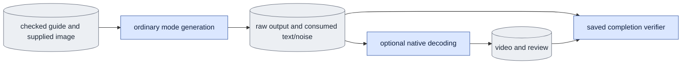

# `infer.py` — generate from a guide and supplied first image

`infer.py` is the product path. It generates D1 output from two inputs: a
guide video and one supplied first image. The product has no capture target,
so it computes no capture metric.

## Objective

Generate D1 output in one explicit mode: bidirectional or causal. Do all
checks before the model weights load. Save the raw result before any decoding
or rendering.

The product path has these fixed settings:

- The global sigma uses the float32 contract (`global_sigma_dtype` from
  `model.common`).
- Causal mode uses `history_mode="cache"` and `kv_source="refresh"`.
- The adapter uses `application_method="peft_unmerged_fp32"`.
  `model.adapters.inference_transformer` loads the same saved adapter function
  as training. It freezes the adapter and wraps it once in stock x0.
- There is no research override, no diagnostic history option, no method
  switch and no fused fallback.

The adapter checker compares the requested settings with
`cached_refresh_global_sigma0` before the weights load. It refuses an adapter
that does not declare its precision. Research code can accept a known
different calibration. The product refuses it.

The product records its software profile (the manifest of source files). It
records the profile before input checks. It checks the profile again at these
points:

1. Before it opens the model and text sessions.
2. Before it publishes the generated encodings.
3. Before it opens the decoder (decoder source files are in the profile when
   you request decoding).
4. Before it saves review panels and the generated video record.

Both renderings save the profile. The identity of the raw result alone does
not certify the media that the product publishes later.

## Usage

Humans can use the foreground queue or run this module directly.
See [launch, output and stop commands](usage.md). Agents use the queue.
The queue recipes below describe managed execution.

Start product generation as a queue `product` job. The queue selects the GPU,
so do not give `--gpu-id` in the job. See
[run guide §7](../configs/README.md#7-product-generation-from-a-supplied-image).

This is the agent path. A person can also run the same module directly, or start the queue in the foreground; see [usage](usage.md).

1. Prepare the supplied image with
   [`prepare_inputs supplied-image`](prepare_inputs.md#usage).
2. Check the arguments on CPU. A dry run loads no weights and writes nothing:

   ```bash
   cd LTX-2
   "$PY" -m scripts.onestep_avatar.infer --mode bidirectional \
     --guide <GUIDE_BUNDLE.pt> --first-image <PREPARED_INPUT>/image.pt \
     --checkpoint <D1_ADAPTER.safetensors> --variant dev --schedule 0.725 0 \
     --span-latent-frames 7 --seed 42 --decode --review --poster-frame 0 \
     --output <FRESH_OUT> --dry-run
   ```

3. Put the same arguments, without `--dry-run`, in a `product` job.

| Argument | Meaning |
|---|---|
| `--mode {bidirectional,causal}` | Required. The attention mode. It must match the adapter. |
| `--guide` | Required. A version-two encoded guide bundle. |
| `--first-image` | Required. One encoded supplied-image bundle (`image.pt`). |
| `--output` | Required. A new output directory. The command refuses a used path. |
| `--schedule S0 ... 0` | Required. The exact sigma schedule, for example `0.725 0`. |
| `--checkpoint` | The D1 adapter. Without it, the command uses the base model. |
| `--variant {distilled,dev}`, `--model` | The base weights. |
| `--span-latent-frames N` | The number of encoded output frames. |
| `--block-latent-frames`, `--blocks-per-sample`, `--context-latent-frames` | Causal mode only. They must match the adapter. |
| `--seed`, `--prompt` | The noise seed and the text prompt. |
| `--decode` | Also decode the output to an MP4 and a poster. |
| `--review` | Also save a review video: image, guide and output. Requires `--decode`. |
| `--poster-frame N` | The frame for the poster image. |
| `--dry-run` | Print the checked conditions only. |

Outputs in `<FRESH_OUT>`:

- `result.json`: the raw result record.
- `generation_inputs.pt`: the native text and noise that generation used.
- `rendering.json`, the MP4 and the poster: written with `--decode`.
- `review/rendering.json` and the review video: written with `--review`.

## Data flow



The checked guide and the encoded supplied image go to the shared token grid.
The mode sampler generates the output. The command saves the encoding and the
run record. Then the shared decoder and media code can decode and render it.

## Organization logic

### Input checks

The command reads the guide bundle and the supplied-image bundle with the
public master reader. The two bundles must agree on these items: channels,
encoded height and width, fps, background, crop, VAE identity and encoding
version.

The image bundle must have exactly one encoded frame. It must be an encoding
of a supplied image. It must not be the first frame of the guide. The file
identities stay explicit in the record.

The command selects complete causal blocks, or the full bidirectional segment.
It then builds the request record: mode, base, task, shape and schedule. It
checks the adapter header and the actual adapter matrices before it opens a
transformer. The product has generated history only. It refuses an adapter
trained with teacher forcing, unless that adapter's contract matches the
requested generated-history conditions. No product override exists.

### Causal output length

In causal mode, `--span-latent-frames` selects how many frames of the
continuous guide to generate. It does not set the training field for segment
selection in `CausalSettings`. That field stays `None` by default.

So a default-span B2/K3 adapter can request seven encoded frames from a longer
guide. Its recorded training settings do not change. The complete frame count
is still a separate adapter condition that must match.

An adapter can record an explicit training span. If that span equals the
selected complete frame count, the request records the same span. The request
adopts no other adapter setting. A different B, K or D, history, forcing, start
policy, schedule or frame count fails the checker before the weights load.

Worked check: use a 17-frame guide and an independently encoded one-frame
image, with `--span-latent-frames 7` and B2/K3/D8.

- A matching default-span adapter gives a checked seven-frame request with
  training span `None`.
- A matching explicit-span seven-frame adapter gives a checked request with
  training span `7`.
- A request for nine complete frames fails with either seven-frame adapter.

### Generation

Generation patchifies the guide and the supplied image separately. The
supplied image becomes `c0`, the first-image input with no added noise. Its
token noise is zero, but the global sigma is active. Both mode samplers keep
`c0` unchanged.

- Bidirectional sampling uses no cache.
- Causal sampling draws noise for each original block with the seed plus the
  block index. This keeps the deployed noise keys. With a saved noise array,
  the sampler uses its exact slices instead.

Generation returns the encoded frames and the actual forward counts. The
record keeps the identities of the source, image, text and noise, and the
exact schedule.

### Run order

1. Parse and check all arguments. Invalid review options fail during parsing,
   before any file or model access.
2. Check the source and image records, base channels, position limits,
   distilled levels, VAE fingerprint, tensor shapes and adapter conditions.
   With `--dry-run`, stop here and print the checked conditions.
3. Check the pinned adapter again with the public
   `checkpoints.recheck_adapter`. Do this after the data checks and before any
   native handle, text encoding or output write.
4. Check the adapter again immediately before the product transformer opens:
   the contract, the actual tensor slices and the file identity. Pass the
   checked identity to `model.adapters`. The product uses no second checker.
5. Create the native session. Patchify the guide and image, call `generate`,
   then release the transformer.
6. Save the raw output, the conditions and the input hashes atomically.
7. With `--decode`, open a separate decoder session with a recorded seed and
   VAE identity. Save a generated-only MP4 and the selected poster. Write the
   decoder key and the video and poster hashes to `rendering.json`.
8. With `--review`, decode the supplied-image encoding and the guide with the
   same decoder and a fresh seed. Label both as VAE-decoded inputs. Save the
   review under `review/` with the shared media renderer.

### Review layout

The review has one row of three panels, in this order: "Input image", "Guide"
and "Generated". The image is a still that shows for the full video. The guide
and the output show on every generated frame. The moving panels map to the
exact generated RGB range. A removed causal tail never shows.

For seven encoded frames, the moving panels have 49 RGB frames. The review
adds no capture target, capture metric or original-RGB claim. It records each
decoded input's content, VAE, shape, method, seed and runtime key, and the raw
result identity.

### Completion check

The parser provides `completion_descriptor(args)`. The completion files are:

- `result.json` for the raw result.
- `rendering.json` in addition, when you request decoding.
- `review/rendering.json` in addition, when you request a review.

`verify_completion(arguments, root)` runs the same input and adapter checks,
without the fresh-output check. It compares these items with the saved record:
every requested setting, the prompt, the source file hashes, the guide and
`c0` tensor hashes, the text and noise hashes, the output path, hash and shape,
and the clean `c0`. Saved inputs must be finite native bf16 tensors. The
verifier checks the expected list of denoise and refresh calls with the shared
geometry. The software and producer identities must still match the current
files.

The verifier never generates the seeded noise again on CPU. CUDA uses a
different random stream, so the CPU noise is different.

When you requested decoding, the verifier also checks these items:

- The generated-only video and poster record.
- The exact frames, fps, poster and native decode key.
- The current VAE hash and decoder settings.
- The hash of every media file.

For a review, `check_review_panels` checks the panel rule from the
[review layout](#review-layout). Each present panel has an empty
`missing_reason`, which is how `media.Panel` marks a present panel. It also
checks the moving frame map and both decoded input keys against the source
encodings.

`evidence_paths` lists the verified files. The verifier and `evidence_paths`
open no weights, text or decoder session. They start no process and repair no
output.

The queue can call `evidence_paths(..., verified=True)` only after it ran the
verifier in the same receipt check. Then the call reads the checked list and
does not run the verifier again. Direct callers keep the default
`verified=False`, which runs the verifier first.

Worked completion checks:

- Replace `generation_inputs.pt` and update its file claim. The check still
  fails, because its native tensor hashes differ from the result.
- Delete the requested review media. The check fails, even though the raw
  generation is complete.

## Invariants

- All adapter and input checks come before the weights load.
- No capture history exists.
- The supplied image is never replaced with guide frame zero.
- The raw evidence is saved first.
- A product request cannot use a research override.
- The cache, fusion and random-start [known gaps](known_gaps.md) are separate
  limits.

## Gotchas

The command accepts a prepared supplied-image encoding. Its crop, background
and VAE records must match the guide. Corpus and VAE helpers own the RGB
preparation. The command does not infer it from the image file name. A decoded
guide is a motion input, not ground truth.

The checked producer of the image is
[`prepare_inputs.py supplied-image`](prepare_inputs.md). It uses one actual RGB
image, the guide's crop on the original canvas, and an explicit matte for
`white`. Its `image.pt` records one native encode call and the actual pixel,
input and VAE provenance. A slice of a video master cannot replace this
producer.

## Tests

`test_ordinary_queue_completion.py` runs both product modes on a controlled
CPU model. Then it blocks the native loaders and decoders during verification.
These changes fail without output: changed saved text or noise, wrong
precision, nonfinite tensors, a changed clean `c0`, changed call counts and
missing saved inputs.

Other tests:

- Small real models verify both modes, exact `c0` preservation and the actual
  call counts.
- Bidirectional sampling calls no cache allocator.
- Mismatched metadata and adapter conditions fail before any transformer
  loader.
- The causal coverage checks use real safetensors contracts and 17-frame guide
  and one-frame image bundles. They cover default and explicit training spans.
  They refuse changed frame counts, geometry, schedule and teacher forcing.
- No result or metric describes an absent capture target.
- The review test uses a controlled decoder and the real shared renderer and
  writer. It checks the panel order, the still-image flag, the nine-frame
  moving range, the poster frame, the decode keys and the unchanged raw
  record. This is rendering evidence only. It is not native VAE or model
  acceptance. The full-size and 480-pixel posters were inspected for readable
  labels.

On CPU, generation with matched native tensor layouts is bit-identical to the
old causal rollout. Keep the native patchification when you compare exact
floating-point results. Identical values in a different memory layout can
round differently. So the comparison applies only to matched native input
layouts.
