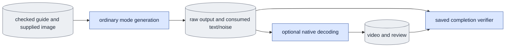

# `infer.py` — generate from a guide and supplied first image

Ordinary execution requests `global_sigma_dtype` from `model.common`'s float32
contract. Adapter preflight rejects an adapter without declared precision before weights
load; research may explicitly acknowledge a known differing calibration, while
product refuses it. Saved conditions preserve the requested precision.

## Objective

Product runtime snapshots its software profile before input preflight, rechecks
before model/text sessions and before publishing generated latents, and records
the manifest in the result. Include decoder source owners when decoding is
requested. Recheck that same manifest before opening the decoder, saving review
panels, and publishing the generated video record; save it in both renderings.
Raw-result identity alone does not certify later media publication.

Product causal preflight explicitly requests `history_mode="cache"` and
`kv_source="refresh"`. The shared adapter checker compares these with
`cached_refresh_global_sigma0` before weight loading. Product inference has no
diagnostic-history choice or research override.
Product also explicitly requests `application_method="peft_unmerged_fp32"`.
`model.adapters.inference_transformer` loads the same saved adapter function
as training, frozen and wrapped once in stock x0. There is no method switch or
fused fallback in the product CLI.

Generate D1 output in an explicit bidirectional or causal mode. Product inputs
have no capture target. Use the shared version-two adapter checker without a
research override. Save encoding and actual run records before rendering.

## Data flow

Checked guide master and supplied-image encoding → shared grid → mode sampler
→ saved encoding and record → optional shared decoder and media.

## Organization logic

The ordinary parser exposes `completion_descriptor(args)`. Raw completion is
`result.json`; decoding additionally requires `rendering.json`, and review
requires `review/rendering.json`. New CLI runs preserve the actually consumed
native text and noise in `generation_inputs.pt`, with a file identity in the
raw result. An optional input observer records these tensors before sampling;
the default public generation API makes the same draws and calls as before.

`verify_completion(arguments, root)` runs the existing input/adapter preflight
with its fresh-output gate disabled. It compares every requested setting,
prompt, source-file hash, canonical guide/c0 tensor hash, text/noise hash,
output path/hash/shape and clean c0. Raw and saved inputs must be finite native
bf16 tensors. Check the expected unguided denoise/refresh call inventory through
the shared geometry. Never regenerate seeded noise on CPU: CUDA uses a different
random stream. Software and producer identities must still match current bytes.

When decoding was requested, require the generated-only video/poster record,
exact frames/fps/poster and native decode key, current VAE hash/decoder settings,
and every media byte hash. Review additionally checks the fixed image/guide/
generated roles, moving frame mapping and both decoded-input keys against the
checked source encodings. `check_review_panels` owns the panel rule: three
panels in that order, titles "Input image", "Guide" and "Generated", the image
as a still with no frames, the other two on every generated frame, and an
empty `missing_reason` on each, which is how `media.Panel` marks a present panel. `evidence_paths` lists these verified files. Neither
helper opens weights, text or decoder sessions, starts a process, or repairs output.

Worked completion control: replacing `generation_inputs.pt` and refreshing its
file claim still fails if its native tensor hashes differ from the result.
Deleting requested review media fails even when raw generation remains complete.

Read guide and supplied-image bundles with the public master reader. Require
matching channels, encoded height/width, fps, background, crop, VAE identity and
encoding version. The image has exactly one encoded frame. It must be a supplied
image encoding, not a guide-derived first frame. File identities remain explicit.
Select complete causal blocks or the full bidirectional segment. Build the
requested mode/base/task/shape/schedule record and check the adapter header and
actual matrices before opening a transformer. Product mode has generated history
only. Reject teacher-trained calibration unless its contract matches the requested
generated-history conditions; no product override exists.

For causal CLI input, `--span-latent-frames` selects output coverage from the
continuous guide. It does not set the training segment-selection field in
`CausalSettings`; that field defaults to `None`. A default-span B2/K3 adapter
can therefore request seven encoded frames from a longer guide without changing
its recorded training settings. The actual complete frame count remains a
separate required adapter condition. Preserve explicit-span causal adapters:
when a validated adapter records a non-null training span equal to the selected
complete frame count, represent that same span in the request. Adopt no other
adapter setting. Different B/K/D, history, forcing, start policy, schedule or
supported frame count still fails the unchanged checker before weight loading.

Worked check: a 17-frame guide and independently encoded one-frame image,
`--span-latent-frames 7`, B2/K3/D8 and a matching default-span adapter produce a
checked seven-frame request with training span `None`. A matching explicit-span
seven-frame adapter produces a checked request with training span `7`. Asking
for nine complete frames from either seven-frame calibration fails.

Generation patchifies the guide and the supplied image separately. The supplied
image becomes c0, at zero token noise but with the global sigma active. Both mode
samplers preserve c0. Bidirectional sampling has no cache. Causal sampling draws
noise per original block with seed plus block index, preserving deployed noise
keys. With an explicit saved noise array, use its exact slices instead.
Return encoded frames and actual forward counts. Record source/image/text/noise
identities and exact schedule. Compute no capture-reference metric.

## Invariants

All adapter/input checks precede weight loading. No capture history exists.
Never replace the supplied image with guide frame zero. Save raw evidence first.
Product requests cannot use a research override. The cache, fusion and random-start
[known gaps](known_gaps.md) remain separate limits.

## Gotchas

The CLI accepts a prepared supplied-image encoding. Its crop/background/VAE
provenance must match the guide. RGB preparation is owned by corpus/VAE helpers,
not inferred from the image filename. A decoded guide is a motion input, not GT.
The checked producer is [prepare_inputs.py supplied-image](prepare_inputs.md):
one actual RGB image, the guide's original-canvas crop and an explicit matte for
white. Its `image.pt` records one native encode call and actual pixel/input/VAE
provenance. A sliced video master cannot replace this producer.

## Tests

`test_ordinary_queue_completion.py` executes both product modes on a controlled
CPU model and then blocks native loaders/decoders during verification. Tampered
saved text/noise, wrong precision, nonfinite tensors, changed clean c0, altered
call counts and missing saved inputs fail without creating output.

Use small real models to verify both modes, exact c0 preservation and actual
call counts. Prove bidirectional sampling calls no cache allocator. Reject
mismatched metadata and adapter conditions before any transformer loader.
The causal coverage preflight controls use real safetensors contracts and
17-frame guide/one-frame image bundles. They cover default and explicit training
spans and reject changed frame counts, geometry, schedule and teacher forcing.
No result or metric may describe an absent capture target.
The review orchestration check uses a controlled decoder and the real shared
renderer/writer. It verifies the one-row role order, still-image flag, nine-frame
moving range, selected poster frame, input/generated decode keys and unchanged
raw record. This is rendering evidence, not native VAE or model acceptance.
Its full-size and 480-pixel posters were inspected for readable bounded labels.

Matched native tensor-layout CPU generation is bit-identical to the old causal
rollout. Preserve native patchification when comparing exact floating results;
repacking identical values into a different memory layout can change float
rounding. The comparison is scoped to matched native input layouts.

### Product CLI and preflight

Require `--mode`, `--guide` (version-two encoded bundle), `--first-image` (one
encoded supplied-image bundle), `--output`, and exact `--schedule`. An optional
checkpoint is checked by the shared product checker; no override flag exists.
Reject causal options in bidirectional mode and capture-history options always.
Check source/image records, base channels, positional limits, distilled levels,
VAE fingerprint, actual tensor shapes and adapter conditions before model/text
sessions or output writes. `--dry-run` returns the checked conditions only.
Refuse used output paths. Retain checked CPU data for execution.

Create the native session only after successful preflight. Patchify the retained
guide/image independently, call `generate`, release the transformer, and save
raw output/conditions/input hashes atomically. Optional decoding runs afterwards
with a separate decoder session and a recorded seed/VAE identity. It saves a
generated-only MP4 and an explicitly selected poster. Reference review panels
use `--review`, which requires `--decode`. After the generated encoding is saved,
decode the supplied-image encoding and the retained guide through the same
decoder and fresh seed. Label both as VAE-decoded inputs. Show the image as a
still, followed by guide and generated video in one row. Map moving panels to
the exact generated RGB range; a removed causal tail never appears. Use the
shared media renderer and save the review separately under `review/`.
For seven encoded frames the moving panels contain 49 RGB frames, while the
first-image panel contains one still displayed throughout. No capture target,
capture metric, or original-RGB claim is added. Record each decoded input's
content/VAE/shape/method/seed/runtime key and the raw result identity. Invalid
review options fail during argument parsing before any file/model access.

Generated-only rendering writes its decoder content/VAE/shape/method/seed/settings
key and video/poster hashes to `rendering.json`. Raw generation is saved first.

After product data preflight and before native handles, text encoding or output writes, recheck the pinned adapter. Repeat immediately before opening the product transformer: recheck the adapter contract, actual tensor slices and preflight file identity through public `checkpoints.recheck_adapter`. Pass the checked identity to `model.adapters`; product does not select a second contract checker.

The queue may request `evidence_paths(..., verified=True)` only after it has
completed this owner's scientific verifier in the same receipt check. That path
reads the checked inventory without repeating the verifier. Direct callers keep
the default `verified=False`, which verifies before exposing evidence.
