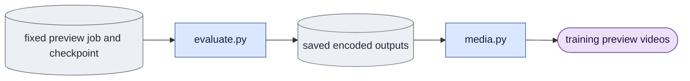
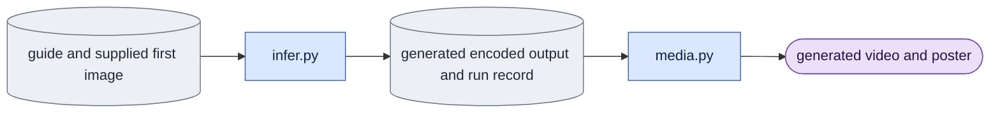
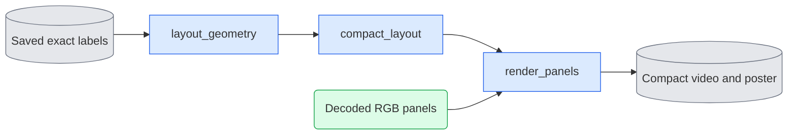

# `media.py` — visualize training and generation results

## Objective

Decode saved encoded frames and make readable visual outputs. The outputs
support training previews, evaluation comparisons and product generation.

The module owns these parts:

- decoder normalization and the decode identity;
- checked RGB panel layouts;
- video and poster saves;
- rendering records with RGB content hashes;
- frame labels and panel positions.

The module uses the existing `scripts.prune.evaluate.decode.decode_latent`. Do
not add another VAE decoder or a transformer generation loop. Training timing
and job selection belong to
[training/engine](training/engine.md#visualization-during-training).

This module stays in LTX-2. Reusable VAE decoding, metrics and video functions
do not go in `expr/`. Report code under `expr/` reads the saved outputs.

## Usage

The CLI has one operation: prepare the fixed reference pixels for training
previews. Run it directly from `LTX-2` in the `ltx` environment, on one free
GPU that you select. Only the decoder loads. See
[run guide §6](../configs/README.md#6-fixed-training-previews).

```bash
cd LTX-2
"$PY" -m scripts.onestep_avatar.media --prepare-training-references \
  --subset <MEMBERSHIP.json> --source <VIEW_ID> --encoded-frames 7 --guide-mode d1 \
  --model 2.5 --seed 42 --output <FRESH_REFERENCES> --gpu-id <FREE_GPU>
```

| Argument | Meaning |
|---|---|
| `--prepare-training-references` | Required. Selects the operation. |
| `--subset` | Required. A version-two fixed video list. |
| `--source` | Required. One view ID from the list. |
| `--encoded-frames N` | Required. The number of encoded frames, from frame zero. |
| `--guide-mode {d0,d1}` | Required. D1 requires the guide. D0 can omit it. |
| `--output` | Required. A new output directory. |
| `--gpu-id` | Required. A free GPU. |
| `--corpus-root` | Another location of the checked corpus. |
| `--model` | The VAE version. Default `2.5`. |
| `--seed` | The decode seed. Default 42. |

Output: `<FRESH_REFERENCES>/references.json` and three pixel tensors. Give
`references.json` to [`prepare_inputs preview`](prepare_inputs.md#usage) or to a
saved comparison as `reference_bundle`.

The command prepares references only. It does not make a complete preview
input record, noise, text or model predictions.

## Data flow

### Training previews

Use the same preview videos and inputs at each completed checkpoint. Run
evaluation outside the distributed training loop.



The preview job records these items: checkpoint step and hash, mode, input
video IDs and hashes, first-image data, text identity, saved noise and seed,
exact denoising levels, frame coverage and output directory. It also records
the state: pending, complete or failed. It refuses incomplete checkpoints and
changed input hashes.

Use the [training layout](#training-preview-layout). Show the recorded video,
the decoded recording, the motion guide, the base output and the trained
output. The titles name the roles. The trained-model title gives its training
step. Keep the frames aligned and the display heights equal. State the fixed
mode, frame rate and schedule in the caption and the saved record.
`plot_training.py` makes the loss curves from engine logs, not from preview
videos.

### Inference output

Product generation has a guide and a supplied image, but no capture target.
Both modes use this path.



1. `infer.py` checks the mode and adapter conditions and calls the `sample`
   function of the selected mode.
2. It saves the generated encoding and the run record before rendering.
3. It releases the transformer session before a separate decoder session opens,
   when memory requires it.
4. It makes the generated MP4 and a poster image. The generated video has no
   presentation labels.
5. An optional review MP4 uses the [inference layout](#inference-review-layout).
   It shows the supplied image, the guide and the generated video.

With prepared encoded inputs, the review panels say "VAE-decoded image" and
"VAE-decoded guide". These are reconstructions of the inputs. They are not
original RGB or capture targets. The supplied image stays still for the full
moving-frame range. Do not compute capture-based scores without a capture
reference.

## Organization logic

### Software identity

The reference CLI records the decoding software profile before the input
checks. It checks the profile again before the VAE opens and before the
references are published. It saves the profile with the producer record.

A software manifest given to any render or reference save is checked before
media writing and before the final record. Low-level RGB assembly does not
invent a decoder identity. Saved references keep their saved provenance when
they load. They do not require the current decoder software.

### Decoder settings and session

`native_decoder_settings()` returns the settings of the shared native decode
path: bfloat16, no tiling, a fresh generator for each decode and the current
Torch version. Reference assembly records this identity. Preview rendering
requires the reference settings to equal the current identity before a decoder
opens. For example, references from another Torch version fail. They are never
used to label new pixels with the older runtime. `decode_saved` uses the public
decoder.

`open_decoder_session(model, gpu_id, script)` sets up a session for saved
decoding only:

1. Call the shared CUDA and model check. It checks the free device memory and
   sets the current device.
2. Construct `Session` with `context=None`.
3. Do not call the general `open_session`. That factory prepares text
   embeddings, which saved decoding does not use.

The helper opens no transformer or text encoder. The caller opens
`session.decoder()` only after its saved-input checks. Session setup does not
decode pixels. Saved comparisons and `decode_saved` use this helper. A test
forbids prompt-cache access and the general factory. It checks the model,
device, script and null context.

Native decoding makes the session's CUDA device current for the full decode
call. Then it restores the earlier device. Tensor placement alone is not
sufficient, because Triton kernels use the current-device context. CPU decoding
uses a no-op context. The VAE, the latent values and the fresh seeded generator
stay the same.

Device-context tests check that the latent transfer and the decoding run inside
the selected context. They check that the earlier device comes back after
success and after a decoder failure. A real LTX-2.5 capture decode on GPU 4
turned 17 encoded frames into 129 RGB frames at 1024×1024. Its saved MP4
metadata agrees. This is decoder acceptance for one saved input. It is not
evidence of generation quality.

### Reference pixels

`prepare_training_references` owns the three fixed reference panels of a
preview. It does these steps:

1. Verify the current hash of the saved capture encoding and the VAE
   fingerprint.
2. Prepare the recorded capture RGB and the guide RGB through the checked
   producer readers.
3. Slice the saved capture encoding from zero to the declared encoded-frame
   count. Decode it with the native decoder and a fixed seed.
4. Return the roles in this order: recorded capture RGB, VAE-decoded capture,
   guide RGB. All three map to the same consecutive original RGB frames.
5. Save the pixel identities, the source hashes and the decoder reuse identity
   in the reference record.

The keyword `require_guide` defaults to true. If it is false and the source has
no guide hash, the function reads no guide files. It returns a guide cell with
no pixels and the label `Guide not used`. A supplied guide is still checked. A
broken guide is never treated as absent. Only the guide role can be absent, and
only with this exact reason and a null producer guide hash.

The function loads no transformer, makes no new crop and never replaces
unavailable references with synthetic pixels. Evaluation and the shared
renderer own generation and final rendering.

**CLI checks.** The CLI reads the checked membership and the selected master
before a decoder-only session opens. It refuses unknown sources, invalid frame
counts and used output paths. D1 requires the checked guide. D0 can omit it,
but a recorded guide is checked, not ignored. The command uses the saved crop
and objective without new preprocessing choices. It verifies the VAE and input
identities before it publishes `references.json`. Until publication, it checks
these bytes again: membership, VAE, capture bundle, RGB, bbox and the
`white` matte. It also binds all guide inputs when a guide is recorded.

**Save and load.** `save_training_references` publishes the three pixel tensors
and then a version-two reference manifest. It refuses a used destination. It
binds each role, title, source-frame map, file hash and pixel identity to the
producer record. An absent guide is saved explicitly: null pixel and file
hashes, and no guide tensor file.

`load_training_references` verifies those hashes before it returns panels. It
decodes no source and runs no VAE or transformer. A missing or corrupted panel
fails. It is never rebuilt. The bundle is a saved input for rendering. It does
not complete a preview job by itself.

**Recorded capture.** `recorded_capture_rgb` uses the public
`precompute.crop_source` producer calculation:

1. Check the saved raw RGB hash, the capture objective and crop, and the
   producer RGB and matte fingerprints.
2. Require a matching source ID and fps, and enough recorded pixel coverage for
   the requested range. An invalid time base or coverage fails before decoding.
3. Use the recorded crop directly. Do not calculate a new box. For `white`,
   apply the producer's full-resolution continuous matte before the resize.
4. Return uint8 FCHW pixels.

Seventeen encoded frames need 129 consecutive original RGB frames at scale
eight. A missing or changed source or matte fails without a model session.
Never make a recording from a guide or a decoded capture.

**Recorded guide.** `recorded_guide_rgb` reads the prepared guide with no new
crop or resize:

1. Verify the render and sidecar hashes, and the encoding's render fingerprint,
   objective, crop and frame coverage.
2. Require the encoding's source ID and fps to match the fixed video list.
3. The sidecar must state the selected objective, the current compositing
   version, a matching edge and enough original frames. A pinned but
   incompatible sidecar fails before the video opens. Hashes alone do not
   prove compatibility.
4. Check the stored video fps and the edge of each frame against the producer
   record.
5. Decode in order from frame zero, convert BGR to RGB and return uint8 FCHW.

Missing frames fail. Do not stretch, repeat or shorten the guide to fit a
panel.

### Saved-video coverage

Saved-video checks run `ffprobe -count_frames` on the actual MP4. They require
one video stream, positive dimensions, exactly the requested frame count and
the exact rational playback rate. A failed probe, bad metadata or wrong
coverage fails. Manifest counts alone are not sufficient. This check opens no
VAE or transformer, and it does not judge pixel content.

Saved PNG samples load fully. They must be RGB PNG with the same dimensions as
the probed video. A corrupt image or a changed size fails, even if its
declared content hash was updated. This checks image coverage, not equality
with lossy MP4 pixels.

### Visualization layout

One comparison video answers one question for one person and view, over one
matched frame range.

- Keep the same role order for all cases.
- Do not put unrelated experiments into one large grid.
- Show the baseline and the changed output next to each other.
- Keep a matched recorded-video reference when you judge capture fidelity,
  identity or motion.

Display rules:

- Use equal image heights and equal title-band heights.
- Scale each image with its aspect ratio kept. Pad it to fit the panel. Never
  stretch an image or crop away evidence.
- Use a neutral background, clear gaps and high-contrast text.
- Make panel roles clear without color.
- Draw text in bands outside the image area, so it cannot hide a face or
  motion.

#### Training preview layout

The default is two rows and three columns. This is the screen order:

| Screen row | Left panel | Middle panel | Right panel |
|---|---|---|---|
| Top | Recorded video | Decoded recording | Motion guide |
| Bottom | Base model | Trained model, with its step | Unused |

- **Recorded video** is the capture RGB after the recorded crop, resize and
  background preparation, before VAE encoding. For `white`, use the capture
  target's recorded matte rule. Replay the checked producer settings through
  shared helpers. Do not choose a new crop or background.
- **Decoded recording** is the capture master decoded with the same VAE
  settings as the model outputs. It shows the changes from encoding and
  decoding.
- **Motion guide** is the guide RGB in the same crop and frame range. It shows
  the render before VAE encoding and noise. It is not the noisy model input.
- **Base model** uses the declared base weights without the adapter.
- **Trained model** uses the selected completed checkpoint.

For a D1 preview, both output panels use the same guide, first image, noise,
text, mode and schedule. Only the adapter changes. Across checkpoints, only the
adapter step and hash change. Make one video for each checkpoint. Do not
change the checkpoint while a video plays.

To compare two checkpoints, put the two trained outputs in the bottom-left and
bottom-middle cells. Their titles show their exact steps. Do not label either
as the base model. The references stay in the top row.

Missing cells:

- An optional missing reference stays in its cell and says `Not available`.
- For capture-only D0, the absent guide cell says `Guide not used`.
- A required missing input is an error, not an empty panel.
- The unused cell has no video and says `Unused`.

Preview rendering plans all five panel labels before the decoder opens. It
tries `training` first. If those exact labels do not fit, it uses
`compact_layout`. Labels that fit neither layout fail before decoding or before
an output directory exists. For example, `VAE-decoded capture` selects
`compact_training` at the default panel size of 320 pixels and a reading width
of 480 pixels. Short labels can keep the normal layout. The rendering record
saves the selected layout. Neither path shortens labels.

#### Experiment comparison layout

Use the same reference row as a training preview. The bottom-left panel is the
baseline output. The bottom-middle panel is the changed output. The
bottom-right cell is unused. Name each output's model role and the value of the
changed variable. The displayed value must agree with the run records.

Change one factor in each comparison. For example, compare two noise levels
with the weights, first image, text, noise bytes and history fixed. Compare
recorded and generated past frames separately within each exact schedule. Do
not also change the schedule or the noise and call it a history comparison.
Put other factors in separate videos.

Use a shared reference row only when the capture preprocessing and the
reference match every output. If the factor changes the reference (for example,
original background against white), use two rows and two columns, with each
output below its own reference:

| Screen row | Left panel | Right panel |
|---|---|---|
| Top | Recorded video for baseline | Recorded video for changed condition |
| Bottom | Baseline output | Changed output |

The titles show the same changed value on each output and its reference. Keep
the original source time aligned. Save the input and target hashes for each
column. Do not suggest that one processed reference is the correct target for
both conditions.

If lengths differ, show only the common recorded frame range. Keep the complete
source videos as separate outputs. State the shared range in the caption. Do
not slow, repeat or freeze a short output to fill a longer one.

#### Saved comparison layout

Saved comparisons use the `comparison` layout. It keeps the supplied panel
order, uses at most three columns and pads the last row with explicit unused
cells. Panel roles must be unique and cannot use the reserved `unused` role.
The same frame map, title readability, aspect-preserving padding and record
replay checks apply as for the training and inference layouts.

#### Inference review layout

The standard review video is one row with three columns:

| Left panel | Middle panel | Right panel |
|---|---|---|
| First image (still) | Motion guide | Generated video |

- Keep the supplied image visible for the full video. Label it
  `First image (still)`.
- Show the RGB preparation that made the first-image input. State its crop and
  background in the caption.
- The guide and the generated panels play together at the recorded frame rate.
- The image is an identity reference. The guide is a motion input. Neither is
  a capture target.
- The generated-only MP4 keeps its original image area without review bands.
  Its poster uses an explicitly recorded output frame.

#### Readable display size

Choose the image height and font size for the intended viewing width.

- Measure the rendered width of each title. Use at most two title lines: the
  role, then the changed value.
- Use short role names. Never truncate an important number or label.
- At a 480-pixel viewing width, the font must stay at least 16 pixels high
  after scaling.
- Inspect normal playback and a still frame at that width.

If the three-column layout cannot meet that rule, also make a compact review
video:

| Screen row | Left panel | Right panel |
|---|---|---|
| Top | Recorded video | Decoded recording |
| Middle | Motion guide | Unused |
| Bottom | Baseline output | Changed output |

This keeps the compared outputs next to each other. For compact inference, put
the still image and an unused cell in the top row, and the guide and generated
video in the bottom row. Both sizes use the same frames, titles and settings.
Do not reduce image quality or remove an essential reference to make text fit.

#### Compact saved comparisons

`layout_geometry` owns the role placement, font measurement and canvas
arithmetic from metadata only. It uses no pixels or decoder. The RGB renderer
uses the same plan, so the early layout check and the final rendering always
agree. The layouts are:

- `comparison`: up to three columns;
- `compact_comparison`: up to two columns;
- `stacked_comparison`: one column.

Each layout keeps the supplied panel order and pads only unused cells. Labels,
values and source frames do not change. Labels are never truncated to make them
fit.

`compact_layout` measures candidates at a viewing width of 480. For generic
comparisons, it tries three, two and then one column. It selects the first
layout where all text fits its title bands at a scaled font of at least
16 pixels. Training and inference layouts use their declared compact forms. If
no layout fits, the command fails before the model loads. The compact video
uses the same decoded panel tensors as the full video. It does not decode again
or change the seed.

The normal saved layout keeps its requested viewing width (1280 by default).
The producer also makes the compact layout at width 480 from the same RGB data
and labels. Completion requires both.

Worked four-panel check: 400-pixel square panels and long corpus labels on a
1232-pixel three-column canvas fail the 480-pixel title measurement. Two
columns give an 824-pixel canvas with 28-pixel text (16.31 pixels at width
480). The role order is capture, frozen, one-clip, corpus, row by row. The
normal layout stays at three columns. The compact layout is a matched second
format with its own hashes and rendering record.



The metadata plan is checked before the model loads. Both formats use the same
RGB tensors.

### Checkpoint visualization

The [checkpoint workflow](comparisons.md#prepare-checkpoint-videos) reuses this
renderer. Each video shows GT RGB, base, and four saved adapters in that order.
The full layout places GT, base and the first adapter on the top row.
It places the other three adapters on the bottom row. All six cells have the
same height and aspect-preserving padding. Titles state each checkpoint update.
The video title identifies the person, data group and denoising step count.
Both schedules show the same recorded frames at the same playback rate.

The seven default checkpoints form two groups with update 400 in both.
One-step and four-step denoising each render the two groups, making four videos
per person. The official-tail selection and exact schedules belong to the
comparison specification. Reports show video links, not extracted RGB frames.
Compact videos retain the same panels and frame mapping in a readable layout.

Reference preparation also accepts the version-two membership crop stored in
`capture_encode_record`. Before RGB replay, it verifies this crop against the
original capture manifest and supplies a copy with the top-level crop field.
No membership, crop, encoding or producer pin changes.

### Text inside the video

Use only text that helps the viewer understand this comparison. The video needs
a short question, the panel roles and the changed variable. Full run details
go in the saved record and the report caption.

| Text position | Content | Example |
|---|---|---|
| One title band for the video | One plain question, 15 words or fewer | `Does more training improve the output?` |
| First line above each panel | The input or output role | `Recorded video`, `Motion guide`, `Trained model` |
| Second line of a panel title | The changed factor and its exact value, where relevant | `Step 100`, `Step 200` |
| Optional shared line | A fixed fact that the question needs | `One direct denoising step` |
| Optional shared time label | Recorded time or frame, only for a timing or block-boundary question | `Recorded frame 32` |

- For a normal preview, `Base model` and `Trained model / Step 100` identify
  the comparison. Do not add noise, cache size or GPU settings only because
  the record has them.
- For a noise comparison, show `Noise 0.421875` and `Noise 0.725` on the
  output panels.
- For a history comparison, use `Recorded past frames` and
  `Generated past frames`. These are the past frames given to the causal model.
  Do not use `GT` or `oracle` without an explanation.
- If the schedule changes, show its family and the actual step count. Show a
  direct schedule such as `[0.421875, 0]` when it fits. Keep a long exact
  schedule in the caption and the record. Do not round different noise levels
  to the same label.
- A research override that affects the meaning needs a short, specific label,
  for example `Outside trained noise range`.
- For an inference review, the title can be `Guide and generated video`. The
  panel roles are sufficient when no variable changes.

Keep seeds, hashes, paths, experiment IDs, checkpoint file names, tensor shapes
and timing logs out of the video. Show one of these values only when it is the
tested factor. Do not put metric scores or words such as `better` on the video.
Put numbers in separate report figures with their definitions and limits. Fixed
settings appear once in the caption, not on every panel.

### Rendering procedure and records

Check the output shape, frame rate, input hashes, VAE identity and decoder
settings. Use a fixed decode seed for compared outputs. Normalize the frame and
channel layout once.

Cache a decode only by the encoded content hash, VAE identity, dimensions,
method, seed and actual decoder settings. Keep random decoder settings fixed
across compared cases. An adapter name or update number alone is not a valid
reuse key.

`render_from_record` reproduces the saved titles, frame maps, layout and poster
selection. It refuses changed pixels.

Render in this order:

1. Read the comparison question, the changed factor, the ordered variants and
   the saved run records.
2. Verify the matching fixed inputs. Map all panels to the same recorded frame
   times. A random-start encoding needs an explicit map from decoded frames to
   original frames. Resetting model positions to zero does not reset the
   original video time. Refuse a missing or unsupported map. Do not claim
   synchronized capture evidence without it.
3. Decode the required saved encodings. Read the capture and guide RGB through
   their recorded crop, background preparation and time map.
4. Select the layout. Give each panel its role, row and column.
5. Build short titles from the actual values. Check the title width and the
   scaled text size.
6. Scale and pad the image panels. Add title bands outside the image areas.
7. For each shared frame time, assemble the panels in the same order. Write the
   comparison MP4.
8. Save a poster from a recorded frame. Save the rendering record atomically.

The rendering record contains:

- the question, the changed factor, the exact variant values and the essential
  shared text;
- the actual panel titles and the role, row and column map;
- the layout version, display size and font size;
- the source frame and time maps, and the reasons for missing panels;
- the output hashes, the crop and padding rule, the poster frame and all common
  settings.

Use this record to reproduce the layout. Do not infer it from file names.
Report generators read it when they build captions.

Report generators under `expr/` make Markdown sections, captions and
report-specific plots. They can assemble saved panels for a question. They do
not load a VAE, run evaluation or recreate missing outputs. They put shared
settings in captions and mark missing panels.

### MP4 writing

MP4 canvases pad the outer edge to an even width and height for the native
H.264 writer. This never resizes or crops panel evidence. The native writer
accepts only integer playback rates. A fractional rate fails before writing. It
is never truncated. Pixel-only layouts still record the exact requested rate.
Fractional-rate MP4 support is a known limitation.

## Invariants

- Check the encoded output and the VAE records before rendering.
- Rendering saved outputs never calls a transformer sampler.
- Training preview jobs cannot change the training weights or input selection.
- Each comparison has the same time base and declared frame coverage.
- Panel padding keeps the image aspect ratio.
- Labels separate original RGB, decoded capture, guide and generated output.
- The baseline and the changed output stay next to each other, with role and
  value labels.
- Video text states the question and the important variable, not the full run
  configuration.
- Text does not cover image content.
- All panels use the same source time. A still-image panel has a label.
- Inference does not invent a capture reference.
- Report assembly reads saved media. Decoding and reusable rendering stay in
  this package.

## Gotchas

- Equal panel sizes do not prove matching crops. Use the crop, mask and file
  hash records to check alignment.
- Training previews show examples. They do not prove general video quality.
- An inference video can be judged against the supplied image and the guide,
  but not against an absent target.

## Tests

CPU integration tests use the actual `prepare_training_references` titles and
the real renderer and MP4 writer. They check:

- compact layout selection;
- D0 with no guide, and D1 refusing absent references;
- a no-fit failure before the decoder exists;
- failed jobs keep the saved adapters.

The reference CLI tests check unknown sources, invalid ranges, changed capture
or VAE, broken optional guides, membership or matte changes during decoding,
and replay of a saved absent guide without rebuilding it.

Worked design check: preview steps 100 and 200 use the same video, first-image,
text and noise hashes. Only the adapter step and hash change. For 17 encoded
output frames, the VAE frame rule gives `(17-1)*8+1 = 129` RGB frames. Both
comparison rows must show the same 129 frame times. A changed noise hash makes
the comparison invalid. A changed adapter requires a new decoded-output hash.

Worked inference check: a supplied image and a guide with 17 encoded frames
give 17 encoded output frames and 129 decoded RGB frames. The supplied image is
a labeled still. No capture-target panel or capture-MSE result exists.

Worked layout check: compare checkpoints 100 and 200 for one D1 video.

- The title is `Does more training improve the output?`.
- The top row reads `Recorded video`, `Decoded recording`, `Motion guide`.
- The bottom row reads `Trained model / Step 100`, `Trained model / Step 200`,
  `Unused`. The slash separates two title lines. It is not printed.
- The five videos show the same recorded frame at each playback time.
- Only the checkpoint step and hash change. Sigma, seed, file hashes and paths
  stay outside the image bands.
- At 480 pixels wide, all titles must pass the 16-pixel text rule. Otherwise,
  use the compact layout and inspect it.

Worked experiment check: change the noise from 0.421875 to 0.725 with all other
inputs fixed. Both output titles say `Trained model`. The second lines show the
exact noise values. The caption gives the shared direct-step setting. The
record stores each exact schedule and input hash. A changed noise array, not
only a changed mixing level, fails this matched-input comparison.

Further checks:

- changed-input refusal and decode reuse keys, with small media fixtures;
- loader sentinels that prove rendering loads no transformer;
- training job states and checkpoint-step labels;
- inference with no capture reference;
- output frame count, rate, hashes and deterministic decode settings;
- exact role, row and column maps for the training, checkpoint, experiment and
  inference layouts;
- shared-reference and separate-reference decisions against the actual
  preprocessing and input identities;
- missing-guide and missing-reference labels without shifted cells;
- a still image stays fixed while the video panels move;
- title bounds and scaled font size, with refusal of clipped or unreadable
  labels;
- the video contains only the declared question, roles, changed values and
  essential shared text;
- a rebuild from a rendering record keeps the titles, frame map, layout and
  poster;
- report rebuilds use saved media with the VAE and transformer loaders
  disabled.

Inspect panel alignment, labels, padding and narrow displays.
