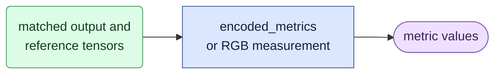

# `metrics.py` — measure encoded and RGB outputs

## Objective

Compute reusable measurements from supplied tensors. Keep the exact fp32
arithmetic, the clean first frame in the denominator, the subject mask rule and
the LPIPS batching. No function loads transformer, text-encoder or VAE weights.

## Data flow

## Organization logic

### Encoded MSE

`encoded_metrics` requires two `B,C,F,H,W` tensors of equal shape.

1. Convert both tensors to fp32.
2. Subtract, square, then average every element. The clean `c0` frame stays in
   the denominator.
3. Also average over `B,C,H,W` separately to get one MSE for each encoded
   frame.

Worked check: the prediction has four scalar elements `[0,0,1,1]` and the
target is zeros. The encoded MSE is 0.5, with the clean first frame included.

### RGB MSE and PSNR

RGB checks require matching, finite, nonempty `F,3,H,W` floating pixels in
`[0,1]`.

`rgb_metrics` computes the squared error once. It returns:

- a per-frame MSE and PSNR, which average `C,H,W`;
- a full-frame MSE and PSNR, which average `F,C,H,W` before the logarithm. Do
  not average the per-frame PSNR values.

PSNR is `-10*log10(MSE)`. An exact match returns PSNR `None` and an explicit
match flag, not infinity. A zero aggregate MSE returns a null PSNR and
`all_exact_match=true`.

### Subject mask

`subject_mask` reads the optional saved lossless capture mask through the
public mask codec. It is for RGB QA. An absent file returns no mask. The
function requires positive dimensions and count, and enough uint8 `F,H,W`
frames. It then does these steps:

1. Take the requested prefix of frames.
2. Divide by 255.
3. Apply 5×5 maximum pooling at stride one with two-pixel padding.
4. Resize to the actual RGB height and width with nearest neighbors.
5. Keep values strictly above 0.5.

This keeps the two-cell dilation of the old renderer. It is a QA rule, not a
training mask or a new crop. A single interior foreground pixel selects 25
cells before the resize, and 100 cells after a twofold resize in each
direction.

### Subject RGB scores

`subject_rgb_metrics` takes aligned floating `F,3,H,W` inputs in `[0,1]` and a
boolean `F,H,W` subject mask. It checks all shapes and values, and that the
mask selects at least one pixel, before it measures.

1. Average the squared error over the three RGB channels.
2. Average over the selected pixels and frames.
3. Return the MSE, the PSNR and the exact-match status.

A zero MSE has no finite PSNR. It returns `null` and the exact-match flag, not
the old renderer's 99 dB value. The mask is supplied, checked evidence. The
function creates no crop, dilation or alignment. A uniform difference of 0.5
gives MSE 0.25 and PSNR 6.0206 dB for any selected area.

### Transition scores

Transition scores use the union of the foreground masks of two adjacent frames
and the mean absolute RGB change. An empty denominator is clipped to one.

### LPIPS

Both LPIPS helpers use a perceptual model that the caller already loaded. They
do not load or download weights. One shared batch iterator owns the RGB checks,
the conversion from `[0,1]` to `[-1,1]`, the model calls and the output checks.
The iterator requires a positive integer batch size, a tensor output with one
finite score for each frame and the frame order across the final short batch.

- `lpips_frame_scores` returns ordered Python floats, one for each aligned
  frame. The default batch size is 16, which matches the reference
  full-resolution analyzer. It does not exclude `c0` and does not average
  frames. The caller selects any excluded frames.
- `lpips_distance` sums one model score for each frame and divides by the total
  frame count. It refuses empty, nonfinite or out-of-range inputs and a batch
  size below one, before the model call. It keeps the original tensor sums for
  each batch on the model device. A Python reduction for each frame would
  change the scalar rounding.

On controlled pixels, the per-frame list must match the reference
FHWC-to-FCHW scoring path exactly. This parity checks the measurement code,
not the native VAE or identity.

The caller records the model identity. LPIPS measures perceptual difference. It
does not measure correct motion or identity. Both helpers stay outside report
code. Ordinary rendering and experiment owners call this shared owner. Reports
read saved scores.

Worked check: for equal RGB pixels, the MSE is zero, the PSNR is `None` and
exact-match is true.

## Invariants

- The array shape and scope decide the denominator.
- Convert to float before subtraction.
- There is no hidden first-frame exclusion and no study boundary selection.

## Gotchas

- A zero PSNR denominator has an explicit status.
- A supplied subject mask measures only its pixels.
- LPIPS is a supporting perceptual measurement.

## Tests

`test_evaluate.py` and `test_rgb_measurements.py` keep the numerical fixtures:
malformed RGB, mask alignment, frame scores and batch weighting. The caller
fixtures in ordinary evaluation and comparisons use this one owner.
