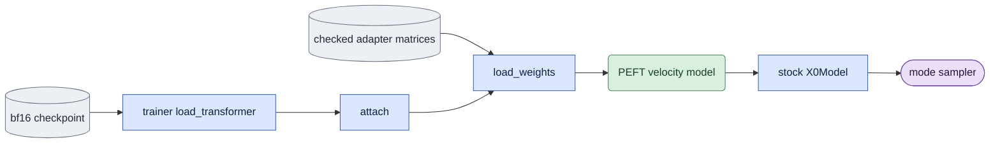

# `model/adapters.py` — share the trained adapter function

## Objective

Own the PEFT construction and the loading of exported tensors for training,
evaluation and product inference. The ordinary application is
`peft_unmerged_fp32`: frozen bf16 base weights plus unmerged fp32 LoRA
matrices, with zero dropout. It is the function that training optimizes. bf16
fusion stays an explicit research condition.

## Data flow

1. The training loader makes a velocity model.
2. `attach` adds PEFT with the recorded rank, alpha and target list.
3. `load_weights` reads the exported ComfyUI matrices into that same function.
4. Evaluation wraps the loaded velocity function in the stock `X0Model`. So
   generation and guidance receive x0, as their native-x0 predictors expect.
   No second velocity conversion is applied.

Base-only execution keeps the native Session path.

## Organization logic

### Construction

1. Freeze the base parameters before PEFT construction.
2. Optionally set training's initialization seed. Keep its existing RNG rule.
3. Use the shared target registry, alpha equal to rank, zero dropout and
   PEFT's standard initialization.
4. Verify that the adapter weights are fp32 and stay unmerged.

### Loading exported tensors

1. Read the exported tensors once.
2. Require the exact key list and matrix shapes of the constructed PEFT
   adapter, finite values and the exported key prefix.
3. Rewrite that prefix once.
4. Load into the fp32 adapter parameters. Refuse missing or unexpected adapter
   matrices. Never keep a random initialization.

### Inference

Ordinary inference does these steps, outside FSDP:

1. Load the bf16 velocity backbone with the trainer's loader on the explicit
   session device.
2. Construct the recorded adapter and read the checked matrices.
3. Freeze all weights, disable checkpointing and set evaluation mode.
4. Yield the stock `X0Model(PEFT velocity model)`.

The fused diagnostic calls `Session.transformer(loras=...)` explicitly.
Base-only calls `Session.transformer()` without adapters. There is no resource
fallback. Callers drop their reference to the yielded model after the context
ends and before the next transformer or decoder loads. Context cleanup alone
cannot delete references that the caller owns to a full resident checkpoint.

### Memory

The unmerged path stores the bf16 base plus the fp32 A and B matrices. It
allocates no full fp32 base and no merge buffer. Its adapter memory is four
bytes for each matrix element. E2 reports the measured total allocation and
time. A memory failure is raised and recorded as a failure. It never switches
to fusion.

### Checked contract and current file identity

`LORA_TARGETS` lives here. Every parser and checkpoint consumer imports this
owner.

1. A caller validates the conditions, metadata and actual tensor slices through
   `training.checkpoints`.
2. The caller calls the public `recheck_adapter` immediately before it opens
   the model weights.
3. The caller passes the checked contract and `adapter_sha256` to
   `inference_transformer`. A checkpoint without both fails before either
   loader runs.
4. The model owner compares the whole file hash before loading and before
   yielding, also on the explicit fused path. So a changed metadata record or
   tensor payload cannot use a stale check.

`load_weights` separately checks the actual constructed PEFT list, the matrix
shapes, finite values and complete loading. It can bind the caller's expected
digest before and after it reads the matrices. The E2 reference uses this guard
after the backbone loads too. The model owner imports no training module and
has no contract checker.

Worked check: pin a valid adapter. Then change only one B matrix and keep the
metadata. The caller's check and the model's identity guard both refuse the
changed file before a transformer opens. An unchanged zero adapter still equals
its own base.

## Invariants

- Training and ordinary inference share the PEFT configuration and the tensor
  loading.
- The base stays bf16. The adapter matrices stay fp32. No matrix is merged.
- The product uses only the ordinary method. Evaluation fusion needs the
  existing research override, checked before the model loads.
- Both inference methods return x0 models. Training keeps the velocity model.
- With B at zero, the correction is zero, and matched base outputs must agree.

## Gotchas

- The exported matrices are bf16 on disk. Loading them into fp32 restores the
  saved function, not the unrounded training weights before export. E2
  compares the training reference after it loads the same saved matrices.
- Wrap a velocity model in x0 exactly once. If velocity is treated as x0, the
  outputs look plausible but are wrong.
- Do not change the global sigma or the per-token `c0` timesteps here.

## Tests

A real small LTX model with PEFT checks:

- dtype, freezing and dropout, and the exact list;
- zero-adapter equality, and loaded nonzero-adapter equality against the
  training reference;
- loader device selection, explicit fused routing, failure without fallback
  and the caller's x0 meaning;
- metadata and tensor changes, a missing identity, both application methods
  and exact loaded-function parity in both modes.

The full native E2 effect and memory checks are separate acceptance
requirements.
